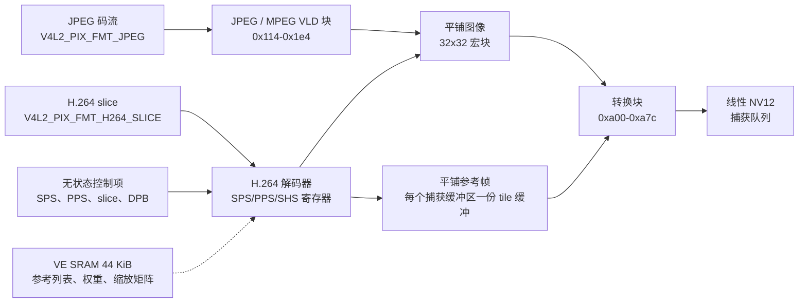

F101 的视频引擎（VE）是硬件视频解码器。在这颗芯片上它能解 JPEG 和 H.264；它没有编码器，cedrus 驱动在其它全志 SoC 上支持的 HEVC、MPEG-2 和 VP8 块在这里也不存在。Linux 用主线 cedrus 驱动来驱动它，在 `/dev/video1` 上暴露成 V4L2 mem2mem 解码器，并在 `/dev/media0` 上提供 media controller。两个解码器给使用者的都是线性 NV12 图像，尽管引擎内部解码成平铺布局。

| 项目 | 内容 |
| --- | --- |
| 驱动文件 | `drivers/staging/media/sunxi/cedrus/cedrus.c`、`cedrus_hw.c`、`cedrus_video.c`、`cedrus_dec.c`、`cedrus_jpeg.c`、`cedrus_h264.c`、`cedrus_regs.h` |
| 兼容字符串 | `allwinner,sun252i-f101-video-engine` |
| 基地址 | `0x01c0e000`，8 KiB 寄存器窗口 |
| 中断 | PLIC 66，高电平；一条解码器中断线 |
| 时钟与复位 | `ahb`、`mod`、`ram`；模块时钟 300 MHz；复位 `RST_BUS_VE` |
| SRAM | VE 段位于 `0x00020000`-`0x0002afff`（44 KiB），通过系统控制器申请 |
| Kconfig | `CONFIG_MEDIA_SUPPORT`、`CONFIG_VIDEO_DEV`、`CONFIG_VIDEO_SUNXI_CEDRUS`、`CONFIG_MEDIA_CONTROLLER`、`CONFIG_SUNXI_SRAM`、`CONFIG_VIDEOBUF2_DMA_CONTIG` |
| 用户空间 | `/dev/video1`（V4L2 mem2mem 解码器）、`/dev/media0`（media request） |

## 硬件

引擎分成顶部块、解码器段和转换块。顶部块选择解码器并管理 SRAM 端口；解码器段包含 JPEG/MPEG VLD 块、H.264 解码器和它们共用的存储；转换块把平铺的宏块图像变成捕获队列暴露的线性 NV12。



### 顶部块与解码器编号

寄存器窗口的顶部由所有解码器共用。`0x00` 的 `VE_MODE` 选择解码器、图像宽度标志和内存写模式。F101 变体带 `CEDRUS_CAPABILITY_MODE_INVERTED`：解码器字段的低三位被反相，所以驱动把值异或上 `VE_MODE_INVERT`。

| 解码器 | 基础值 | F101 写入值 |
| --- | --- | --- |
| MPEG/JPEG | `0x00` | `0x08` |
| H.264 | `0x01` | `0x09` |
| HEVC | `0x04` | `0x0c` |

F101 变体只使能 JPEG 和 H.264，所以只有前两行可达。JPEG 使用 MPEG 解码块，因为 JPEG 熵解码器就在那里；`VE_MODE` 写 MPEG 族的值，JPEG VLD 通过 `0x114` 的块单独触发。

`0x50` 的 `VE_BUF_CTRL` 选择 H.264 行缓冲放在哪里。F101 写 `0x0a`，即 `VE_BUF_CTRL_INTRAPRED_EXT_RAM | VE_BUF_CTRL_DBLK_EXT_RAM`：帧内预测和去块的行缓冲都在外部 RAM。地址写到 `VE_DBLK_DRAM_BUF_ADDR`（`0x54`）和 `VE_INTRAPRED_DRAM_BUF_ADDR`（`0x58`）。这个设置是 H.264 在这个引擎版本上能解码的前提；内部 SRAM 没有交给解码器。

### SRAM 段

VE SRAM 是系统控制器下的 `mmio-sram` 子节点，44 KiB，位于 `0x00020000`。申请这段会把系统控制寄存器 `0x03000004` 的 bit 24 写成 0；写 1 则把区域交给 CPU。启动引导程序也从 `0x00020000` 运行，所以这块区域要等 Linux 启动后才空出来给解码器用。H.264 解码器用它放参考图像列表、参考列表 0 和 1、8x8 和 4x4 缩放矩阵以及预测权重表。驱动通过 SRAM 端口写这些结构：

- `VE_AVC_SRAM_PORT_OFFSET` 选择一个字偏移；
- `VE_AVC_SRAM_PORT_DATA` 写一个 32 位字。

偏移是固定的：预测权重在 `0x000`，帧缓冲列表在 `0x100`，参考列表 0 在 `0x190`，参考列表 1 在 `0x199`，8x8 缩放矩阵在 `0x200` 和 `0x210`，4x4 矩阵在 `0x220`。

### JPEG 块

JPEG 解码器是 baseline JPEG 熵解码器。软件解析标记段（DQT、DHT、SOF0、SOS），按引擎要求的格式构造 Huffman 表，并通过 `JPEG_HUFF_ADDR`/`JPEG_HUFF_DATA` 加载。然后引擎把扫描数据解码成平铺宏块，写到 `JPEG_RECON_Y` 和 `JPEG_RECON_C`。

| 寄存器 | 偏移 | 作用 |
| --- | --- | --- |
| `JPEG_CTRL` | `0x114` | 中断使能和控制 |
| `JPEG_START` | `0x118` | 写 `JPEG_START_DECODE`（14）启动 |
| `JPEG_FORMAT` | `0x11b` | 字节 `(chroma_sampling << 3) \| 3` |
| `JPEG_STATUS` | `0x11c` | 写 1 清除，bit 0 表示完成 |
| `JPEG_STREAM_ADDR` | `0x128` | 编码数据地址，使用引擎的字格式 |
| `JPEG_STREAM_OFFSET` | `0x12c` | 扫描起点，单位为 bit |
| `JPEG_STREAM_LEN` | `0x130` | 扫描长度，单位为 bit |
| `JPEG_STREAM_END` | `0x134` | 输入缓冲区的最后一个字节 |
| `JPEG_QTAB` | `0x180` | 量化表条目 |
| `JPEG_MCU_SIZE` | `0x1b8` | MCU 列数和行数，减一 |
| `JPEG_RESTART` | `0x1c0` | 重启间隔 |
| `JPEG_RECON_Y`、`JPEG_RECON_C` | `0x1cc`、`0x1d0` | 平铺输出平面 |
| `JPEG_HUFF_ADDR`、`JPEG_HUFF_DATA` | `0x1e0`、`0x1e4` | Huffman 表端口 |

驱动只接受 4:2:0 图像，而且只在 32 对齐的源尺寸和捕获尺寸一致时接受。其它采样方式会被解析，但在 setup 阶段拒绝。Huffman 表可以省略，这时使用标准表。支持重启间隔。

### H.264 块

H.264 解码器是无状态解码器：用户空间解析码流，把 SPS、PPS、slice 参数、解码参数、缩放矩阵和预测权重作为挂在 media request 上的 V4L2 控制项传进来。驱动把它们转换成引擎自己的寄存器：

| 寄存器组 | 作用 |
| --- | --- |
| `VE_H264_SPS`、`VE_H264_PPS` | 序列和图像参数 |
| `VE_H264_SHS`、`VE_H264_SHS2`、`VE_H264_SHS_QP` | slice 头、参考数、去块、QP |
| `VE_H264_VLD_ADDR`、`VE_H264_VLD_LEN`、`VE_H264_VLD_OFFSET`、`VE_H264_VLD_END` | slice 码流窗口 |
| `VE_H264_TRIGGER_TYPE` | flush-bits 和 slice 解码触发 |
| `VE_H264_STATUS`、`VE_H264_CTRL` | 中断状态和使能 |
| `VE_H264_OUTPUT_FRAME_IDX` | 参考帧列表里的槽位 |

有两个 F101 细节很重要。第一，`VE_H264_VLD_END` 必须是整个输入缓冲区的最后一个字节，而不是 slice 的末尾；如果结束位置在 slice 末尾，解码器在第一次 burst 后就停止，图像解不完。第二，`VE_H264_CTRL` 在图像之间保持 bit 10 置位，因为这是这个引擎版本的复位值。触发时还会在启动 slice 解码前置寄存器 `0x1c` 的 bit 6。

输入格式是 `V4L2_PIX_FMT_H264_SLICE`，配合 `V4L2_STATELESS_H264_DECODE_MODE_SLICE_BASED` 和 `V4L2_STATELESS_H264_START_CODE_NONE`。`START_CODE_NONE` 表示缓冲区从 NAL 头开始，而不是从 `00 00 01` 起始码开始。测试程序自己剥掉起始码，每个 request 排一个 slice NAL。

### 转换块

JPEG 和 H.264 共用转换块。它读平铺图像，写两个线性平面：亮度写到目标地址，色度写到 `destination + width * height`。驱动通过一组固定寄存器来编程：

| 寄存器 | 偏移 | 值或作用 |
| --- | --- | --- |
| `CV_SIZE` | `0xa00` | 宏块列数和行数 |
| `CV_STRIDE` | `0xa04` | 源 stride |
| `CV_ENABLE` | `0xa08` | `0x50080001`，bit 0 使能 |
| `CV_MODE` | `0xa0c` | `1` 启动转换 |
| `CV_STATUS` | `0xa10` | bit 0 表示完成 |
| `CV_LINE` | `0xa14` | 行数 |
| `CV_CONFIG` | `0xa2c` | 配置 |
| `CV_OUT_Y`、`CV_OUT_C` | `0xa70`、`0xa74` | 线性输出平面 |
| `CV_IN_Y`、`CV_IN_C` | `0xa78`、`0xa7c` | 平铺输入平面 |

启动转换块之前，驱动把 `VE_MODE` 写成 2，即选择转换通路的 "top mode"，并复位顶部块。转换是同一个作业的第二阶段，不是独立的 V4L2 缓冲区。

## 设备树

SoC 节点和它的 SRAM 段：

```text
ve: video-codec@1c0e000 {
	compatible = "allwinner,sun252i-f101-video-engine";
	reg = <0x0 0x01c0e000 0x0 0x2000>;
	interrupts = <66 IRQ_TYPE_LEVEL_HIGH>;
	clocks = <&ccu CLK_BUS_VE>,
		 <&ccu CLK_VE>,
		 <&ccu CLK_BUS_VE_M>;
	clock-names = "ahb", "mod", "ram";
	resets = <&ccu RST_BUS_VE>;
	allwinner,sram = <&ve_sram_section 1>;
	status = "disabled";
};

syscon: syscon@3000000 {
	compatible = "allwinner,sun252i-f101-system-control";
	reg = <0x0 0x03000000 0x0 0x1000>;
	#address-cells = <1>;
	#size-cells = <1>;
	ranges = <0x0 0x0 0x0 0x40000000>;

	ve_sram: sram@20000 {
		compatible = "mmio-sram";
		reg = <0x20000 0xb000>;
		#address-cells = <1>;
		#size-cells = <1>;
		ranges = <0 0x20000 0xb000>;

		ve_sram_section: sram-section@0 {
			compatible = "allwinner,sun252i-f101-sram-ve";
			reg = <0x0 0xb000>;
		};
	};
};
```

板级文件使能引擎：

```text
&ve {
	status = "okay";
};
```

绑定文件是 `Documentation/devicetree/bindings/media/allwinner,sun4i-a10-video-engine.yaml`，其中列出了 F101 兼容字符串和必需的 `allwinner,sram` 属性。

## Kconfig

```text
CONFIG_MEDIA_SUPPORT=y
CONFIG_MEDIA_SUPPORT_FILTER=y
CONFIG_MEDIA_PLATFORM_SUPPORT=y
CONFIG_STAGING=y
CONFIG_STAGING_MEDIA=y
CONFIG_VIDEO_DEV=y
CONFIG_VIDEO_SUNXI=y
CONFIG_VIDEO_SUNXI_CEDRUS=y
CONFIG_MEDIA_CONTROLLER=y
CONFIG_SUNXI_SRAM=y
CONFIG_VIDEOBUF2_DMA_CONTIG=y
```

这些选项在 `arch/riscv/configs/sun252i_f101_yuzukineko_defconfig` 里设置。`CONFIG_VIDEO_SUNXI_CEDRUS` 是 tristate，会选中 `MEDIA_CONTROLLER`、`SUNXI_SRAM`、`VIDEOBUF2_DMA_CONTIG` 和 `V4L2_MEM2MEM_DEV`。驱动在 staging 里，所以还需要 `CONFIG_STAGING` 和 `CONFIG_STAGING_MEDIA`。

## 驱动内部

### 变体与探测

F101 变体声明三个能力，模块时钟 300 MHz：

```c
static const struct cedrus_variant sun252i_f101_cedrus_variant = {
	.capabilities	= CEDRUS_CAPABILITY_MODE_INVERTED |
			  CEDRUS_CAPABILITY_JPEG_DEC |
			  CEDRUS_CAPABILITY_H264_DEC,
	.mod_rate	= 300000000,
};
```

探测申请中断，初始化可选的 reserved memory，申请 SRAM 段，取得三个时钟和复位，映射寄存器并设置模块时钟。时钟是 300 MHz，因为 512 MHz 会让这块板子上的引擎挂死。驱动启用 runtime PM；suspend 路径关闭 RAM、模块和 AHB 时钟并断言复位，resume 路径按相反顺序恢复。

视频设备用 `VFL_TYPE_VIDEO` 注册，media 设备用 `v4l2_m2m_register_media_controller()` 注册。media 设备是无状态 request 的前提：`MEDIA_IOC_REQUEST_ALLOC` 创建 request 文件描述符，控制项和缓冲区挂到它上面，`MEDIA_REQUEST_IOC_QUEUE` 原子地提交它们。

### 队列与缓冲区

两个队列都是单平面，使用 `vb2_dma_contig_memops`。`queue_setup` 从当前格式取大小并接受一个平面。`buf_prepare` 检查大小，对捕获缓冲区把 payload 设成 `sizeimage`。

输出格式决定解码器以及是否需要 request：

|输出格式 | 解码器 | Request |
| --- | --- | --- |
| `V4L2_PIX_FMT_JPEG` | `cedrus_dec_ops_jpeg` | 不需要 |
| `V4L2_PIX_FMT_H264_SLICE` | `cedrus_dec_ops_h264` | 需要 |

`cedrus_s_fmt_vid_out_p()` 对除 JPEG 以外的所有格式把 `vq->requires_requests` 设为 true，并安装对应的解码器操作。任一队列忙时，改变输出格式会被拒绝。

### 捕获格式与对齐

在 F101 上两个解码器都是 "converted"：`cedrus_cap_converted()` 对 JPEG 为真，对带 `CEDRUS_CAPABILITY_MODE_INVERTED` 的变体上的 H.264 也为真。对 converted 解码器，捕获队列上只有 `V4L2_PIX_FMT_NV12` 可用，`try_fmt` 强制宏块对齐：

- `bytesperline = ALIGN(source_width, 32)`；
- `width = bytesperline`；
- `height = ALIGN(source_height, 32)`；
- `sizeimage = stride * height * 3 / 2`。

源尺寸不是 32 的倍数时，可见区域比缓冲区小。`VIDIOC_G_SELECTION` 报告它：

| Selection target | 矩形 |
| --- | --- |
| `V4L2_SEL_TGT_COMPOSE` | `0,0,source_width,source_height` |
| `V4L2_SEL_TGT_COMPOSE_DEFAULT` | 与 compose 相同 |
| `V4L2_SEL_TGT_COMPOSE_BOUNDS` | `0,0,capture_width,capture_height` |
| `V4L2_SEL_TGT_COMPOSE_PADDED` | 与 bounds 相同 |

拷贝图像的播放器必须用 compose 的宽高和捕获缓冲区的 stride，而不是捕获缓冲区的宽高。

### JPEG 作业

JPEG 路径是有状态的，不需要 media request。一个作业分两个阶段，每个阶段以一次中断结束：

1. 软件解析 JPEG 标记，加载表、码流地址、码流长度和平铺输出地址。
2. `cedrus_jpeg_trigger()` 往 `JPEG_START` 写 14。
3. 解码器中断置 `converting`，启动转换块并返回 `CEDRUS_IRQ_CONTINUE`。
4. 转换中断完成捕获缓冲区。

tile 缓冲区在 `cedrus_jpeg_start()` 里每个流式会话分配一次，亮度平面大小为 `width * height`，色度平面为 `2 * ALIGN((width + 1) / 2, 16) * ALIGN((height + 1) / 2, 32)`。输出缓冲区就是 V4L2捕获缓冲区。

### H.264 作业

H.264 路径是无状态的。`cedrus_device_run()` 把 request 控制项复制进每上下文的控制项处理器，然后 `cedrus_h264_setup()` 编程引擎：

1. 选择 H.264 解码器并复位 F101输出寄存器。
2. 写额外缓冲区：picture info 和 neighbour info。
3. 写缩放矩阵。
4. 从 DPB 构造参考帧列表并写进 SRAM。
5. 为这个捕获缓冲区分配或复用平铺输出缓冲区。
6. 写 SPS、PPS、slice 头、QP、参考列表和预测权重。
7. 清状态，使能 slice 解码、解码错误和 VLD 数据请求中断，并保持 bit 10 置位。
8. 触发 slice 解码；引擎写平铺图像，中断启动转换块，第二次中断完成缓冲区。

每个捕获缓冲区拥有一个 tile 缓冲和一个运动矢量/列缓冲。tile 缓冲由 `cedrus_h264_tile_alloc()` 在缓冲区第一次使用时延迟分配。去块和帧内预测行缓冲是每上下文的，大小使用 F101 的厂商公式：

- 去块：`DIV_ROUND_UP(width, 16) * 1024`；
- 帧内预测：`16 KiB + DIV_ROUND_UP(width, 16) * 546`。

picture info 缓冲区从 `18 * 0x1000` 字节起，按 `source_height * 2 * 64` 增长，且不小于 130 KiB；neighbour info 缓冲区是 32 KiB。

### 中断与看门狗

唯一的中断线由解码器和转换块共用。`cedrus_irq()` 取消看门狗，向当前解码器查询状态，处理三种情况：

- `CEDRUS_IRQ_OK`：作业完成；
- `CEDRUS_IRQ_CONTINUE`：一个阶段完成，重新挂上看门狗并等下一次中断；
- `CEDRUS_IRQ_ERROR`：用 `VB2_BUF_STATE_ERROR` 完成缓冲区。

看门狗在 2 秒后触发，打印 `frame processing timed out!`，复位引擎并把作业当成错误完成。JPEG 路径的两个阶段也用同一个看门狗。

### Cache 与 PBMT

C906/C907 核运行 Sv32，没有 PBMT，所以 DMA 缓冲区不会自动变成非缓存。解码器在硬件里写捕获缓冲区。测试用的是 DMA 分配器的 MMAP 缓冲区，在这个队列上不会被标记为非一致性；dma-buf 导入会被标记为非一致性，`vb2_dma_contig` 的 prepare 和 finish memop 会在作业前后同步它。H.264 行缓冲和 tile 缓冲用 `dma_alloc_attrs()` 分配，并有意建立内核映射好让内核清零，因为解码器要求行缓冲从零开始。

## 用户空间

### 设备

`/dev/video1` 是解码器。G2D 在 `/dev/video0`，两个视频节点按探测顺序分配；用下面的命令确认：

```sh
cat /sys/class/video4linux/video*/name
```

解码器报告的 driver 是 `cedrus`，card 是 `cedrus`。`/dev/media0` 是同一设备的 media controller；它只用于 request 的分配和排队。

### 无状态控制项

H.264 控制项是标准的 V4L2 无状态 H.264 集合：

| 控制项 | 内容 |
| --- | --- |
| `V4L2_CID_STATELESS_H264_SPS` | 序列参数，只支持 4:2:0 8 位 |
| `V4L2_CID_STATELESS_H264_PPS` | 图像参数 |
| `V4L2_CID_STATELESS_H264_SLICE_PARAMS` | slice 头字段 |
| `V4L2_CID_STATELESS_H264_DECODE_PARAMS` | DPB 条目、帧号、POC、标志 |
| `V4L2_CID_STATELESS_H264_SCALING_MATRIX` | 缩放矩阵 |
| `V4L2_CID_STATELESS_H264_PRED_WEIGHTS` | 预测权重表 |
| `V4L2_CID_STATELESS_H264_DECODE_MODE` | 固定为 slice-based |
| `V4L2_CID_STATELESS_H264_START_CODE` | 固定为 none |

`cedrus_try_ctrl()` 拒绝不是 4:2:0、亮度与色度位深不一致、或位深不是 8 的 SPS。profile 控制项接受 Baseline、Main 和 High；Extended 被屏蔽。

### 示例：解码 JPEG

下面的程序把一张 baseline JPEG 解码成线性 NV12。它走有状态路径：不需要 media request，一个输出缓冲区和一个捕获缓冲区。输出格式必须带图像的真实宽高，因为捕获格式由它推导；示例假设 1920x1080 的 JPEG，换图时改这两个数。

```c
#include <stdio.h>
#include <stdlib.h>
#include <string.h>
#include <fcntl.h>
#include <unistd.h>
#include <errno.h>
#include <poll.h>
#include <sys/ioctl.h>
#include <sys/mman.h>
#include <sys/stat.h>
#include <linux/videodev2.h>

static int xioctl(int fd, unsigned long req, void *arg)
{
	int ret = ioctl(fd, req, arg);

	if (ret)
		perror("ioctl");
	return ret;
}

int main(int argc, char **argv)
{
	enum v4l2_buf_type out = V4L2_BUF_TYPE_VIDEO_OUTPUT;
	enum v4l2_buf_type cap = V4L2_BUF_TYPE_VIDEO_CAPTURE;
	struct v4l2_format f;
	struct v4l2_requestbuffers rq;
	struct v4l2_buffer b;
	struct stat st;
	void *src, *dst;
	int fd, i, size;

	if (argc != 2) {
		fprintf(stderr, "usage: jpegdec picture.jpg\n");
		return 1;
	}
	fd = open("/dev/video1", O_RDWR);
	if (fd < 0) {
		perror("video1");
		return 1;
	}

	memset(&f, 0, sizeof(f));
	f.type = out;
	f.fmt.pix.pixelformat = V4L2_PIX_FMT_JPEG;
	f.fmt.pix.width = 1920;
	f.fmt.pix.height = 1080;
	f.fmt.pix.sizeimage = 2 * 1024 * 1024;
	xioctl(fd, VIDIOC_S_FMT, &f);

	memset(&f, 0, sizeof(f));
	f.type = cap;
	f.fmt.pix.pixelformat = V4L2_PIX_FMT_NV12;
	f.fmt.pix.width = 1920;
	f.fmt.pix.height = 1080;
	xioctl(fd, VIDIOC_S_FMT, &f);
	printf("capture %ux%u stride %u size %u\n", f.fmt.pix.width,
	       f.fmt.pix.height, f.fmt.pix.bytesperline, f.fmt.pix.sizeimage);

	for (i = 0; i < 2; i++) {
		enum v4l2_buf_type t = i ? cap : out;

		memset(&rq, 0, sizeof(rq));
		rq.count = 1;
		rq.type = t;
		rq.memory = V4L2_MEMORY_MMAP;
		xioctl(fd, VIDIOC_REQBUFS, &rq);
	}

	memset(&b, 0, sizeof(b));
	b.type = out;
	b.memory = V4L2_MEMORY_MMAP;
	b.index = 0;
	xioctl(fd, VIDIOC_QUERYBUF, &b);
	src = mmap(NULL, b.length, PROT_READ | PROT_WRITE, MAP_SHARED, fd, b.m.offset);

	memset(&b, 0, sizeof(b));
	b.type = cap;
	b.memory = V4L2_MEMORY_MMAP;
	b.index = 0;
	xioctl(fd, VIDIOC_QUERYBUF, &b);
	dst = mmap(NULL, b.length, PROT_READ | PROT_WRITE, MAP_SHARED, fd, b.m.offset);

	stat(argv[1], &st);
	{
		FILE *fp = fopen(argv[1], "rb");

		if (!fp || (int)fread(src, 1, st.st_size, fp) != st.st_size) {
			perror("read");
			return 1;
		}
		fclose(fp);
	}

	memset(&b, 0, sizeof(b));
	b.type = out;
	b.memory = V4L2_MEMORY_MMAP;
	b.index = 0;
	b.bytesused = st.st_size;
	xioctl(fd, VIDIOC_QBUF, &b);

	memset(&b, 0, sizeof(b));
	b.type = cap;
	b.memory = V4L2_MEMORY_MMAP;
	b.index = 0;
	xioctl(fd, VIDIOC_QBUF, &b);

	xioctl(fd, VIDIOC_STREAMON, &out);
	xioctl(fd, VIDIOC_STREAMON, &cap);

	{
		struct pollfd p = { .fd = fd, .events = POLLIN | POLLOUT };

		poll(&p, 1, 3000);
		memset(&b, 0, sizeof(b));
		b.type = cap;
		b.memory = V4L2_MEMORY_MMAP;
		xioctl(fd, VIDIOC_DQBUF, &b);
		if (b.flags & V4L2_BUF_FLAG_ERROR) {
			printf("decode error\n");
			return 1;
		}
		printf("decoded buffer %u, %u bytes\n", b.index, b.bytesused);
		size = b.bytesused;
	}

	return size > 0 ? 0 : 1;
}
```

程序打印驱动选择的、对齐后的捕获格式。源宽高本来就是 32 的倍数时，打印的就是源尺寸，stride 等于宽度；否则两者都向上取整。

### 示例：用 request 解码 H.264

测试程序 `fel-stage/src/h264t.c` 是完整的无状态客户端。关键顺序是：

1. 用当前值通过 `VIDIOC_S_EXT_CTRLS` 把 `V4L2_CID_STATELESS_H264_DECODE_MODE` 设成 slice-based，把 `V4L2_CID_STATELESS_H264_START_CODE` 设成 none。
2.输出格式设成 `V4L2_PIX_FMT_H264_SLICE`，捕获格式设成 `V4L2_PIX_FMT_NV12`。
3. 分配一个输出缓冲区和 `NBUF` 个捕获缓冲区；测试用四个。
4. 对每个类型 1 或 5 的 NAL，解析 SPS/PPS 和 slice 头，填六个控制项，用 `MEDIA_IOC_REQUEST_ALLOC` 分配 media request，再用 `V4L2_CTRL_WHICH_REQUEST_VAL` 和 `request_fd` 设置控制项。
5. 用 `V4L2_BUF_FLAG_REQUEST_FD` 排入 slice 缓冲区，排入一个空闲捕获缓冲区，然后对 request fd 调用 `MEDIA_REQUEST_IOC_QUEUE`。
6. 对 request fd `poll()` `POLLPRI`，然后取出两个缓冲区。
7. 用捕获缓冲区的 stride 拷贝可见矩形，并把它的 CRC 和期望值比较。

控制项集合挂在 request 上，而不是上下文上，所以两个 request 可以同时在途，一个的参数不会覆盖另一个。驱动的 request 校验器每次 request 只接受一个缓冲区，所以测试每个 request 发一个 slice。

### 完整示例：CRC 测试

在主机上编译程序：

```sh
build-rv32/host/bin/riscv32-buildroot-linux-musl-gcc -static -O2 \
	-o h264t fel-stage/src/h264t.c
```

板子没有网络。程序和码流用 `xfel` 写进 `0x41e00000` 的 reserved memory，再用 `/dev/mem` 取出来。这里用的是测试设备树，它在 `0x41e00000` 保留了 2 MiB；正式 NOR 启动的设备树没有描述这块保留区。

```bat
xfel write 0x41e00000 h264t
xfel write 0x41f00000 test.h264
```

在板子上，`0x41e00000` 是 1054 MiB，所以读一兆字节用：

```sh
dd if=/dev/mem of=/tmp/h264t bs=1M skip=1054 count=1
dd if=/dev/mem of=/tmp/test.h264 bs=1M skip=1055 count=1
chmod +x /tmp/h264t
/tmp/h264t /tmp/test.h264
```

两兆字节的 reserved 区域在 `0x41e00000`，所以程序必须小于到码流之间的 1 MiB 间隔。准确的 `count` 应该是文件大小向上取整到兆字节；固定读一兆字节只在两个文件都放得下时才安全。

程序每个阶段打印一行，最后给出结论：

```text
stream <width>x<height>, <n> frames
SPS profile <profile_idc> level <level_idc> poc_type <type> refs <n> <w>x<h> mbs
PPS cabac <0|1> qp <qp> deblock_ctl <0|1>
capture <aligned width>x<aligned height> stride <stride> size <size>
H264 result: <ok> frames ok, <bad> bad
H264 PASS
```

`H264 PASS` 表示每一帧的亮度 CRC 都和主机上由 ffmpeg 生成的值一致。已验证的集合是 Baseline、Main CABAC 和 High 8x8dct，使用 I 帧和 P 帧。B 帧、每图像多 slice、MBAFF 和加权预测还没有测过。

### 播放管线

`fel-stage/src/hplay.c` 把解码器接到显示上：

1. cedrus 把 H.264 解码成 NV12捕获缓冲区。
2. 用 `VIDIOC_EXPBUF` 把捕获缓冲区导出成 dma-buf 文件描述符。
3. G2D 把它们当作 `V4L2_MEMORY_DMABUF` 源缓冲区导入，并把 XBGR32 写进 fbcon 帧缓冲。
4. fbcon 帧缓冲通过 `DRM_IOCTL_MODE_GETCRTC`、`DRM_IOCTL_MODE_GETFB` 和 `DRM_IOCTL_PRIME_HANDLE_TO_FD` 取得，再作为 dma-buf 文件描述符传给 G2D。

镜像里没有 libdrm，所以 DRM 侧使用[显示页面](display.md)里描述的原始 ioctl。程序用 G2D 缩放到面板尺寸，并打印每帧耗时摘要：

```text
shown <n> frames, g2d <x.x> ms/frame
PLAY DONE
```

`vplay.c` 对 MJPEG 走同样的模式。

## 限制

| 限制 | 说明 |
| --- | --- |
| 没有编码器 | F101 只有解码器；没有 H.264 或 JPEG 编码器 |
| 两种解码器 | 这个变体只使能 JPEG 和 H.264；没有 HEVC、MPEG-2 和 VP8 |
| H.264 profile 覆盖 | 已验证 Baseline、Main CABAC 和 High 8x8dct 的 I/P 帧；B 帧、多 slice、MBAFF 和加权预测未测 |
| JPEG 采样 | 只有 baseline 4:2:0；其它采样和渐进式 JPEG 会被拒绝 |
|输出格式 | 只有线性 NV12；converted 解码器不暴露平铺的 NV12_32L32 |
| 对齐 |捕获缓冲区是 32 对齐的；可见矩形来自 compose 选择 |
| 不缩放 | 解码器不缩放；解码后用 G2D |
| 每 request 一个 slice | media request 校验器每次 request 只接受一个缓冲区 |
| 时钟 | 300 MHz；512 MHz 会让引擎挂死 |
| 尺寸 | 驱动最大 4096 x 2304，最小 16 x 16 |

## 故障排查

| 现象 | 原因 | 处理 |
| --- | --- | --- |
| 没有 `/dev/video1` | 节点被禁用、cedrus 没编译，或 SRAM 申请失败 | 使能 `&ve` 和 `CONFIG_VIDEO_SUNXI_CEDRUS`，在 `dmesg` 里找 `Failed to claim SRAM` |
|捕获队列的 `VIDIOC_S_FMT` 只返回 `V4L2_PIX_FMT_NV12_32L32` | 变体没有被识别成 converted | 检查兼容字符串，确认匹配 F101 变体 |
| H.264输出错位或底部缺失 | 拷贝捕获缓冲区时忽略了 compose 矩形 | 用 compose 矩形的宽高配合捕获缓冲区的 stride |
| H.264 作业超时 | `VE_BUF_CTRL` 不是 `0x0a`，或 VLD 结束地址不对 | 使用 F101 变体；确认缓冲区结束位置是最后一个字节 |
| JPEG 以 `-EINVAL` 被拒绝 | 不是 4:2:0，或 32 对齐尺寸和捕获格式不一致 | 用 4:2:0 baseline JPEG，并让 `try_fmt` 设置捕获尺寸 |
| Request 超时 | 挂了不止一个缓冲区，或 request 没有排队 | 只排一个缓冲区，并调用 `MEDIA_REQUEST_IOC_QUEUE` |
|捕获缓冲区有彩色噪声 | 解码器和消费者之间的 cache 没有同步 | 用 `vb2_dma_contig` 会同步的 MMAP 路径，或用带 begin/end CPU access 的 dma-buf 消费者 |
| 只在 252 MHz PSRAM 下损坏 | PSRAM 不稳定影响解码器的参考帧 | 使用 192 MHz PSRAM 设置 |

## 另见

- [Linux 开发](../index.md)
- [显示 - DE、TCON、DSI 与面板](display.md)
- [G2D - 2D 图形加速](g2d.md)
- [MBUS 与 SRAM](mbus-sram.md)
- [预编译镜像](../linux-prebuilt.md)
