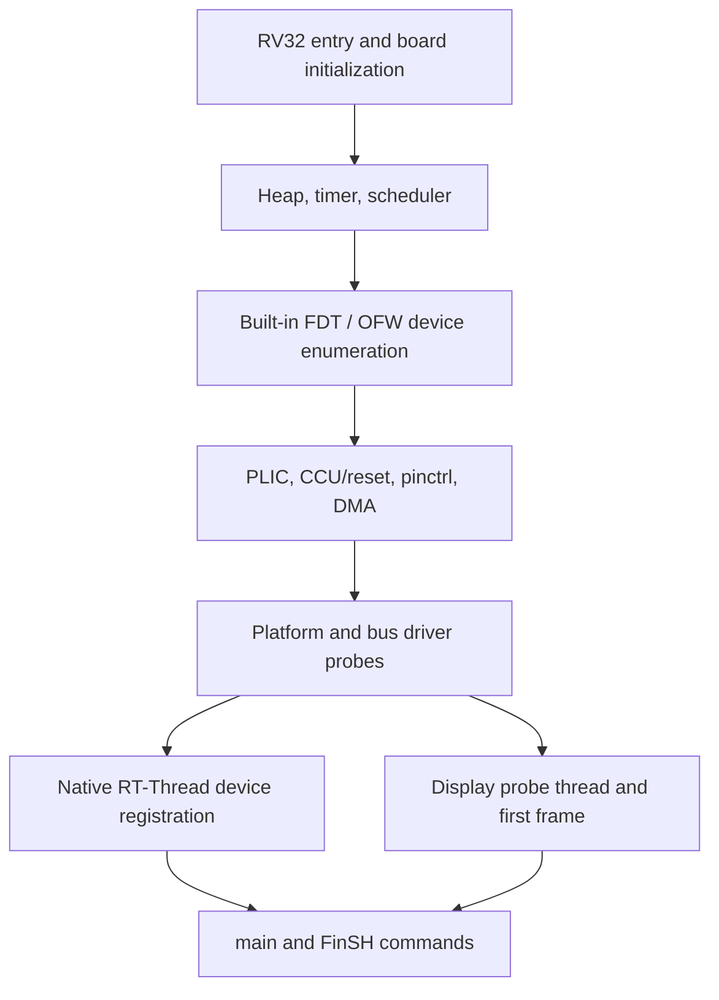

## 初始化顺序



`board/SConscript` 预处理 `dts/sun252iw2-${SUN252I_BOARD}.dts`，编译 DTB，再由 `board/builtin_fdt.S` 嵌入镜像。这与 Zephyr 的编译期设备生成不同。驱动运行时匹配 `compatible`，通过 RT-Thread 设备模型取得时钟、复位、中断、引脚和 DMA。显示在独立线程初始化，平台设备注册完成不代表帧缓冲已就绪。

## 代码放置位置

| BSP 内相对路径 | 职责 |
| --- | --- |
| `board/` | 启动、控制台、堆与嵌入 DTB |
| `dts/` | 板级布线与 SoC 资源 |
| `drivers/` | F101 设备模型驱动与 BSP 公共头 |
| `applications/*.c` | 应用入口及小型 FinSH 示例 |
| `applications/apps/` | USB CDC、USB 副屏和 MP4 应用 |
| `applications/tests/` | 驱动回归命令 |
| `applications/bench/` | 显式开启的性能测试命令 |

## 加入并调用示例

将某驱动页的完整 C 程序保存为 `applications/demo_<name>.c`。`applications/SConscript` 已收集顶层 C 文件，驱动组会导出头文件路径。重新构建、下载后，在 FinSH 输入 `MSH_CMD_EXPORT` 注册的命令名。逐个运行示例，它们可能修改帧缓冲、背光或设备所有权。完整 C 示例已用本 BSP 交叉编译并完成链接检查，尚未逐个在板上运行；板测结果属于另行标明的回归命令。

```c
#include <rtthread.h>
#include <rtdevice.h>
#define DBG_TAG "demo"
#define DBG_LVL DBG_INFO
#include <rtdbg.h>

static int demo_devices(int argc, char **argv)
{
    const char *names[] = {"uart1", "i2c1", "touch0", "spi0", "rtc", "sd0"};
    for (rt_size_t i = 0; i < sizeof(names) / sizeof(names[0]); ++i)
        LOG_I("%s: %s", names[i], rt_device_find(names[i]) ? "present" : "absent");
    return 0;
}
MSH_CMD_EXPORT(demo_devices, Inspect board devices);
```

```text
msh /> demo_devices
msh /> list_device
msh /> free
```

## 返回值与所有权

每个子系统的返回契约不同：`rt_i2c_transfer` 返回消息数，`sd0` 的 `rt_device_read` 返回扇区数，串口/音频读返回字节数，`rt_spi_send_then_recv` 返回错误码。BSP 图形和解码 API 常用负 POSIX errno，原生驱动使用 `-RT_EINVAL` 等 RT-Thread 错误。不能统一按字节数判断，也不能假设两类错误的数值相同。

DMA 缓冲区按 64 字节对齐并隔离缓存行，`rt_malloc_align` 必须对应 `rt_free_align`。clean 使 CPU 写入对硬件可见，invalidate 使硬件写入对 CPU 可见。提交成功不会转移缓冲区所有权，应保留到任务完成且显示图层不再扫描它。中断回调避免打印、休眠和堆分配，可通知工作线程或投递小事件。

## 原生日志

在包含 `rtdbg.h` 之前定义 `DBG_TAG` 和 `DBG_LVL`。`LOG_E/W/I/D` 自行添加行尾；`RT_USING_ULOG=y` 时走 ulog，否则使用标准调试实现。显示标签包括 `display`、`display.core`、`display.dsi` 和 `display.de-rcq`。需要调试消息时调整对应源码日志级别，显示没有另设 printf 日志系统。
