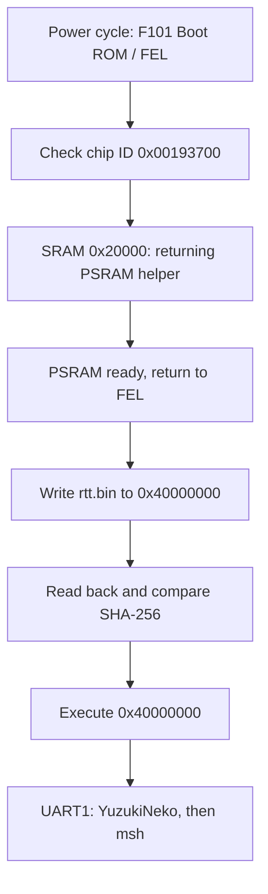

以下构建命令均在 `rt-thread/bsp/allwinner-hal/sun252iw2` 执行，先激活[开发环境](setup.md)。板级选择决定布线，Kconfig 种子决定功能，两者需要同时匹配。

## 求解配置并构建

```sh
export SUN252I_BOARD=yuzukineko
python3 - <<'CONFIG'
from kconfiglib import Kconfig
k = Kconfig("Kconfig")
k.load_config("rtconfig.defconfig")
k.write_config(".config")
CONFIG
scons --useconfig=.config
scons -j8
```

`kconfiglib` 求解默认值和依赖，再由 `scons --useconfig=.config` 生成 `rtconfig.h`。直接将精简种子传给 `--useconfig` 会跳过依赖求解。修改已求解配置使用 `scons --menuconfig`，不要手改生成头。SCons 实际退出码非零时停止下载。产物为 BSP 目录中的 `rtthread.elf`、`rtthread.map` 和 `rtt.bin`。

| 种子 / 板级 | 用途 |
| --- | --- |
| `rtconfig.defconfig` / `yuzukineko` | 常规镜像，关闭测试和基准命令 |
| `test_defconfig` / `yuzukineko` | 驱动回归命令 |
| `pio_window_defconfig` / `yuzukineko` | SD PIO、UI 分辨率除以 2、512×384 输出窗口 |
| `test_defconfig` / `yuzukineko-spif` | 独立 SPIF 控制器，关闭 SPI0 |
| `usbdisp_defconfig` / `usbdisp` | 旧 EVB 布线及精简 USB 副屏，不能用于 YuzukiNeko |

## 启动流程与地址



RAM 镜像链接在 `0x40000000`。helper 在 SRAM 地址 `0x20000` 执行；NOR 偏移 `0x20000` 属于另一地址空间，用于保存开发采样参数。该 RAM 流程不写 NOR 启动区或应用分区。

## 编译可返回的 PSRAM helper

使用当前 [`YuzukiHD/SyterKit`](https://github.com/YuzukiHD/SyterKit)。SoC eFEX 应用初始化 PSRAM 后返回 ROM，普通 SRAM 启动程序不提供这种返回路径。确认其 UART 默认为 UART1 PB0/PB1，内存参数与板子一致。

```sh
cd ~/f101-rtt
git clone https://github.com/YuzukiHD/SyterKit.git
cd SyterKit
make O=out/rtt-efex sun252iw2_rv32_efex_defconfig
make O=out/rtt-efex CROSS_COMPILE="$RTT_EXEC_PATH/riscv64-unknown-elf-" -j8
ls -l out/rtt-efex/build/soc/sun252iw2/app_efex/init_psram/init_psram_efex.bin
```

本次配置识别到 16 MiB APS128M，运行在 252 MHz。检查 helper 的构建结果、源码版本和散列。不要假设 `xfel ddr` 预设或旧 loader 文件能正确初始化同一内存。

## 下载与验证

每轮运行前断电重启进入 FEL。F101 芯片 ID 为 `0x00193700`，scratchpad 为 `0x00020000`。连接多块板时，确认目标断电后对应 USB 设备消失。`0x00191800` 是另一目标。

```sh
xfel version
xfel write 0x20000 init_psram_efex.bin
xfel exec 0x20000
xfel version
xfel write 0x40000000 rtt.bin
python3 -c 'from pathlib import Path; print(hex(Path("rtt.bin").stat().st_size))'
```

把输出的文件大小填入下面的读回命令。每条命令单独执行并检查输出，散列一致后再执行。Windows 使用 `xfel.exe` 和 `Get-FileHash` 检查对应文件。

```sh
xfel read 0x40000000 <size-in-hex> rtt-readback.bin
sha256sum rtt.bin rtt-readback.bin
xfel exec 0x40000000
```

## 核对板卡与控制台

```text
Machine model: YuzukiHD YuzukiNeko
Console: uart1 (serial@2500400)
```

以上两行是实测的板级身份信息，并非完整启动日志。继续等待本轮新的 `msh />` 提示符。exec 后 FEL USB 消失只说明 ROM 移交控制，不能证明应用启动成功。如果显示 EVB 或 UART3，重新检查构建 DTS、helper 的 UART 以及实体串口接线。

默认保留 RAM 开发方式。独立 NOR 启动需要单独验证启动链与布局，不能将 Zephyr XIP 应用偏移直接当作 RT-Thread 通用烧录方案。参见 [Flash 布局](../../boot/flash-layout.md)和 [SPIF 接口](drivers/spif-nor.md)。
