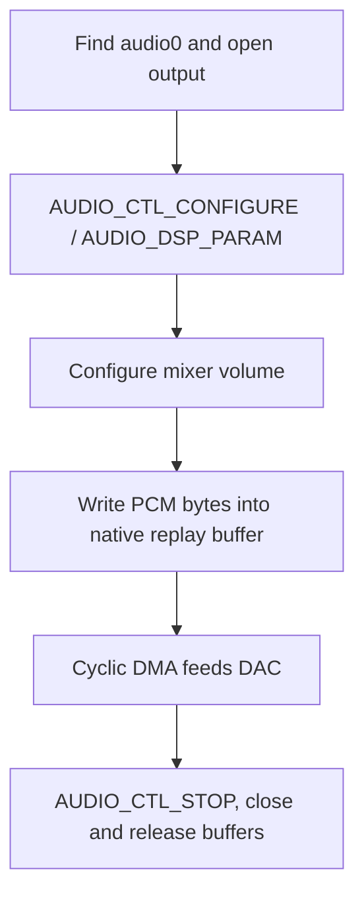

片上 codec 使用原生 RT-Thread `audio0`（`drivers/audio/codec-sun252i.c`）。独立 I2S0 和 OWA/S/PDIF 模块通过 `i2s-sun252i.h`、`owa-sun252i.h` 提供 BSP 循环缓冲函数，不是 Zephyr I2S 设备。

## 资源与支持配置

开启 `RT_USING_AUDIO` 与 DMA，保留已开启的 `codec`、`i2s0`、`owa` DTS 节点，以及时钟、复位、DMA 请求和板级 pinctrl。Codec、I2S0 和 OWA 寄存器起点分别为 `0x02030000`、`0x02032000`、`0x02036000`。外部功放路由需要与数字样本搬运分开检查。

| 路径 | 当前行为 |
| --- | --- |
| Codec 播放 | 单/双声道，16/24 位配置，48 kHz 与 44.1 kHz 时钟族 |
| Codec 采集 | 48 kHz 时钟族、最高 48 kHz，确认实际声道打包 |
| 播放 DMA | 四块，测试模式每块 1200 个立体声 16 位帧 / 4800 字节 |
| I2S0 | 主机、16 位立体声样本放入 32 位 slot，可配置支持的频率 |
| OWA | 当前 BSP 环形 helper 使用 48 kHz 立体声，RX DMA 请求仍未解决 |
| 时钟共享 | 协调音频 PLL 与资源，独立流可能冲突 |

## 原生 codec 调用顺序



用 `struct rt_audio_caps`，`main_type` 为 `AUDIO_TYPE_OUTPUT` 或 `INPUT`，`sub_type=AUDIO_DSP_PARAM`，参数放在 `udata.config`。混音控制使用 `AUDIO_TYPE_MIXER` 与 `AUDIO_MIXER_VOLUME` / `AUDIO_MIXER_MIC`。`rt_device_write/read` 数量单位为字节，不是帧。播放通过原生 replay 路径启动，采集使用 `AUDIO_CTL_START`。停止并关闭后再释放调用方缓冲。

## 完整 48 kHz 播放示例

命令输出约一秒、低幅度的 1 kHz 方波。先确认扬声器/耳机路由，关闭 MP4 播放器等其他音频所有者。示例用于演示样本交付，不用于证明音质。

```c
#include <rtthread.h>
#include <rtdevice.h>
static int demo_audio(int argc, char **argv)
{
    rt_device_t dev = rt_device_find("audio0");
    struct rt_audio_caps caps = {0};
    rt_int16_t *pcm = RT_NULL;
    int ret;
    if (!dev) return -RT_ENOSYS;
    ret = rt_device_open(dev, RT_DEVICE_OFLAG_WRONLY);
    if (ret) return ret;
    caps.main_type = AUDIO_TYPE_OUTPUT;
    caps.sub_type = AUDIO_DSP_PARAM;
    caps.udata.config.samplerate = 48000;
    caps.udata.config.channels = 2;
    caps.udata.config.samplebits = 16;
    ret = rt_device_control(dev, AUDIO_CTL_CONFIGURE, &caps);
    if (ret) goto out;
    caps.main_type = AUDIO_TYPE_MIXER; caps.sub_type = AUDIO_MIXER_VOLUME;
    caps.udata.value = 20;
    ret = rt_device_control(dev, AUDIO_CTL_CONFIGURE, &caps);
    if (ret) goto out;
    pcm = rt_malloc_align(4800, 64);
    if (!pcm) { ret = -RT_ENOMEM; goto out; }
    for (unsigned i = 0; i < 1200; ++i)
        pcm[2 * i] = pcm[2 * i + 1] = i % 48 < 24 ? 2000 : -2000;
    for (unsigned block = 0; block < 40; ++block)
        if (rt_device_write(dev, 0, pcm, 4800) != 4800) { ret = -RT_EIO; break; }
    rt_thread_mdelay(150);
out:
    rt_device_control(dev, AUDIO_CTL_STOP, RT_NULL);
    rt_device_close(dev);
    if (pcm) rt_free_align(pcm);
    return ret;
}
MSH_CMD_EXPORT(demo_audio, Play a short low-amplitude stereo tone);
```

## I2S 与 OWA 环形接口

| 函数组 | 用途 |
| --- | --- |
| `sun252i_i2s_open(rate, period_frames, periods, loopback)` | 分配驱动持有的 TX/RX 环，使用支持的频率，非零 period 数 1–8 |
| `sun252i_i2s_tx_buffer()` / `rx_buffer()` | 环形指针，每个立体声 16 位帧为 4 字节 |
| `sun252i_i2s_start()` / `stop()` / `close()` | 开启 DMA、停止、释放环及所占时钟 |
| `sun252i_i2s_tx_periods()` / `rx_periods()` | 已完成的 period 计数 |
| `sun252i_owa_open(period_frames, periods, loopback)` | 固定当前频率的类似 helper |
| `sun252i_owa_*` | 对应的缓冲、计数、启停与关闭函数 |
| `sun252i_codec_dac_count/tx_blocks/tx_position` | 用于节奏与诊断的硬件/DMA 进度 |

调用方应校验环形参数非零，不要给底层 helper 传入零长度 period。启动前填充并 clean TX，先开启 RX 再开启 TX，不能重写 DMA 正在使用的 period。CPU 读取 RX 前先停止双向 DMA 并 invalidate。部分启动失败后关闭资源。外部 I2S 需要匹配引脚复用、MCLK/BCLK/LRCK、电平和 slot 格式，内部回环不能验证外部布线。

## 调用与证据

```text
demo_audio
test_audio
test_mic
test_i2s
test_owa
```

保存为 `applications/demo_audio.c`。回归检查了 codec 在 48/44.1 kHz 的 DMA 推进和 I2S 内部搬运，但未确认听感，麦克风样本为零。OWA RX 未收到 DMA 请求，即使 TX 时序通过仍明确 SKIP。扬声器无声时，在 DAC 计数检查后检查模拟路由和功放供电；RX 无数据时分别检查 DMA 请求路由与 FIFO 状态。
