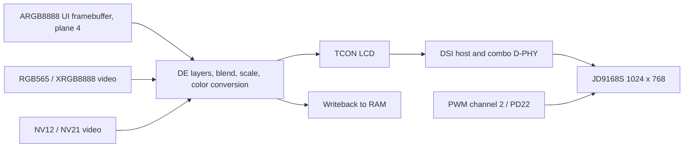

显示栈位于 `drivers/display/`。应用可使用 `drv_display.h` 的帧缓冲/视频层便捷接口，或 `hal/display/display_engine.h` 的显式流水线 API。它不是 Zephyr `display_write` 设备，也不是 Linux DRM 文件描述符。

## 流水线与板级规格



| 项目 | YuzukiNeko 设置 |
| --- | --- |
| 板级 DTS | `dts/sun252iw2-yuzukineko.dts` |
| 面板 | JD9168S，1024×768，RGB888，DSI 通道 0–3 |
| DSI 引脚 | PD12–PD21，复用 4 |
| 像素时钟 | 54 MHz |
| 水平同步 / 前沿 / 后沿 | 10 / 40 / 40 像素 |
| 垂直同步 / 前沿 / 后沿 | 8 / 12 / 21 行 |
| 标称时序刷新率 | 54 MHz / (1114 × 809)，约 59.92 Hz |
| UI 像素布局 | `0xAARRGGBB`，4 字节/像素，小端内存为 B,G,R,A |
| 默认 UI 分配 | 1024×768×4 = 3 MiB，动态分配、64 字节对齐 |

`BSP_LCD_FB_DIV` 按除数降低分配的逻辑 UI 尺寸。`BSP_LCD_FB_WIDTH/HEIGHT` 选择输出窗口，不修改面板时序。本面板除以 2 并设置 512×384 窗口时，分配的帧缓冲仍为 512×384，但仅将其中 256×192 源区域缩放到 512×384 窗口。应查询 `lcd_width/height`，不要按物理面板推算 pitch。

## 面板适配与命令序列

时钟、复位、pinctrl 和 endpoint graph 放在 DTS。面板节点提供尺寸、通道数、像素格式、模式标志、时序以及上电/初始化/退出序列。板级 DTS 已包含完整 JD9168S 初始化；下面只解释编码，不能替换完整序列。

```c
init-sequence = <SUNXI_CMD_DCS(120, 1, 0x11)
                 SUNXI_CMD_DCS(20, 1, 0x29)>;
```

`SUNXI_CMD_DCS(delay_ms, byte_count, bytes...)` 的显式字节数包含命令字节。包含 `dt-bindings/display/sunxi-display.h`，通用 DSI 写使用 `SUNXI_CMD_GENERIC`。转换屏厂命令时完整保留字节数、延时、页面切换和复位序列，并双向连接 endpoint。改用 RGB/LVDS 屏时同时修改编码器、引脚、总线格式和时序；开启旧 EVB RGB 节点会与本板触摸/DSI 布线冲突。

## 帧缓冲与视频接口

| 接口 | 行为 / 所有权 |
| --- | --- |
| `lcd_framebuffer()` | BSP 持有的 ARGB8888 内存，就绪前为 NULL，不能释放 |
| `lcd_width()` / `lcd_height()` | 分配的逻辑帧缓冲尺寸，不是物理面板尺寸 |
| `lcd_flush()` | clean 整个 UI 缓存，不复制也不交换缓冲 |
| `lcd_wait_vsync(timeout_ms)` | 等待刷新，超时单位为毫秒 |
| `lcd_fb_enable(bool)` | 开关 UI 图层，不释放 UI 缓冲 |
| `lcd_show_rgb(&img)` | RGB565 或 XRGB8888，字节 stride，保持比例的视频层 |
| `lcd_show_yuv(&img)` | NV12/NV21，Y/UV 独立字节 stride，范围与矩阵选择 |
| `lcd_hide_yuv()` | 关闭共用的 RGB/YUV 视频层，UI 仍可使用 |

`crop_width/height=0` 表示整图。裁剪会限幅，YUV 裁剪起点和尺寸对齐到偶数。RGB `pixel_perfect=true` 在裁剪区域能放入屏幕时选择整数倍及最近邻缩放，否则使用普通等比缩放。YUV 的 `nv21`、`full_range`、`bt709` 选择色度顺序、全/限幅范围和 BT.709/601，应匹配数据生产者而不是面板。stride 为每行字节数，包含 padding。

## 完整 UI 示例

```c
#include <rtthread.h>
#include <rtdevice.h>
#include <drv_display.h>
static int demo_display(int argc, char **argv)
{
    rt_uint32_t *fb = lcd_framebuffer();
    rt_uint32_t w = lcd_width(), h = lcd_height();
    if (!fb || !w || !h) return -RT_ENOSYS;
    for (rt_uint32_t y = 0; y < h; ++y)
        for (rt_uint32_t x = 0; x < w; ++x)
            fb[y * w + x] = x < w / 2 ? 0xffff0000u : 0xff0000ffu;
    lcd_flush();
    int ret = lcd_fb_enable(RT_TRUE);
    if (!ret) ret = lcd_wait_vsync(100);
    return ret;
}
MSH_CMD_EXPORT(demo_display, Draw red and blue halves in the UI framebuffer);
```

## 完整 RGB 示例及缓冲生命周期

示例在硬件扫描期间一直持有图像。`demo_rgb` 显示棋盘格，`demo_rgb_hide` 先关闭视频层再释放内存。由一个线程拥有 `lcd` API，或对其串行化。示例将 UI 清为透明，避免遮住视频。

```c
#include <rtthread.h>
#include <rtdevice.h>
#include <string.h>
#include <drv_display.h>
static rt_uint16_t *rgb_demo_pixels;
static int demo_rgb_hide(int argc, char **argv)
{
    int ret = lcd_hide_yuv();
    if (!ret && rgb_demo_pixels)
    {
        rt_free_align(rgb_demo_pixels);
        rgb_demo_pixels = RT_NULL;
    }
    return ret;
}
static int demo_rgb(int argc, char **argv)
{
    if (!lcd_framebuffer()) return -RT_ENOSYS;
    if (rgb_demo_pixels) return -RT_EBUSY;
    rgb_demo_pixels = rt_malloc_align(160 * 120 * 2, 64);
    if (!rgb_demo_pixels) return -RT_ENOMEM;
    for (unsigned y = 0; y < 120; ++y)
        for (unsigned x = 0; x < 160; ++x)
            rgb_demo_pixels[y * 160 + x] = ((x / 8) ^ (y / 8)) & 1 ? 0xf800 : 0x07e0;
    rt_memset(lcd_framebuffer(), 0, lcd_width() * lcd_height() * 4);
    lcd_flush();
    rt_hw_cpu_dcache_ops(RT_HW_CACHE_FLUSH, rgb_demo_pixels, 160 * 120 * 2);
    struct lcd_rgb img = {
        .data = rgb_demo_pixels, .width = 160, .height = 120,
        .stride = 320, .pixel_perfect = RT_TRUE, .nonblock = RT_FALSE,
    };
    int ret = lcd_show_rgb(&img);
    if (ret) demo_rgb_hide(0, RT_NULL);
    return ret;
}
MSH_CMD_EXPORT(demo_rgb, Show an owned RGB565 video buffer);
MSH_CMD_EXPORT(demo_rgb_hide, Disable video before freeing its buffer);
```

## 显式流水线调用

通过 `display_get_caps`、`display_get_plane_caps` 和 `display_get_mode` 查询能力。`display_get_state` 读取当前状态，`display_pipeline_state_init` 生成默认状态。`display_submit` 更新流水线，`display_submit_ex(..., DISPLAY_SUBMIT_PARTIAL)` 只改变指定图层。普通提交等待应用完成，`DISPLAY_SUBMIT_NONBLOCK` 在刷新前返回，因此应保留旧、新缓冲到确认锁存。底层还提供 `display_blank`、背光、背景、gamma、色彩调整、TCON 测试图、抓屏和统计。不要让原始状态提交与独立的 `lcd_*` 所有者竞争。

## 日志、验证与诊断

所有显示源码使用 RT-Thread `rtdbg.h` 宏，标签包括 `display.core`、`display.dsi` 和 `display.de-rcq`，同一调用可接入 ulog。修改相应模块的调试级别后重建。黑屏依次定位：帧缓冲分配、endpoint graph、DE/TCON 运行、DSI 通道/格式/模式、屏复位/初始化、背光。TCON 测试图可区分链路问题与像素缓冲问题。

```text
demo_display
demo_rgb
demo_rgb_hide
test_display_features
usb_display_selftest
```

两个 C 示例分别保存到应用文件。本次通过 22 项内部像素检查，两个日志后端均通过 30 帧 JPEG 显示自测。这些检查使用整帧 writeback，非零抓屏裁剪起点是已知问题。中间 alpha 色彩和实物屏幕观感仍有[验证页](../testing.md)所述限制。
