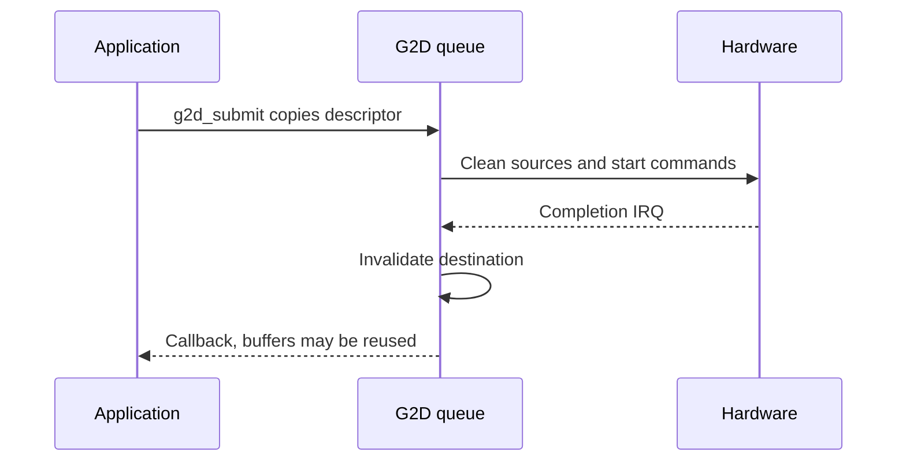

`drivers/g2d/g2d.h` 提供内存间填充、搬运、缩放、旋转、格式转换和 Porter-Duff 合成。`g2d-sun252i.c` 复制操作描述符并排队，按提交顺序完成。G2D 本身不会将像素显示到屏幕。

## 配置与 surface

开启 `BSP_USING_G2D`，保留板级 G2D 节点及其时钟/复位/IRQ。初始化后使用 `g2d_ready()` 和 `g2d_get_capabilities()`。查询源/目标格式位图、最大尺寸、队列深度和旋转地址/pitch 对齐，不假设所有格式均可写。NV12/NV21/I420/YUYV 属于 YUV 源格式，输出路径使用 RGB/ARGB 变体。

| 类型 / 字段 | 含义 |
| --- | --- |
| `g2d_surface.format` | 像素格式，字内分量顺序遵循枚举 |
| `width`, `height` | 缓冲区完整像素尺寸 |
| `plane[3]`, `pitch[3]` | 地址及每行字节数，pitch 为零表示紧密排列 |
| `g2d_rect` | surface 内的像素起点和尺寸 |
| `g2d_op` | 描述符会复制，像素内存仍由调用方持有 |
| `G2D_FLAG_NO_CACHE_OPS` | 调用方承担全部 clean/invalidate 责任 |
| `G2D_FLAG_YUV_FULL_RANGE` / `BT709` | 源色彩解释，默认限幅 BT.601 |

## 操作接口

| 函数 | 用途 |
| --- | --- |
| `g2d_fill(dst, rect, color)` | 同步按 ARGB8888 颜色填充 |
| `g2d_blit(src, sr, dst, dr, rotation, flags)` | 复制/转换/缩放，旋转 0/90/180/270 后再翻转 |
| `g2d_blend(fg, fr, bg, br, dst, dr, blend, flags)` | 按 Porter-Duff 模式将前景和背景合成 |
| `g2d_submit(&op)` | 异步入队，回调在驱动线程中执行，不得阻塞 |
| `g2d_run(&op, timeout_ticks)` | 同步等待，`-EAGAIN` 超时不会取消硬件任务 |
| `g2d_last_hw_time_x100us()` | 单位 1/100 µs 的硬件间隔，不含调度/缓存 |
| `g2d_set/get_clock_rate()` | 实际模块时钟，设置失败返回零 |
| `g2d_set/get_ddr_limit()` | 引擎带宽限制，与 MBUS 仲裁不同 |

## 完整填充、缩放与合成示例

```c
#include <rtthread.h>
#include <rtdevice.h>
#include <g2d.h>
static int demo_g2d(int argc, char **argv)
{
    struct g2d_capabilities caps;
    struct g2d_rect sr = {0, 0, 64, 64}, dr = {0, 0, 128, 128};
    struct g2d_surface src = {.format = G2D_PIXFMT_ARGB8888, .width = 64, .height = 64};
    struct g2d_surface dst = {.format = G2D_PIXFMT_ARGB8888, .width = 128, .height = 128};
    struct g2d_blend blend = {
        .mode = G2D_BLEND_SRC_OVER, .fg_alpha_mode = G2D_ALPHA_GLOBAL, .fg_alpha = 128,
        .bg_alpha_mode = G2D_ALPHA_GLOBAL, .bg_alpha = 255,
    };
    int ret = g2d_get_capabilities(&caps);
    if (ret) return ret;
    src.plane[0] = rt_malloc_align(64 * 64 * 4, 64);
    dst.plane[0] = rt_malloc_align(128 * 128 * 4, 64);
    if (!src.plane[0] || !dst.plane[0]) { ret = -ENOMEM; goto out; }
    ret = g2d_fill(&src, &sr, 0xffff0000);
    if (!ret) ret = g2d_fill(&dst, &dr, 0xff0000ff);
    if (!ret) ret = g2d_blit(&src, &sr, &dst, &dr, G2D_ROTATE_0, 0);
    if (!ret) rt_kprintf("scaled pixel=%08x\n", *(rt_uint32_t *)dst.plane[0]);
    if (!ret) ret = g2d_fill(&dst, &dr, 0xff0000ff);
    if (!ret) ret = g2d_blend(&src, &sr, &dst, &dr, &dst, &dr, &blend, 0);
    if (!ret) rt_kprintf("first pixel=%08x\n", *(rt_uint32_t *)dst.plane[0]);
out:
    if (src.plane[0]) rt_free_align(src.plane[0]);
    if (dst.plane[0]) rt_free_align(dst.plane[0]);
    return ret;
}
MSH_CMD_EXPORT(demo_g2d, Fill scale and blend caller-owned surfaces);
```

## 异步生命周期与验证



保存为 `applications/demo_g2d.c`，调用 `demo_g2d`。同步便捷接口等待完成；异步任务必须持有全部源/目标缓冲和回调状态直到完成，等待超时后也不能释放。旋转 90/270 会交换输出尺寸，每个平面地址及 pitch 均按查询得到的旋转限制对齐。预乘标志必须匹配实际像素，并明确选择 alpha 模式。

`test_g2d` 已纳入板级回归。BSP 中历史吞吐表早于本次更新，不是本示例的测量。显示结果时，在显示层引用目标缓冲期间保持其存活，或 blit 到常驻 UI 帧缓冲后 flush，参见[显示](display.md)。
