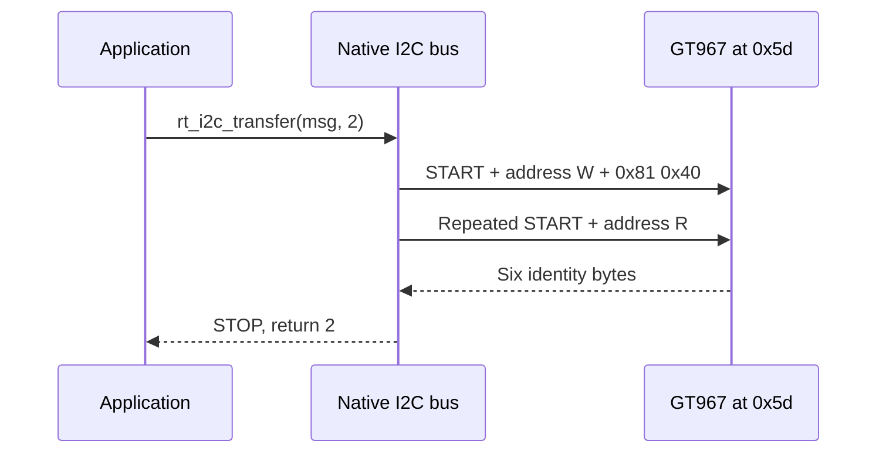

`drivers/i2c/i2c-sun252i.c` 注册原生 `i2cN` 总线，事务使用 `struct rt_i2c_msg` 和 `rt_i2c_transfer`。驱动轮询控制器状态，支持带重复 START 的先写后读。

## 板级配置

```c
&i2c1 {
    status = "okay";
    clock-frequency = <400000>;
    touchscreen@5d {
        compatible = "goodix,gt967";
        reg = <0x5d>;
    };
};
```

此处是总线选择的简化节点，使用时保留板级 DTS 的完整触摸属性。I2C1 使用 PD0/PD1、复用 4，连接 GT967。I2C0 使用 PE8/PE9，I2C2 关闭。需要 `CONFIG_RT_USING_I2C` 与设备模型。`clock-frequency` 仅支持 100000、200000 和 400000 Hz（默认 100000），其他值导致 probe 失败。仍需正确电压和外部上拉。

## 事务契约

地址填写 7 位地址，不左移成地址字节。`RT_I2C_WR` / `RT_I2C_RD` 选择方向。`rt_i2c_transfer(bus, messages, count)` 返回 `count` 才表示成功，不是返回零或数据字节数。读寄存器时将地址写和数据读放在同一次调用中，以保留重复 START。多个线程共享外设时，跨多次调用的设备协议需要另行串行化。

## 完整 GT967 身份读取

```c
#include <rtthread.h>
#include <rtdevice.h>
static int demo_i2c_id(int argc, char **argv)
{
    struct rt_i2c_bus_device *bus = rt_i2c_bus_device_find("i2c1");
    rt_uint8_t reg[] = {0x81, 0x40};
    rt_uint8_t id[6] = {0};
    struct rt_i2c_msg msg[2] = {
        {.addr = 0x5d, .flags = RT_I2C_WR, .len = sizeof(reg), .buf = reg},
        {.addr = 0x5d, .flags = RT_I2C_RD, .len = sizeof(id), .buf = id},
    };
    if (!bus) return -RT_ENOSYS;
    if (rt_i2c_transfer(bus, msg, 2) != 2) return -RT_EIO;
    rt_kprintf("GT product=%.4s firmware=%02x%02x\n", id, id[5], id[4]);
    return 0;
}
MSH_CMD_EXPORT(demo_i2c_id, Read GT967 identity with repeated START);
```

保存为 `applications/demo_i2c.c`，调用 `demo_i2c_id`。两个寄存器地址字节为大端，这是 GT967 协议要求。读取身份不会消费触摸坐标或修改配置；其他 I2C 外设可能使用单字节寄存器地址或不同协议。

## 总线时序与验证



运行 `test_i2c i2c1`：本次在 400 kHz 下通过 5 项检查并发现 `0x5d`。NACK 可能是地址错误；START 超时应检查总线卡死、引脚占用、上拉和供电。扫描任意设备可能产生副作用，已知外设应优先读取身份寄存器。事件处理见[触摸](touch.md)。
