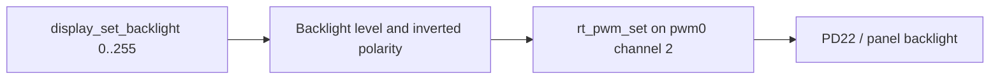

通用 PWM 驱动为 `drivers/pwm/pwm-sun252i.c`，原生设备 `pwm0`，通道 0–3。YuzukiNeko 使用 PD22（复用 4）的通道 2 驱动 DSI 背光。独立的模拟 PWM-BL 灌电流模块在该板关闭，不能套用 EVB 的 `pwm_bl0` 路径。

## 设备树与时序

```c
&pwm {
    pinctrl-names = "default";
    pinctrl-0 = <&pwm2_pins>;
    status = "okay";
};
/ {
    backlight_dsi: backlight-dsi {
        compatible = "pwm-backlight";
        pwms = <&pwm 2 1000000 1>;
        max-level = <255>;
        default-level = <96>;
    };
};
```

开启 `RT_USING_PWM`。周期和脉宽单位为纳秒；`rt_pwm_set` 拒绝通道 ≥4、零周期和脉宽大于周期。零脉宽关闭通道时钟。常规周期使用 24 MHz，经 2 的幂分频和 8 位预分频后进入 16 位计数器，因此存在量化。周期 ≤334 ns 使用 100 MHz 旁路，不代表可生成任意高速占空比波形。

## 接口与实际限制

| 接口 | 行为 |
| --- | --- |
| `rt_pwm_set(pwm, ch, period, pulse)` | 设置并打开所选通道 |
| `rt_pwm_enable(pwm, ch)` / `disable()` | 控制通道时钟门 |
| `rt_pwm_get()` | 当前驱动未填入有意义的硬件读回值 |
| `display_set_backlight(level)` | 推荐面板接口，使用 DTS 极性和亮度范围 |
| `display_get_backlight(&level)` | 读取显示管理的亮度状态 |

底层 PWM 驱动未实现通用 PWM 的全部极性和控制命令。显示背光层负责应用板级反相约定，直接将底层 50% 脉宽解释为亮度百分比可能有误。

## 完整背光示例

```c
#include <rtthread.h>
#include <rtdevice.h>
#include <hal/display/display_engine.h>
static int demo_backlight(int argc, char **argv)
{
    uint32_t saved;
    int ret = display_get_backlight(&saved);
    if (ret) return ret;
    for (uint32_t level = 32; level <= 224; level += 64)
    {
        ret = display_set_backlight(level);
        if (ret) break;
        rt_kprintf("backlight level=%u\n", level);
        rt_thread_mdelay(500);
    }
    int restore = display_set_backlight(saved);
    return ret ? ret : restore;
}
MSH_CMD_EXPORT(demo_backlight, Sweep and restore panel backlight);
```

## 调用流程与验证



保存为 `applications/demo_pwm.c`，显示就绪后运行 `demo_backlight`。`test_pwm` 检查通道寄存器，`test_backlight` 运行面板路径。寄存器和内部显示检查不能证明实际亮度或 PWM 波形精度，这些需要现场观察与示波器。
