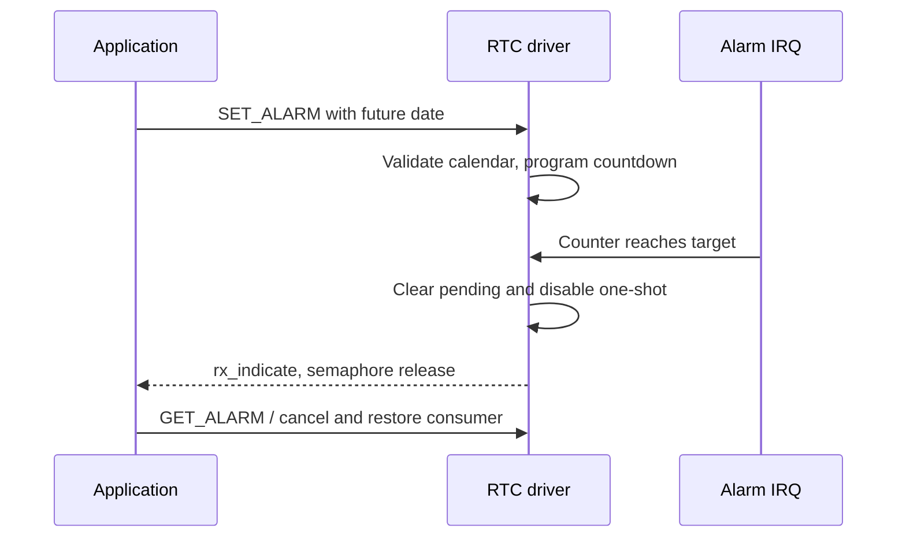

原生 `rtc` 设备由 `drivers/rtc/rtc-sun252i.c` 实现，支持日历转换、带日期的一次性闹钟及 `rx_indicate` 中断通知。日历范围为 1970–2097 年（含边界），硬件日期计数从第 1 天开始。

## 资源与原生调用

```c
&rtc {
    status = "okay";
    clock-source = "hosc";
};
```

开启 `RT_USING_RTC`。SoC 节点 compatible 为 `allwinner,sunxi-rtc`，寄存器位于 `0x03090000`，PLIC 中断 144。当前板级选择 HOSC，测试不能证明断电后的备份域保持能力或振荡精度。

| 控制命令 | 参数 |
| --- | --- |
| `RT_DEVICE_CTRL_RTC_GET_TIME` | `time_t *`，Unix epoch 起的秒数 |
| `RT_DEVICE_CTRL_RTC_SET_TIME` | `time_t *`，检查支持的年份范围 |
| `RT_DEVICE_CTRL_RTC_GET_TIMEVAL` | `struct timeval *`，秒分辨率 |
| `RT_DEVICE_CTRL_RTC_GET_ALARM` | `struct rt_rtc_wkalarm *` |
| `RT_DEVICE_CTRL_RTC_SET_ALARM` | 开启未来闹钟，或用 `enable=0` 取消 |
| `rt_device_set_rx_indicate` | 一次性 IRQ 回调，用于通知等待线程 |

闹钟日期遵循 `struct tm`：年份减 1900、月份 0–11。UTC 转换使用 `timegm` / `gmtime_r`，避免本地时区歧义。过去日期、溢出年份和非法日期返回错误。硬件只有一个闹钟，需要与闹钟框架或应用协调所有权。

## 完整未来闹钟示例

在没有其他应用占用 RTC 闹钟时运行。示例读取当前日期，若已有闹钟则拒绝，设置三秒后的闹钟并等待，结束时取消并恢复回调，不修改当前时钟。

```c
#include <rtthread.h>
#include <rtdevice.h>
#include <time.h>
static struct rt_semaphore rtc_demo_done;
static rt_err_t demo_alarm_rx(rt_device_t dev, rt_size_t n)
{
    return rt_sem_release(&rtc_demo_done);
}
static int demo_rtc(int argc, char **argv)
{
    rt_device_t rtc = rt_device_find("rtc");
    struct rt_rtc_wkalarm alarm = {0};
    struct tm tm;
    time_t now;
    int ret;
    if (!rtc) return -RT_ENOSYS;
    ret = rt_device_control(rtc, RT_DEVICE_CTRL_RTC_GET_ALARM, &alarm);
    if (ret || alarm.enable) return ret ? ret : -RT_EBUSY;
    ret = rt_device_control(rtc, RT_DEVICE_CTRL_RTC_GET_TIME, &now);
    if (ret) return ret;
    now += 3;
    if (!gmtime_r(&now, &tm)) return -RT_EINVAL;
    alarm.enable = 1;
    alarm.tm_year = tm.tm_year; alarm.tm_mon = tm.tm_mon;
    alarm.tm_mday = tm.tm_mday; alarm.tm_hour = tm.tm_hour;
    alarm.tm_min = tm.tm_min; alarm.tm_sec = tm.tm_sec;
    ret = rt_sem_init(&rtc_demo_done, "rtc-demo", 0, RT_IPC_FLAG_FIFO);
    if (ret) return ret;
    rt_err_t (*saved)(rt_device_t, rt_size_t) = rtc->rx_indicate;
    rt_device_set_rx_indicate(rtc, demo_alarm_rx);
    ret = rt_device_control(rtc, RT_DEVICE_CTRL_RTC_SET_ALARM, &alarm);
    if (!ret) ret = rt_sem_take(&rtc_demo_done, rt_tick_from_millisecond(4500));
    alarm.enable = 0;
    int cancel = rt_device_control(rtc, RT_DEVICE_CTRL_RTC_SET_ALARM, &alarm);
    rt_device_set_rx_indicate(rtc, saved);
    rt_sem_detach(&rtc_demo_done);
    rt_kprintf("alarm wait=%d cancel=%d\n", ret, cancel);
    return ret ? ret : cancel;
}
MSH_CMD_EXPORT(demo_rtc, Wait for a native one-shot RTC alarm);
```

## 闹钟流程与验证



保存为 `applications/demo_rtc.c`，调用 `demo_rtc`。`test_rtc` 已通过 13 项检查，包括闰日、最后支持年份、非法/过去日期、走时、取消和一次性通知。信号量超时时，除日历读回外还应分别检查 clock-source、挂起 IRQ 与 PLIC 配置。
