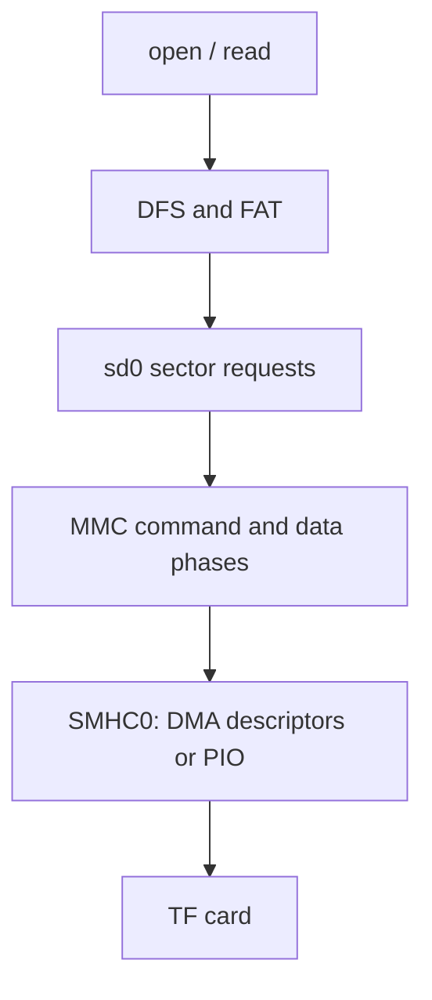

`drivers/sdio/sdio-sun252i.c` 实现原生 MMC/SD 主控制器，MMC 栈枚举卡后将其注册为块设备 `sd0`。应用通常通过 DFS/FAT 访问文件，而不是直接发送原始 SD 命令。

## 引脚与配置

```c
&mmc0 { status = "okay"; };
&{/jtag} { status = "disabled"; };
```

YuzukiNeko 的 TF 槽使用 SMHC0 PF0–PF5，与 JTAG 共用，因此不能同时开启。保留完整的 SoC/板级 pinctrl、时钟/复位和总线宽度设置。开启 `RT_USING_SDIO`、`RT_USING_DFS` 与 `RT_USING_DFS_ELMFAT`。`BSP_SD_DMA=y` 最多使用 `BSP_SD_DMA_DESCRIPTORS=128`，当前描述符链每次 host 传输最多 1 MiB，块设备栈拆分更大请求。PIO 配置关闭该选项。

## 块单位与完整读取示例

`rt_device_read(sd, lba, buffer, count)` 的位置和数量单位为扇区，返回值也是扇区，不是字节。通过 geometry 查询容量。下面程序只读打开并打印扇区签名，不修改卡。

```c
#include <rtthread.h>
#include <rtdevice.h>
static int demo_sd(int argc, char **argv)
{
    rt_device_t sd = rt_device_find("sd0");
    struct rt_device_blk_geometry geo = {0};
    void *buf = RT_NULL;
    int ret;
    if (!sd) return -RT_ENOSYS;
    ret = rt_device_open(sd, RT_DEVICE_OFLAG_RDONLY);
    if (ret) return ret;
    ret = rt_device_control(sd, RT_DEVICE_CTRL_BLK_GETGEOME, &geo);
    if (ret) goto out;
    if (!geo.bytes_per_sector) { ret = -RT_EINVAL; goto out; }
    buf = rt_malloc_align(geo.bytes_per_sector, 64);
    if (!buf) { ret = -RT_ENOMEM; goto out; }
    if (rt_device_read(sd, 0, buf, 1) != 1) ret = -RT_EIO;
    if (!ret && geo.bytes_per_sector >= 512)
    {
        rt_uint8_t *p = buf;
        rt_kprintf("sector bytes=%u signature=%02x%02x\n",
                   geo.bytes_per_sector, p[510], p[511]);
    }
out:
    if (buf) rt_free_align(buf);
    rt_device_close(sd);
    return ret;
}
MSH_CMD_EXPORT(demo_sd, Read SD sector zero without writing);
```

## FAT 挂载与文件调用

应用已挂载文件系统时直接使用现有挂载；否则先以 `elm` 挂载 `sd0` 再读取。在 `/` 挂载会改变应用命名空间，应与首次使用时挂载卡的 MP4 播放器协调。不能因挂载失败就格式化已有数据的卡。

```c
#include <rtthread.h>
#include <rtdevice.h>
#include <dfs_fs.h>
#include <fcntl.h>
#include <unistd.h>
static int demo_sd_file(int argc, char **argv)
{
    char buf[128];
    if (argc != 2) return -RT_EINVAL;
    int fd = open(argv[1], O_RDONLY);
    if (fd < 0) return -RT_EIO;
    ssize_t n = read(fd, buf, sizeof(buf));
    if (n > 0) rt_kprintf("read %d bytes\n", (int)n);
    int close_ret = close(fd);
    return n < 0 || close_ret < 0 ? -RT_EIO : 0;
}
MSH_CMD_EXPORT(demo_sd_file, Read a file from an already mounted SD card);
```

```text
demo_sd
mount sd0 / elm
demo_sd_file /example.txt
test_sd
```

## 请求流程与证据



两个 C 程序分别保存到应用文件。本次 DMA 读取 2 MiB 为 89 ms，PIO 为 772 ms，速度取决于卡与构建。已通过 bounce 路径检查非对齐目标。`55aa` 签名反映卡内容，不能证明电气总线完整性。日常回归运行不带 `write` 的 `test_sd`；可选写测试会修改原始扇区，不应对正在挂载的文件系统执行。
