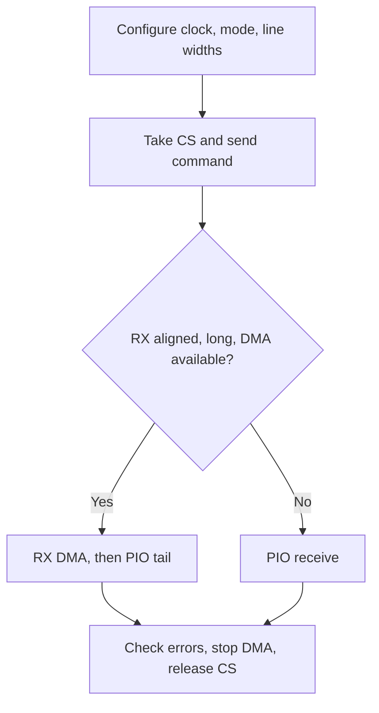

`drivers/spi/spi-sun252i.c` 实现原生 RT-Thread SPI 主机事务。SPI0 使用板载 NOR 的 PC0–PC5。SPI1 及显示总线功能与其他外设共用引脚，开启控制器需要分配板级引脚，不能只打开 Kconfig。

## 能力与配置

| 项目 | 行为 |
| --- | --- |
| 角色 / 字长 | 主机，8 位字长 |
| 时钟 | 请求范围 3 kHz–100 MHz，实际频率由硬件分频决定 |
| 模式 | CPOL/CPHA 模式 0–3，MSB/LSB 顺序 |
| 数据线 | 单线发送，通过 `data_width_rx` 选择单线或四线接收 |
| 采样 | `sunxi_spi_set_sample(bus, mode, delay)`，模式 0–6，延迟 0–63 |
| DMA | 接收 ≥256 字节、目标 64 字节对齐且有 RX DMA 通道 |
| 回退 | 非对齐/短读使用 PIO，FIFO 尾部由 CPU 读取 |
| 拒绝 | 从机、高有效片选、无片选、三线、READY 和非 8 位字长 |

```c
&spi0 {
    status = "okay";
    clocks = <&ccu CLK_BUS_SPI0>, <&ccu CLK_SPI0>, <&ccu CLK_PLL_PERI_1X>;
    clock-names = "ahb", "mod", "peri1x";
    dmas = <&dma 7 22>;
    dma-names = "rx";
};
```

SoC DTS 已提供上述资源，使用时保留 pinctrl 与复位属性。开启 `RT_USING_SPI`、`RT_USING_DMA` 和 `BSP_SPI_DMA`。`struct rt_spi_configuration.data_width` 是每字位数，`data_width_tx/rx` 是数据线数。原生 SPI core 在比较与复制配置时保留这些线宽字段。

## 完整只读 NOR 示例

```c
#include <rtthread.h>
#include <rtdevice.h>
#include <string.h>
static struct rt_spi_device demo_nor_device;
static int demo_spi(int argc, char **argv)
{
    struct rt_spi_device *dev = (void *)rt_device_find("demo-nor");
    struct rt_spi_configuration cfg = {
        .mode = RT_SPI_MODE_0 | RT_SPI_MSB, .data_width = 8,
        .data_width_tx = 1, .data_width_rx = 1, .max_hz = 24000000,
    };
    const rt_uint8_t cmd[] = {0x5a, 0, 0, 0, 0};
    rt_uint8_t *buf;
    int ret;
    if (!dev)
    {
        ret = rt_spi_bus_attach_device(&demo_nor_device, "demo-nor", "spi0", RT_NULL);
        if (ret) return ret;
        dev = &demo_nor_device;
    }
    ret = rt_spi_configure(dev, &cfg);
    if (ret) return ret;
    buf = rt_malloc_align(4096, 64);
    if (!buf) return -RT_ENOMEM;
    ret = rt_spi_send_then_recv(dev, cmd, sizeof(cmd), buf, 4096);
    if (!ret && memcmp(buf, "SFDP", 4)) ret = -RT_EIO;
    rt_kprintf("SFDP read result=%d\n", ret);
    rt_free_align(buf);
    return ret;
}
MSH_CMD_EXPORT(demo_spi, Read NOR SFDP through native SPI);
```

保存为 `applications/demo_spi.c`，调用 `demo_spi`。挂载参数 `RT_NULL` 使用板级驱动默认硬件 CS0。`rt_spi_send_then_recv` 在命令和数据之间保持片选，成功返回 `RT_EOK`；分开的 `rt_spi_send`、`rt_spi_recv` 通常会在中间释放片选。示例不修改 Flash 数据。

## 高速与四线接收

先在 24 MHz 读取有效且非均匀的数据作为参考，再提高 `cfg.max_hz`，通过 `sunxi_spi_set_sample` 应用候选采样点，与参考反复比较，并选择有效窗口中间。测试板在 100 MHz、模式 0 / 延迟 17 通过，其他布线与 Flash 可能不同。采样设置在下一次传输作用于整个总线，需要协调各客户端。

NOR 的 1-1-4 读取使用 `0x6b`、三个地址字节和一个 dummy 字节，发送线宽 1、接收线宽 4。先确认 Flash 的 QE 位和命令协议。`test_spi_quad` 临时设置被测芯片的易失 QE 并恢复，但其状态寄存器协议不是通用协议，不能用于身份未知的 Flash。

## 传输流程与验证



```text
demo_spi
test_spi_features
test_spi_quad
```

本次通过 14 项功能检查和 6 项四线检查。对齐 DMA 与非对齐 PIO 均匹配 NOR `0x80000` 的单线参考。JEDEC ID 可读不能证明四线数据或高速采样正确。SPI0 和 [SPIF](spif-nor.md) 共用焊盘，不能同时启用。
