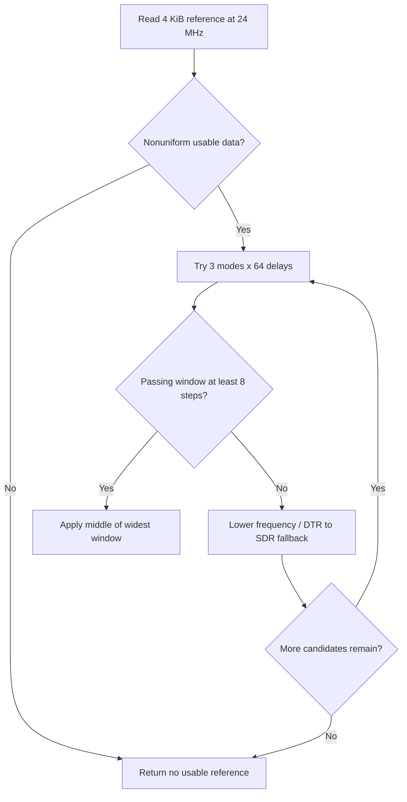

SPIF 是独立 NOR 控制器，与 SPI0 不同。`drivers/spif/spif-sun252i.c` 提供原生 MTD NOR 设备 `spif0`，以及 `spif-sun252i.h` 扩展函数。SPI0 与 SPIF 使用相同的 PC0–PC5 焊盘但复用不同，只能由一个控制器占用。

## 只读板测配置

选择 `SUN252I_BOARD=yuzukineko-spif`，配合常规或测试种子重新生成配置并构建。DTS 包含 YuzukiNeko、关闭 SPI0，选择 SPIF 复用 4。`RT_USING_MTD_NOR` 控制驱动编译。配置请求 100 MHz 四线 DTR，并使用 `0x80000` 现有非均匀数据调谐。

```c
&spi0 { status = "disabled"; };
&spif {
    status = "okay";
    pinctrl-names = "default";
    pinctrl-0 = <&spif_data_pins>, <&spif_control_pins>;
    clock-frequency = <100000000>;
    quad;
    dtr;
    tune-offset = <0x80000>;
};
```

完整引脚组位于 `dts/sun252iw2-yuzukineko-spif.dts`。没有设置 `params-offset` 或 `clear-block-protect`，因此该配置不擦写 Flash 数据或保存参数，但四线读取仍可能按需设置 Flash 的状态/QE 位。

## 公共接口

| 接口 | 契约 |
| --- | --- |
| `sun252i_spif_get_info(&info)` | ID、容量、实际时钟、线模式、采样和 XIP 状态 |
| `sun252i_spif_read(offset, buf, len)` | 返回读取字节数或负错误 |
| `sun252i_spif_write(offset, buf, len)` | 编程 NOR，由调用方管理擦除状态与分区 |
| `sun252i_spif_erase(offset, len)` | 偏移和长度均为 4 KiB 的整数倍 |
| `sun252i_spif_tune(&result)` | 搜索并应用有效采样窗口，XIP 映射期间不可执行 |
| `sun252i_spif_set_sample(mode, delay)` | 显式应用工作频率下的采样点 |
| `sun252i_spif_params_save/load/erase()` | 持久参数记录，无参数扇区时禁用 |
| `sun252i_spif_xip_enable(offset, len)` | 映射 4 KiB 对齐的 Flash 范围 |
| `sun252i_spif_xip_window()` / `xip_disable()` | 获取映射地址 / 关闭映射 |

## 完整读取示例

```c
#include <rtthread.h>
#include <rtdevice.h>
#include <spif-sun252i.h>
static int demo_spif(int argc, char **argv)
{
    struct sun252i_spif_info info;
    rt_uint8_t *data;
    int ret = sun252i_spif_get_info(&info);
    if (ret) return ret;
    rt_kprintf("NOR %02x%02x%02x size=%u Hz=%u quad=%u dtr=%u\n",
               info.jedec_id[0], info.jedec_id[1], info.jedec_id[2], info.size,
               info.frequency, info.quad, info.dtr);
    if (info.size < 0x81000) return -RT_EINVAL;
    data = rt_malloc_align(4096, 64);
    if (!data) return -RT_ENOMEM;
    rt_ssize_t n = sun252i_spif_read(0x80000, data, 4096);
    if (n == 4096)
        rt_kprintf("first bytes: %02x %02x %02x %02x\n",
                   data[0], data[1], data[2], data[3]);
    rt_free_align(data);
    return n == 4096 ? 0 : -RT_EIO;
}
MSH_CMD_EXPORT(demo_spif, Read SPIF without changing flash data);
```

## 调谐流程



调谐将数据及身份与低速参考比较。全 FF 的空扇区无法验证采样。DTR 读 opcode 随地址宽度选择（本次三字节模式使用 `0xed`，四字节模式使用对应 opcode）。实测点为模式 0、延迟 27，不能当作通用默认值。

## XIP 所有权与验证

XIP 映射是驱动能力，不是独立镜像格式。Flash 命令在屏蔽中断时暂时关闭映射，此时其他上下文不得从该窗口执行，驱动自身必须位于 RAM。重新调谐前关闭映射。持久参数 API 会擦写配置的扇区；没有单独明确分区方案时，保留开发启动区和 NOR `0x20000`。

保存为 `applications/demo_spif.c` 并运行 `demo_spif`。本次 `test_spif_read 0x11c60a82` 与未变化的 SPI 参考比较，通过 13 项检查。Flash 内容变化后必须重新计算 CRC。独立参考读取见 [SPI](spi.md)，分区责任见 [Flash 布局](../../../boot/flash-layout.md)。
