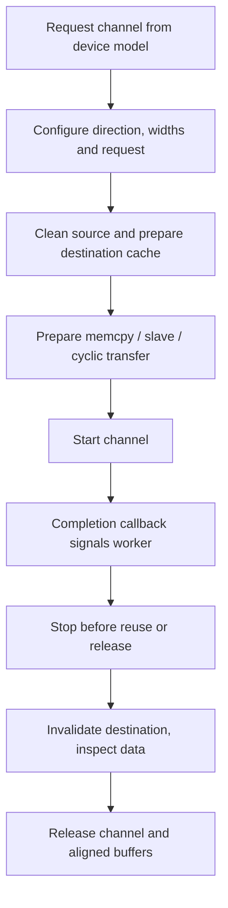

外设驱动共用 RT-Thread 原生 clock、reset、pinctrl、interrupt 和 DMA 框架。资源由所属驱动申请，应用不应另外复制 CCU 或 PLIC 寄存器写操作。本页补充不单列为设备教程的基础模块。

## 源码与配置表

| 模块 | BSP 源码 / 接口 / 配置 |
| --- | --- |
| 时钟/复位 | `drivers/clock_control/ccu-sun252i.c`，原生 `rt_clk_*`、`rt_reset_control_*` |
| 中断 | `drivers/interrupt_controller/pic-plic.c`，原生 PIC，`RT_USING_PIC` |
| 定时器 | `drivers/timer/riscv_machine_timer.c`，调度 tick / `rt_hw_us_delay` |
| DMA | `drivers/dma/dma-sun252i.c`，`<drivers/dma.h>`，`RT_USING_DMA` |
| 看门狗 | `drivers/watchdog/watchdog-sun252i.c`，`wdt0`，`RT_USING_WDT` |
| MBUS | `drivers/mbus/mbus-sun252i.h`，`BSP_USING_MBUS` |
| SID | `drivers/sid/sid-sun252i.h`，只读熔丝访问 |
| DBI | `drivers/mipi_dbi/mipi-dbi-sun252i.h`，`BSP_USING_DBI` |

## 时钟/复位生命周期

平台驱动按 DTS 的索引/名称取得时钟，检查 `rt_is_err_or_null`，解除复位、设置模块频率并 prepare/enable 时钟。probe 失败时逐项回收已申请资源。PLL 父时钟可能共享，请求频率不代表可以任意改变其他运行客户端。引脚组与 DMA 请求号放在 DTS。线程等待使用 `rt_thread_mdelay`，`rt_hw_us_delay` 仅用于短硬件时序，因为它会忙等。

## 原生 DMA 生命周期



通道分配与音频/SPI 等客户端共享，不要硬编码空闲通道。完成回调的 size 单位为字节。DMA 通道 8–11 在本 BSP 中使用轮询完成路径，回调不保证来自 ISR，两种上下文都应保持简短。`sun252i_dma_position` 表示运行缓冲/环中的位置，`sun252i_dma_pending` 为当前块剩余字节数，不是全部排队任务。

## 完整 DMA 复制与超时清理

```c
#include <rtthread.h>
#include <rtdevice.h>
#include <drivers/dma.h>
#include <string.h>
static struct rt_semaphore dma_demo_done;
static void demo_dma_done(struct rt_dma_chan *chan, rt_size_t size)
{
    rt_sem_release(&dma_demo_done);
}
static int demo_dma(int argc, char **argv)
{
    enum { BYTES = 4096 };
    rt_uint8_t *src = rt_malloc_align(BYTES, 64), *dst = rt_malloc_align(BYTES, 64);
    struct rt_dma_chan *chan = RT_NULL;
    struct rt_dma_slave_config cfg = {.direction = RT_DMA_MEM_TO_MEM};
    int ret = -RT_ENOMEM;
    if (!src || !dst) goto free_buffers;
    ret = rt_sem_init(&dma_demo_done, "dma-demo", 0, RT_IPC_FLAG_FIFO);
    if (ret) goto free_buffers;
    chan = rt_dma_chan_request(rt_console_get_device(), RT_NULL);
    if (rt_is_err_or_null(chan)) { ret = -RT_EBUSY; goto detach; }
    ret = rt_dma_chan_config(chan, &cfg);
    if (ret) goto release;
    for (unsigned i = 0; i < BYTES; ++i) src[i] = i * 7 + 3;
    memset(dst, 0, BYTES);
    rt_hw_cpu_dcache_ops(RT_HW_CACHE_FLUSH, src, BYTES);
    rt_hw_cpu_dcache_ops(RT_HW_CACHE_FLUSH | RT_HW_CACHE_INVALIDATE, dst, BYTES);
    struct rt_dma_slave_transfer xfer = {
        .src_addr = (rt_ubase_t)src, .dst_addr = (rt_ubase_t)dst, .buffer_len = BYTES,
    };
    chan->callback = demo_dma_done;
    ret = rt_dma_prep_memcpy(chan, &xfer);
    if (!ret) ret = rt_dma_chan_start(chan);
    if (!ret) ret = rt_sem_take(&dma_demo_done, rt_tick_from_millisecond(1000));
    rt_dma_chan_stop(chan);
    rt_hw_cpu_dcache_ops(RT_HW_CACHE_INVALIDATE, dst, BYTES);
    if (!ret && memcmp(src, dst, BYTES)) ret = -RT_EIO;
release:
    rt_dma_chan_release(chan);
detach:
    rt_sem_detach(&dma_demo_done);
free_buffers:
    if (src) rt_free_align(src);
    if (dst) rt_free_align(dst);
    return ret;
}
MSH_CMD_EXPORT(demo_dma, Copy aligned memory through a native DMA channel);
```

## 看门狗控制与应用所有权

`wdt0` 接受以秒为单位的 `RT_DEVICE_CTRL_WDT_SET_TIMEOUT` / `GET_TIMEOUT`，以及 `START`、`KEEPALIVE`、`STOP`。驱动向上取整到 1、2、3、4、5、6、8、10、12、14 或 16 秒。先配置再启动，已安装/运行的 timeout 在 STOP 清除状态前不能修改。关闭设备不等于 STOP。应用确认取得进展后再喂狗，不应由无关的永久循环掩盖故障。

```text
test_wdt
```

该命令验证喂狗及停止。`test_wdt_reset` 会主动复位芯片，不属于普通连续驱动回归；仅 RAM 启动的镜像会回到 ROM 启动路径，不会自动重新加载自己。

## SID 与 MBUS 查询示例

```c
#include <rtthread.h>
#include <rtdevice.h>
#include <sid-sun252i.h>
#include <mbus-sun252i.h>
static int demo_system_info(int argc, char **argv)
{
    rt_uint8_t id[SUN252I_SID_CHIPID_BYTES];
    rt_ssize_t n = sun252i_sid_chipid(id, sizeof(id));
    if (n != sizeof(id)) return -RT_EIO;
    rt_kprintf("SID:");
    for (unsigned i = 0; i < sizeof(id); ++i) rt_kprintf("%02x", id[i]);
    rt_kprintf("\nDMA traffic counter=%u\n", mbus_traffic(MBUS_PMU_DMA));
    return 0;
}
MSH_CMD_EXPORT(demo_system_info, Inspect chip identity and MBUS without changing policy);
```

SID 包含 512 位熔丝；`sun252i_sid_read(offset, buf, len)` 要求偏移和长度均为 4 字节整数倍，返回字节数，只提供读取接口。MBUS 提供具名流量计数及 `mbus_set/get_priority(master, ...)`、`mbus_set/get_limit(master, ...)`。带宽限制会量化，零表示关闭限制。原始计数快照不直接等于 MB/s，应使用明确采样区间并考虑回绕和后台流量。修改优先级可能饿死其他实时客户端，应先观察再调参。

## DBI 与验证范围

DBI 使用独立总线路径：用 `sun252i_dbi_ready` 判断就绪，`sun252i_dbi_reset(delay_ms)` 复位外接面板，通过 `sun252i_dbi_command_write(cmd, data, len)` 发送面板命令，再用 `sun252i_dbi_write_display(framebuf, size)` 发送像素。先匹配外接屏的命令协议和像素打包，不能将 DSI 屏序列直接用于 DBI。本次回归没有外接 DBI 屏。

将两个完整 C 程序分别保存到 `applications/`，调用 `demo_dma` 与 `demo_system_info`。现有检查包括 `test_dma`、`test_dma_hi`、`test_wdt`、`test_sid`、`test_mbus`、`test_cache`、`test_cpu`。CPU/内存时钟变化后，需要对目标地址范围运行匹配的内存稳定性测试，寄存器读回或短复制不能证明完整 PSRAM 稳定。
