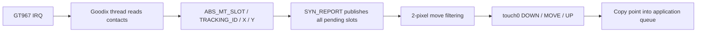

GT967 使用原生 `components/drivers/input/touchscreen/ts-goodix.c` 与 `input_touch.c` 桥接。输入设备为 `input0`，原生触摸设备为 `touch0`。驱动先读取 228 字节配置，再发布触点数和坐标范围。

## 设备树与配置

```c
&i2c1 {
    clock-frequency = <400000>;
    touchscreen@5d {
        compatible = "goodix,gt967";
        reg = <0x5d>;
        touchscreen-size-x = <1024>;
        touchscreen-size-y = <768>;
        touchscreen-fuzz-x = <2>;
        touchscreen-fuzz-y = <2>;
        irq-gpios = <&pio ALLWINNER_PIO_PD 2 0>;
        reset-gpios = <&pio ALLWINNER_PIO_PD 3 1>;
    };
};
```

Kconfig 开启 `RT_USING_INPUT`、`RT_INPUT_TOUCHSCREEN`、`RT_INPUT_TOUCHSCREEN_GOODIX`、`RT_USING_TOUCH` 和 I2C（在 `.config` 中加 `CONFIG_` 前缀）。PD2 为中断，PD3 为复位。保留复位极性和地址选择时序。坐标属于物理 1024×768 面板，降低 UI 分辨率后应转换到逻辑坐标。

## 触点生命周期



按 `track_id` 管理触点，不能按数组位置。`ABS_MT_TRACKING_ID=-1` 产生一次 UP，新触点为 DOWN，已有触点为 MOVE。一次 SYN 内的多个触点都会发布，X/Y 变化均在 fuzz 范围内的微小 MOVE 被过滤。`rt_device_read(touch, 0, &point, 1)` 返回一个点，不是一个字节。必须在接收回调中立即读取：桥接暴露当前 slot，没有为每个触点保留持久 FIFO。

## 完整队列采集示例

示例独占触摸消费者十秒，运行前停止 GUI 或其他触摸观察命令。回调立即复制触点而不打印，由 FinSH 线程读取队列并打印，最后报告丢弃数。

```c
#include <rtthread.h>
#include <rtdevice.h>
static rt_mq_t touch_queue;
static volatile unsigned touch_drops;
static rt_err_t demo_touch_rx(rt_device_t dev, rt_size_t size)
{
    struct rt_touch_data point;
    if (rt_device_read(dev, 0, &point, 1) == 1 &&
        rt_mq_send(touch_queue, &point, sizeof(point)) != RT_EOK)
        ++touch_drops;
    return RT_EOK;
}
static int demo_touch(int argc, char **argv)
{
    rt_device_t dev = rt_device_find("touch0");
    struct rt_touch_data point;
    rt_err_t ret;
    if (!dev || touch_queue) return -RT_EBUSY;
    touch_queue = rt_mq_create("touch-demo", sizeof(point), 32, RT_IPC_FLAG_FIFO);
    if (!touch_queue) return -RT_ENOMEM;
    ret = rt_device_open(dev, RT_DEVICE_OFLAG_RDONLY);
    if (ret) goto out;
    rt_err_t (*saved)(rt_device_t, rt_size_t) = dev->rx_indicate;
    touch_drops = 0;
    rt_device_set_rx_indicate(dev, demo_touch_rx);
    ret = rt_device_control(dev, RT_TOUCH_CTRL_ENABLE_INT, RT_NULL);
    rt_tick_t start = rt_tick_get();
    while (!ret && rt_tick_get() - start < 10 * RT_TICK_PER_SECOND)
    {
        if (rt_mq_recv(touch_queue, &point, sizeof(point), RT_TICK_PER_SECOND) < 0)
            continue;
        rt_kprintf("event=%u id=%u x=%u y=%u\n", point.event, point.track_id,
                   point.x_coordinate, point.y_coordinate);
    }
    rt_device_control(dev, RT_TOUCH_CTRL_DISABLE_INT, RT_NULL);
    rt_device_set_rx_indicate(dev, saved);
    rt_device_close(dev);
    rt_kprintf("dropped=%u\n", touch_drops);
out:
    rt_mq_delete(touch_queue);
    touch_queue = RT_NULL;
    return ret;
}
MSH_CMD_EXPORT(demo_touch, Capture physical touch for ten seconds);
```

## 调用与证据

```text
demo_touch
test_touch
test_touch_watch 60
```

保存为 `applications/demo_touch.c`。运行期间点击、拖动并使用双指。`test_touch` 已通过 16 项控制器及原生事件检查，但 180 秒实体观察未收到事件，实物触摸仍待确认。身份可读但无触点时检查 IRQ 极性、PD2 活动、复位接线和当前消费者；合成事件无法验证实物中断链路。
