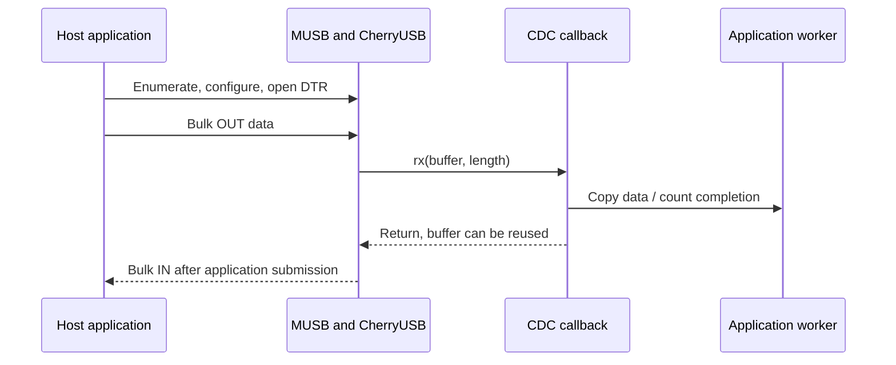

BSP 通过 `drivers/usb/cherryusb/` 接入仓库自带 CherryUSB，`drivers/usb/phy/` 管理共享 PHY。MUSB 提供设备模式，EHCI/OHCI 提供 host 模式。单一物理端口同时用于 FEL 下载，需要明确角色与 USB class 所有权。

## 配置与资源

```text
CONFIG_RT_USING_CHERRYUSB=y
CONFIG_RT_CHERRYUSB_DEVICE=y
CONFIG_RT_CHERRYUSB_DEVICE_SPEED_HS=y
CONFIG_RT_CHERRYUSB_DEVICE_MUSB_SUNXI=y
CONFIG_RT_CHERRYUSB_DEVICE_CDC_ACM=y
CONFIG_RT_CHERRYUSB_DEVICE_DISPLAY=y
CONFIG_RT_CHERRYUSB_HOST=y
CONFIG_RT_CHERRYUSB_HOST_EHCI_CUSTOM=y
```

保留与板卡匹配的 `usbotg`、`usbhci`、`usbphy` DTS 资源。平台 probe 完成前，控制器基址 getter 返回零。PHY 由 DEVICE 或 HOST 独占，切换角色前必须释放。Kconfig 可同时编译两个栈，不代表运行时可同时占用同一 PHY。高速 bulk 包长为 512 字节，对齐缓冲可用 MUSB 内部 DMA，短包及尾部需要 CPU 路径。

## 完整 CDC 接入示例

现有 CDC 应用管理描述符与端点，hook 用于观察数据，不会自动将其变为通用串口设备或回显服务器。保存为 `applications/demo_usb.c`。在本轮新启动后运行一次，不能先启动 `usb_device_start`、基准或显示 class。

```c
#include <rtthread.h>
#include <rtdevice.h>
#include <usb/cherryusb/usb-glue-sun252i.h>
#include "apps/usb_cdc/cdc_device.h"
static volatile rt_uint32_t demo_rx_bytes, demo_tx_bytes;
static rt_bool_t demo_usb_started;
static void demo_cdc_rx(const uint8_t *data, uint32_t len) { demo_rx_bytes += len; }
static void demo_cdc_tx(uint32_t len) { demo_tx_bytes += len; }
static const struct usb_cdc_hooks demo_hooks = {.rx = demo_cdc_rx, .tx = demo_cdc_tx};
static int demo_usb_cdc(int argc, char **argv)
{
    rt_ubase_t base = sun252i_usb_otg_base();
    if (!base) return -RT_ENOSYS;
    if (demo_usb_started) return -RT_EBUSY;
    usb_cdc_set_hooks(&demo_hooks);
    cdc_acm_init(0, base);
    demo_usb_started = RT_TRUE;
    rt_kprintf("CDC initialized; verify host enumeration and open DTR\n");
    return 0;
}
static int demo_usb_stats(int argc, char **argv)
{
    rt_kprintf("CDC RX=%u TX=%u\n", demo_rx_bytes, demo_tx_bytes);
    return 0;
}
MSH_CMD_EXPORT(demo_usb_cdc, Initialize the existing CDC class once);
MSH_CMD_EXPORT(demo_usb_stats, Inspect CDC completion byte counters);
```

hook 结构具有静态生命周期。RX 数据在回调返回后立即复用，需要后续处理时复制到应用队列，不能保留指针，也不能在完成回调中分配大缓冲、打印或阻塞。`cdc_acm_init` 是 void helper，通过日志报告初始化问题，因此命令返回零不能证明枚举成功。本示例没有 class teardown，切换 class 前重启。

## 主机传输与回调流程



新枚举的 CDC COM 口与 UART 控制台要分别确认。现有发送 helper 要求主机已拉起 DTR。测试镜像中，`usb_device_send` 向已打开的主机端口发送 2048 字节模式数据。FEL 执行后，若主机保留旧设备状态，可用 `usb_reconnect` 强制重新连接。

## USB 副屏与解码接入

```text
usb_display_selftest
usb_display_start 1024 768 30 6 500
usb_display_stop
```

`usb_display_selftest` 解码并显示 30 帧内置 JPEG，不需要主机 USB 软件。`usb_display_start [width height [fps [quality [limit_KB]]]]` 枚举 vendor 显示 class，需要匹配的 Windows 显示驱动。描述符尺寸在本轮启动固定，DE 再缩放到面板。`usb_display_stop` 停止显示，不代表注销 USB class；选择 CDC 前重启。帧缓冲、压缩环和解码图片总量必须能放入 PSRAM。

JPEG 路径完整初始化显示描述符，并选择 NV12、BT.601 全范围。自测清空 UI 覆盖层，释放解码器后保留独立的 112.5 KiB 预览；停止或下次运行时先关闭视频层再释放预览。在 `test_defconfig` 中还会通过 DE 回写校验流式显示的八条色带，随后运行 `test_display_jpeg` 可校验保留的预览。预期顺序为白、黄、青、绿、品红、红、蓝、黑，详见 [VE 验证流程](vdec.md#验证与不支持的输入)。

可选旧 `touch` 桥使用 EVB 控制器协议，不是 YuzukiNeko GT967 的原生触摸路径。本板使用 [touch0](touch.md)。Windows 驱动安装和 PC 应用模式可参考 [Zephyr USB 副屏指南](../../zephyr/apps/usb-display.md)，但 RT-Thread 的命令与内存限制以本页为准。

## Host 模式与实际验证

Host 模式需要拔掉连接 PC 的设备线，接入合适供电的外设/转接器。测试镜像用 `usbh_start` 经 EHCI/OHCI 启动枚举，具体 class 还要打开相应 CherryUSB host 选项。设备 class 持有 PHY 时不能申请 HOST。本次未接 USB host 外设，host 注册不能证明 class 功能正常。

当前确认的是常规与 ulog 构建均通过 30 帧 JPEG 解码/显示自测。BSP 文档的历史 CDC 吞吐早于本次同步，要引用当前速度必须重新测量。枚举、bulk 数据完整性、短包处理与显示观感需要分别验证。
