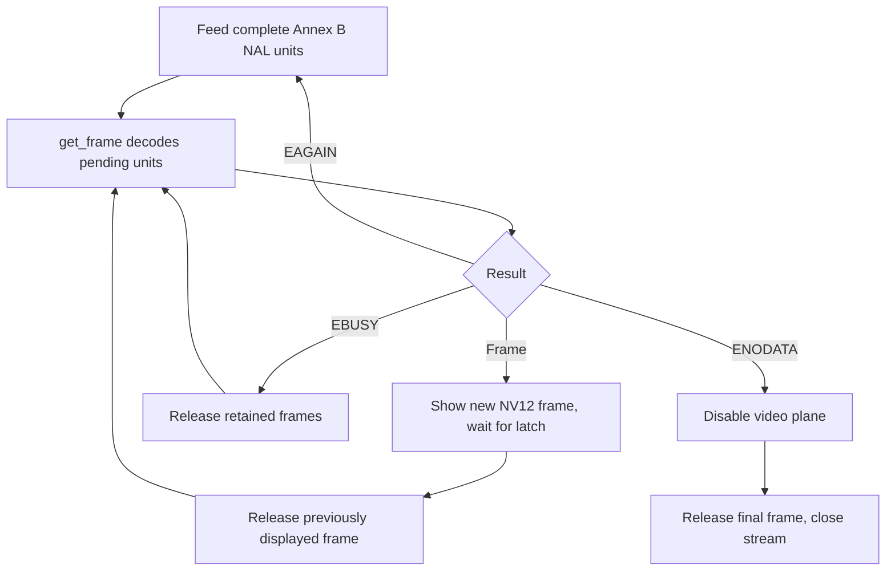

公共 API 位于 `drivers/vdec/vdec.h`，编解码逻辑、解析器、码流环和帧池由 `drivers/vdec/sunxi/` 的 C 源码构建。JPEG 与 H.264 使用视频引擎，当前移植中的 PNG 处理由软件实现。API 可用不代表所有格式均由硬件处理。

## 格式、资源与配置

| 输入 | API / 输出 / 限制 |
| --- | --- |
| Baseline JPEG | `vdec_decode_image`，NV12 或 NV21，当前输出路径接受 4:2:0 采样 |
| MJPEG | `vdec_stream_*`，codec 为 JPEG，输入完整 JPEG 图片并提供尺寸 |
| PNG | `vdec_decode_image`，RGBA8888，解析调色板/灰度/RGB/alpha 及交错格式 |
| H.264 | `vdec_stream_*`，Annex B 完整 NAL，NV12 或 NV21 |
| 未提供 | 视频编码、HEVC、任意容器解封装 |
| VE 资源 | `0x01c0e000`，PLIC 66，DTS 时钟与复位 |
| 默认预算 | VE 300 MHz、压缩环 512 KiB、解码内存上限 12288 KiB |
| codec 开关 | `BSP_USING_VDEC`、`BSP_VDEC_JPEG`、`BSP_VDEC_PNG`、`BSP_VDEC_H264` |

NV12 为 Y 加交错 UV，NV21 为 Y 加 VU。这里 RGBA8888 表示小端字 `0xRRGGBBAA`，内存字节为 A,B,G,R，与显示 UI 的 `0xAARRGGBB` 不同。必须使用 `frame.stride[]`、可见尺寸和格式，不能假设平面紧密排列。H.264 DPB、平铺参考帧、线性输出、码流环和 UI 帧缓冲共用 16 MiB PSRAM。Kconfig 上限不会预留内存。

## 公共调用与返回行为

| 调用 | 契约 |
| --- | --- |
| `vdec_decode_image(codec, data, len, format, &frame)` | 阻塞解单图，返回后不再持有输入 |
| `vdec_frame_release(&frame)` | 归还输出所有权，每个成功帧必须恰好释放一次 |
| `vdec_stream_open(&cfg, &stream)` | 占用解码器，分配有界 session 与环形缓冲 |
| `vdec_stream_feed(stream, data, len, pts, &consumed)` | 复制完整 NAL/图片单元，始终按实际 consumed 推进 |
| `vdec_stream_get_frame(stream, &frame)` | 执行解码，0 为帧，`-EAGAIN` 需数据，`-EBUSY` 需释放帧 |
| `vdec_stream_flush(stream)` | 声明输入结束，持续取帧直到 `-ENODATA` |
| `vdec_stream_close(stream)` | 关闭 session，未释放帧延后销毁和解码器占用释放 |
| `vdec_set_clock_hz(hz)` / `vdec_clock_hz()` | 设置实际时钟（失败为负 errno）/ 查询频率 |

`vdec_stream_config.buffer_size=0` 使用默认值。`no_cache_ops=true` 仅适用于 CPU 不读取像素的路径，校验和或 CPU 转换应保持 false。当前 `holding_frames` 为保留字段，额外帧预算来自 `BSP_VDEC_H264_EXTRA_PICTURES`。单图持帧期间占用全局解码器，流则占用到 close 且所有帧释放；首帧未释放就开始第二次解码可能阻塞。

## 完整 JPEG 文件示例

先挂载 SD 文件系统。保存为 `applications/demo_jpeg.c`，调用 `demo_jpeg /test.jpg`。程序限制压缩文件大小，处理短读，打印可见亮度样本并释放帧，不涉及显示持帧。

```c
#include <rtthread.h>
#include <rtdevice.h>
#include <vdec.h>
#include <fcntl.h>
#include <unistd.h>
static int demo_jpeg(int argc, char **argv)
{
    if (argc != 2) return -EINVAL;
    int fd = open(argv[1], O_RDONLY), ret = -EIO;
    if (fd < 0) return ret;
    off_t len = lseek(fd, 0, SEEK_END);
    if (len <= 0 || len > 1024 * 1024 || lseek(fd, 0, SEEK_SET) < 0)
    { close(fd); return -EINVAL; }
    rt_uint8_t *data = rt_malloc((rt_size_t)len);
    if (!data) { close(fd); return -ENOMEM; }
    size_t off = 0;
    while (off < (size_t)len)
    {
        ssize_t n = read(fd, data + off, len - off);
        if (n <= 0) goto out;
        off += n;
    }
    struct vdec_frame frame = {0};
    ret = vdec_decode_image(VDEC_CODEC_JPEG, data, len, VDEC_FORMAT_NV12, &frame);
    if (!ret)
    {
        rt_kprintf("JPEG %ux%u stride=%u Y0=%u\n", frame.width, frame.height,
                   frame.stride[0], frame.plane[0][0]);
        vdec_frame_release(&frame);
    }
out:
    rt_free(data);
    close(fd);
    return ret;
}
MSH_CMD_EXPORT(demo_jpeg, Decode a mounted JPEG file and release its frame);
```

## 完整 Annex B 解码示例

此示例解码 BSP 内置的 30 帧参考码流，不依赖 SD 卡和解封装器，展示部分 feed、反压、输入结束后的 drain 和逐帧释放。保存为 `applications/demo_h264.c`。包含的媒体头是现有测试素材，不是应用必须依赖的接口。

```c
#include <rtthread.h>
#include <rtdevice.h>
#include <vdec.h>
#include "tests/data/test_h264.h"
static int demo_h264(int argc, char **argv)
{
    struct vdec_stream *stream = RT_NULL;
    struct vdec_stream_config cfg = {
        .codec = VDEC_CODEC_H264, .format = VDEC_FORMAT_NV12,
        .buffer_size = 512 * 1024, .no_cache_ops = false,
    };
    size_t offset = 0;
    unsigned frames = 0;
    int flushed = 0, ret = vdec_stream_open(&cfg, &stream);
    if (ret) return ret;
    for (;;)
    {
        size_t used = 0;
        if (offset < sizeof(test_h264))
        {
            ret = vdec_stream_feed(stream, test_h264 + offset,
                                  sizeof(test_h264) - offset, -1, &used);
            if (ret && ret != -EAGAIN) break;
            offset += used;
        }
        if (offset == sizeof(test_h264) && !flushed)
        {
            ret = vdec_stream_flush(stream);
            if (ret) break;
            flushed = 1;
        }
        struct vdec_frame frame = {0};
        ret = vdec_stream_get_frame(stream, &frame);
        if (!ret)
        {
            ++frames;
            vdec_frame_release(&frame);
            continue;
        }
        if (ret == -ENODATA) { ret = 0; break; }
        if (ret != -EAGAIN || flushed || !used) break;
    }
    vdec_stream_close(stream);
    rt_kprintf("frames=%u result=%d\n", frames, ret);
    return ret;
}
MSH_CMD_EXPORT(demo_h264, Feed drain and release an Annex B stream);
```

## 解码与显示所有权流程



显示时用返回的平面指针、stride 和尺寸构造 `lcd_yuv`。JPEG 通常为全范围，应按实际码流元数据设置范围与矩阵。阻塞调用 `lcd_show_yuv`，确认替换锁存后释放上一帧，最后一帧在关闭视频层后释放。`lcd_show_yuv` 返回不代表新帧已经不再被扫描。允许持帧关闭流，但释放前解码器不能被其他会话复用。

必须初始化整个描述符，包括裁剪、UV 顺序和范围。未初始化的 `nv21` 会使正确的 NV12 解码结果交换 Cb/Cr。针对 baseline JFIF JPEG，下面的完整函数选择 BT.601 全范围并等待显示；调用者仍需保留 `frame`，直到替换锁存或关闭视频层：

```c
#include <rtthread.h>
#include <stdbool.h>
#include <vdec.h>
#include <drv_display.h>
int demo_present_jpeg(const struct vdec_frame *frame)
{
    if (!frame || (frame->format != VDEC_FORMAT_NV12 && frame->format != VDEC_FORMAT_NV21))
        return -RT_EINVAL;
    struct lcd_yuv image = {
        .y = frame->plane[0], .uv = frame->plane[1],
        .width = frame->width, .height = frame->height,
        .stride_y = frame->stride[0], .stride_uv = frame->stride[1],
        .nv21 = frame->format == VDEC_FORMAT_NV21,
        .full_range = RT_TRUE, .bt709 = RT_FALSE, .nonblock = RT_FALSE,
    };
    return lcd_show_yuv(&image);
}
```

该函数的 JPEG 范围假设不能直接用于 H.264，视频应采用码流的矩阵与范围元数据。

## 验证与不支持的输入

`test_vdec` 使用 `applications/tests/data/` 的内置 `test_jpeg.h`、`test_png.h`、`test_h264.h`。JPEG 分别对 NV12、NV21 校验每个 16×16 块的 Y 均值与对应 8×8 块的 Cb/Cr 均值，允许与主机解码结果相差 3。色度参考采用 FFmpeg `yuvj420p`；只校验亮度无法发现 UV 交换。PNG 校验 CRC `03c854ec`，H.264 比较 30 帧完整 Y+UV 的 CRC，生命周期测试执行 320 次 JPEG，覆盖环形回绕和持帧关闭后释放。

测试镜像中先执行 `usb_display_selftest`，再执行 `test_display_jpeg`。自测先校验流式显示的回写像素，再保留独立的 320×240 预览；第二条命令校验该预览。两者均比较顶部八条色带与主机 RGB，每通道容差 4。自左向右应为**白、黄、青、绿、品红、红、蓝、黑**。`usb_display_stop` 关闭并释放预览。内部回写验证 DE 输出，实体屏幕仍需要目视确认。

渐进 JPEG、不支持的 H.264 特性、损坏数据或帧池预算不足会失败，应报告 errno 并保留输入用于排查。MP4 是容器，应使用现有 `mp4_play <file>` 或解封装器，不能将 MP4 字节直接送入 Annex B 输入。
