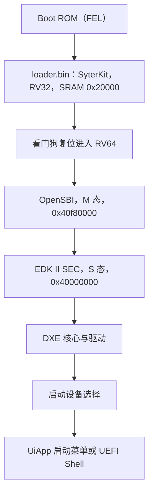

本章介绍 YuzukiHD F101 开发板上的 EDK II（UEFI）固件，源码位于 [`YuzukiHD/edk2-build`](https://github.com/YuzukiHD/edk2-build)。文档基线为提交 `26143d69715127d9a52cf5e2cb8f269b9c900ea8`（2026-10-10）。构建产物是一个通过 FEL 下载后在 PSRAM 中运行的固件镜像：SyterKit 加载器把 C907 从 RV32 切到 RV64，OpenSBI 运行在 M 态，EDK II 作为 S 态负载，在屏幕和串口上提供启动菜单。

:::caution
仓库里只有 **F101 EVB** 一个平台。它的控制台是 UART3（PE08/PE09），屏幕是 1024×600 RGB 屏，内存映射按 16 MiB PSRAM 设计。打包生成的 `run.sh` 用 `xfel ddr f101-s3` 初始化 PSRAM。YuzukiNeko 的控制台是 UART1（PB0/PB1），屏幕是 1024×768 MIPI DSI，F101S4 板子的 PSRAM 为 32 MiB；要在 YuzukiNeko 上运行这个镜像，得在设备树和显示驱动里增加板级变体。
:::

| 项目 | 当前移植 |
| --- | --- |
| CPU | 玄铁 C907，RV64 `rv64imafdc`，单核；OpenSBI 运行在 M 态，EDK II 运行在 S 态 |
| 内存 | 16 MiB PSRAM，起始 `0x40000000`；固件在低地址，设备树和 OpenSBI 在高地址 |
| 控制台 | UART3，PE08 TX / PE09 RX，115200 8N1，SBI debug console |
| 固件 | `edk2.fd`，约 0.7 MiB：SEC 加一个 LZMA 压缩的 DXE 固件卷 |
| 加载方式 | FEL；`run.sh` 写入固件、设备树和加载器，然后执行加载器 |
| 显示 | 显示引擎、TCON 与 RGB 编码器；1024×600 RGB666 屏；`EFI_GRAPHICS_OUTPUT_PROTOCOL` |
| Shell | 固件内包含 UEFI Shell；启动后进入 UiApp 启动菜单 |
| 变量 | 内存中的模拟变量存储；复位后丢失 |
| 输入 | 只有串口控制台；没有 USB 主机和键盘 |

## 构建产物

- `edk2.fd`：SEC、DxeCore、UEFI 驱动和 UiApp，打成一个 3 MiB 的 FD，里面是 LZMA 压缩的 DXE 固件卷。
- `dtb_sbi.bin`：256 KiB 槽位里的设备树，后面紧跟 OpenSBI `fw_jump`。
- `loader.bin`：把核心切到 RV64 的 SyterKit RV32 加载器。
- `run.sh` 和 `README.txt`：xfel 命令和内存映射。
- EVB 屏幕的图形输出驱动、UEFI 启动菜单和 UEFI Shell。
- 记录板子、C907 和 16 MiB 内存的 SMBIOS 表。

## 启动流程

C907 在复位时锁存 RV32 或 RV64。加载器是运行在 SRAM 里的 RV32 程序，它改写复位向量并置位 RV64，然后通过 RISC-V 看门狗重启核心。复位后进入一段跳转桩，跳到 OpenSBI；OpenSBI 在 S 态从 `0x40000000` 启动 EDK II，设备树地址放在 `a1`。

## 阅读顺序

先读[构建与运行](build-run.md)，生成 `out/f101-edk2/` 并通过 FEL 启动。[启动链](boot-chain.md)逐段说明从 xfel 到 S 态的过程。[平台固件](platform.md)介绍 SEC、DXE、变量存储、控制台、SMBIOS 和启动管理器。[图形输出](display.md)说明 GOP 驱动和显示栈。[调试](debug.md)列出日志级别、构建开关和 SBI hello 负载。[状态与已知限制](limits.md)记录已经验证和仍然缺失的部分。

任何 RAM 镜像加载前的 PSRAM 初始化都是全局主题，见 [PSRAM 初始化与 RAM 启动](../../boot/psram-init.md)。FEL 命令和 USB 驱动见 [FEL 下载模式与工具](../../boot/fel.md)。

## 状态

启动链能进入 UiApp 启动菜单，GOP 驱动能在屏幕上扫描输出，串口控制台通过 SBI debug console 工作。UEFI Shell 编进了固件，但不是默认启动项。USB 输入、SD 卡、持久化变量和网络都没有实现。细节见[状态与已知限制](limits.md)。

## 与其他章节的关系

Zephyr、RT-Thread 和 ESP-IDF 让 C907 运行在 RV32 模式，镜像链接在 `0x40000000`。EDK II 让同一颗核心运行在 RV64 模式，后面是 OpenSBI；加载器是 SyterKit 的 `usb-boot-rv64i` 应用，不是 eFEX helper。[启动与下载](../../boot/bootloader.md)里的 FEL、PSRAM 和 NOR 规则仍然适用：这个镜像是 RAM 镜像，`run.sh` 不写 SPI NOR。
