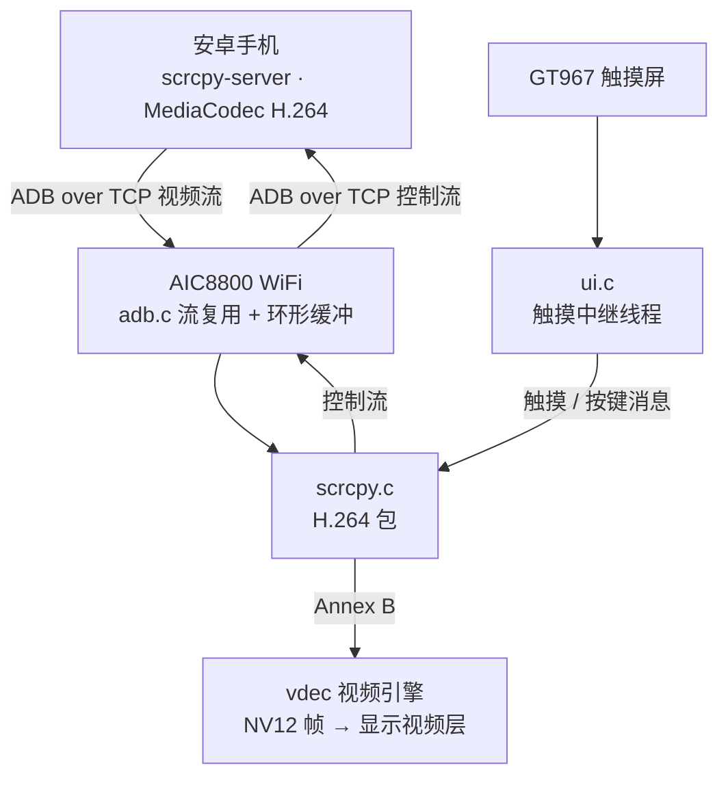
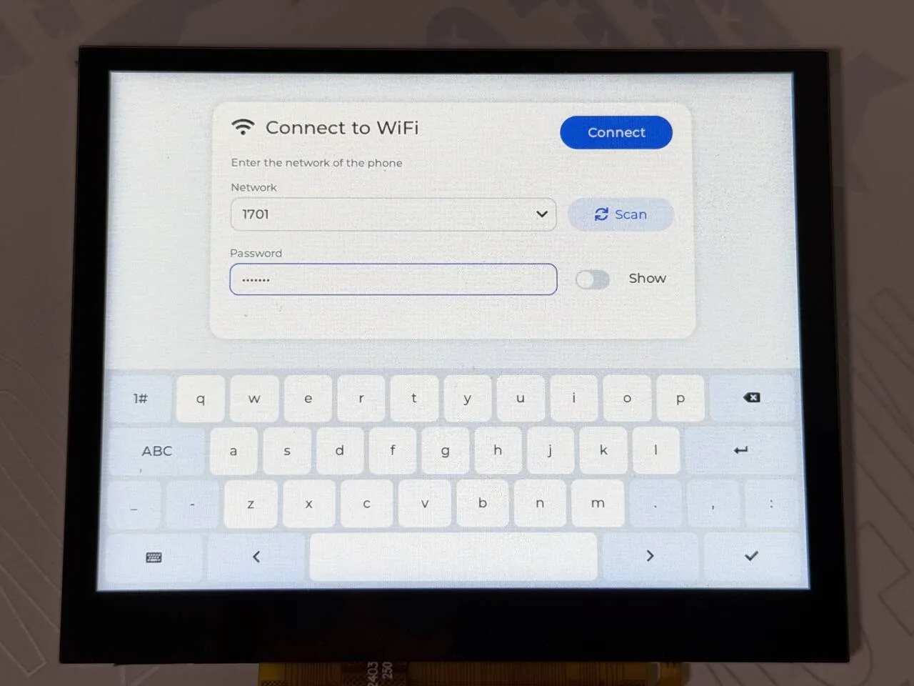
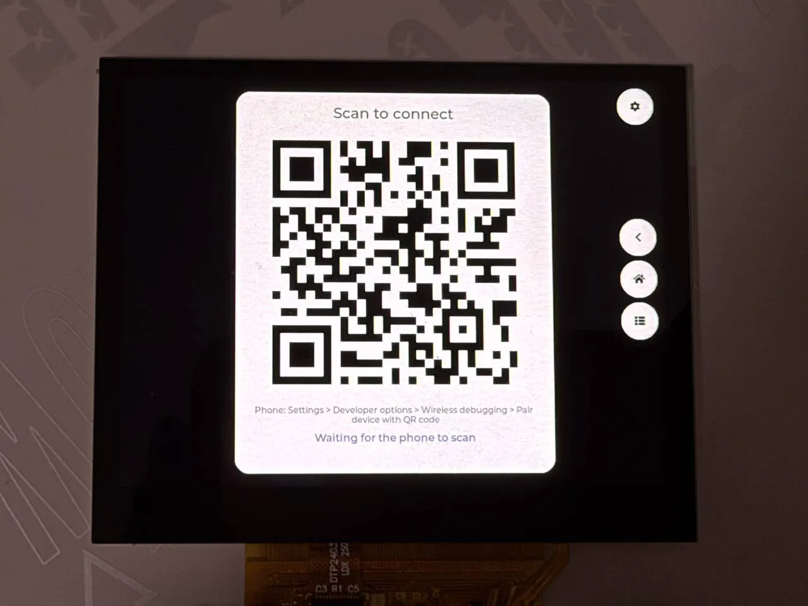
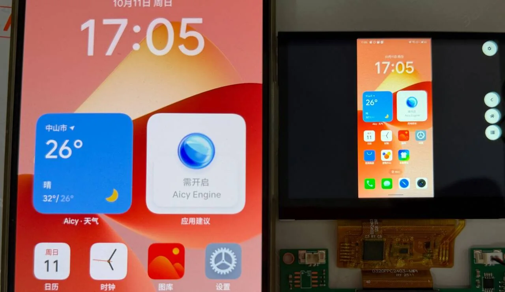
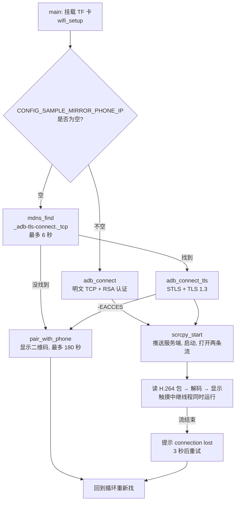
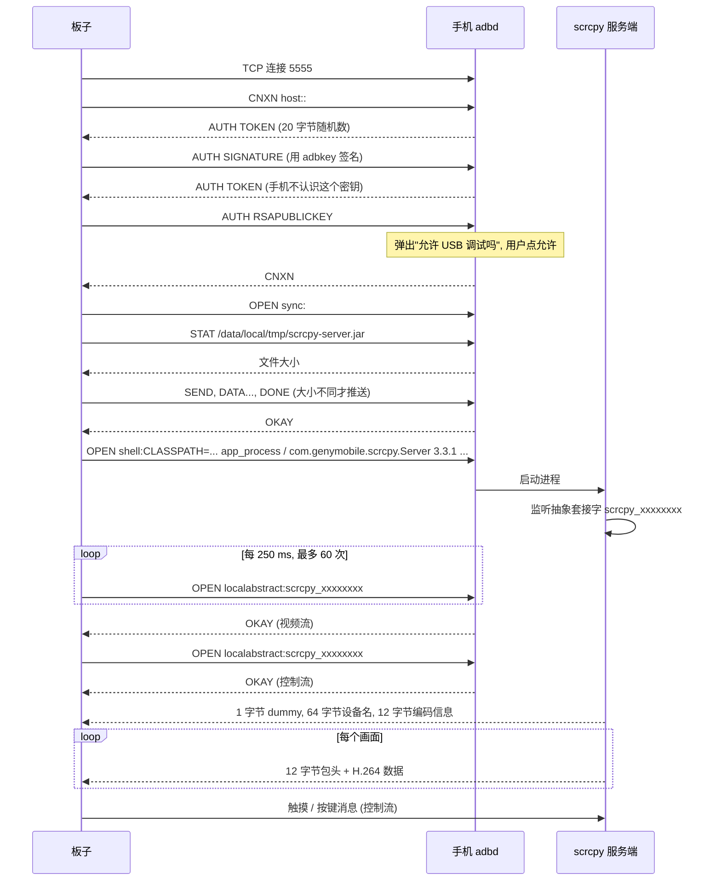
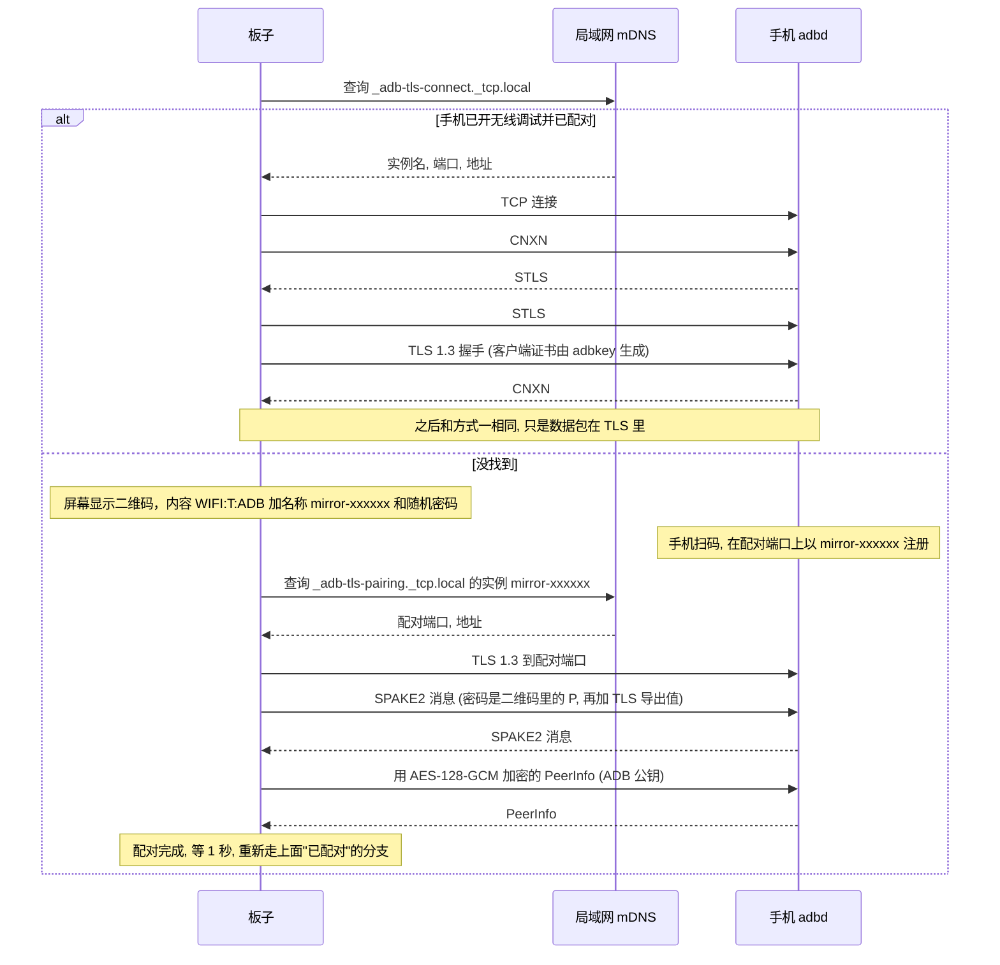
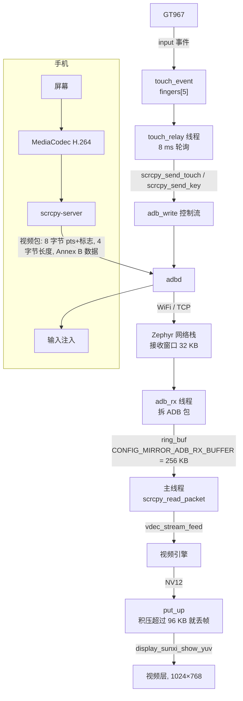

把安卓手机的屏幕投到板子的屏幕上，并把触摸和导航键传回手机。板子通过 WiFi 连到手机的 adbd（ADB over TCP），在手机上启动 [scrcpy](https://github.com/Genymobile/scrcpy) 的服务端，服务端把屏幕编码成 H.264 流发回来，板子用片上视频引擎解码，送到显示的视频层。示例是 `zephyr-components/android-screen-mirror/samples/mirror_player`，组件本身（ADB 客户端、配对、scrcpy 客户端）在同一个目录的 `src/` 里。



开始前请先完成 [配置开发环境](../zephyr-setup-env.md) 和 [获取 Zephyr 代码](../zephyr-get-source.md)。WiFi 部分用的是 [AIC8800 WIFI](../components/aic8800-wifi.md) 驱动，扫描、连接、DHCP 的细节看那一篇。

## 准备

### 需要什么

- 板子：`yuzukineko`，用到 AIC8800 WiFi、1024×768 MIPI-DSI 屏、GT967 触摸屏（最多 5 点）、TF 卡槽。
- 手机：安卓手机。连接方式二选一：用 USB 线执行一次 `adb tcpip`（任意安卓版本），或用“无线调试”（安卓 11 及以上）。
- TF 卡：FAT 或 exFAT。放 `scrcpy-server.jar`；板子还会在卡上写 `wifi.cfg`（WiFi 名称和密码）和 `adbkey`（ADB 私钥）。
- 网络：板子和手机在同一个 WiFi 里，路由器不能开“客户端隔离”；用无线调试时路由器还要转发 mDNS 组播。
- 电脑：下载 scrcpy 服务端；用 `adb tcpip` 方式时需要 `adb`。

### 手机端准备

#### 打开开发者选项

1. 设置 → 关于手机 → 连续点“版本号”7 次，进入开发者模式。
2. 设置 → 系统 → 开发者选项（各厂商菜单位置不同）。
3. 打开“USB 调试”。
4. 部分厂商（例如小米系的系统）还有一个“USB 调试（安全设置）”，不打开的话触摸和按键注入会被系统拒绝。画面不受影响，所以现象是“能看不能点”。

#### 方式一：adb tcpip（固定地址）

手机用 USB 接到电脑，执行一次：

```sh
adb tcpip 5555
adb shell ip route
```

第二条命令的输出里 `src` 后面是手机的 WiFi 地址。之后可以拔掉 USB。手机重启后这个设置会失效，需要重新执行。

把手机地址写进板子的配置 `CONFIG_SAMPLE_MIRROR_PHONE_IP`（见 [编译前设置手机地址](#编译前设置手机地址)），板子启动后直接连这个地址的 5555 端口。第一次连接时手机弹出“允许 USB 调试吗？”，勾选“一律允许”后点允许；板子最多等 60 秒（`adb_connect()` 的 `accept_timeout_ms`，由 `scrcpy_start()` 传入）。

#### 方式二：无线调试（不用地址，不用 USB）

要求安卓 11 及以上，手机和板子在同一个 WiFi。

1. 开发者选项 → 打开“无线调试”。手机用 mDNS 广播 `_adb-tls-connect._tcp` 服务。
2. 板子启动后会找这个服务；找不到就在屏幕上显示一个二维码（内容是 `WIFI:T:ADB;S:mirror-xxxxxx;P:<密码>;;`，名称和密码每次随机）。
3. 手机上：开发者选项 → 无线调试 → “使用二维码配对设备”，扫板子屏幕上的二维码。
4. 配对成功后板子保存的密钥被手机接受，之后重新找服务并连接。

`CONFIG_SAMPLE_MIRROR_PHONE_IP` 留空就是这种方式（默认）。配对只在密钥第一次被手机接受之前需要；密钥换了或手机里删掉了配对记录，连接会返回 `-EACCES`，板子重新显示二维码。

### scrcpy 服务端

scrcpy 的服务端是一个 jar（实际是装着 `classes.dex` 的 zip），由板子推到手机的 `/data/local/tmp/scrcpy-server.jar`，再用 `app_process` 启动。**版本必须和板子配置的版本一致**：`CONFIG_SAMPLE_MIRROR_SERVER_VERSION` 默认 `3.3.1`，服务端启动时会比对命令行里的版本号，不一致就退出（板子会把服务端的输出打印成 `server: …`）。

在电脑上下载 3.3.1 版，改名为 `scrcpy-server.jar`，放到 TF 卡根目录：

```sh
curl -L -o scrcpy-server.jar \
  https://github.com/Genymobile/scrcpy/releases/download/v3.3.1/scrcpy-server-v3.3.1
sha256sum scrcpy-server.jar
```

文件大小 90788 字节，SHA-256 为 `a0f70b20aa4998fbf658c94118cd6c8dab6abbb0647a3bdab344d70bc1ebcbb8`，以 [scrcpy 发布页](https://github.com/Genymobile/scrcpy/releases/tag/v3.3.1) 上公布的校验值为准。

不需要手动 `adb push`：每次连接，`adb_push_file()` 先用 sync 服务的 `STAT` 查手机上这个文件的大小，和卡上的文件大小一样就跳过，不一样才推送（只比大小，不比内容；换了同样大小的另一个版本不会重推，要先在手机上删掉旧文件）。卡上没有这个文件，`fs_stat()` 失败，屏幕显示 `cannot copy the server`。

想换版本：同时改卡上的 jar 和 `CONFIG_SAMPLE_MIRROR_SERVER_VERSION`。服务端的控制消息格式随版本变，`scrcpy.c` 里的消息布局对应 3.x，换到别的大版本需要对照 scrcpy 的 `doc/develop.md` 检查。

### 配置 WiFi

WiFi 驱动、固件加载、`net_mgmt` 接口见 [AIC8800 WIFI](../components/aic8800-wifi.md)。本示例用到的部分：

- `CONFIG_AIC8800=y` 打开驱动，固件编进镜像，不用放在卡上。
- 只有 STA 模式；支持 2.4 GHz 和 5 GHz，WPA2-PSK 和开放网络；<strong>不支持 WPA3</strong>。
- 板子用 DHCPv4 取地址，不支持 IPv6（`CONFIG_NET_IPV6=n`）。

示例怎么拿到网络名称和密码，依次尝试：

1. TF 卡上的 `/SD:/wifi.cfg`：两行文本，第一行名称，第二行密码，明文保存。
2. 编译时给的 `CONFIG_SAMPLE_MIRROR_WIFI_SSID` 和 `CONFIG_SAMPLE_MIRROR_WIFI_PSK`（只有卡上没有保存的网络时才用）。
3. 都没有，或者连不上：屏幕显示 WiFi 设置表单——“Scan”按钮扫描，下拉框选网络（列表末尾的“其他”项可手动输入名称），用屏幕键盘输入密码，点连接。连上以后写回 `wifi.cfg`。

连接成功才写 `wifi.cfg`，下次启动直接用。连着投屏时点右上角的齿轮，菜单里“Change WiFi network”可以换网络。

`wifi_join()` 等连接结果最多 30 秒，再等 DHCP 地址最多 30 秒；`main()` 里 `wifi_setup(false)` 失败（驱动里没有 WiFi 接口）才显示 `no WiFi` 并退出，连不上网络则一直回到表单。

:::note
AIC8800 驱动在加入网络时会把 SSID 和密码用 `aic8800` 的日志明文打在串口上（`Connect Wi-Fi: …`、`SET_NETWORK 0 psk "…"`）。串口日志贴给别人之前先把这几行抹掉。本文贴的日志已经用 `<SSID>`、`<PSK>` 占位符替换。
:::

## 编译

组件和 WiFi 驱动都是 `zephyr-components` 下的 Zephyr 模块。示例的 `CMakeLists.txt` 自己把它们加进 `ZEPHYR_EXTRA_MODULES`：

```cmake
# the screen mirror module is two directories up, the WiFi module is a sibling
list(APPEND ZEPHYR_EXTRA_MODULES ${CMAKE_CURRENT_SOURCE_DIR}/../..
     ${CMAKE_CURRENT_SOURCE_DIR}/../../../aic8800)
```

所以不需要在命令行指定模块路径。在工作区里执行：

```sh
. ~/f101-zephyr/env.sh
cd ~/f101-zephyr
west build -b yuzukineko -d build/android-mirror zephyr-components/android-screen-mirror/samples/mirror_player
```

<div class="asciinema-cast" data-src="assets/casts/zephyr/apps-android-mirror/build.cast" data-speed="6"></div>

产物是 `build/android-mirror/zephyr/zephyr.bin`，7567584 字节（约 7.2 MiB，包含 AIC8800 固件），链接地址 `0x40010000`，RAM 占用 7567584 字节，占 16320 KB 的 45.28%。

示例的 `prj.conf` 里设了 `CONFIG_MINIMAL_LIBC=y`：AIC8800 驱动的 `compat/` 头文件按最小 C 库写，用板子默认的 picolibc 会在 `getchar` 的声明上冲突，见 [AIC8800 WIFI](../components/aic8800-wifi.md)。自己的应用用这个驱动时也要设。

### 编译前设置手机地址

用 adb tcpip 方式时，把手机地址写进示例目录的 `prj.conf`（字符串要带引号）：

```ini
CONFIG_SAMPLE_MIRROR_PHONE_IP="192.168.1.23"
```

初始的 WiFi 也可以这样给：`CONFIG_SAMPLE_MIRROR_WIFI_SSID="…"` 和 `CONFIG_SAMPLE_MIRROR_WIFI_PSK="…"`，省得在屏幕上输入。改了 `prj.conf` 以后，要换一个新的构建目录或给 `west build` 加 `-p`，否则 CMake 缓存里的旧值会生效。

## 运行

下载方式见 [编译与运行](../zephyr-build-run.md)，控制台是 UART1（PB00/PB01，115200 8N1）。镜像有 7.2 MiB，调试时用方式一：

```sh
xfel ddr f101-s3
xfel write 0x40010000 build/android-mirror/zephyr/zephyr.bin
xfel exec 0x40010000
```

:::caution
板子只有一个 USB-C 口，既是 xfel 下载口，也是 UF2 盘的口。先下载，再接别的设备。
:::

### 下载并启动

TF 卡根目录放好 `scrcpy-server.jar`，插进板子，上电或下载。

串口先输出启动横幅，接着显示驱动打印 `1024x768 @ 60 Hz`，GT967 报告固件版本，配置更新为 `1024x768, 5 point(s)`，触摸屏和显示就绪。

### 连上 WiFi

屏幕左上角的状态框显示 `joining the WiFi`。TF 卡里已有保存的 `wifi.cfg` 时，板子读它直接连网，不经过设置表单；第一次用或连不上，屏幕出现 WiFi 设置表单，选网络、输入密码、连接。



上图是 WiFi 设置表单：网络从下拉框里选（Scan 重新扫描），密码输入框右边的 Show 开关切换是否明文显示，下面是屏幕键盘。

串口打印 `wifi: connecting to <SSID>`。AIC8800 完成 SDIO 枚举（`sdio card up: 2 functions`）、芯片识别（`chip_id=c3`）、固件下载（`### Upload firmware`、`Start app`），wpa_supplicant 启动后打印 `wifi: connect ok (0)`，DHCP 给出 `wifi: address 192.168.1.55`。驱动细节见 [AIC8800 WIFI](../components/aic8800-wifi.md)。驱动把 SSID 和密码明文打在了串口上，下面的日志已把它们替换成 `<SSID>`、`<PSK>`。完整日志：

```text
*** Booting Zephyr OS build 55f8a211e870 ***
[00:00:00.494,000] <inf> display_sunxi: 1024x768 @ 60 Hz, fb 0x40287840, video plane 0
[00:00:00.565,000] <inf> gt967: GT967 firmware 0x1040, 1024x768
[00:00:00.570,000] <inf> gt967: configuration 0x63: 1024 x 768, up to 1 point(s), module switch 0x04
[00:00:00.576,000] <inf> gt967: configuration updated: 1024x768, 5 point(s)
wifi: connecting to <SSID>
[00:00:01.663,000] <inf> aic8800: aic_wifi_init, mode=0
[00:00:01.663,000] <inf> aic8800: release version:aic 2025-06-10 12:08:28 +0800 b6a954b6
[00:00:01.663,000] <inf> aic8800: aic_wifi_open: 0
[00:00:01.663,000] <inf> aic8800: aicwf chipid: USE AIC8800D80
[00:00:02.064,000] <inf> aic8800: aic_wifi_reset_power done
[00:00:03.078,000] <inf> sd: Card does not support CMD8, assuming legacy card
[00:00:03.089,000] <inf> aic8800: sdio card up: 2 functions
[00:00:03.089,000] <inf> aic8800: sdio aggr_buf:0x40847c10, aggr_buf_align:0x40847c40
[00:00:03.089,000] <inf> aic8800: sdio_host_init:enable func1 ok!
[00:00:03.089,000] <inf> aic8800: sdio_host_init:aic_sdio_set_block_size 512
[00:00:03.089,000] <inf> aic8800: sdio_host_init:sdio_set_block_size 512
[00:00:03.089,000] <inf> aic8800: aicwf_sdio_reg_init
[00:00:03.089,000] <inf> aic8800: sdio_host_init:host_int ok
[00:00:03.089,000] <inf> aic8800: fhost_rx_init
[00:00:03.089,000] <inf> aic8800: fhost_rx_task
[00:00:03.090,000] <inf> aic8800: rwnx_fdrv_init enter
[00:00:03.090,000] <inf> aic8800: chipid 3
[00:00:03.090,000] <inf> aic8800: 40500000=73c38820
[00:00:03.091,000] <inf> aic8800: flag:20=88200002
[00:00:03.091,000] <inf> aic8800: chip_id=c3, chip_sub_id=2
[00:00:03.091,000] <inf> aic8800: ### Upload firmware, @ = 120000
[00:00:03.091,000] <inf> aic8800: ### dst=0x4019ebf8, size=336848
[00:00:03.261,000] <inf> aic8800: rd_version_val=06090101
[00:00:03.265,000] <inf> aic8800: Read FW mem: 00120000
[00:00:03.266,000] <inf> aic8800: cfm: [00120000] = 001a0000
[00:00:03.266,000] <inf> aic8800: Start app: 00120000
[00:00:03.289,000] <inf> aic8800: get_userconfig_xtal_cap:enable       :1
[00:00:03.289,000] <inf> aic8800: get_userconfig_xtal_cap:xtal_cap     :24
[00:00:03.289,000] <inf> aic8800: get_userconfig_xtal_cap:xtal_cap_fine:31
[00:00:04.282,000] <inf> aic8800: rwnx_fdrv_init exit
[00:00:04.282,000] <inf> aic8800: aic_cli_cmd_init
[00:00:04.282,000] <inf> aic8800: cli_cmd_task
[00:00:04.282,000] <inf> aic8800: use default mac addr, read efuse
[00:00:04.282,000] <inf> aic8800: fhost_mac_addr cc:4e:6e:6c:47:9d
[00:00:04.282,000] <inf> aic8800: Connect Wi-Fi: Empty_SSID, Empty_Password
[00:00:04.282,000] <inf> aic8800: net_if_add wl
[00:00:04.282,000] <inf> aic8800: net_tx_buf_sema initial count:200
[00:00:04.284,000] <inf> aic8800: wifi open ok
[00:00:04.284,000] <inf> aic8800: aic_wifi_init ok
[00:00:04.284,000] <inf> aic8800: Connect Wi-Fi: <SSID>, <PSK>
[00:00:04.284,000] <inf> aic8800: fhost_wpa_create_network
[00:00:04.284,000] <inf> aic8800: fhost_wpa_start
[00:00:04.287,000] <inf> aic8800: target->sem 40880720
[00:00:04.287,000] <inf> aic8800: target.sem 0
[00:00:04.287,000] <inf> aic8800: WPA task started for interface {FVIF-0}
[00:00:04.287,000] <inf> aic8800: fhost_wpa_execute_cmd cmd:ADD_NETWORK
[00:00:04.288,000] <inf> aic8800: fhost_wpa_execute_cmd cmd:SET_NETWORK 0 ssid "<SSID>"
[00:00:04.289,000] <inf> aic8800: fhost_wpa_execute_cmd cmd:SET_NETWORK 0 key_mgmt WPA-PSK
[00:00:04.289,000] <inf> aic8800: fhost_wpa_execute_cmd cmd:SET_NETWORK 0 psk "<PSK>"
[00:00:04.516,000] <inf> aic8800: fhost_wpa_execute_cmd cmd:SET_NETWORK 0 ieee80211w 1
[00:00:04.516,000] <inf> aic8800: fhost_wpa_execute_cmd cmd:SET filter_ssids 1
[00:00:04.517,000] <inf> aic8800: WPA network 0: created and configured
[00:00:04.517,000] <inf> aic8800: fhost_wpa_execute_cmd cmd:ENABLE_NETWORK 0 
[00:00:04.518,000] <inf> aic8800:  fhost_cntrl_cfgrwnx_scan resp.status 0
wifi: connect ok (0)
[00:00:06.460,000] <inf> aic8800: WPA enter FHOST_WPA_STATE_CONNECTED
[00:00:06.461,000] <inf> aic8800: target->sem 40893b80
wifi: address 192.168.1.55
```

### 连接手机

方式一：手机已执行 `adb tcpip 5555`，屏幕状态栏依次显示 `connecting to the phone`、`copying the server`、`starting the server`、`waiting for the first picture`。第一次连接要在手机上点允许。

方式二：手机打开无线调试后，屏幕显示 `looking for the phone (turn on Wireless debugging)`，找到就连；没有配对过就显示二维码，按上面的步骤扫码。



上图是没有配对过时显示的二维码，下面一行小字是手机上的操作路径，最下面是 `Waiting for the phone to scan`。

### 操作镜像画面

出现手机画面后，画面里点哪里就等于在手机对应位置点哪里。屏幕右侧一列三个圆键是返回、主屏幕、最近任务，右上角是设置。



左边是手机，右边是板子的屏幕：手机竖屏，画面按比例缩放后居中，两侧留黑。右侧一列圆键从上到下是返回、主屏幕、最近任务，右上角圆键是设置。


点右上角的设置键弹出这个菜单：`Change WiFi network` 重新打开 WiFi 设置表单，`Pair a new phone` 重新配对，`Close` 关闭菜单。

### 屏幕上的状态文字

状态栏的文字来自 `ui_set_status()`，`main.c` 和 `scrcpy.c` 里写的是英文原文：

| 文字 | 含义 |
| --- | --- |
| `joining the WiFi` | 正在连 WiFi |
| `no SD card` | `fs_mount()` 重试 5 次仍失败，程序到这里结束 |
| `no WiFi` | 没有 WiFi 接口，程序结束 |
| `looking for the phone (turn on Wireless debugging)` | 在找 `_adb-tls-connect` 服务 |
| `Waiting for the phone to scan` | 显示二维码，等手机扫码 |
| `Pairing...` | 手机已扫码，正在配对 |
| `connecting to the phone` | 连 adbd |
| `key refused by the phone` | 手机拒绝密钥（`-EACCES`） |
| `cannot connect to adb` | 连接或 TLS 失败 |
| `copying the server` | 推送服务端 |
| `cannot copy the server` | 推送失败，多半是卡上没有 `scrcpy-server.jar` |
| `starting the server` | 启动服务端 |
| `the server did not start` | 15 秒内连不上服务端的套接字 |
| `waiting for the first picture` | 两条流已打开，等第一帧 |
| `connection lost, retrying` | 流断了，3 秒后重试 |

## 功能与修改位置

| 功能 | 位置 | 怎么改 |
| --- | --- | --- |
| 手机地址、端口、连接方式 | `Kconfig` 的 `SAMPLE_MIRROR_PHONE_IP`、`SAMPLE_MIRROR_PHONE_PORT`；`main.c` 的 `connect_round()`（531–560 行） | 改配置；要同时支持两种方式需改 `connect_round()` |
| scrcpy 参数（分辨率、帧率、码率） | `Kconfig` 的 `SAMPLE_MIRROR_MAX_SIZE`、`SAMPLE_MIRROR_MAX_FPS`、`SAMPLE_MIRROR_BIT_RATE`；命令行拼接在 `scrcpy.c` 84–90 行 | 改配置；要加别的服务端参数改那段字符串 |
| 丢帧阈值 | `main.c` 35 行 `BACKLOG_DROP` | 改宏 |
| 视频包最大长度 | `main.c` 33 行 `PACKET_MAX`（1 MiB） | 改宏；超过的包被丢掉并打印 `packet too large` |
| 解码器缓冲 | `main.c` 的 `stream_open()`，`.buffer_size = 512 * 1024` | 改 `buffer_size` |
| 导航键位置和数量 | `ui.c` 25–26 行 `KEY_SIZE`、`KEY_GAP`，`key_rect()`；键值表在 603 行 | 改常量，或改 `key_codes[]` 换成别的安卓键值 |
| 触摸映射 | `ui.c` 的 `picture_rect()`（584–597 行）和 `relay_main()`（608 行起） | 见 [触摸映射](#触摸映射) |
| 触摸松开保持时间 | `ui.c` 28 行 `RELEASE_HOLD_MS`（50 ms） | 改宏 |
| 设置菜单项 | `ui.c` 的 `menu_build()`，492–493 行 | 改 `items[]`，在 `main()` 的循环里处理新增的 `enum ui_action` |
| WiFi 配置文件位置 | `main.c` 153 行 `WIFI_CFG` | 改宏 |

## 配置选项

### 组件（`android-screen-mirror/Kconfig`）

| 选项 | 默认 | 说明 |
| --- | --- | --- |
| `CONFIG_MIRROR` | `n` | 打开组件。依赖 `NETWORKING`、`NET_TCP`、`FILE_SYSTEM`，并选中 mbed TLS 的 RSA、PKCS#1 v1.5、SHA-1/256/512、HKDF、GCM 和 `RING_BUFFER` |
| `CONFIG_MIRROR_ADB_MAX_PAYLOAD` | 65536 | 板子接受的最大 ADB 数据包，范围 4096–262144；发送、接收缓冲各按这个大小分配一块 |
| `CONFIG_MIRROR_ADB_RX_BUFFER` | 262144 | 每条流的接收环形缓冲（字节）。满了以后接收线程等读者取走，TCP 窗口随之收紧 |
| `CONFIG_MIRROR_ADB_TRACE` | 0 | 设为 1，每收到一个 ADB 包打印一行包头 |

使用组件的应用还必须设 `CONFIG_MBEDTLS_USER_CONFIG_FILE="mirror_mbedtls.h"`，头文件在 `android-screen-mirror/include/`，用来打开 PEM、X.509 生成和 TLS 密钥导出等 mbed TLS 功能。

### 示例（`samples/mirror_player/Kconfig`）

| 选项 | 默认 | 说明 |
| --- | --- | --- |
| `CONFIG_SAMPLE_MIRROR_WIFI_SSID` | `""` | 卡上没有保存网络时使用的 WiFi 名称 |
| `CONFIG_SAMPLE_MIRROR_WIFI_PSK` | `""` | 对应的 WPA2 密码 |
| `CONFIG_SAMPLE_MIRROR_PHONE_IP` | `""` | 手机的 IPv4 地址。空：用无线调试找手机并配对；非空：连这个地址的 ADB 明文端口 |
| `CONFIG_SAMPLE_MIRROR_PHONE_PORT` | 5555 | 上面这种方式的端口 |
| `CONFIG_SAMPLE_MIRROR_KEY_FILE` | `"/SD:/adbkey"` | ADB 私钥文件，不存在就生成。可以直接放电脑上 `~/.android/adbkey`，这样手机认为是同一台电脑，不再弹窗 |
| `CONFIG_SAMPLE_MIRROR_SERVER_FILE` | `"/SD:/scrcpy-server.jar"` | 卡上的 scrcpy 服务端文件 |
| `CONFIG_SAMPLE_MIRROR_SERVER_VERSION` | `"3.3.1"` | 服务端版本，要和 jar 一致 |
| `CONFIG_SAMPLE_MIRROR_MAX_SIZE` | 1024 | 画面长边最多多少像素，服务端会等比缩小 |
| `CONFIG_SAMPLE_MIRROR_MAX_FPS` | 30 | 帧率上限 |
| `CONFIG_SAMPLE_MIRROR_BIT_RATE` | 4000000 | 视频码率（比特每秒） |

### prj.conf 里和投屏有关的选项

| 选项 | 作用 |
| --- | --- |
| `CONFIG_MIRROR=y` | 打开组件 |
| `CONFIG_MINIMAL_LIBC=y` | AIC8800 驱动的 `compat/` 头文件按最小 C 库写，picolibc 下编译失败 |
| `CONFIG_AIC8800=y` | 打开 WiFi 驱动 |
| `CONFIG_VDEC=y` | 视频引擎，解码 H.264 |
| `CONFIG_DISPLAY=y` | 显示驱动 |
| `CONFIG_DISPLAY_SUNXI_ARGB8888=y` | ARGB 界面层，状态栏、按键、二维码画在这一层 |
| `CONFIG_LVGL=y` | 界面库 |
| `CONFIG_LV_USE_QRCODE=y` | 配对二维码 |
| `CONFIG_LV_USE_KEYBOARD=y` | WiFi 表单的屏幕键盘 |
| `CONFIG_LV_USE_TEXTAREA=y` | WiFi 表单的输入框 |
| `CONFIG_LV_USE_SWITCH=y` | WiFi 表单里“Show”开关，切换密码是否明文显示 |
| `CONFIG_SDHC=y` | SD 主机控制器 |
| `CONFIG_FAT_FILESYSTEM_ELM=y` | FatFs，读服务端、读写 `wifi.cfg` 和 `adbkey` |
| `CONFIG_FS_FATFS_EXFAT=y` | 支持 exFAT 卡 |
| `CONFIG_FS_FATFS_LFN=y` | 长文件名 |
| `CONFIG_NET_TCP_MAX_RECV_WINDOW_SIZE=32768` | TCP 接收窗口 32 KB |
| `CONFIG_NET_TCP_MAX_SEND_WINDOW_SIZE=32768` | TCP 发送窗口 32 KB |
| `CONFIG_NET_PKT_RX_COUNT=64` | 视频流需要比默认多的包缓冲（另有 `NET_PKT_TX_COUNT`、`NET_BUF_RX_COUNT=256`、`NET_BUF_TX_COUNT=256`） |
| `CONFIG_NET_BUF_DATA_SIZE=1536` | 每个网络缓冲的数据区 |
| `CONFIG_NET_IPV4_IGMP=y` | 加入 mDNS 组播组 |
| `CONFIG_NET_CONTEXT_REUSEADDR=y`、`CONFIG_NET_CONTEXT_REUSEPORT=y` | mDNS 的 5353 端口复用 |
| `CONFIG_MBEDTLS_TLS_VERSION_1_3=y` | 无线调试的 TLS 1.3 |
| `CONFIG_MBEDTLS_HEAP_SIZE=131072` | mbed TLS 专用堆，生成 RSA 密钥和 TLS 握手要用 |
| `CONFIG_TEST_RANDOM_GENERATOR=y` | SoC 的随机数发生器还没有驱动，用伪随机源。ADB 密钥、TLS 和配对都用它，不能用于正式产品 |
| `CONFIG_HEAP_MEM_POOL_SIZE=262144` | 内核堆，AIC8800 驱动从这里分配；ADB 收发缓冲和 1 MiB 的视频包缓冲用 `malloc()` |
| `CONFIG_COMMON_LIBC_MALLOC_ARENA_SIZE=-1` | `malloc()` 使用剩余内存 |
| `CONFIG_MAIN_STACK_SIZE=16384` | 主线程栈，TLS 握手栈用量大 |
| `CONFIG_SYSTEM_WORKQUEUE_STACK_SIZE=4096` | WiFi 扫描在系统工作队列里运行 |
| `CONFIG_NET_MGMT_EVENT_STACK_SIZE=4096` | WiFi 事件线程栈 |
| `CONFIG_INPUT_THREAD_PRIORITY=4` | 输入线程优先级，在 `boards/yuzukineko.conf` |
| `CONFIG_INPUT_GT967_MAX_TOUCH_POINTS=5` | 触摸屏最多上报 5 点，在 `boards/yuzukineko.conf` |

## 代码结构

| 文件 | 内容 |
| --- | --- |
| `android-screen-mirror/src/adb.c` | ADB 客户端：连接与认证、`STLS` 升级、流复用、`sync:` 推送文件 |
| `android-screen-mirror/src/adb_auth.c` | ADB 密钥：生成或读取 RSA 2048 密钥（PEM），签名、导出 ADB 公钥格式、生成自签名证书 |
| `android-screen-mirror/src/tls_io.c` | mbed TLS 的套接字适配，TLS 1.3，不校验对方证书 |
| `android-screen-mirror/src/pairing.c`、`ed25519_ops.c` | 无线调试配对：SPAKE2（edwards25519）+ HKDF + AES-128-GCM |
| `android-screen-mirror/src/mdns.c` | 最小的 mDNS 查询（PTR、SRV、A 记录） |
| `android-screen-mirror/src/scrcpy.c` | scrcpy 客户端：推送并启动服务端、读视频包、发触摸和按键 |
| `android-screen-mirror/include/mirror_zephyr/*.h` | 对外接口 |
| `samples/mirror_player/src/main.c` | WiFi、会话循环、解码和显示、找手机与配对 |
| `samples/mirror_player/src/ui.c` | LVGL 界面（状态、二维码、WiFi 表单、设置菜单）和触摸中继 |

线程：

| 线程 | 优先级 | 作用 |
| --- | --- | --- |
| `main` | 6 | 读视频包、喂解码器、取帧显示 |
| `adb_rx` | 5 | 每个 ADB 连接一个，收包并把数据放进流的环形缓冲 |
| `touch_relay` | 5 | 触摸中继 |
| `ui` | 7 | LVGL |
| 输入线程 | 4（`CONFIG_INPUT_THREAD_PRIORITY`） | 触摸驱动的事件，优先级放在主线程之上，防止解码时丢手指 |

### scrcpy 会话

`scrcpy_start()` 的主要步骤，命令行字符串是 scrcpy 3.x 服务端的 key=value 参数：

```c
	snprintk(sock, sizeof(sock), "localabstract:scrcpy_%08x", scid);
	snprintk(cmd, sizeof(cmd),
		 "shell:CLASSPATH=%s app_process / com.genymobile.scrcpy.Server %s scid=%08x "
		 "log_level=info video=true audio=false control=true tunnel_forward=true "
		 "max_size=%u max_fps=%u video_bit_rate=%u video_codec=h264 "
		 "send_device_meta=true send_frame_meta=true send_dummy_byte=true "
		 "send_codec_meta=true clipboard_autosync=false",
		 REMOTE_JAR, cfg->version, scid, cfg->max_size, cfg->max_fps, cfg->bit_rate);
	say(cfg, "starting the server");
	ret = adb_open(s->adb, cmd, shell_sink, NULL, &s->shell);
	if (ret != 0) {
		printk("scrcpy: cannot start the server: %d\n", ret);
		goto fail;
	}

	/* the server needs a moment before it listens */
	ret = -ECONNREFUSED;
	for (int i = 0; i < SOCKET_RETRIES && ret != 0; i++) {
		if (adb_is_closed(s->shell)) {
			ret = -ECONNRESET;
			break;
		}
		k_msleep(SOCKET_RETRY_MS);
		ret = adb_open(s->adb, sock, NULL, NULL, &s->video);
	}
	if (ret != 0) {
		printk("scrcpy: the server did not come up: %d\n", ret);
		say(cfg, "the server did not start");
		goto fail;
	}
```

几点说明：

- `tunnel_forward=true`：服务端监听，板子通过 ADB 去连（`localabstract:scrcpy_xxxxxxxx`），而不是服务端反连。`scid` 是随机的 31 位数，避免和手机上别的 scrcpy 会话冲突。
- `audio=false`：不传音频。`control=true`：打开控制流。`clipboard_autosync=false`：不同步剪贴板。
- `send_dummy_byte`、`send_device_meta`、`send_codec_meta`、`send_frame_meta`：服务端先发 1 个字节，64 字节设备名，12 字节编码信息（4 字符编码名加宽高各 4 字节），之后每个包有 12 字节包头（高 2 位是 config 和关键帧标志，其余 62 位是 pts，微秒；后 4 字节是长度）。
- 服务端启动要时间，所以视频流最多重试 60 次，每次间隔 250 ms，共 15 秒。
- 控制流上服务端发来的消息（剪贴板）直接丢掉（`drop_sink`）。

### 解码与显示

会话循环读包、喂解码器、取帧：

```c
while (true) {
    size_t len = PACKET_MAX, off = 0;
    unsigned int flags;
    int64_t pts;
    int ret = scrcpy_read_packet(&s, pkt, &len, &pts, &flags);

    if (ret == -EMSGSIZE) {
        printk("mirror: packet too large, skipped\n");
        continue;
    }
    if (ret != 0) {
        printk("mirror: stream ended: %d\n", ret);
        break;
    }
    bytes += len;

    if (flags & SCRCPY_PACKET_CONFIG) {
        /* a new picture size needs a new decoder */
        if (stream != NULL && (len != config_len || memcmp(config, pkt, len) != 0)) {
            stream_close();
        }
        config_len = MIN(len, sizeof(config));
        memcpy(config, pkt, config_len);
    }
    if (stream == NULL && stream_open() != 0) {
        printk("mirror: cannot open the decoder\n");
        break;
    }

    uint32_t c0 = k_cycle_get_32();

    while (off < len) {
        size_t used = 0;

        ret = vdec_stream_feed(vdec_dev, stream, pkt + off, len - off,
                       (flags & SCRCPY_PACKET_CONFIG) ? -1 : pts, &used);
        if (ret == 0) {
            off += used;
        } else if (ret == -EAGAIN) {
            drain(&s);
            k_msleep(1);
        } else {
            printk("mirror: feed error %d\n", ret);
            break;
        }
    }
    drain(&s);
    t_decode_us += (uint32_t)k_cyc_to_us_floor64(k_cycle_get_32() - c0);
```

`SCRCPY_PACKET_CONFIG` 包是 SPS/PPS，内容变了（分辨率变了，例如手机旋转）就关闭旧解码流重开。显示函数在积压时直接丢帧：

```c
static void put_up(struct scrcpy *s, struct vdec_frame *f)
{
	struct display_sunxi_yuv yuv = {
		.y = f->plane[0],
		.uv = f->plane[1],
		.width = f->width,
		.height = f->height,
		.stride_y = f->stride[0],
		.stride_uv = f->stride[1],
		.bt709 = true,
		.nonblock = true,
	};

	if (scrcpy_video_backlog(s) > BACKLOG_DROP) {
		vdec_frame_release(vdec_dev, f);
		dropped_count++;

		return;
	}
	display_sunxi_show_yuv(disp, &yuv);
	ui_set_video_size(f->width, f->height);
	/* the picture before the last may still be scanned out */
	if (older.priv != NULL) {
		vdec_frame_release(vdec_dev, &older);
	}
	older = shown;
	shown = *f;
	shown_count++;
}
```

`scrcpy_video_backlog()` 是视频流环形缓冲里还没读走的字节数。积压超过 96 KB 说明解码或显示跟不上，这一帧不显示，用丢帧换低延迟。

### 找手机和配对

```c
static void connect_round(uint8_t *pkt)
{
	char host[NET_IPV4_ADDR_LEN];
	struct mdns_service svc;
	int ret;

	if (strlen(CONFIG_SAMPLE_MIRROR_PHONE_IP) > 0U) {
		/* a fixed address: ADB over TCP (adb tcpip 5555) */
		run_session(pkt, CONFIG_SAMPLE_MIRROR_PHONE_IP, CONFIG_SAMPLE_MIRROR_PHONE_PORT,
			    false);
		return;
	}
	ui_set_status("looking for the phone (turn on Wireless debugging)");
	if (mdns_find(SERVICE_CONNECT, NULL, &svc, 6000, ui_action_pending) != 0) {
		if (ui_action_pending()) {
			return;
		}
		/* nothing known to connect to: offer the code, the phone then pairs and shows up */
		printk("mirror: no wireless debugging service found, showing the pairing code\n");
		pair_with_phone();
		return;
	}
	zsock_inet_ntop(AF_INET, &svc.addr, host, sizeof(host));
	printk("mirror: %s at %s:%u\n", svc.instance, host, svc.port);
	ret = run_session(pkt, host, svc.port, true);
	if (ret == -EACCES && pair_with_phone()) {
		/* the connect port is new after a pairing */
		k_sleep(K_SECONDS(1));
	}
}
```

## 协议流程

### 总体



### 时序：方式一，adb tcpip



### 时序：方式二，无线调试



ADB 数据包头是 24 字节：命令、`arg0`、`arg1`、长度、校验、命令取反。`adb.c` 里实现了 `CNXN`、`AUTH`、`STLS`、`OPEN`、`OKAY`、`WRTE`、`CLSE`。一个连接最多同时 4 条流（`MAX_STREAMS`）：shell、视频、控制各一条，推送服务端时的 sync 流是第四条，所以推送完要先关。

### 数据流



## 触摸映射

触摸屏是 GT967，板子分辨率 1024×768。输入事件在 `touch_event()` 里按槽位记到 `fingers[]`（最多 5 个槽），唤醒 `touch_relay` 线程；线程在有手指按着时每 8 ms 轮询一次，没有手指就睡到下一次事件。

显示驱动把手机的画面按比例缩放到面板里居中，`picture_rect()` 用同样的算法算出画面在面板上的位置，使触摸坐标能反算回手机画面坐标：

```c
/* the same fit as the display driver: the largest size inside the panel with the aspect kept */
static void picture_rect(struct geom *g, uint16_t vw, uint16_t vh)
{
	if ((uint64_t)g->panel_w * vh <= (uint64_t)g->panel_h * vw) {
		g->w = g->panel_w;
		g->h = (uint64_t)vh * g->panel_w / vw;
	} else {
		g->h = g->panel_h;
		g->w = (uint64_t)vw * g->panel_h / vh;
	}
	g->w &= ~1;
	g->h &= ~1;
	g->x = (g->panel_w - g->w) / 2;
	g->y = (g->panel_h - g->h) / 2;
}
```

手指落下时（`OWNER_NONE` 状态）：

```c
case OWNER_NONE:
    if (down && !menu_open) {
        int k = key_hit(&g, fx, fy);

        if (k >= 0) {
            owner[i] = OWNER_KEY;
            key_of[i] = k;
            if (k < NKEYS) {
                keys_pressed |= BIT(k);
                scrcpy_send_key(s, true, key_codes[k]);
            }
        } else if (fx >= g.x && fx < g.x + g.w && fy >= g.y &&
               fy < g.y + g.h) {
            owner[i] = OWNER_TOUCH;
            sent_x[i] = (fx - g.x) * vw / g.w;
            sent_y[i] = (fy - g.y) * vh / g.h;
            ev[n++] = (struct scrcpy_touch){
                SCRCPY_TOUCH_DOWN, i, sent_x[i], sent_y[i]};
        }
    }
    break;
```

规则：

- 落点在右侧三个圆键或右上角齿轮上：这根手指归“按键”，不作为触摸发给手机。圆键发 `scrcpy_send_key()`，按下时发 down，松开时发 up；齿轮由 LVGL 处理。
- 落点在画面范围内：这根手指归“触摸”，坐标换算成手机画面的像素，`(fx - g.x) * vw / g.w`，其中 `vw`、`vh` 是当前视频帧的宽高。之后位置变化发 `MOVE`，松开发 `UP`。
- 落点在画面外（比如竖屏手机两边的黑边）：忽略。
- 设置菜单打开时（`menu_open`），所有触摸都不发给手机。
- 手指松开要连续 50 ms 没有报点才算（`RELEASE_HOLD_MS`），因为触摸控制器有时在手指没抬起时漏一帧。
- 一个槽位对应一个 scrcpy 触摸指针 ID（`i`），多点触摸最多 5 点，一次循环里的所有事件合成一次 `adb_write()`。

发到手机的消息是 scrcpy 控制协议的 `INJECT_TOUCH_EVENT`，32 字节，全是大端：

```c
int scrcpy_send_touch(struct scrcpy *s, const struct scrcpy_touch *t, unsigned int count,
		      uint16_t w, uint16_t h)
{
	uint8_t msg[5 * 32];
	uint8_t *p = msg;

	count = MIN(count, 5U);
	for (unsigned int i = 0; i < count; i++) {
		p[0] = CTRL_INJECT_TOUCH;
		p[1] = t[i].action;
		sys_put_be64(t[i].id, p + 2);
		sys_put_be32(t[i].x, p + 10);
		sys_put_be32(t[i].y, p + 14);
		sys_put_be16(w, p + 18);
		sys_put_be16(h, p + 20);
		sys_put_be16(t[i].action == SCRCPY_TOUCH_UP ? 0 : 0xffff, p + 22);
		sys_put_be32(0, p + 24);	/* action button */
		sys_put_be32(0, p + 28);	/* buttons */
		p += 32;
	}

	return adb_write(s->control, msg, p - msg);
}
```

| 偏移 | 长度 | 内容 |
| --- | --- | --- |
| 0 | 1 | 消息类型 2（`CTRL_INJECT_TOUCH`） |
| 1 | 1 | 动作：0 按下、1 抬起、2 移动 |
| 2 | 8 | 指针 ID |
| 10 | 4 | x，手机画面像素 |
| 14 | 4 | y |
| 18 | 2 | 画面宽（告诉服务端这个坐标基于多大的画面） |
| 20 | 2 | 画面高 |
| 22 | 2 | 压力：抬起为 0，其余 0xffff |
| 24 | 4 | action button，固定 0 |
| 28 | 4 | buttons，固定 0 |

按键是 `INJECT_KEYCODE`（类型 0，14 字节）：动作 0/1 表示按下/抬起，后面是安卓键值、重复次数 0、meta 状态 0。示例用三个键值：

| 圆键 | 键值 | 宏 |
| --- | --- | --- |
| 左（返回） | 4 | `SCRCPY_KEY_BACK` |
| 中（主屏幕） | 3 | `SCRCPY_KEY_HOME` |
| 右（最近任务） | 187 | `SCRCPY_KEY_APP_SWITCH` |

## 功能范围

### 延迟

端到端延迟（从手机上发生变化到板子画面变化）由这些环节组成：

| 环节 | 说明 |
| --- | --- |
| 手机编码 | 手机上 MediaCodec 的编码延迟，随手机和编码器而异 |
| WiFi 与 TCP | 局域网往返时间；发送方在网络差时会堆积数据 |
| 板子接收缓冲 | 环形缓冲 256 KB，但 `put_up()` 在积压超过 96 KB 时丢帧，用来限制排队长度 |
| 解码 | 视频引擎，`main.c` 每 5 秒打印一次累计解码耗时 |
| 显示 | 异步提交到视频层（`.nonblock = true`），等下一次刷新 |
| 触摸回传 | 8 ms 轮询 + 一次 TCP 小包 + 手机注入 |

在默认码率 4 Mbit/s（每秒约 500000 字节）时，96 KB（98304 字节）的积压对应约 0.2 秒的数据，这是排队延迟的上限，不是测量值。

画面不做音视频同步：解码出来的帧马上提交，不看 pts。

### 不支持的功能

| 项 | 情况 |
| --- | --- |
| 声音 | 不支持，服务端以 `audio=false` 启动 |
| 剪贴板 | 不支持，两个方向都不同步 |
| 键盘输入 | 不支持把板子侧的键盘按键发给手机；输入文字要点手机屏幕上的输入法 |
| 导航键 | 只有返回、主屏幕、最近任务三个；没有电源键、音量键 |
| 滚轮、鼠标 | 不支持，只有触摸 |
| 触摸点数 | 最多 5 点（`SLOTS`），一次最多发 5 个事件 |
| 压力、触摸面积 | 不支持，压力只有“按着”（0xffff）和“抬起”（0） |
| 屏幕方向 | 手机旋转后服务端会发新的 SPS/PPS，示例会重开解码流并用新尺寸换算触摸 |
| 多台手机 | 不支持，一次连一台；`MAX_STREAMS` 为 4 |
| 视频编码 | 只请求 H.264（`video_codec=h264`），由视频引擎解码 |
| WiFi | 只有 STA，不支持 WPA3；路由器开了客户端隔离就连不上手机 |
| 手机证书 | 不校验，原因见下面的“证书不校验” |
| 随机数 | 来自伪随机源，不能换成硬件随机数，原因见下面的“随机数” |
| 密钥存放 | `adbkey` 以明文 PEM 存在卡上，`wifi.cfg` 也是明文 |
| 版本 | 服务端和客户端版本必须一致，`scrcpy.c` 的消息布局对应 scrcpy 3.x |
| 手机重启 | `adb tcpip` 方式的 5555 端口在手机重启后消失，需要重新执行 |

### 证书不校验

`tls_io.c` 把 mbed TLS 设成 `MBEDTLS_SSL_VERIFY_NONE`，不检查手机出示的证书。这是 ADB 协议决定的：adbd 和配对服务用的是手机自己生成的自签名证书，没有 CA 签发，也没有板子能事先拿到的指纹；ADB 认证的方向是手机认客户端：手机用配对时记下的客户端密钥校验板子出示的客户端证书。板子没有办法认手机。配对时的保护靠二维码里的一次性密码（SPAKE2），没有这个密码的人完成不了配对。

需要校验时，在 `tls_io.c` 里记住第一次连接的手机证书指纹，之后比对（类似 SSH 的首次信任）；示例不做这个检查。

### 随机数

ADB 的 RSA 密钥、TLS 握手和配对用的随机数都经 `adb_rng()` 调 `sys_rand_get()`。在这块板上它的来源是 `CONFIG_TEST_RANDOM_GENERATOR=y`，一个测试用的伪随机发生器，输出可以预测。

F101 的 SoC 上有硬件随机数发生器（TRNG），示例没有使用它：Zephyr 里没有 Allwinner 的 `entropy` 驱动，设备树里也没有 TRNG 节点。需要时加一个 `entropy` 驱动并选 `CONFIG_ENTROPY_GENERATOR`，把 `CONFIG_TEST_RANDOM_GENERATOR` 去掉，应用代码不用改。在此之前，生成的 ADB 私钥不要当作安全的密钥使用。

## 排错

| 现象 | 原因与处理 |
| --- | --- |
| `no SD card` | 卡没插好，或不是 FAT/exFAT |
| 一直停在 WiFi 表单 | 名称或密码错，或路由器是 WPA3 only；驱动不支持 WPA3 |
| `looking for the phone` 之后马上出二维码 | 手机没开无线调试，或路由器不转发 mDNS，或开了客户端隔离。改用 `adb tcpip` 方式，设 `CONFIG_SAMPLE_MIRROR_PHONE_IP` |
| `key refused by the phone` | 手机里没有这个密钥的配对记录。方式一在手机弹窗里点允许；方式二重新扫码配对 |
| `cannot connect to adb` | 地址或端口错，手机没执行 `adb tcpip`，或手机和板子不在同一网络 |
| `cannot copy the server` | 卡上没有 `scrcpy-server.jar`，或文件名不对 |
| `the server did not start` | 服务端启动失败，看串口里的 `server: …` 输出；常见原因是服务端版本和 `CONFIG_SAMPLE_MIRROR_SERVER_VERSION` 不一致 |
| 有画面不能点 | 部分厂商需要打开“USB 调试（安全设置）” |
| 画面卡顿、丢帧多 | 降低 `CONFIG_SAMPLE_MIRROR_MAX_SIZE` 或 `CONFIG_SAMPLE_MIRROR_BIT_RATE`，换一个信号好的网络，用 5 GHz |
| `mirror: cannot open the decoder` | 视频引擎打不开解码流，关掉别的占用视频引擎的程序 |
