Bilibili 是 YuzukiNeko 上的 B 站客户端：触摸界面（LVGL，1024×768），有封面卡片、带拼音输入法的搜索、边下载边播放的播放器、滚动弹幕、扫码登录和 Wi-Fi 设置。它是一个应用而不是模块，和 [NekoBox](nekobox.md) 一样<strong>直接在 SPI NOR flash 中原地运行</strong>（XIP），并且用 NekoBox 的播放器文件编译。代码在 `zephyr-components/bilibili-tv`。

本页按模块讲它是怎么做的，每个模块都附上代码：线程和命令队列、HTTP 与 TLS 客户端、带签名的网页接口、视频流怎样找到并下载、播放器、弹幕，以及界面的每个部分。

| 部分 | 文件 | 作用 |
| --- | --- | --- |
| 命令与线程 | `src/main.c`、`src/core/app.h` | 工作线程、命令队列、列表 |
| HTTP 客户端 | `src/net/http.c`、`http_parse.c` | 带 `Range` 的 GET、TLS、分块正文、cookie |
| 网页接口 | `src/api/bili_api.c`、`src/net/wbi.c`、`bili_parse.c`、`src/net/json.c` | 带签名的请求、解析 |
| 下载 | `src/net/download.c` | 播放的同时在卡上不断变长的文件 |
| 播放器 | `src/player/` | MP4 解封装、H.264 与 AAC 解码、时钟 |
| 弹幕 | `src/net/inflate.c`、`src/api/danmaku.c`、`src/ui/ui_danmaku.c`、`src/gfx/shift.c` | 获取、解析、绘制、移动 |
| 界面 | `src/ui/` | 首页、卡片、封面、搜索、播放页、账号、设置 |
| 账号与 Wi-Fi | `src/api/account.c`、`src/net/wifi.c` | 扫码登录、连接、忘记 |

开始之前，请先完成[配置开发环境](../zephyr-setup-env.md)和[获取 Zephyr 源码](../zephyr-get-source.md)。

## 构建与运行

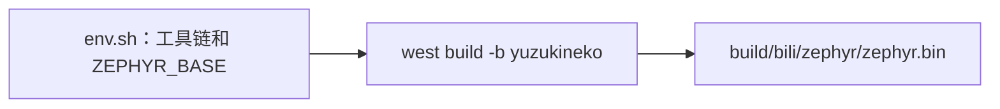

```sh
. ~/f101-zephyr/env.sh
west build -b yuzukineko -d build/bili zephyr-components/bilibili-tv
```

镜像从 flash 窗口运行，所以开发流程与 NekoBox 相同：把 `zephyr.bin` 写到 flash `0x80000`，再从 RAM 运行 XIP 加载器（见[构建与运行](../zephyr-build-run.md)）。这会替换该位置上的 NekoBox；开发时不需要写入启动桩。


```sh
xfel spinor write 0x80000 zephyr.bin
xfel write 0x20000 xip-boot_fel.bin
xfel exec 0x20000
```

TF 卡上需要：

| 文件 | 内容 |
| --- | --- |
| `/SD:/wifi.cfg` | 第一行网络名，第二行密码（设置界面也会写它） |
| `/SD:/bilibili/` | 下载的视频，`<BV 号>.mp4`；完整的文件再次播放时不用下载 |
| `/SD:/bilibili/auth.cfg` | 二维码确认后写入的登录信息 |
| `/SD:/bilibili/settings.cfg` | 音量和亮度 |

## 整体结构

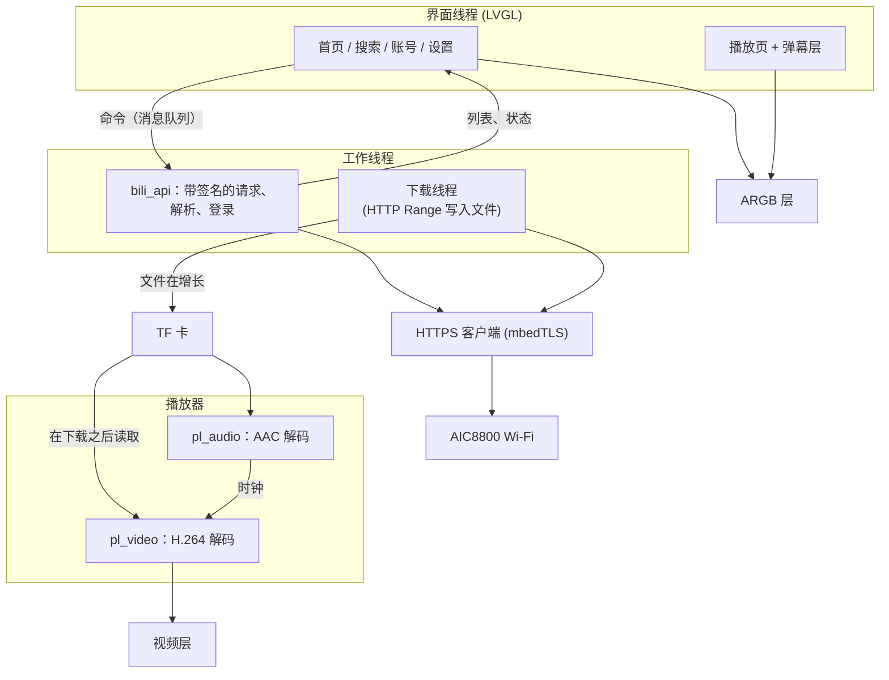

| 线程 | 优先级 | 作用 |
| --- | --- | --- |
| 音频（`pl_audio`） | 3 | 解码 AAC，喂给 codec 环；它的位置就是播放器的时钟 |
| 显示（`disp`） | 5 | 把画面提交给显示器并等待翻页 |
| 视频（`pl_video`） | 6 | 解封装并解码 H.264，时钟到点时显示画面 |
| 界面 | 播放页上为 8 | LVGL，有弹幕时以固定的 33 ms 节拍运行 |
| 下载、封面 | 8 和 9 | 网络和存储卡 |
| 工作线程 | 更低 | 请求、解析、登录、播放流程 |

播放页上界面线程的优先级低于视频线程：同一优先级时，重绘会让每 5 秒多出 2 到 10 张迟到的画面，优先级 8 时只有 0 到 1 张。

## 命令与工作线程

界面从不等待网络。每个动作都是放进消息队列的一条命令（`app_cmd()` 可以从任何线程调用），由工作线程逐条取走。命令声明在 `src/core/app.h`：

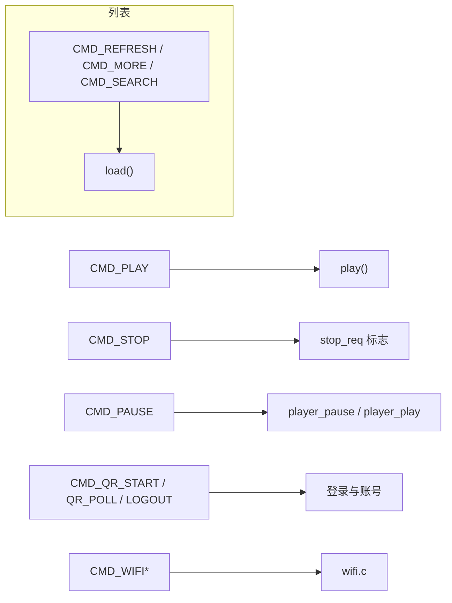

```c
enum app_cmd_type {
	CMD_REFRESH,	/**< arg: list, load its first page again */
	CMD_MORE,	/**< arg: list, append the next page */
	CMD_SEARCH,	/**< keyword in the command: a new search */
	CMD_PLAY,	/**< arg: list << 16 | index */
	CMD_STOP,	/**< back from the player */
	CMD_PAUSE,	/**< toggles */
	CMD_WIFI,	/**< join the network in ssid / psk */
	CMD_QR_START,	/**< ask for a new login code */
	CMD_QR_POLL,	/**< ask how the scan of the code is going */
	CMD_LOGOUT,	/**< forget the login */
	/* ... scan, disconnect, forget, settings, account numbers */
};
```

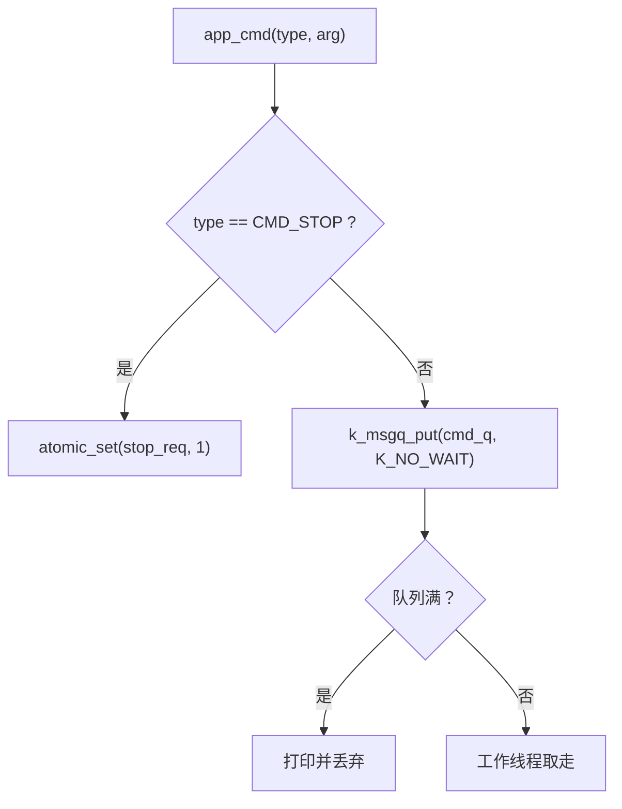

```c
K_MSGQ_DEFINE(cmd_q, sizeof(struct cmd), 8, 4);

void app_cmd(enum app_cmd_type type, int arg)
{
	struct cmd c = {.type = type, .arg = arg};

	if (type == CMD_STOP) {
		/* the flag is the whole command: a message left in the queue would stop the next
		 * video as soon as it opens */
		atomic_set(&stop_req, 1);
		return;
	}
	if (k_msgq_put(&cmd_q, &c, K_NO_WAIT) != 0) {
		printk("app: command queue full\n");
	}
}
```

`CMD_STOP` 是特例：视频播放期间工作线程正忙在 `play()` 里，停止命令不能在队列里等。它是一个标志，播放循环和下载都会查看它。工作线程本身就是一个循环：

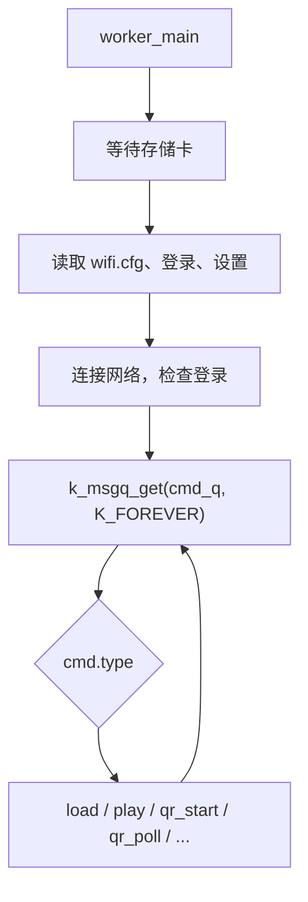

```c
static void worker_main(void *a, void *b, void *c)
{
	struct cmd cmd;
	/* ... wait for the card, read wifi.cfg, load the login and the settings, join the network */
	for (;;) {
		k_msgq_get(&cmd_q, &cmd, K_FOREVER);
		switch (cmd.type) {
		case CMD_REFRESH:  load(cmd.arg, 1); break;
		case CMD_MORE:     /* load(list, next_page) */ break;
		case CMD_SEARCH:   /* store the keyword */ load(LIST_SEARCH, 1); break;
		case CMD_PLAY:     play(cmd.arg >> 16, cmd.arg & 0xffff); break;
		case CMD_QR_START: qr_start(); break;
		case CMD_QR_POLL:  qr_poll(); break;
		/* ... */
		}
	}
}
```

### 列表

列表是一个固定数组，由工作线程填写、界面线程读取，用互斥锁保护。`gen` 记录列表被替换了多少次，界面据此知道什么时候要重建卡片：

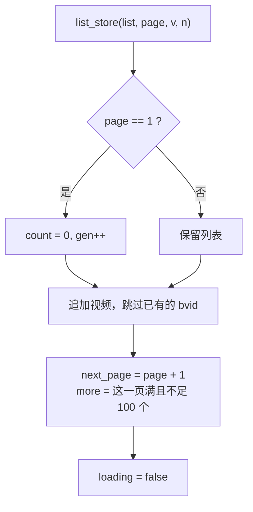

```c
struct vlist {
	struct bili_video v[MAX_VIDEOS];	/* MAX_VIDEOS = 100 */
	int count, next_page, pages;
	bool more, loading;
	int error;		/* what the last page request returned, 0 when it worked */
	uint32_t gen;
	char keyword[96];
};

/* the first page replaces the list, the others are appended without the videos already there */
static void list_store(enum list_id list, int page, const struct bili_video *v, int n, int pages)
{
	struct vlist *l = &lists[list];

	k_mutex_lock(&lists_lock, K_FOREVER);
	if (page == 1) {
		l->count = 0;
		l->gen++;
	}
	for (int i = 0; i < n && l->count < MAX_VIDEOS; i++) {
		bool dup = false;

		for (int j = 0; j < l->count && !dup; j++) {
			dup = strcmp(l->v[j].bvid, v[i].bvid) == 0;
		}
		if (!dup) {
			l->v[l->count++] = v[i];
		}
	}
	l->next_page = page + 1;
	l->pages = pages;
	l->more = n >= PAGE_SIZE / 2 && l->count < MAX_VIDEOS && (pages == 0 || page < pages);
	l->loading = false;
	k_mutex_unlock(&lists_lock);
}
```

`load()` 按列表选择接口（`bili_api_feed`、`bili_api_popular`、`bili_api_follow`、`bili_api_search`），保存结果，并给界面一条状态文字。

### 从工作线程到界面

工作线程从不碰 LVGL 对象。它在互斥锁下把内容写进一小块待处理状态，界面线程在每一轮开始时取走（`src/ui/ui.c` 里的 `ui_run()`）：

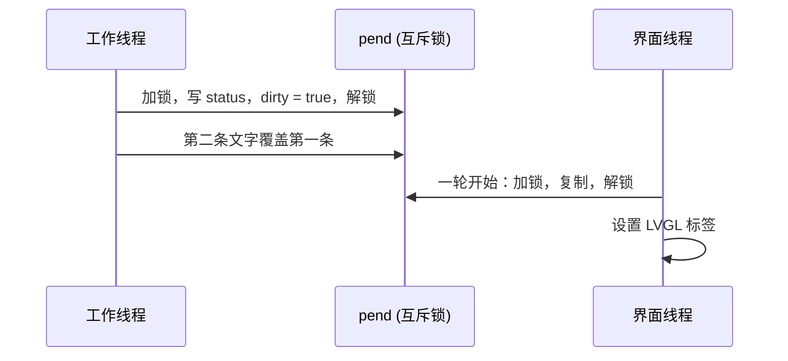

```c
static K_MUTEX_DEFINE(lock);
static struct {
	bool status_dirty, hot_dirty, play_dirty, pos_dirty;
	char status[128];
	/* ... trending words, title, duration, position, paused */
} pend;

void ui_set_status(const char *fmt, ...)
{
	va_list ap;

	k_mutex_lock(&lock, K_FOREVER);
	va_start(ap, fmt);
	vsnprintf(pend.status, sizeof(pend.status), fmt, ap);
	va_end(ap);
	pend.status_dirty = true;
	k_mutex_unlock(&lock);
}
```

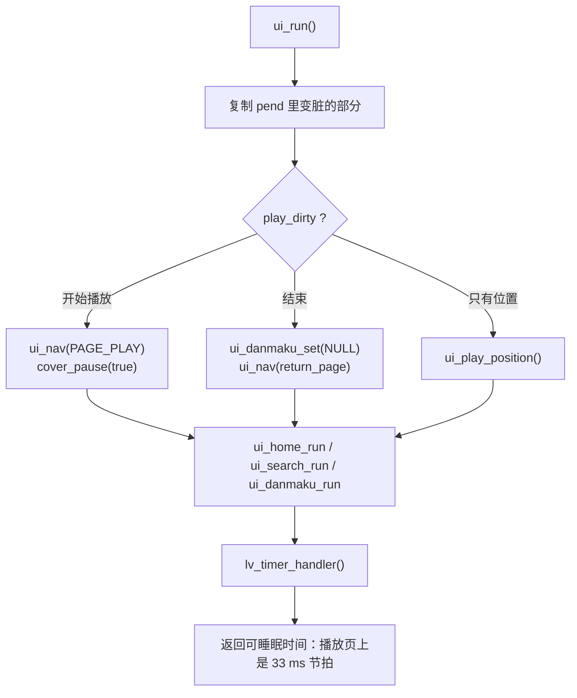

```c
uint32_t ui_run(void)
{
	/* ... copy the dirty parts of pend under the lock, then, without it: */
	if (status_dirty) {
		ui_set_status_label(status);
	}
	if (play_dirty) {
		if (playing) {
			ui_play_set(title, dur);
			cover_pause(true);	/* the covers give their memory to the decoder */
			ui_nav(PAGE_PLAY);
		} else {
			cover_pause(false);
			ui_danmaku_set(NULL);
			ui_nav(return_page);
		}
	} else if (pos_dirty && cur == PAGE_PLAY) {
		ui_play_position(pos, paused);
		ui_play_buffered(buffered_permille);
	}
	ui_home_run(cur == PAGE_HOME);
	ui_search_run(cur == PAGE_SEARCH);
	if (cur == PAGE_PLAY && ui_danmaku_active()) {
		ui_danmaku_run(round_us);
	}
	uint32_t next = lv_timer_handler();
	/* ... */
}
```

状态文字在界面看到之前被设置了两次，就只显示最后一次，状态行本来就该如此。`ui_run()` 的返回值是调用者可以睡多久：在有弹幕的播放页上它是固定的节拍（`beat += 33`），而不是“工作完之后再等 40 ms”，因为步长均匀看起来才流畅。

## HTTP 客户端

`src/net/http.c` 是基于 Zephyr socket 的小型 HTTP/1.1 客户端。它存在的原因是回包必须流式处理：一个视频有几兆字节，堆没有这么大，所以正文一到就交给回调。

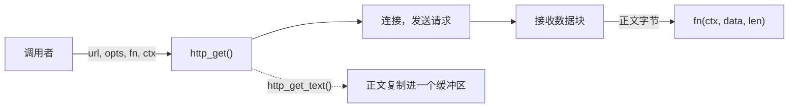

```c
typedef int (*http_body_fn)(void *ctx, const uint8_t *data, size_t len);

struct http_opts {
	const char *headers;	/**< extra header lines, each ending in CRLF, may be NULL */
	int64_t range_start;	/**< >= 0 asks for the bytes from this offset on */
	int timeout_ms;		/**< no data for this long ends the request, 0 is 15 s */
	int tls_verify;
};

int http_get(const char *url, const struct http_opts *opts, http_body_fn fn, void *ctx,
	     struct http_result *res);
int http_get_text(const char *url, const struct http_opts *opts, char *buf, size_t size,
		  struct http_result *res);	/* the whole body in one buffer */
```

### 连接

对 `https`，socket 是 Zephyr 原生的 TLS socket：协议在创建 socket 时选定，主机名作为选项传入：

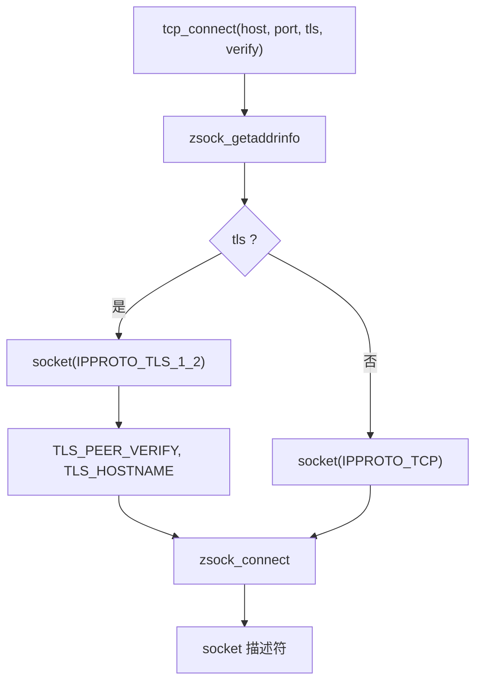

```c
static int tcp_connect(const char *host, const char *port, int tls_native, int verify)
{
	struct zsock_addrinfo hints = {.ai_family = AF_INET, .ai_socktype = SOCK_STREAM};
	struct zsock_addrinfo *res;
	int sock, ret;

	ret = zsock_getaddrinfo(host, port, &hints, &res);
	if (ret != 0) {
		return -EHOSTUNREACH;
	}
	sock = zsock_socket(res->ai_family, res->ai_socktype, tls_native ? IPPROTO_TLS_1_2 : IPPROTO_TCP);
	if (sock < 0) {
		ret = -errno;
		zsock_freeaddrinfo(res);
		return ret;
	}
	if (tls_native) {
		int v = verify ? TLS_PEER_VERIFY_REQUIRED : TLS_PEER_VERIFY_NONE;

		zsock_setsockopt(sock, SOL_TLS, TLS_PEER_VERIFY, &v, sizeof(v));
		zsock_setsockopt(sock, SOL_TLS, TLS_HOSTNAME, host, strlen(host) + 1);
	}
	ret = zsock_connect(sock, res->ai_addr, res->ai_addrlen);
	/* ... close and report on failure */
	zsock_freeaddrinfo(res);

	return sock;
}
```

### 请求

请求头是浏览器会发的那些：没有 `Referer` 的请求会被 CDN 拒绝。调用者想续传文件时加上 `Range` 头，调用者自己的行（cookie）放在最后：

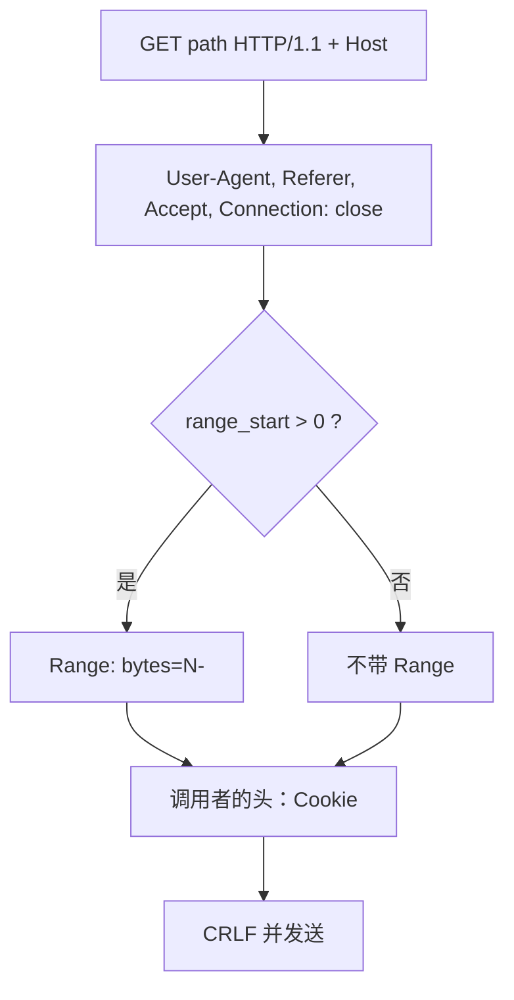

```c
ret = snprintf(req, REQ_SIZE, "GET %s HTTP/1.1\r\nHost: %s\r\n", u.path, u.host);
ret += snprintf(req + ret, REQ_SIZE - ret,
		"User-Agent: " USER_AGENT "\r\n"
		"Referer: https://www.bilibili.com/\r\nAccept: */*\r\nConnection: close\r\n");
if (opts != NULL && opts->range_start > 0) {
	ret += snprintf(req + ret, REQ_SIZE - ret, "Range: bytes=%lld-\r\n",
			(long long)opts->range_start);
}
if (opts != NULL && opts->headers != NULL) {
	ret += snprintf(req + ret, REQ_SIZE - ret, "%s", opts->headers);
}
strcpy(req + ret, "\r\n");
```

`Connection: close` 让客户端保持简单：每个请求一个连接，正文的结束就是连接的结束，或者服务器声明的长度。连接时间、首字节时间和总时间都被测量并放进 `struct http_result` 返回（下载很慢时日志里打印的就是它们）。

### 解析器

回包以 `RECV_SIZE` 为块读取，交给一个状态机（`src/net/http_parse.c`），它认识头、带长度的正文、直到关闭的正文和分块正文。它是单独的文件，这样可以在主机上测试：

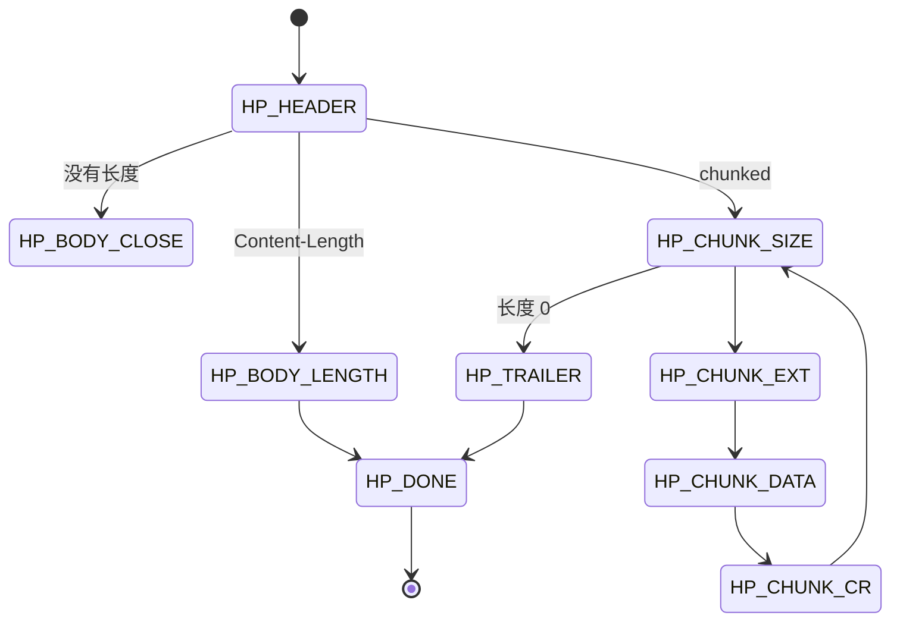

```c
enum http_parse_state {
	HP_HEADER, HP_BODY_LENGTH, HP_BODY_CLOSE,
	HP_CHUNK_SIZE, HP_CHUNK_EXT, HP_CHUNK_DATA, HP_CHUNK_CR, HP_TRAILER,
	HP_DONE,
};

/* returns 1 when the body is complete, 0 for more, negative on a malformed answer */
int http_parser_feed(struct http_parser *p, const uint8_t *data, size_t len,
		     http_body_fn fn, void *ctx);
```

接收循环是 socket 和解析器之间的胶水：

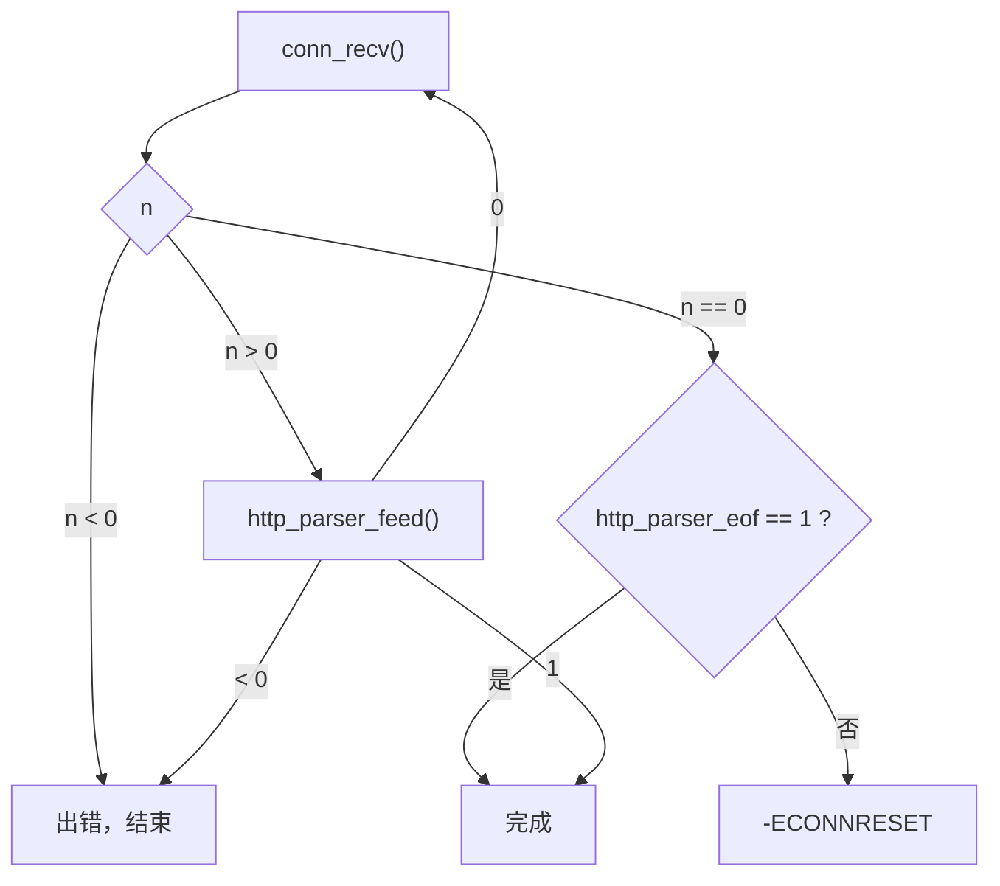

```c
for (;;) {
	ssize_t n = conn_recv(c, rx, RECV_SIZE);

	if (n < 0) { ret = n; break; }
	if (n == 0) { ret = http_parser_eof(p) == 1 ? 0 : -ECONNRESET; break; }
	ret = http_parser_feed(p, rx, n, gate_body, &g);	/* gate_body calls fn for 2xx only */
	if (ret == 1) { ret = 0; break; }
	if (ret < 0) { break; }
}
```

回包的 `Set-Cookie` 字段被收集到 `res->set_cookie`；登录需要它们。

## 带签名的网页接口

全部在 `src/api/bili_api.c` 里，签名在 `src/net/wbi.c`，MD5 在 `src/net/md5.c`，解析在 `src/api/bili_parse.c`。

### 签名密钥

大多数列表和播放接口都要求签名（WBI）。密钥并不保密：`/x/web-interface/nav` 的回包里有两个图片地址（`wbi_img.img_url` 和 `sub_url`），即使没有人登录也有（回包的 code 是 `-101`，但数据仍在）。把两个文件名里扩展名前的 32 个字符拼成 64 个字符，用一张固定的 64 项表重新排列；结果的前 32 个字符就是密钥：

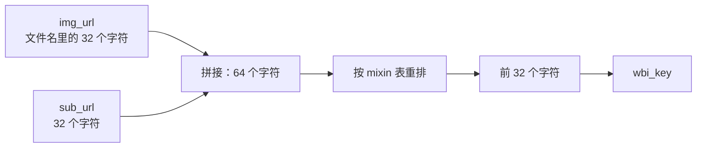

```c
static const uint8_t mixin[64] = {
	46, 47, 18, 2, 53, 8, 23, 32, 15, 50, 10, 31, 58, 3, 45, 35, 27, 43, 5, 49, 33, 9, 42, 19, 29, 28,
	14, 39, 12, 38, 41, 13, 37, 48, 7, 16, 24, 55, 40, 61, 26, 17, 0, 1, 60, 51, 30, 4, 22, 25, 54,
	21, 56, 59, 6, 63, 57, 62, 11, 36, 20, 34, 44, 52,
};

/* the 32 characters in front of the extension of the last path segment */
static int image_key(const char *url, char out[32])
{
	const char *name = strrchr(url, '/');
	const char *dot;

	name = name != NULL ? name + 1 : url;
	dot = strchr(name, '.');
	if (dot == NULL || dot - name != 32) {
		return -EINVAL;
	}
	memcpy(out, name, 32);

	return 0;
}

int wbi_make_key(const char *img_url, const char *sub_url, char key[33])
{
	char raw[64];

	if (image_key(img_url, raw) != 0 || image_key(sub_url, raw + 32) != 0) {
		return -EINVAL;
	}
	for (int i = 0; i < 32; i++) {
		key[i] = raw[mixin[i]];
	}
	key[32] = '\0';

	return 0;
}
```

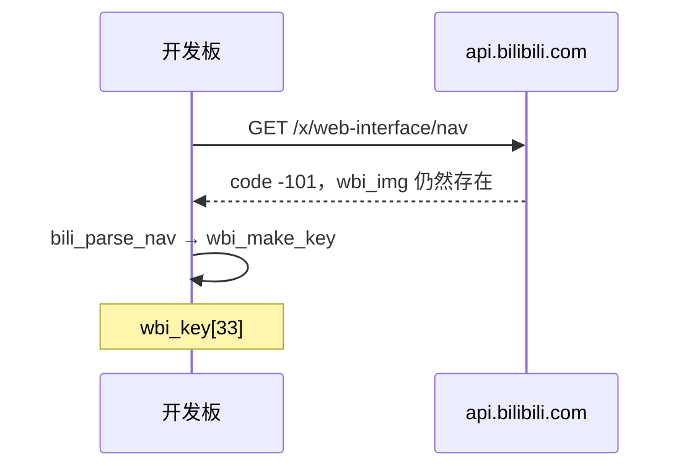

```c
static int load_key(void)
{
	char *a = fetch(API "/x/web-interface/nav");
	int ret;

	if (a == NULL) {
		return -EIO;
	}
	ret = bili_parse_nav(a, wbi_key);	/* wbi_make_key() of the two addresses in the answer */
	free(a);

	return ret;
}
```

### 给请求签名

`wbi_query()` 把参数当作 `name=value` 字符串，写出带签名的查询串：

1. 加上 `wts=<时间戳>`；
2. 按名称排序；
3. 对值做百分号编码（先去掉 `!'()*` 这几个字符，服务器也是这样做的）；
4. 拼成 `a=1&b=2`，末尾接上密钥，这段文本的 MD5 就是 `w_rid`；
5. 返回排好序的查询串，后面接 `&w_rid=<哈希>`。

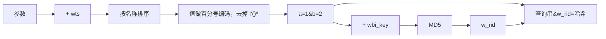

```c
/* order by name: the text up to the '=' */
static int name_cmp(const char *a, const char *b)
{
	for (;; a++, b++) {
		unsigned char x = *a == '=' ? 0 : *a, y = *b == '=' ? 0 : *b;

		if (x != y || x == 0) {
			return (int)x - (int)y;
		}
	}
}

/* percent encoding of everything but the unreserved characters, after the server's filter */
static int encode(const char *s, char *out, size_t size)
{
	size_t n = 0;

	for (; *s != '\0'; s++) {
		unsigned char c = *s;

		if (strchr("!'()*", c) != NULL) {
			continue;
		}
		if ((c >= '0' && c <= '9') || (c >= 'a' && c <= 'z') || (c >= 'A' && c <= 'Z') ||
		    c == '-' || c == '_' || c == '.' || c == '~') {
			out[n++] = c;
		} else {
			n += snprintf(out + n, size - n, "%%%02X", c);
		}
	}
	out[n] = '\0';

	return n;
}
```

排序是对指针做插入排序：列表只有几项。服务器不检查时间戳，所以此时没有网络时间的开发板用一个固定的基数加运行时间：

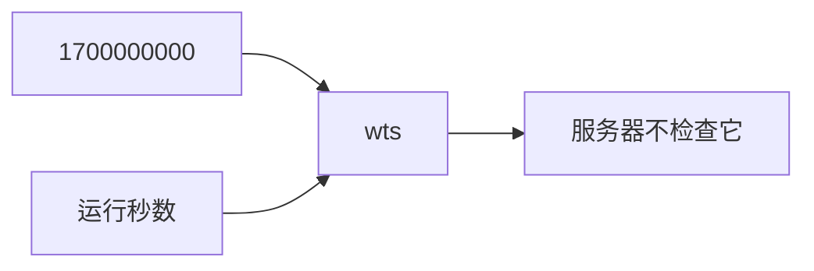

```c
static int64_t stamp(void)
{
	return 1700000000 + k_uptime_get() / 1000;
}
```

### 一次调用，两种重试

`call()` 是发出带签名请求的唯一途径。它签名、发送、读取回包的 `code`，并对这个站点已知的两种失败各恢复一次：

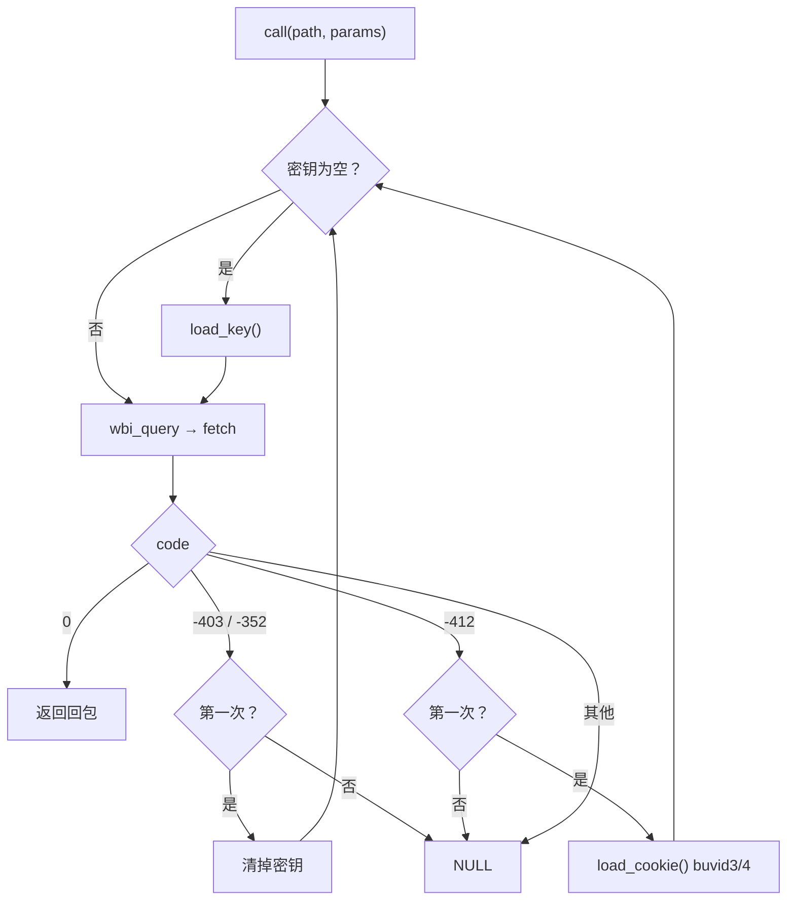

```c
#define CODE_RISK	(-412)	/* too many requests / no browser identity */
#define CODE_SIGN_1	(-403)	/* the signature or its key is wrong */
#define CODE_SIGN_2	(-352)

static char *call(const char *path, const char *const *params, int count, int *code)
{
	bool new_key = false, new_cookie = false;

	for (;;) {
		char url[800], query[600], *a;

		*code = 0;
		if (wbi_key[0] == '\0' && load_key() != 0) {
			return NULL;
		}
		if (wbi_query(params, count, wbi_key, stamp(), query, sizeof(query)) < 0) {
			return NULL;
		}
		snprintf(url, sizeof(url), API "%s?%s", path, query);
		a = fetch(url);
		if (a == NULL) {
			return NULL;
		}
		*code = bili_parse_code(a);
		if (*code == 0) {
			return a;
		}
		free(a);
		if ((*code == CODE_SIGN_1 || *code == CODE_SIGN_2) && !new_key) {
			new_key = true;
			wbi_key[0] = '\0';		/* load the key again */
		} else if (*code == CODE_RISK && !new_cookie) {
			new_cookie = true;
			if (load_cookie() != 0) {	/* /x/frontend/finger/spi */
				return NULL;
			}
		} else {
			return NULL;
		}
	}
}
```

`load_cookie()` 向 `/x/frontend/finger/spi` 要两个 id，保存为 `buvid3=...; buvid4=...`。`headers()` 用这些 id 以及（有登录时）`account.c` 的登录 cookie 构造每个请求的 `Cookie:` 行：

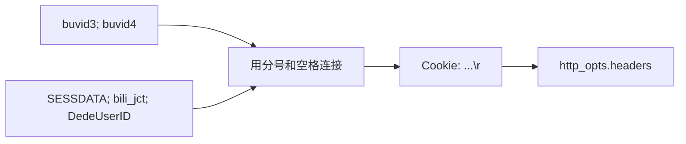

```c
static const char *headers(void)
{
	char acc[460];

	account_cookie(acc, sizeof(acc));
	if (buvid[0] == '\0' && acc[0] == '\0') {
		return NULL;
	}
	snprintf(cookie_hdr, sizeof(cookie_hdr), "Cookie: %s%s%s\r\n", buvid,
		 buvid[0] && acc[0] ? "; " : "", acc);

	return cookie_hdr;
}
```

### 各个接口

| 函数 | 接口 |
| --- | --- |
| `bili_api_feed()` | `/x/web-interface/wbi/index/top/feed/rcmd`（登录后是个性化的） |
| `bili_api_popular()` | `/x/web-interface/popular` |
| `bili_api_search()` | `/x/web-interface/wbi/search/type` |
| `bili_api_hot_words()` | `/x/web-interface/wbi/search/square` |
| `bili_api_follow()` | `/x/polymer/web-dynamic/v1/feed/all?type=video`（需要登录；缓冲区 512 KiB，20 条动态的回包超过 128 KiB） |
| `bili_api_stream()` | `/x/player/wbi/playurl`（没有 `cid` 时先调 `/x/player/pagelist`） |
| `bili_api_danmaku()` | `/x/v1/dm/list.so?oid=<cid>` |
| `bili_api_qr_new()`、`bili_api_qr_poll()` | `passport.bilibili.com/x/passport-login/web/qrcode/generate` 和 `/poll` |
| `bili_api_user()`、`bili_api_user_stats()` | `/x/web-interface/nav`、`/x/web-interface/nav/stat` |

以推荐为例：

```mermaid
sequenceDiagram
    participant W as 工作线程
    participant C as call()
    participant P as bili_parse_feed
    W->>C: bili_api_feed(page)
    C->>C: 签名并请求 rcmd
    C-->>W: JSON
    W->>P: data.item 数组
    P-->>W: struct bili_video[]
```

```c
int bili_api_feed(int page, struct bili_video *out, int max)
{
	char ps[16], idx[24];
	const char *params[] = {ps, "fresh_type=4", idx, "web_location=1430650"};
	char *a;
	/* ps=<max>, fresh_idx=<page> ... */
	a = call("/x/web-interface/wbi/index/top/feed/rcmd", params, ARRAY_SIZE(params), &code);
	/* ... bili_parse_feed(a, out, max) */
}
```

### 不建树地读 JSON

回包有 10 到 500 KiB 的 JSON，堆又很小，所以 `src/net/json.c` 不建树。一个值就是指向它在回包中第一个字符的指针；只有被要求取字符串时才复制：

```mermaid
flowchart LR
    A["JSON 文本在内存里"] --> B["js_path(v, 'data.owner.name')"]
    B --> C["js_get 每一段"]
    C --> D["js_skip 跳过不要的值"]
    C --> E["指向这个值的指针"]
    E --> F["js_str / js_int 复制出来"]
    E --> G["js_first / js_next 遍历数组"]
```

```c
const char *js_get(const char *obj, const char *key);	/* value of a key of an object */
const char *js_path(const char *v, const char *path);	/* "data.owner.name" */
const char *js_first(const char *arr);			/* first and next element of an array */
const char *js_next(const char *elem);
int js_str(const char *v, char *out, size_t size);	/* decodes escapes and \uXXXX to UTF-8 */
long long js_int(const char *v, long long def);
```

`js_get()` 逐个走过一个对象的键，用 `js_skip()` 跳过不想要的值；`js_path()` 对每一段带点的路径调用它一次。`bili_parse.c` 里的解析函数是对数组的循环，只复制卡片要显示的内容：

```mermaid
flowchart TD
    A["bili_parse_feed"] --> B["js_first(data.item)"]
    B --> C{"还有元素？"}
    C -- "是" --> D["parse_video → out[n++]"] --> E["js_next"] --> C
    C -- "否" --> F["return n"]
    G["bili_parse_playurl"] --> H["data.durl[0]"]
    H --> I["url, size, length_ms, quality"]
```

```c
int bili_parse_feed(const char *json, struct bili_video *out, int max)
{
	int n = 0;

	for (const char *it = js_first(js_path(json, "data.item")); it != NULL && n < max;
	     it = js_next(it)) {
		if (parse_video(it, &out[n]) == 0) {
			n++;
		}
	}

	return n;
}

int bili_parse_playurl(const char *json, struct bili_stream *out)
{
	const char *d = js_first(js_path(json, "data.durl"));

	if (d == NULL || js_str(js_get(d, "url"), out->url, sizeof(out->url)) <= 0) {
		return -ENOENT;
	}
	out->size = js_int(js_get(d, "size"), 0);
	out->length_ms = js_int(js_get(d, "length"), 0);
	out->quality = js_int(js_path(json, "data.quality"), 0);

	return 0;
}
```

文本必须是合法的 JSON；每个函数遇到被截断的回包都返回 NULL，而不会越过结尾。解析函数有用录下的回包做的主机测试（见下面的测试辅助）。

## 找到视频流

```mermaid
sequenceDiagram
    participant B as 开发板
    participant A as api.bilibili.com
    participant C as CDN (bilivideo.com)
    B->>A: GET /x/web-interface/nav
    A-->>B: wbi_img.img_url、sub_url（即使"未登录"也有）
    Note over B: 由两个文件名得到签名密钥
    B->>A: GET /x/web-interface/wbi/index/top/feed/rcmd?...&w_rid=...
    A-->>B: 视频列表（bvid、标题、封面、UP 主、统计）
    B->>A: GET /x/player/pagelist?bvid=...（没有 cid 时）
    A-->>B: cid
    B->>A: GET /x/player/wbi/playurl?bvid&cid&qn=16&fnval=0&platform=html5&w_rid=...
    A-->>B: durl[0].url（一个 MP4：H.264 + AAC）、大小、时长
    B->>C: GET url，Range: bytes=0-
    C-->>B: 文件，流式传输
```

```mermaid
flowchart TD
    A["bili_api_stream(v)"] --> B{"cid == 0 ?"}
    B -- "是" --> C["resolve_cid: /x/player/pagelist"]
    B -- "否" --> D["bvid, cid, qn=16, fnval=0, platform=html5"]
    C --> D
    D --> E["call(/x/player/wbi/playurl)"]
    E --> F["bili_parse_playurl"]
    F --> G["地址、大小、时长"]
```

```c
int bili_api_stream(const struct bili_video *v, struct bili_stream *out)
{
	char bvid[32], cid[32], qn[16];
	const char *params[] = {bvid, cid, qn, "fnval=0", "fnver=0", "fourk=0", "platform=html5",
				"high_quality=1"};
	uint64_t id = v->cid;
	char *a;
	int ret, code;

	if (id == 0) {
		ret = resolve_cid(v->bvid, &id);	/* a search result has no cid */
		if (ret != 0) {
			return ret;
		}
	}
	snprintf(bvid, sizeof(bvid), "bvid=%s", v->bvid);
	snprintf(cid, sizeof(cid), "cid=%llu", (unsigned long long)id);
	snprintf(qn, sizeof(qn), "qn=%d", QN_360P);		/* QN_360P is 16 */
	a = call("/x/player/wbi/playurl", params, ARRAY_SIZE(params), &code);
	if (a == NULL) {
		return code != 0 ? -EACCES : -EIO;
	}
	ret = bili_parse_playurl(a, out);
	out->cid = id;
	free(a);
	/* the address of the answer is used as it is, over HTTPS (CONFIG_BILI_CDN_HTTPS) */

	return ret;
}
```

- `qn=16` 是 360P。这种画质的视频是一个 MP4 文件，H.264 视频和 AAC 音频交织在一起：`fnval=0` 要的是旧的 `durl` 格式，而不是分离的 DASH 流。开发板只需要解一个文件的封装，不用合并音视频，码率也低到 Wi-Fi 和 SD 卡跟得上。
- 更高的画质（720P 及以上）需要有更多权限的登录，并且使用 DASH；这里不用。这个客户端的登录只让列表个性化。
- 回包里有 `durl[0].url`（带签名和截止时间的 CDN 地址）、字节大小和毫秒时长。

## 边下载边播放

### 流程

`src/main.c` 里的 `play()` 就是整个流程，由工作线程运行：

```mermaid
flowchart TD
    A["play(list, index)"] --> B["打开播放页，清掉封面"]
    B --> C["bili_api_stream"]
    C --> D["bili_api_danmaku"]
    D --> E{"卡上有完整文件？"}
    E -- "是" --> F["player_open"]
    E -- "否" --> G["dl_start + player_open_growing"]
    G --> H["prebuffer"]
    F --> I["player_play"]
    H --> I
    I --> J["play_loop 直到结束或停止"]
```

```c
static void play(enum list_id list, int index)
{
	/* ... */
	ui_set_playing(v.title, 0);			/* the player page opens at once */
	for (int i = 0; i < 50 && cover_in_use() > 0; i++) {
		k_msleep(20);
	}
	cover_flush();					/* the decoder needs the memory the covers hold */

	ret = bili_api_stream(&v, &s);			/* the address of the file */
	/* the comments: nothing to wait for when they cannot be had */
	n = bili_api_danmaku(s.cid, dm);
	ui_set_danmaku(dm);

	snprintf(path, sizeof(path), CONFIG_BILI_CACHE_DIR "/%s.mp4", v.bvid);
	if (cached(path, s.size)) {
		ret = player_open(path, &info);		/* a complete file from an earlier time */
	} else {
		static struct player_growing g;

		g = (struct player_growing){.total = s.size, .avail = dl_avail};
		ret = dl_start(s.url, path, s.size, on_progress, NULL);
		ret = player_open_growing(path, &g, &info);
		prebuffer(&s, &info);			/* wait for a few seconds of the stream */
	}
	player_play();
	play_loop(&v, &info, growing);			/* until the end or a stop */
}
```

先打开播放页，再把封面清掉，因为 640×360 的解码器需要约 6 MB，而这些内存被封面占着。`player_growing` 是 `static` 的，因为播放器在关闭之前一直保存着这个指针：内层块里的变量到那时已经不存在了（这是一个真实的 bug：开发板在第一次暂停时死机）。

### 下载线程

`src/net/download.c` 以 64 KiB 为一块下载到卡上的文件里。文件经由一个暂存缓冲区写入，每写一块就同步，并把“已经在文件里、也在目录项里”的字节数公布出来供播放器读取：

```mermaid
flowchart TD
    A["sink(data)"] --> B["复制进 64 KiB 暂存区"]
    B --> C{"暂存区满？"}
    C -- "否" --> A
    C -- "是" --> D["fs_write"]
    D --> E["fs_sync"]
    E --> F["atomic_set(synced, written)"]
    F --> G["播放器可以读到这里"]
```

```c
#define STAGE_SIZE	(64 * 1024)
#define ATTEMPTS	6

static int flush(struct dl *d)
{
	ssize_t n = fs_write(d->fp, d->stage, d->used);

	if (n != (ssize_t)d->used) {
		return n < 0 ? (int)n : -EIO;
	}
	d->written += d->used;
	d->used = 0;
	if (d->synced != NULL) {
		/* a reader opens the file by its own handle: the size must be in the directory entry */
		int ret = fs_sync(d->fp);

		if (ret != 0) {
			return ret;
		}
		atomic_set(d->synced, (atomic_val_t)d->written);
	}

	return 0;
}
```

正文回调把数据复制进暂存区，满了就写；它每 250 ms 报告一次进度，用户退出时返回 `-ECANCELED`。重试循环会从已有的字节处继续一次中断的传输：

```mermaid
flowchart TD
    A["http_get(Range: done-)"] --> B{"结果"}
    B -- "5xx / 429" --> C["等 1 秒、2 秒…再请求"] --> A
    B -- "其他非 2xx" --> D["失败：403/404 为 -EACCES"]
    B -- "续传时回 200" --> E["-EPROTO"]
    B -- "字节已到齐" --> F["完成"]
    B -- "连接中断" --> G["等 0.5 秒，从 done 继续"] --> A
```

```c
for (attempt = 0; attempt < ATTEMPTS; attempt++) {
	struct http_opts o = {.range_start = d.done, .timeout_ms = 10000};
	struct http_result r;

	ret = http_get(url, &o, sink, &d, &r);
	/* ... flush what is staged ... */
	if (ret == 0 && (r.status >= 500 || r.status == 429) && attempt + 1 < ATTEMPTS) {
		/* the cache server is busy or has none of the file yet: a new request often works */
		k_msleep(1000 * (attempt + 1));
		continue;
	}
	if (ret == 0 && r.status / 100 != 2) {
		ret = r.status == 403 || r.status == 404 ? -EACCES : -EIO;
		break;
	}
	if (ret == 0 && d.done > 0 && o.range_start > 0 && r.status != 206) {
		ret = -EPROTO;	/* the server does not do ranges: cannot continue */
		break;
	}
	if (ret == 0 && (total == 0 || d.done >= total)) {
		break;			/* complete */
	}
	k_msleep(500);			/* the connection broke: again from d.done */
}
```

后台形式（`dl_start()`）里，同一个 `run()` 是一个线程（优先级 8）的主体，它的状态是两个原子变量，播放器通过 `dl_avail()` 读取：

```mermaid
stateDiagram-v2
    [*] --> Running: dl_start
    Running --> Done: 字节齐了
    Running --> Failed: 负的 errno
    Running --> Failed: 被取消
    note right of Running: dl_avail → state 0, bg_synced
```

```c
static atomic_t bg_synced, bg_state;	/* state: 0 running, 1 done, negative errno */

uint64_t dl_avail(void *ctx, int *state)
{
	*state = (int)atomic_get(&bg_state);

	return (uint64_t)(uint32_t)atomic_get(&bg_synced);
}
```

### 读一个没有下完的文件

播放器（`src/player/player.c`，由 NekoBox 的播放器加上这一处改动构建）通过一个函数读文件。读取需要的字节还不在文件里时，它等待下载，然后重新打开自己的文件句柄，因为 FAT 文件句柄只记得打开时看到的大小：

```mermaid
flowchart TD
    A["pl_file_read(off, len)"] --> B{"在窗口内？"}
    B -- "是" --> R["读窗口"]
    B -- "否" --> C["pl_grow_wait"]
    C --> D{"avail >= off + len ?"}
    D -- "否，状态 < 0" --> X["-EIO"]
    D -- "否" --> E["k_msleep(20)"] --> C
    D -- "是" --> F{"句柄比数据旧？"}
    F -- "是" --> G["fs_close, fs_open"]
    F -- "否" --> R
    G --> R
```

```c
/* waits until [off, off + len) is in the file; reopens the handle when it is older than the data */
static int pl_grow_wait(struct reader *r, uint64_t off, size_t len)
{
	uint64_t need = off + len, av;
	int st;

	for (;;) {
		av = pl_grow->avail(pl_grow->ctx, &st);
		if (st == 1) {
			av = pl_grow->total;		/* the download is complete */
		}
		if (av >= need) {
			break;
		}
		if (st < 0) {
			return -EIO;			/* the download failed */
		}
		k_msleep(20);
	}
	if (need > r->known) {
		fs_close(&r->f);
		fs_file_t_init(&r->f);
		int ret = fs_open(&r->f, pl_path, FS_O_READ);

		if (ret != 0) {
			return ret;
		}
		r->known = st == 1 ? UINT64_MAX : av;
	}

	return 0;
}

int pl_file_read(void *ctx, uint64_t off, void *buf, size_t len)
{
	struct reader *r = ctx;
	/* ... */
	if (pl_grow != NULL && !(r->win_len > 0 && off >= r->win_off && off + len <= r->win_off + r->win_len)) {
		ret = pl_grow_wait(r, off, len);	/* only when the read is not in the window */
		if (ret != 0) {
			return ret;
		}
	}
	/* ... read through a 128 KiB window (video) or a 32 KiB one (audio) */
}
```

这个站点的文件，`moov` 在开头，所以解封装器在最初几 KB 之后就能读到轨道表。播放器为视频和音频各开一个 reader，两者都经过 `pl_file_read()`。

### 等第一批存量

还在下载的文件打开后先停在第一张画面上（`PLAYER_PAUSED`：显示第一张画面，什么都不播放），应用等下载到几秒的数据之后才用 `player_play()` 启动声音和视频，这样连接的慢启动不会吃掉最初几秒：

```mermaid
flowchart TD
    A["open_impl(path, g)"] --> B{"g != NULL ?"}
    B -- "还在下载的文件" --> C["PLAYER_PAUSED<br/>request(play = false)"]
    B -- "完整文件" --> D["PLAYER_PLAYING<br/>request(play = true)"]
    C --> E["显示第一张画面，什么都不播放"]
    E --> F["player_play() 预缓冲之后"]
```

```c
/* player.c, open_impl() */
pl_state = g != NULL ? PLAYER_PAUSED : PLAYER_PLAYING;
pl_req.seq = 0;
pl_req_post(0, g == NULL);
```

```mermaid
flowchart TD
    A["prebuffer"] --> B["want = 6 秒平均码率，至少 256 KiB"]
    B --> C["av = dl_avail()"]
    C --> D["显示这批存量的缓冲百分比"]
    D --> E{"结束、失败、停止、av ≥ want 或 20 秒？"}
    E -- "否" --> F["k_msleep(50)"] --> C
    E -- "是" --> G["返回"]
```

```c
static void prebuffer(const struct bili_stream *s, const struct player_info *info)
{
	uint64_t want, av;
	int64_t t0 = k_uptime_get();
	int state;

	if (CONFIG_BILI_PREBUFFER_SEC <= 0 || info->duration_ms == 0 || s->size == 0) {
		return;
	}
	want = s->size * (CONFIG_BILI_PREBUFFER_SEC * 1000ULL) / info->duration_ms;
	want = MIN(MAX(want, 256 * 1024ULL), s->size);
	for (;;) {
		av = dl_avail(NULL, &state);
		ui_set_status("buffering %u%%", (unsigned int)MIN(av * 100 / want, 99ULL));
		if (state != 0 || av >= want || atomic_get(&stop_req) ||
		    k_uptime_get() - t0 > CONFIG_BILI_PREBUFFER_TIMEOUT_SEC * 1000) {
			break;
		}
		k_msleep(50);
	}
}
```

`want` 是 `BILI_PREBUFFER_SEC` 秒（6）的平均码率，至少 256 KiB；下载结束、失败、被取消，或超过 `BILI_PREBUFFER_TIMEOUT_SEC`（20 秒）时，等待立即结束。显示的百分比是这批存量的，不是整个文件的：文件有几兆字节，它的百分比整个等待期间都停在 1 或 2。之后在 `play_loop()` 里，画面停住超过 1.5 秒时会再次出现 `缓冲中...`，表示下载落后了。

### 播放器线程

播放器由三个线程运行。它们通过一个带序号的请求通信；新请求（跳转、暂停）会让正在运行的会话结束，下一个会话从请求的位置开始：

```mermaid
sequenceDiagram
    participant U as 界面 / 工作线程
    participant R as pl_req (seq)
    participant V as pl_video
    U->>R: player_seek / pause / play → seq + 1
    V->>R: pl_req_changed(seq)?
    R-->>V: 是
    V->>V: 结束会话，释放画面
    V->>R: 读取新请求
    V->>V: 从 pos_us 开始新会话，播放或保持
```

```c
struct request {
	uint32_t seq;
	int64_t pos_us;
	bool play;
};

bool pl_req_changed(uint32_t seq)
{
	return pl_quit || pl_req_get().seq != seq;
}
```

暂停不是“停掉时钟”：它是对当前位置的一个不播放的会话的请求。这个会话从位置之前的关键帧开始解码，显示位置处的画面并保持住（`held = true`）；恢复是对同一位置的一个播放会话的请求。这也是为什么跳转和暂停的开销差不多，以及为什么视频最好每一两秒有一个关键帧。

**时钟。** 音频位置就是播放器的时钟：codec 已经播放的块数乘以每块的时长，再加上自上一块以来的时间：

```mermaid
flowchart LR
    A["pl_audio_base_us"] --> S["+"]
    B["已播放块数 × 每块时长"] --> S
    C["自上一块以来的时间"] --> S
    S --> D["音频时钟（微秒）"]
```

```c
int64_t pl_audio_clock_us(void)
{
	uint32_t blocks, cycle;

	if (!pl_audio_running) {
		return -1;
	}
	i2s_sunxi_codec_tx_position(pl_codec_i2s, &blocks, &cycle);

	return pl_audio_base_us + (int64_t)blocks * AAC_FRAMES * 1000000 / pl_mp4.audio.sample_rate +
	       (int64_t)k_cyc_to_us_floor64(k_cycle_get_32() - cycle);
}
```

**等待一张画面。** 视频线程解码后，等到时钟到达这张画面的时间。晚了两帧以上的画面不显示（`WAIT_LATE`，日志里记为 `late`）：

```mermaid
flowchart TD
    A["diff = pts - clock"] --> B{"diff"}
    B -- "< -2 帧" --> C["WAIT_LATE 丢弃，计为 late"]
    B -- "在提前量内" --> D["WAIT_ON_TIME 显示"]
    B -- "太早" --> E["k_msleep(1..20 ms)"] --> A
    F["请求变了"] --> G["WAIT_ABORT"]
```

```c
#define DROP_US		(2 * 33367)

enum wait_result pl_wait_for(uint32_t seq, int64_t pts_us, int64_t start_us, int64_t start_ms)
{
	for (;;) {
		int64_t now = pl_audio_clock_us(), diff;

		if (pl_req_changed(seq)) {
			return WAIT_ABORT;
		}
		if (now < 0) {
			/* no sound running: the wall clock from the start of the session */
			now = start_us + (k_uptime_get() - start_ms) * 1000;
		}
		diff = pts_us - now;
		if (diff < -DROP_US) {
			return WAIT_LATE;
		}
		if (diff <= LEAD_US) {
			return WAIT_ON_TIME;
		}
		k_msleep(CLAMP((int)((diff - LEAD_US) / 1000), 1, 20));
	}
}
```

**会话循环。** 每个 H.264 sample 从文件读出（经过 `pl_file_read()`），从 AVCC（长度前缀）转换成 Annex B（起始码），再喂给视频引擎。解码器用返回码说明它需要什么：

```mermaid
flowchart TD
    A["vdec_stream_get_frame"] --> B{"ret"}
    B -- "0" --> C["pl_wait_for"]
    C -- "ON_TIME" --> D["disp_q → 显示线程"]
    C -- "LATE" --> E["释放画面"]
    B -- "-EBUSY" --> F["k_msleep(2)"]
    B -- "-EAGAIN" --> G["pl_file_read → avcc_to_annexb"]
    G --> H["vdec_stream_feed"]
```

```c
ret = vdec_stream_get_frame(pl_vdec_dev, stream, &frame);
if (ret == 0) {
	/* the pictures from the key frame up to the position are not shown */
	w = r->play ? pl_wait_for(r->seq, pts_us, r->pos_us, start_ms) : WAIT_ON_TIME;
	if (w == WAIT_ON_TIME) {
		k_msgq_put(&disp_q, &frame, K_FOREVER);	/* to the display thread */
		pl_pos_publish(r->seq, pts_us / 1000);
		if (!r->play) {
			held = true;			/* a paused session shows one picture and holds */
			break;
		}
	} else {
		vdec_frame_release(pl_vdec_dev, &frame);	/* late */
	}
	continue;
}
if (ret == -EBUSY) {			/* the decoder is working */
	k_msleep(2);
	continue;
}
/* -EAGAIN: it wants data */
if (pl_file_read(&pl_vfile, s.offset, raw, s.size) == 0) {
	ab_len = avcc_to_annexb(raw, s.size, ab, first || s.sync);
	ret = vdec_stream_feed(pl_vdec_dev, stream, ab + ab_used, ab_len - ab_used, pending_pts, &used);
}
```

**显示线程。** 提交一张画面要等上一张翻页，这会卡住解码器，所以由单独的线程来做。它只有在下一张画面显示出来之后才交还上一张，由视频线程释放（这样解码器保持单线程）：

```mermaid
sequenceDiagram
    participant V as pl_video
    participant Q as disp_q
    participant D as disp thread
    participant E as done_q
    V->>Q: 解码后的画面
    Q->>D: k_msgq_get
    D->>D: show() 画面显示出来后返回
    D->>E: 前一张画面
    V->>E: pl_release_done → vdec_frame_release
```

```c
K_MSGQ_DEFINE(disp_q, sizeof(struct vdec_frame), 1, 4);
K_MSGQ_DEFINE(done_q, sizeof(struct vdec_frame), 4, 4);

static void disp_main(void *a, void *b, void *c)
{
	struct vdec_frame f, shown = {0};

	for (;;) {
		k_msgq_get(&disp_q, &f, K_FOREVER);
		/* ... a frame without a buffer ends the session ... */
		show(&f);			/* display_sunxi_show_yuv(): returns when the picture is up */
		if (shown.priv != NULL) {
			k_msgq_put(&done_q, &shown, K_FOREVER);
		}
		shown = f;
	}
}
```

画面以 NV12 和 BT.709 矩阵送到视频层（`display_sunxi_show_yuv()`）；视频引擎和显示引擎读的是同一块内存，CPU 从不碰像素。

## 弹幕

### 获取与解压

一个视频的弹幕是一个 XML 文件（`/x/v1/dm/list.so?oid=<cid>`），服务器以原始 deflate 发送。两者都不会整个保存：正文随着 TLS 记录到达，经过流式解压器（`src/net/inflate.c`，我们自己的 deflate 解码器）进入流式 XML 扫描器（`src/api/danmaku.c`）：

```mermaid
flowchart TD
    A["dm_body(data)"] --> B{"第一个字节是 '<'？"}
    B -- "是：明文 XML" --> D["dm_parser_feed"]
    B -- "否：原始 deflate" --> C["inflate_feed"]
    C -- "输出块" --> D
    C -- "1：流结束" --> E["忽略后面的数据"]
```

```c
/* the bytes of the answer: raw deflate as the server sends it, or the XML itself */
static int dm_body(void *ctx, const uint8_t *d, size_t n)
{
	struct dm_sink *s = ctx;
	int ret;

	if (!s->started) {
		s->started = true;
		s->plain = n > 0 && d[0] == '<';
	}
	if (s->plain) {
		return dm_parser_feed(s->parser, d, n);
	}
	ret = inflate_feed(s->inf, d, n);

	return ret < 0 ? ret : 0;	/* 1: the stream is complete, what follows is of no interest */
}
```

### 扫描器与集合

扫描器是一个小状态机：标签外的文本、一个标签、`<d p="...">` 元素的文本。属性 `p` 是 `时间,模式,字号,颜色,...`：

```mermaid
stateDiagram-v2
    [*] --> P_OUT
    P_OUT --> P_TAG: 标签开始
    P_TAG --> P_OUT: 标签结束：tag_done
    note right of P_TAG: d 开始：读时间、模式、颜色，in_d = true
    note right of P_OUT: d 结束：用两个标签之间收集的文本调用 add_item
```

```c
static int tag_done(struct dm_parser *p)
{
	p->state = P_OUT;
	p->tag[p->tag_n] = '\0';
	if (strncmp(p->tag, "d p=\"", 5) == 0) {
		p->raw_n = 0;
		p->in_d = true;
		parse_p(p, p->tag + 5);			/* time, mode, colour */
	} else if (strcmp(p->tag, "/d") == 0 && p->in_d) {
		p->in_d = false;
		return add_item(p);			/* unescape the text, store it */
	}

	return 0;
}
```

集合是两个数组：条目（毫秒时间、颜色、文本偏移、模式、长度）和一个存放所有文本的池。文本在字符边界处截断为 90 字节，集合有上限（`BILI_DM_MAX_ITEMS`、`BILI_DM_POOL_KB`）。读完最后一个字节后，条目按时间排序，位置用二分查找：

```mermaid
flowchart LR
    A["XML 条目"] --> B["dm_item<br/>t_ms, rgb, off, mode, len"]
    A --> C["文本池"]
    B --> D["qsort 按时间"]
    D --> E["dm_find(t_ms) 二分查找"]
    E --> F["下一条弹幕的下标"]
```

```c
struct dm_item {
	uint32_t t_ms;
	uint32_t rgb;		/* 0xRRGGBB */
	uint32_t off;		/* position of the text in the pool */
	uint8_t mode;		/* 1 scroll, 4 bottom, 5 top, 6 reverse */
	uint8_t len;
};

uint32_t dm_find(const struct dm_set *set, uint32_t t_ms)
{
	uint32_t lo = 0, hi = set->count;

	while (lo < hi) {
		uint32_t mid = (lo + hi) / 2;

		if (set->items[mid].t_ms < t_ms) {
			lo = mid + 1;
		} else {
			hi = mid;
		}
	}

	return lo;
}
```

### 显示

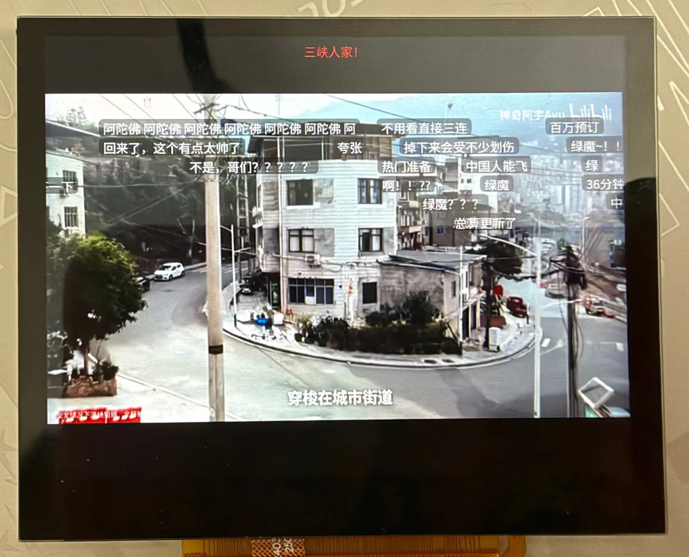

视频上叠着滚动弹幕。标题在最上面，画面在视频平面上，弹幕是在它上方移动的 LVGL 标签，分成几行，白字加深色底，在任何画面上都看得清。

`ui_danmaku_run()` 每一轮由界面调用一次。它在视频上方持有 `BILI_DM_ACTIVE`（20）个 LVGL 标签的池。一条弹幕占用一个空闲标签；滚动弹幕还需要一条不会追上前一条的行：

```mermaid
flowchart TD
    A["spawn(item, p)"] --> B{"有空闲标签？"}
    B -- "否" --> X["false"]
    B -- "是" --> C{"mode"}
    C -- "滚动" --> D["找 p >= free_at 的行"]
    D --> E["free_at = p + (w + GAP) / SPEED"]
    E --> F["x = SCREEN_W, y = lane"]
    C -- "顶部 / 底部" --> G["停留 4 秒的空行"]
    G --> H["x = centred"]
    F --> I["设置文字、颜色、大小、位置；显示"]
    H --> I
```

```c
#define LANE_H		34
#define SPEED		170		/* pixels per second */
#define GAP		28
#define TOP_ROWS	4
#define BOTTOM_ROWS	4
#define FIXED_MS	4000

/* where a scrolling comment is at the time p: all of them move at one speed */
static int32_t scroll_px(uint32_t p)
{
	return (int32_t)((uint64_t)p * SPEED / 1000);
}

static bool spawn(const struct dm_item *it, uint32_t p)
{
	/* ... */
	w = lv_text_get_width(text, it->len, ui_font_m, 0) + 16;
	if (kind == K_SCROLL) {
		for (int i = 0; i < SCROLL_ROWS; i++) {
			if (p >= scroll_free_at[i]) {	/* the lane is free again */
				row = i;
				break;
			}
		}
		if (row < 0) {
			return false;
		}
		/* the next one may enter when the tail of this one has come in, plus a gap */
		scroll_free_at[row] = p + (uint32_t)(w + GAP) * 1000 / SPEED;
		x = SCREEN_W;
		y = 4 + (TOP_ROWS + row) * LANE_H;
	} else {
		/* top and bottom: a row that is free for FIXED_MS */
	}
	/* set the text, the colour, the size and the place, show the label */
}
```

因为所有滚动弹幕速度相同，每个标签的 x 都是一个数的函数：`x = SCREEN_W + s0 - scroll_px(now)`，其中 `s0 = scroll_px(t0)` 是弹幕显示时取的。很深的文字颜色会被改成白色，这样才能在画面上读得清（`readable()`），标签带 40% 的黑色背景。

驱动 `p` 的时钟跟随视频位置，但做了平滑，这样位置汇报得晚时文字不会一格一格地跳：

```mermaid
flowchart TD
    A["视频位置 pos、当前时间 now"] --> B["err = (pos - now) - clk_off"]
    B --> C{"需要同步或 abs(err) > 400 ms？"}
    C -- "是" --> D["clk_off = pos - now"]
    C -- "否" --> E["clk_off += err / 8"]
    D --> F["p = now + clk_off"]
    E --> F
    F --> G["限制：不超前太多，不倒退"]
```

```c
if (playing) {
	int32_t err = (int32_t)(pos - now) - clk_off;

	if (clk_sync || err > CLK_SNAP_MS || err < -CLK_SNAP_MS) {
		clk_off = (int32_t)(pos - now);		/* jump: after a seek or a stall */
		clk_sync = false;
	} else {
		clk_off += err / 8;			/* otherwise follow slowly */
	}
}
p = now + clk_off;
/* never far ahead of the video (a stall), and never backwards */
```

当一轮耗时超过 60 ms 时，`density_div` 变成 2，隔一条丢一条，直到每一轮重新变快。

### 当作一张图来移动

移动 20 个标签会让 LVGL 把每个标签的旧位置和新位置都重画一遍，也就是在视频上做 20 次小的文字重绘。因为它们移动的距离相同，`ui_danmaku.c` 改为用 2D 加速器把这一层当作一张图来移动，只让 LVGL 画右边新进来的那一条。LVGL 自己的刷新在开始时调用 `dm_strips()`（`LV_EVENT_REFR_START`）：

```mermaid
flowchart TD
    A["REFR_START"] --> B{"pend_dx == 0 ?"}
    B -- "是" --> X["返回"]
    B -- "否" --> C{"车道里有别的脏区？"}
    C -- "是" --> D["整条车道重画"]
    C -- "否" --> E["shift_cols(G2D)"]
    E -- "成功" --> F["只画新进来的列"]
    E -- "失败" --> D
    D --> G["lv_inv_area"]
    F --> G
```

```c
static void dm_strips(lv_event_t *e)
{
	lv_display_t *d = lv_display_get_default();
	lv_area_t lanes = {0, LANES_Y, SCREEN_W - 1, LANES_Y + LANES_H - 1}, x;
	bool other = false;

	if (pend_dx == 0) {
		return;
	}
	/* is anything else going to be drawn in the lanes (a button, the message)? */
	for (uint32_t i = 0; i < d->inv_p && !other; i++) {
		other = !d->inv_area_joined[i] && lv_area_intersect(&x, &d->inv_areas[i], &lanes);
	}
	if (other) {
		n_other++;			/* then the lanes are drawn whole */
	} else if (shift_cols(0, LANES_Y, SCREEN_W, LANES_H, pend_dx, false) != 0) {
		n_failed++;
	} else {
		lanes.x1 = SCREEN_W - pend_dx;	/* only the new columns are drawn */
		n_shifted++;
	}
	lv_inv_area(d, &lanes);
	pend_dx = 0;
}
```

`shift_cols()`（`src/gfx/shift.c`）是帧缓冲内部的一次拷贝，从 `x+dx` 到 `x`，然后把右边剩下的几列用透明黑填充：

```mermaid
flowchart TD
    A["shift_cols(x, y, w, h, dx)"] --> B["把这些行的缓存写回"]
    B --> C["g2d_blit: 从 x+dx 到 x，同一缓冲"]
    C --> D["g2d_fill: 右边空出的一条"]
    D --> E["缓存失效"]
    F["cols_check() 第一次使用"] -. "图案测试" .-> A
```

```c
int shift_cols(int x, int y, int w, int h, int dx, bool sync)
{
	struct g2d_surface f, b;
	struct g2d_rect src, dst, strip;
	int ret;

	/* ... checks: ready, 0 < dx < w, inside the frame buffer, self check passed ... */
	surfaces(&f, &b);
	sys_cache_data_flush_range(fb + (size_t)y * stride, (size_t)h * stride);
	src = (struct g2d_rect){x + dx, y, w - dx, h};
	dst = (struct g2d_rect){x, y, w - dx, h};
	ret = g2d_blit(g2d, &f, &src, &f, &dst, G2D_ROTATE_0, G2D_FLAG_NO_CACHE_OPS);
	if (ret == 0) {
		strip = (struct g2d_rect){x + w - dx, y, dx, h};
		g2d_fill(g2d, &f, &strip, 0);
	}
	sys_cache_data_invd_range(fb + (size_t)y * stride, (size_t)h * stride);

	return ret;
}
```

在同一个缓冲内向左拷贝，源和目的是重叠的；第一次使用时，`cols_check()` 画一个测试图案、移动并比较，所以 G2D 如果做不对，就会关掉这个功能，而不是画出乱码。

标签本身在下一轮还是要到达新的 x，但移动标签是一次样式修改，LVGL 在布局更新时才应用它，那会再次让旧位置和新位置失效。所以这个移动在关闭失效标记的窗口里做：

```mermaid
sequenceDiagram
    participant D as 弹幕一轮
    participant L as LVGL
    D->>L: lv_display_enable_invalidation(false)
    D->>L: lv_obj_set_x(label) ×N
    D->>L: lv_obj_update_layout(layer)
    Note over L: 样式修改被应用，没有任何区域被标脏
    D->>L: lv_display_enable_invalidation(true)
```

```c
lv_display_t *d = lv_display_get_default();

lv_display_enable_invalidation(d, false);
for (int i = 0; i < CONFIG_BILI_DM_ACTIVE; i++) {
	if (slots[i].used && slots[i].kind == K_SCROLL) {
		lv_obj_set_x(slots[i].lbl, slots[i].x);
	}
}
lv_obj_update_layout(layer);		/* the style change is applied now, with nothing marked dirty */
lv_display_enable_invalidation(d, true);
```

## 用户界面

### 字体和配色

屏幕 1024×768。LVGL 画在 ARGB 层，显示引擎把它混合到视频层之上。配色是深色的（`src/ui/ui_priv.h`）：

```mermaid
flowchart LR
    BG["C_BG 0b0f14"]:::bg --- BAR["C_BAR 141a21"]:::bar --- CARD["C_CARD 1c232c"]:::card --- PRESS["C_CARD_PRESS 2a3643"]:::press
    ACC["C_ACCENT 00a1d6"]:::acc --- TXT["C_TEXT e8edf2"]:::txt --- DIM["C_DIM 8a97a6"]:::dim
    classDef bg fill:#0b0f14,color:#e8edf2
    classDef bar fill:#141a21,color:#e8edf2
    classDef card fill:#1c232c,color:#e8edf2
    classDef press fill:#2a3643,color:#e8edf2
    classDef acc fill:#00a1d6,color:#0b0f14
    classDef txt fill:#e8edf2,color:#0b0f14
    classDef dim fill:#8a97a6,color:#0b0f14
```

```c
#define C_BG		lv_color_hex(0x0b0f14)
#define C_BAR		lv_color_hex(0x141a21)
#define C_CARD		lv_color_hex(0x1c232c)
#define C_CARD_PRESS	lv_color_hex(0x2a3643)
#define C_ACCENT	lv_color_hex(0x00a1d6)	/* the blue of the site */
#define C_TEXT		lv_color_hex(0xe8edf2)
#define C_DIM		lv_color_hex(0x8a97a6)
```

中文使用 Noto Sans SC（SIL OFL），由 `tools/make_font.py` 裁剪到 GB2312、假名和标点（约 2.7 MB），作为字节数组包含进来，用 TinyTTF 以三种字号绘制，每种有自己的字形缓存：

```mermaid
flowchart LR
    A["font.inc<br/>NotoSansSC subset"] --> B["static const ttf[] 在 flash 窗口里"]
    B --> C["lv_tiny_ttf_create_data_ex 18 px"]
    B --> D["... 22 px"]
    B --> E["... 28 px"]
    C --> F["字形缓存 160"]
    D --> G["字形缓存 320"]
    E --> H["字形缓存 64"]
    C -. "fallback" .-> I["lv_font_montserrat_20 符号"]
```

```c
static const uint8_t ttf[] = {
#include "font.inc"
};

static const lv_font_t *make(int px, int cache)
{
	lv_font_t *f = lv_tiny_ttf_create_data_ex(ttf, sizeof(ttf), px, LV_FONT_KERNING_NONE, cache);

	if (f == NULL) {
		return &lv_font_montserrat_20;
	}
	/* the symbols of LVGL (arrows, play, ...) are not in the font */
	f->fallback = &lv_font_montserrat_20;

	return f;
}

void ui_fonts_init(void)
{
	ui_font_s = make(18, 160);
	ui_font_m = make(22, 320);
	ui_font_l = make(28, 64);
}
```

这个数组留在 flash 窗口里，从不复制到 RAM。字距调整是关闭的（CMake 里设 `LV_TINY_TTF_CACHE_KERNING_CNT=0`）：TinyTTF 的字距缓存会把条目还给字形缓存，导致字形重叠。

### 首页


照片里是热门页。顶栏有标志、搜索框（“搜索视频...”）和刷新按钮；下面左边是推荐、热门、关注三个标签，右边是我的和设置，当前的有下划线。视频是四列封面卡片：封面角上有时长，下面是两行标题，最下面是 UP 主和播放量。

```text
+--------------------------------------------------------------+
| [logo]  [ 搜索 ..................................]  [刷新]   |  BAR_H 72
| 推荐  热门  关注                                  我的  设置  |  TABS_H 52
|--------------------------------------------------------------|
| +------+ +------+ +------+ +------+                           |
| | 封面 | | 封面 | | 封面 | | 封面 |                           |
| | 标题 | | 标题 | | 标题 | | 标题 |   4 列，每张 236 px      |
| |UP/播放| |UP/播放| |UP/播放| |UP/播放|                         |
| +------+ +------+ +------+ +------+                           |
+--------------------------------------------------------------+
```

`ui_home.c` 在一行里有五个标签按钮，每个后面是一个面板或网格。前三个是列表，后两个是面板：

```mermaid
flowchart TD
    A["标签按钮 0..4"] --> B["show_tab(t)"]
    B --> C{"t < 3 ?"}
    C -- "是" --> D["这个列表的卡片网格：推荐、热门、关注"]
    C -- "否" --> E["面板：我的、设置"]
    F["没有登录"] --> G["标签 2 隐藏"]
```

```c
#define LIST_TABS	3	/* recommend, popular, following: a card grid each */
#define TAB_ME		3	/* at the right end of the row, with the settings */
#define TAB_SETTINGS	4
#define TABS		5

static void show_tab(int t)
{
	tab = t;
	for (int i = 0; i < TABS; i++) {
		bool on = i == t;

		lv_obj_set_style_text_color(lv_obj_get_child(tab_btn[i], 0), on ? C_ACCENT : C_DIM, 0);
		lv_obj_set_style_border_width(tab_btn[i], on ? 3 : 0, 0);
		/* the grid or the panel of the tab is shown, the others hidden */
	}
}

/* ... */
lv_obj_add_flag(tab_btn[2], LV_OBJ_FLAG_HIDDEN);	/* "following": until there is a login */
```

### 卡片网格

`ui_card.c` 把一张卡片建成普通的 LVGL 对象，包含封面图、时长标签、标题（两行）、播放量和 UP 主。位置由序号算出，所以不用任何布局：

```mermaid
flowchart LR
    A["idx"] --> B["col = idx % 4"]
    A --> C["row = idx / 4"]
    B --> D["x = col × (236 + 16)"]
    C --> E["y = row × (card_h + 16)"]
    D --> F["lv_obj_set_pos"]
    E --> F
```

```c
#define CARD_W		236
#define CARD_COLS	4

lv_obj_set_pos(o, (idx % CARD_COLS) * (CARD_W + MARGIN),
		  (idx / CARD_COLS) * (ui_card_height() + MARGIN));
```

封面上方的圆角不是用裁剪画的（裁剪会让 LVGL 在离屏图层里渲染对象，很慢）。它们是两张 10×10 的 A8 遮罩，颜色和页面背景相同，盖在角上：

```mermaid
flowchart LR
    A["每个像素到圆心的距离"] --> B["A8 遮罩 10×10"]
    B --> C["镜像得到右边的角"]
    C --> D["重新着色为页面颜色"]
    D --> E["盖在封面的角上"]
```

```c
#define CORNER		10
static uint8_t corner_px[2][CORNER_STRIDE * CORNER] __aligned(4);

for (int y = 0; y < CORNER; y++) {
	for (int x = 0; x < CORNER; x++) {
		float dx = x + 0.5f - CORNER, dy = y + 0.5f - CORNER;
		float a = sqrtf(dx * dx + dy * dy) - CORNER + 0.5f;	/* 0 inside the circle, 1 outside */
		uint8_t v = a <= 0.0f ? 0 : (a >= 1.0f ? 255 : (uint8_t)(a * 255.0f));

		corner_px[0][y * CORNER_STRIDE + x] = v;
		corner_px[1][y * CORNER_STRIDE + CORNER - 1 - x] = v;	/* the mirror image */
	}
}
```

一个 100 个视频的列表有 100 张卡片，但只有屏幕附近的才存在。`window_rows()` 说明哪些行必须有控件（屏幕以及上下各一张卡片高度）；其余的会被删除，进入视野时再重建：

```mermaid
flowchart LR
    A["top = scroll_y, vh = 高度"] --> B["first = (top - row_h) / row_h"]
    A --> C["last = (top + vh + row_h) / row_h"]
    B --> D["[first, last] 里的行有控件"]
    C --> D
    D --> E["其余的删除，进入视野时再建"]
```

```c
static void window_rows(struct ui_grid *g, int *first, int *last)
{
	int row_h = ui_card_height() + MARGIN;
	int top = lv_obj_get_scroll_y(g->obj), vh = lv_obj_get_height(g->obj);
	int rows = (g->built + CARD_COLS - 1) / CARD_COLS;

	*first = MAX(0, (top - row_h) / row_h);
	*last = MIN(rows - 1, (top + vh + row_h) / row_h);
}
```

接近列表末尾时，`ui_grid_more()` 向工作线程要下一页（`CMD_MORE`），每种列表长度只要一次（`asked_at`）。

### 通过移动画面来滚动

和弹幕同样的办法，用在网格上：手指把列表滚动 `dy` 像素时，LVGL 会移动所有卡片并想把整个列表重画一遍。`scrolled()` 则让加速器移动画面，只标记新进来的行：

```mermaid
flowchart TD
    A["LV_EVENT_SCROLL: dy"] --> B{"跳变、隐藏、太远、有别的待绘制、没有 G2D？"}
    B -- "是" --> C["整个重画"]
    B -- "否" --> D["shift_dy += dy"]
    D --> E["标记 pend_top / pend_bottom"]
    E --> F["invalidation off, refresh_soon"]
    F --> G["REFR_START: add_strips"]
    G --> H["shift_rows (G2D) + 只画新进来的行"]
```

```c
static void scrolled(lv_event_t *e)
{
	struct ui_grid *g = lv_event_get_user_data(e);
	lv_display_t *d = lv_display_get_default();
	int y = lv_obj_get_scroll_y(g->obj), dy = y - g->last_scroll;

	g->last_scroll = y;
	g->covers_dirty = true;
	/* ... for a jump, a hidden list or a step as big as the list: draw everything ... */
	if (!move_pending(d, &r, dy)) {
		/* something else waits to be drawn inside the list: draw everything */
	} else {
		g->shift_dy += dy;		/* the picture is moved once per frame, at the refresh */
		if (dy > 0) {
			g->pend_bottom = MIN(h, g->pend_bottom + dy);
			g->pend_top = MAX(0, g->pend_top - dy);
		} else {
			g->pend_top = MIN(h, g->pend_top - dy);
			g->pend_bottom = MAX(0, g->pend_bottom + dy);
		}
		lv_display_enable_invalidation(d, false);	/* LVGL's own full redraw is left out */
		refresh_soon(d);
	}
}
```

在下一次刷新开始时（`add_strips()`，`LV_EVENT_REFR_START`），失效标记重新打开，`shift_rows()` 按整帧的步数移动列表的画面，新进来的行被标为脏，LVGL 只画它们。这期间到达的封面保留它的脏区（`move_pending()` 把它移动同样的步数），所以不会被画两次。LVGL 在滚动开始和结束时给列表设置的状态会刷新它的样式，以前会把整个列表重画一遍；`state_guard_on/off` 在这期间关闭失效标记。

### 封面

封面从图片服务器经过视频引擎到屏幕，CPU 不转换任何一个像素。卡片按地址请求封面；三个线程（`BILI_COVER_THREADS`）负责获取和解码，一个 `BILI_COVER_CACHE`（24）张图片的缓存用引用计数保存它们：

```mermaid
stateDiagram-v2
    [*] --> SLOT_FREE
    SLOT_FREE --> SLOT_QUEUED: cover_request
    SLOT_QUEUED --> SLOT_BUSY: 封面线程取最新的
    SLOT_BUSY --> SLOT_READY: 获取并解码成功
    SLOT_BUSY --> SLOT_QUEUED: 获取失败，最多重试 3 次
    SLOT_BUSY --> SLOT_FAILED: 解码失败
    SLOT_READY --> SLOT_FREE: 被清出，refs == 0
```

```c
enum slot_state { SLOT_FREE, SLOT_QUEUED, SLOT_BUSY, SLOT_READY, SLOT_FAILED };

struct slot {
	enum slot_state state;
	char pic[URL_LEN];
	uint32_t *px;
	int refs;		/* cards that show it */
	uint8_t tries;		/* fetches that failed on the network */
	uint32_t used;		/* tick of the last use, for the choice of what to throw out */
};

void cover_request(const char *pic);			/* queue it if it is not there */
const uint32_t *cover_acquire(const char *pic);		/* NULL until it is ready; counts a reference */
void cover_release(const char *pic);
```

服务器负责缩放：请求是 `<地址>@236w_133h_1c.jpg`，所以文件很小（`JPEG_MAX` 是 48 KiB）。优先处理最新请求的线程（它就是屏幕上的那张）用 `http_get_text()` 获取并解码：

```mermaid
flowchart TD
    A["load(pic)"] --> B["http_get_text @236w_133h_1c.jpg"]
    B --> C{"jpeg_for_engine ?"}
    C -- "基线 4:2:0" --> D["vdec_decode_image → NV12"]
    D --> E["to_xrgb (G2D)"]
    C -- "其他" --> F["decode_soft (tjpgd)"]
    E --> G["像素 XRGB8888"]
    F --> G
```

```c
n = http_get_text(url, &(struct http_opts){.range_start = -1, .timeout_ms = 8000}, (char *)jpeg,
		  JPEG_MAX, NULL);
ret = jpeg_for_engine(jpeg, n) ? vdec_decode_image(vdec, VDEC_CODEC_JPEG, jpeg, n, VDEC_FORMAT_NV12, &f)
			       : -ENOTSUP;
if (ret == 0) {
	px = aligned_alloc(64, COVER_BYTES);
	to_xrgb(&f, px);		/* G2D: NV12 -> XRGB8888 at the size of the cover */
	vdec_frame_release(vdec, &f);
} else if (ret == -ENOTSUP) {
	px = decode_soft(jpeg, n);	/* the engine takes baseline 4:2:0 only: tjpgd for the rest */
}
```

`jpeg_for_engine()` 先读 JPEG 头，只接受引擎能解码的（8 位、三个分量、采样 2×2/1×1/1×1、基线）；它会拒绝的文件绝不交给它。`to_xrgb()` 是一次 `g2d_blit()`，读取 NV12 图片，一遍完成转换并缩放到卡片大小：

```mermaid
flowchart LR
    A["NV12 来自视频引擎"] --> B["g2d_blit"]
    B -- "转换并缩放" --> C["XRGB8888 236×133<br/>行距 960"]
```

```c
struct g2d_surface src = {
	.format = G2D_PIXFMT_NV12, .width = f->width, .height = f->height,
	.plane = {(void *)f->plane[0], (void *)f->plane[1]}, .pitch = {f->stride[0], f->stride[1]},
};
struct g2d_surface dst = {
	.format = G2D_PIXFMT_XRGB8888, .width = COVER_STRIDE / 4, .height = COVER_H,
	.plane = {out}, .pitch = {COVER_STRIDE},
};
g2d_blit(g2d, &src, &sr, &dst, &dr, G2D_ROTATE_0, G2D_FLAG_YUV_FULL_RANGE);
```

结果的行距是 960 字节、64 字节对齐（其他行距时 LVGL 画出了噪点）。视频播放期间 `cover_pause(true)` 停掉这些线程，`cover_flush()` 释放图片，因为解码器需要这些内存。

### 搜索

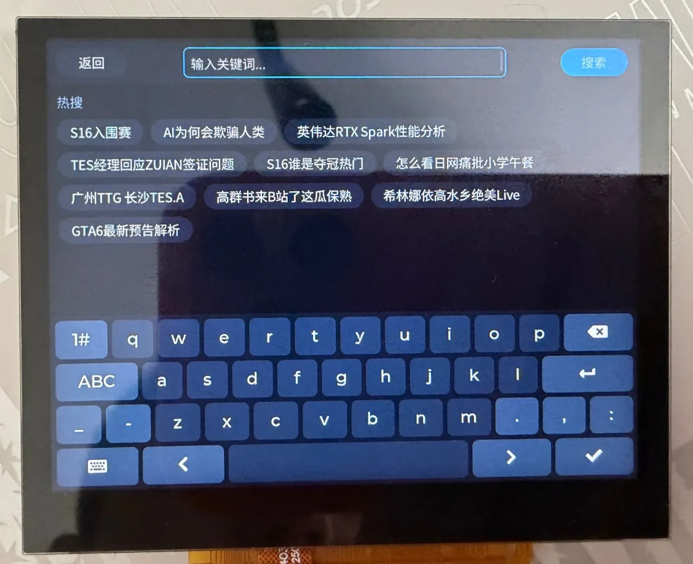

搜索页：左上是返回，中间是文本框（“输入关键词...”），右边是搜索按钮，下面是热搜词按钮，底部是 LVGL 键盘。用它输入拼音字母会通过拼音输入法给出中文候选；点一个热搜词就直接搜它。

搜索页是一个文本框、LVGL 键盘和 `lv_ime_pinyin`，后者按固件提供的字典逐个音节输入中文：

```mermaid
flowchart LR
    A["lv_keyboard"] --> B["lv_ime_pinyin"]
    C["bili_pinyin_dict"] --> B
    B --> D["候选面板"]
    D --> E["文本框"]
    E --> F["CMD_SEARCH"]
```

```c
kb = lv_keyboard_create(page);
ui_keyboard_style(kb);

ime = lv_ime_pinyin_create(page);
lv_ime_pinyin_set_dict(ime, (lv_pinyin_dict_t *)bili_pinyin_dict);
lv_ime_pinyin_set_keyboard(ime, kb);
```

字典（`src/ui/pinyin_dict.c`）由 `tools/make_pinyin_dict.py` 生成：对每个无声调音节，列出字体里有的字，按频率从高到低（频率来自 jieba 的词典，音节来自 pypinyin）。输入法取第一个以输入字母开头的条目，所以条目是排好序的，“ni”排在“nian”之前。输入框下面的热搜词行来自 `CMD_HOT`；点一下把词放进输入框并开始搜索。结果和其他列表一样；播放某个结果时，工作线程用 `/x/player/pagelist` 补上 `cid`。

### 播放页

```mermaid
stateDiagram-v2
    [*] --> Idle
    Idle --> Dragging: PRESSED
    Dragging --> Dragging: PRESSING / seek_move
    Dragging --> Idle: RELEASED / PRESS_LOST → player_seek
    note right of Dragging: v = 条上的 x，限制在已下载部分内
```

```c
/* The progress bar is also the place to seek: the finger sets the position, letting go jumps there. */
#define SEEK_MARGIN	8	/* thousandths kept back from the end of the downloaded part */

static void seek_move(void)
{
	/* lim: the position cannot go past what is downloaded */
	int v, lim = buffered >= 1000 ? 1000 : buffered - SEEK_MARGIN;
	lv_point_t p;

	lv_indev_get_point(lv_indev_active(), &p);
	v = (p.x - a.x1 - bar_x) * 1000 / bar_w;
	v = CLAMP(v, 0, MAX(lim, 0));
	drag_v = v;
	/* the time label, the bar and the knob follow the finger */
}

static void seek_event(lv_event_t *e)
{
	lv_event_code_t code = lv_event_get_code(e);

	touched();
	if (code == LV_EVENT_PRESSED) {
		dragging = true;
		seek_move();
	} else if (code == LV_EVENT_PRESSING) {
		if (dragging) {
			seek_move();
		}
	} else if ((code == LV_EVENT_RELEASED || code == LV_EVENT_PRESS_LOST) && dragging) {
		/* a finger that slides off the strip still sets the position */
		dragging = false;
		player_seek((uint32_t)((uint64_t)duration * drag_v / 1000));
	}
}
```

`buffered` 是已下载部分的千分比：下载的 `on_progress()` 用 `ui_set_buffered()` 设置它。进度条把两条条叠在一起画，已下载的部分和播放位置。按钮图标在 `LV_EVENT_DRAW_MAIN_END` 事件的 `icon_draw()` 里用 `lv_draw_line()`、`lv_draw_triangle()` 和 `lv_draw_rect()` 画出（播放是三角形，暂停是两条竖条，返回是一个尖括号），因为字体里没有符号。

四秒没有触摸后，栏会隐藏：

```mermaid
flowchart TD
    A["每一轮"] --> B{"栏可见、没暂停、4 秒没有触摸？"}
    B -- "是" --> C["show_bars(false)"]
    B -- "否" --> D["保持"]
    E["触摸或暂停"] --> F["show_bars(true)"]
```

```c
if (bars_visible && !paused && k_uptime_get() - last_touch > HIDE_MS) {
	show_bars(false);
}
```

一个提示条承载所有对用户说的话。它可见时弹幕不会当作图片移动（`ui_danmaku_run()` 里的 `!ui_play_msg_visible()`），因为提示条画在同一块区域。

### 账号

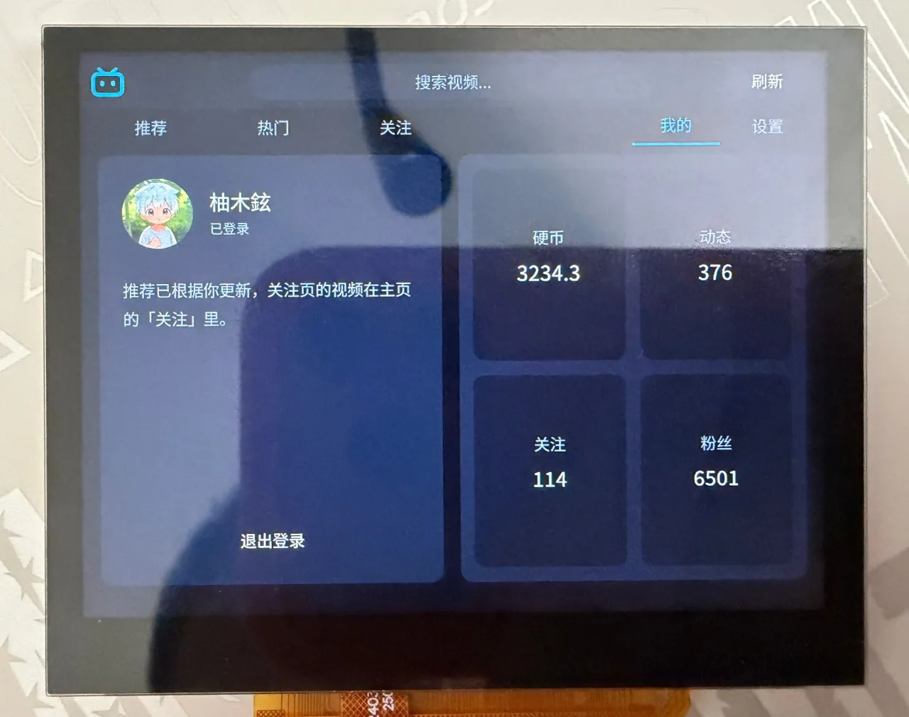

登录后的“我的”页：头像、名字和“已登录”，一行说明推荐已经按账号更新，退出登录按钮，以及硬币、动态、关注、粉丝四块数据。

登录使用网页的二维码流程，开始时不需要任何 cookie：

```mermaid
sequenceDiagram
    participant B as 开发板
    participant P as passport.bilibili.com
    B->>P: GET .../qrcode/generate
    P-->>B: data.url, data.qrcode_key
    loop 每 2 秒
        B->>P: GET .../qrcode/poll?qrcode_key
        P-->>B: data.code
    end
    P-->>B: code 0：cookie 在地址或 Set-Cookie 里
    B->>B: account_set_from_text
```

```c
int bili_api_qr_new(char *url, size_t url_size, char *key, size_t key_size)
{
	char *a = fetch(PASSPORT "/x/passport-login/web/qrcode/generate");
	/* data.url (what the code shows) and data.qrcode_key */
}

int bili_api_qr_poll(const char *key, int *state)
{
	/* GET .../qrcode/poll?qrcode_key=<key> */
	ret = bili_parse_qr_poll(a, state, NULL, 0);
	if (ret == 0 && *state == 0) {
		/* the cookies are in the address of the answer, or set by the server */
		ret = account_set_from_text(a);
		if (ret != 0 && r->set_cookie[0] != '\0') {
			ret = account_set_from_text(r->set_cookie);
		}
	}
}
```

轮询回包里的 `data.code` 是 `86101`（未扫码）、`86090`（已扫码，等待手机上确认）、`86038`（已过期）或 `0`（完成）。工作线程把它们映射成界面显示的状态：

```mermaid
stateDiagram-v2
    [*] --> QR_WAIT: 新二维码
    QR_WAIT --> QR_SCANNED: 86090
    QR_WAIT --> QR_EXPIRED: 86038
    QR_SCANNED --> QR_DONE: 0
    QR_WAIT --> QR_DONE: 0
    QR_DONE --> [*]: login_ready
    QR_WAIT --> QR_ERROR: 其他
```

```c
static void qr_poll(void)
{
	int state = -1, ret = bili_api_qr_poll(qr_key, &state);

	switch (state) {
	case 86101: qr_set(QR_WAIT);    break;
	case 86090: qr_set(QR_SCANNED); break;
	case 0:     qr_set(QR_DONE); login_ready(); break;
	case 86038: qr_set(QR_EXPIRED); break;
	default:    qr_set(QR_ERROR);   break;
	}
}
```

界面从一个定时器发出 `CMD_QR_POLL`，大约每两秒一次。二维码本身由 LVGL 的 `lv_qrcode` 画在白色圆角底座上。成功时回包里带有 `SESSDATA`、`bili_jct` 和 `DedeUserID`；`account.c` 用一个扫描器把它们从文本里取出（`text_value()` 接受查询串、cookie 列表或 JSON），保存在内存里并写入 `auth.cfg`：

```mermaid
flowchart LR
    A["回包文本或 Set-Cookie"] --> B["text_value ×3"]
    B --> C["SESSDATA, bili_jct, DedeUserID"]
    C --> D["保存在内存里"]
    C --> E["auth.cfg 在卡上"]
    D --> F["account_cookie() → Cookie:"]
```

```c
n = snprintf(buf, sizeof(buf), "SESSDATA=%s\nbili_jct=%s\nDedeUserID=%s\n", acc.sessdata, acc.jct, acc.uid);
```

从此 `account_cookie()` 把它们加进每个请求的 `Cookie:` 行（见上面的 `headers()`）。启动时用 `/x/web-interface/nav` 检查保存的登录，服务器不接受时就丢弃（`login_check()`）。登录之后重新加载推荐（现在是个人的），“关注”标签出现，账号页显示用户名、头像（`cover_load_square()`）、硬币数以及来自 `/x/web-interface/nav/stat` 的数字。

### Wi-Fi

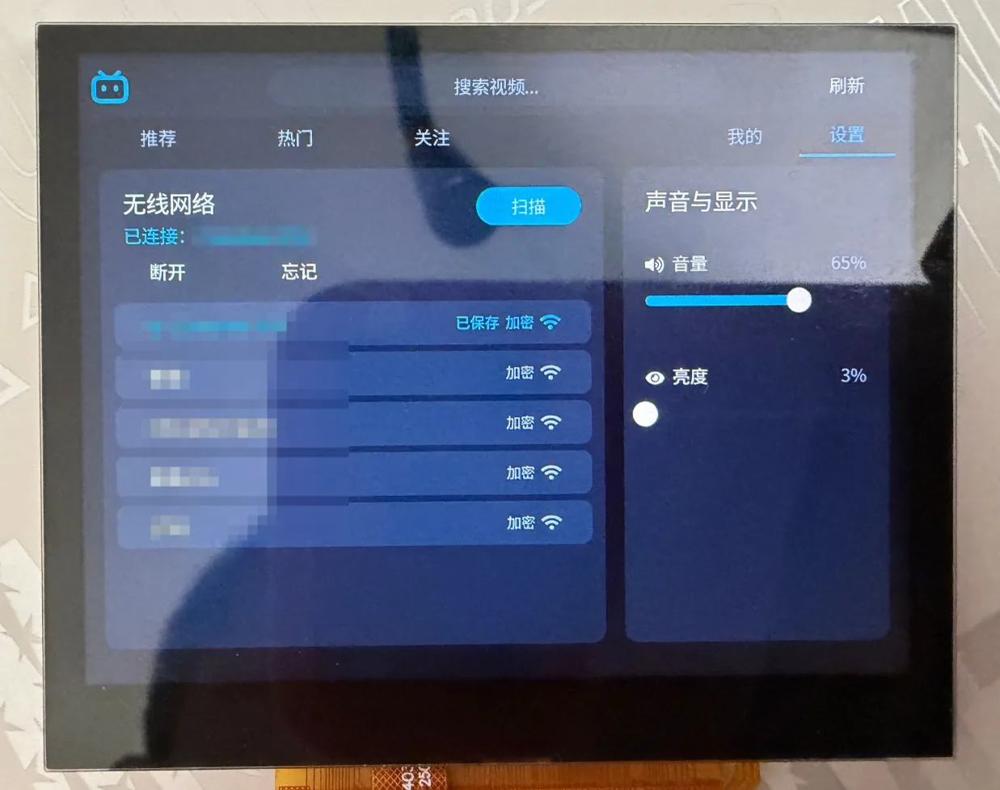

设置页。左边是无线网络卡片：扫描按钮、已连接的网络和断开、忘记按钮，以及扫描到的网络列表，标有已保存、加密和信号强度（照片里网络名做了模糊处理）。右边“声音与显示”是音量和亮度滑块。

`src/net/wifi.c` 在 Zephyr 的 Wi-Fi 管理之上保持一个小状态机：

```mermaid
flowchart TD
    A["wifi_join"] --> B{"已经连接？"}
    B -- "是" --> C["wifi_disconnect"]
    B -- "否" --> D["state = CONNECTING"]
    C --> D
    D --> E["net_mgmt(WIFI_CONNECT)"]
    E --> F{"-EBUSY ?"}
    F -- "是：最多 100 次" --> G["k_msleep(500)"] --> E
    F -- "否" --> H["等待：关联，然后 DHCP 地址"]
    H -- "失败" --> I["断开，state = FAILED"]
    H -- "成功" --> J["state = CONNECTED"]
```

```c
enum wifi_state { WIFI_DISCONNECTED, WIFI_CONNECTING, WIFI_CONNECTED, WIFI_FAILED };

int wifi_join(const char *ssid, const char *psk, int timeout_s)
{
	struct net_if *iface = net_if_get_first_wifi();
	struct wifi_connect_req_params p = {
		.ssid = ssid, .ssid_length = strlen(ssid),
		.psk = psk, .psk_length = strlen(psk),
		.security = strlen(psk) ? WIFI_SECURITY_TYPE_PSK : WIFI_SECURITY_TYPE_NONE,
		.channel = WIFI_CHANNEL_ANY, .band = WIFI_FREQ_BAND_UNKNOWN,
	};

	if (state != WIFI_DISCONNECTED) {
		wifi_disconnect();	/* another network, or the same one again: leave it first */
	}
	k_sem_reset(&connected);
	k_sem_reset(&got_ip);
	state = WIFI_CONNECTING;
	ret = net_mgmt(NET_REQUEST_WIFI_CONNECT, iface, &p, sizeof(p));
	/* the driver reports every join, also a failed one, after at most 20 s; a request while an
	 * earlier join runs is answered with -EBUSY, so it is asked again */
	for (int i = 0; ret == -EBUSY && i < 100; i++) {
		k_msleep(500);
		k_sem_reset(&connected);
		ret = net_mgmt(NET_REQUEST_WIFI_CONNECT, iface, &p, sizeof(p));
	}
	/* wait for the association, then for the DHCP address; stop the attempts on a failure,
	 * or a network that does not answer would join later */
}
```

两个信号量由网络管理事件的处理函数（`NET_EVENT_WIFI_CONNECT_RESULT`、`NET_EVENT_IPV4_ADDR_ADD`）给出。设置页显示状态和最后一次错误，用 `NET_REQUEST_WIFI_SCAN` 扫描，并提供断开、重新连接和忘记；忘记会删除 `wifi.cfg`，需要在 3 秒内点两次（第一次点击改变按钮文字并启动计时器）。音量和亮度是两个滑块：前者调用 `player_set_volume()`，后者对显示设备调用 `display_set_brightness()`；两者都由 `CMD_SAVE_SETTINGS` 保存到 `settings.cfg`，这样手指每动一步都不会去写卡。

## 板子上的网络

不经过代理直接运行时发现的一些事：

- <strong>所有连接都是 HTTPS</strong>，接口服务器和 CDN 都是，使用 Zephyr 的 TLS socket（mbedTLS）。默认不校验证书（`BILI_TLS_VERIFY` 可以打开）。每个连接都占内存：mbedTLS 堆是 256 KiB（`MBEDTLS_HEAP_SIZE`，四个连接时峰值 144 KiB），`NET_SOCKETS_TLS_MAX_CONTEXTS` 是 4（默认值 1 时第二次 `socket()` 会以 `ENOMEM` 失败）。
- <strong>源地址的 bug</strong>：网络协议栈按“目的地址与接口上某个地址的子网共有的前导位数”来选择连接的源地址。环回地址 127.0.0.1（子网 127.0.0.0）对所有首字节小于 128 的目的地址都会胜出，而 B 站的服务器全是这样的地址。SYN 于是发到了环回接口，协议栈自己回了一个 RST：`connect()` 在 0 到 1 ms 后以 `ECONNREFUSED` 失败，没有任何帧离开开发板，看上去就像服务器拒绝了这块板子（也让人觉得必须用代理）。`net_if_ipv4_get_best_match()` 现在在目的地址不是环回地址时跳过环回地址：

  ```mermaid
  flowchart TD
      A["为 dst 选源地址"] --> B["对接口上的每个地址"]
      B --> C{"是环回地址而 dst 不是环回？"}
      C -- "是" --> D["continue 跳过"]
      C -- "否" --> E["前导位匹配最长者胜出"]
      D --> B
      E --> F["源地址"]
  ```

  ```c
  if (net_ipv4_is_addr_loopback(&ipv4->unicast[i].ipv4.address.in_addr) &&
      !net_ipv4_is_addr_loopback((struct in_addr *)dst)) {
  	continue;
  }
  ```

  环回接口保留：Wi-Fi 驱动的控制 socket 要用 127.0.0.1。
- <strong>DNS</strong>：`api.bilibili.com` 会返回六个地址（`DNS_RESOLVER_AI_MAX_ENTRIES=8`），封面线程还会同时查名字（`DNS_NUM_CONCUR_QUERIES=6`）。
- <strong>网络缓冲区</strong>必须装得下 TCP 窗口；太少会丢包，每次丢包都要付出一次重传超时的代价。

## 内存

镜像约 10.4 MB（共 16 MB）；文本和只读数据（字体、Wi-Fi 固件）留在 flash 窗口里。板上实测：

| 状态 | 空闲 RAM |
| --- | --- |
| 首页，封面已加载 | 约 6 MB |
| 首页，封面已释放 | 约 9.5 MB |
| 播放器已打开（640×360） | 约 1.8 MB |

视频解码器的画面来自一个预算（`VDEC_SUNXI_MAX_MEMORY_KB`，这里是 6144；4300 时有些流会在 100 到 400 ms 处停住），`CONFIG_VDEC_SUNXI_H264_EXTRA_PICTURES` 保留备用画面（太少时画面会撕裂）。LVGL 代码、界面文件和封面解码器从 RAM 运行（`BILI_UI_RAM`）：flash 窗口里的代码在缓存未命中时很慢。

## 测试辅助

- `BILI_SELFTEST` 让界面在板子上自己运行：滚动若干轮、搜索、Wi-Fi 离开/加入/忘记一轮、播放热门视频并做一次暂停、一次恢复和九次快速点按钮。结束时打印 `selftest: PASS (0 failures)`，并检查每个视频之后空闲内存和 LVGL 堆是否回到参考值。
- `src/debug/crumbs.c` 的记录器把最近 256 次上下文切换和中断保存在复位不会清除的内存里，并有一个由线程每秒喂一次的看门狗，整个系统停住时复位开发板。复位后开发板停在 FEL，内存完好；<strong>不断电</strong>重新启动加载器，就会打印这个环（`S` 切入、`I` 进入中断、`X` 离开，然后是线程名；`N` 是代码用 `bili_crumb("...")` 留下的备注）。暂停时的死机就是这样找到的：最后一条备注是视频线程的 `r-grow`，而播放器读的是指向 `play()` 里内层块变量的指针。
- 主机测试（`tests/host/run.sh`，这个目录放在源码旁边，不是仓库的一部分）在构建机上带着 sanitizer 构建并运行 HTTP 解析器、JSON 读取器、MD5 和签名、用录下的回包做的解析、弹幕扫描器和解压器。

## 限制

- 只有 360P（一个 MP4 文件）；不用 720P 及以上。
- 很大的视频（热门列表里的 87 MB 文件）无法播放：解码器内存不够。
- 除非打开，否则不校验证书。
- 弹幕是纯文本，每条一种颜色；只显示滚动、顶部和底部弹幕。
- 不能评论、点赞、投币或发布；没有密码或短信登录。
