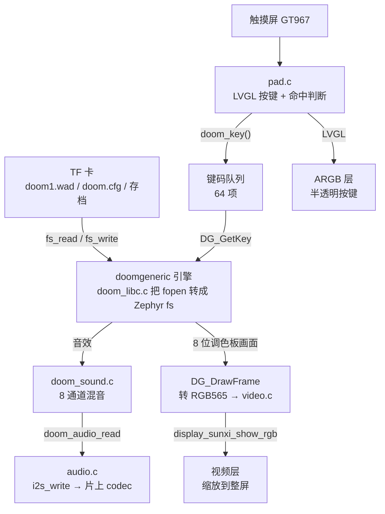
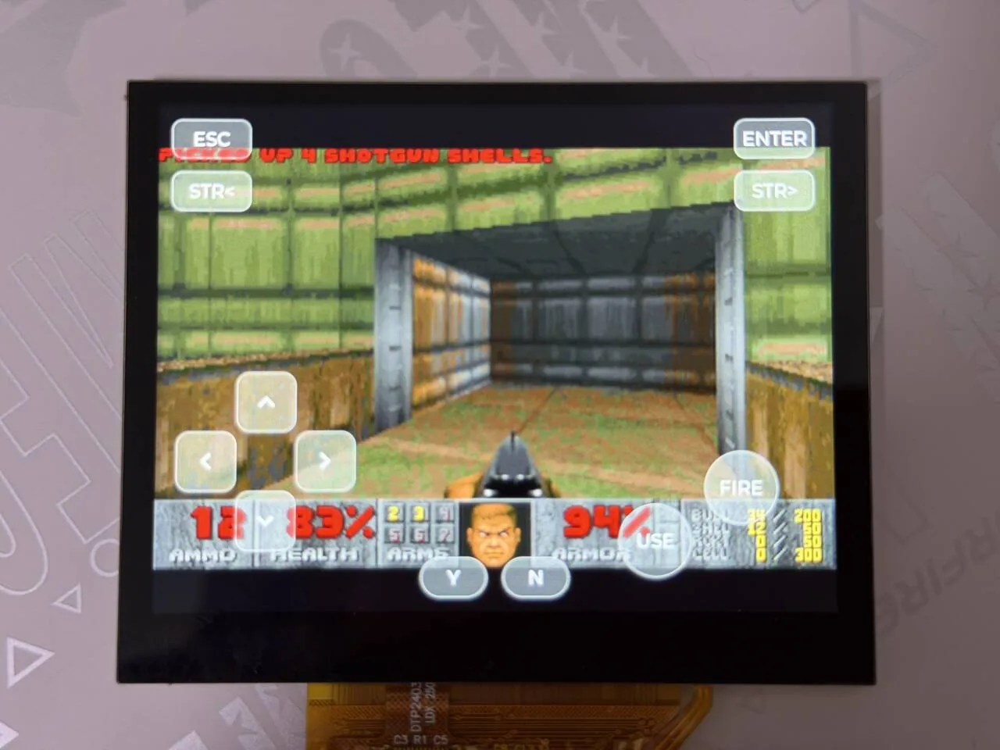
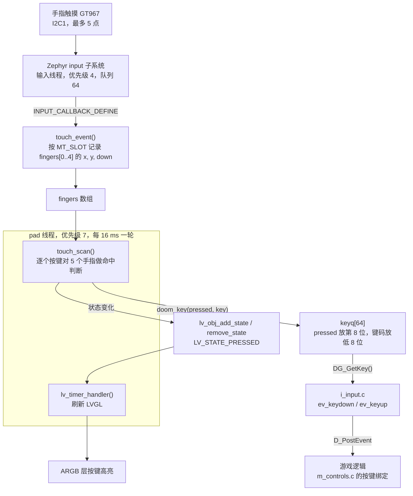

在板子上运行 Doom：游戏引擎用 [doomgeneric](https://github.com/ozkl/doomgeneric)（GPL-2.0），平台层、文件访问和声音混音由 `zephyr-components/doom` 提供。示例是 `samples/doom_player`：从 TF 卡读 WAD 文件，320×200 的画面送到显示的视频层并缩放到整屏，音效从片上 codec 输出，屏幕上用 LVGL 画一组半透明的虚拟按键，用触摸屏操作。



开始前请先完成 [配置开发环境](../zephyr-setup-env.md) 和 [获取 Zephyr 代码](../zephyr-get-source.md)。

## 准备游戏数据（WAD）

游戏数据放在 WAD 文件里，<strong>不在仓库里，需要自备</strong>。

| 来源 | 说明 |
| --- | --- |
| `doom1.wad` | id Software 的共享版（Shareware）数据，第一章。自行从可靠来源取得 |
| `doom.wad`、`doom2.wad` | 正版游戏的数据，来自你自己购买的游戏 |
| Freedoom | 社区制作的免费数据，采用修改版 BSD 许可，可以自由分发，从 [freedoom.github.io](https://freedoom.github.io) 下载 `freedoom1.wad` 或 `freedoom2.wad` |

### TF 卡怎么放

示例用 FatFs 读卡，格式要求和 [MP4 播放器](./mp4-player.md) 一样（FAT 或 exFAT，支持长文件名）。把 WAD 拷到 TF 卡<strong>根目录</strong>：

```text
F:\
├── doom1.wad        # 默认读这个文件名
├── doom.cfg         # 运行后由引擎生成：按键、音量等设置
└── .savegame\       # 运行后生成：存档
```

`main.c` 里先把 TF 卡挂载到 `/SD:`，再选 WAD：

```c
static FATFS fat_fs;
static struct fs_mount_t mp = {
	.type = FS_FATFS,
	.fs_data = &fat_fs,
	.mnt_point = "/SD:",
};

static char wad_path[128];

/* the configured WAD, or else the first .wad file in the root of the card */
static int pick_wad(void)
{
	struct fs_dirent ent;
	struct fs_dir_t dir;

	strncpy(wad_path, CONFIG_SAMPLE_DOOM_WAD, sizeof(wad_path) - 1);
	if (fs_stat(wad_path, &ent) == 0) {
		return 0;
	}
	fs_dir_t_init(&dir);
	if (fs_opendir(&dir, "/SD:") != 0) {
		return -ENOENT;
	}
	wad_path[0] = '\0';
	while (fs_readdir(&dir, &ent) == 0 && ent.name[0] != '\0') {
		size_t n = strlen(ent.name);

		if (ent.type == FS_DIR_ENTRY_FILE && n > 4 &&
		    (strcmp(ent.name + n - 4, ".wad") == 0 || strcmp(ent.name + n - 4, ".WAD") == 0)) {
			snprintf(wad_path, sizeof(wad_path), "/SD:/%s", ent.name);
			break;
		}
	}
	fs_closedir(&dir);

	return wad_path[0] == '\0' ? -ENOENT : 0;
}
```

规则：

- 先找 `CONFIG_SAMPLE_DOOM_WAD`（默认 `/SD:/doom1.wad`），文件存在就用它。
- 不存在就扫描根目录，用找到的<strong>第一个</strong> `.wad` 或 `.WAD`。不会进子目录。
- 都没有，串口打印 `no .wad file on the card` 后退出。

引擎里的文件访问也走 Zephyr 的文件系统：`src/doom_libc.c` 把 `fopen`、`fread`、`fwrite` 等换成 `fs_open`、`fs_read`、`fs_write`，相对路径（`./doom.cfg`、`.savegame/`）都落在 `doom_open()` 的第二个参数 `base_dir` 下，示例传的是 `/SD:`，所以配置和存档都写在卡的根目录。

## 编译

以下命令都在工作区里执行。doomgeneric 是 git 子模块，第一次编译前要把它取下来，否则 CMake 会报 `doomgeneric sources missing`：

```sh
cd ~/f101-zephyr/zephyr-components/doom
git submodule update --init doomgeneric
```

然后编译。示例的 `CMakeLists.txt` 自己把 `../..`（也就是 `doom` 组件）加进了 `ZEPHYR_EXTRA_MODULES`，不用在命令行再指定：

```sh
. ~/f101-zephyr/env.sh
cd ~/f101-zephyr
west build -b yuzukineko -d build/doom-app zephyr-components/doom/samples/doom_player
```

<div class="asciinema-cast" data-src="assets/casts/zephyr/apps-doom/build.cast" data-speed="6"></div>

产物是 `build/doom-app/zephyr/zephyr.bin`，约 4.8 MB（RAM 区使用 28.89%），链接地址 `0x40000000`。

## 运行

下载方式见 [编译与运行](../zephyr-build-run.md)：

```sh
xfel ddr f101-s3
xfel write 0x40000000 build/doom-app/zephyr/zephyr.bin
xfel exec 0x40000000
```

控制台是 UART1（115200 8N1）。TF 卡里放好 `doom1.wad` 再启动，下面按顺序说明串口和屏幕上会出现什么。

### 运行后的输出

<strong>1. 挂载 TF 卡并找到 WAD。</strong>`fs_mount()` 挂载 `/SD:`，`pick_wad()` 选定 WAD 后串口打印 `WAD <路径>`：

```text
WAD /SD:/doom1.wad
```

<strong>2. 引擎启动、读 WAD、写配置。</strong>`doom_open()` 初始化引擎，WAD 通过 `doom_libc.c` 里接到 Zephyr 文件系统的 `fopen`/`fread` 读出，配置文件写回卡上。串口依次打印引擎各个初始化阶段，直到图形初始化：

```text
Z_Init: Init zone memory allocation daemon. 
zone memory: 0x40566fe0, 600000 allocated for zone
M_LoadDefaults: Load system defaults.
	default file: /SD:/doom.cfg
saving config in /SD:/doom.cfg
W_Init: Init WADfiles.
 adding /SD:/doom1.wad
                            DOOM Shareware
...
S_Init: Setting up sound.
startskill 2  deathmatch: 0  startmap: 1  startepisode: 1
I_InitGraphics: DOOM screen size: w x h: 320 x 200
```

`zone memory` 的 `600000` 是十六进制，等于 6 MiB，和 `CONFIG_DOOM_ZONE_SIZE_MB` 的默认值一致。`saving config` 表示 `doom.cfg` 写到了卡的根目录。

<strong>3. 屏幕按键初始化。</strong>`pad_main()` 建完 12 个 LVGL 按键后打印一行 `pad:`，触摸屏路径（`HAS_TOUCH`）启用时显示 `touch on`。GT967 在这之前识别出 1024×768、最多 5 个触点：

```text
[00:00:00.564,000] <inf> gt967: GT967 firmware 0x1040, 1024x768
[00:00:00.569,000] <inf> gt967: configuration 0x63: 1024 x 768, up to 5 point(s), module switch 0x04
...
R_Init: Init DOOM refresh daemon - ..pad: 12 keys, display 1024x768, touch on
```

LVGL 显示的分辨率是 1024×768，所以后面说的 `dy` 是 168。

<strong>4. 主循环和帧统计。</strong>主循环每 5 秒打印一行统计：主循环轮数、出画面的张数、音频断流次数：

```text
doom: 342 passes, 342 pictures, sound underruns 0
doom: 351 passes, 351 pictures, sound underruns 0
```

每 5 秒约 350 轮、350 张画面，也就是每秒约 70 张，`sound underruns` 保持 0。游戏逻辑是引擎固定的 35 tic 每秒，这里的画面数是主循环里 `DG_DrawFrame()` 被调用的次数。

屏幕上是游戏画面，上面叠着半透明的虚拟按键：



照片里是进入关卡后的画面：Doom 的画面放大后显示在面板中间，底部是弹药、生命值、护甲的状态栏，左上角的红字是拾取提示 `PICKED UP 4 SHOTGUN SHELLS.`。半透明的虚拟按键叠在画面上：左上角 ESC、右上角 ENTER，它们下面是向左、向右平移的 STR<、STR>；左下角是方向键；右侧是开火的 FIRE 和 USE（开门、操作）两个圆键；底部中间是 Y、N。

## 画面输出

画面从引擎到屏幕经过三步。

<strong>1. 引擎出画面。</strong>`CMAP256` 模式下引擎画 320×200 的 8 位索引图，存在 `DG_ScreenBuffer`。`src/doom_port.c` 的 `DG_DrawFrame()` 用引擎的调色板把它转成 RGB565，写进应用给的缓冲区：

```c
void DG_DrawFrame(void)
{
	const uint8_t *src = (const uint8_t *)DG_ScreenBuffer;

	if (palette_changed) {
		for (int i = 0; i < 256; i++) {
			palette565[i] = ((colors[i].r & 0xf8) << 8) | ((colors[i].g & 0xfc) << 3) |
					(colors[i].b >> 3);
		}
		palette_changed = false;
	}
	if (out_buf == NULL) {
		return;
	}
	for (int i = 0; i < DOOM_WIDTH * DOOM_HEIGHT; i++) {
		out_buf[i] = palette565[src[i]];
	}
	drawn = 1;
}
```

调色板只有在引擎改过时（受伤变红、拾取变黄等）才重新算一遍。

<strong>2. 应用轮换缓冲区。</strong>`main.c` 的主循环每轮先问 `video_acquire()` 要下一块缓冲区，让引擎画进去，有新画面再 `video_present()`：

```c
	while (true) {
		doom_set_frame_buffer(video_acquire());
		if (doom_run_frame()) {
			video_present(DOOM_WIDTH, DOOM_HEIGHT);
			drawn++;
		}
```

`video.c` 一共分配 4 块 `320 × 200 × 2` 字节的缓冲区（`NBUF`），`video_present()` 先把数据缓存刷到内存，再唤醒 `video` 线程。

<strong>3. 送显示。</strong>`video` 线程调 `display_sunxi_show_rgb()`，把 RGB565 图交给显示引擎的缩放视频层，硬件缩放到整个屏幕（板子的屏是 1024×768）：

```c
		img.data = buf[idx];
		img.width = ready_w;
		img.height = ready_h;
		img.stride = STRIDE;
		img.nonblock = false;
		ret = display_sunxi_show_rgb(disp, &img);
```

这个调用可能要等下一次刷新，所以放在单独的线程里，不拖慢引擎；线程只显示最新的那一张。

LVGL 的按键画在另一层：`CONFIG_DISPLAY_SUNXI_ARGB8888=y` 打开 ARGB8888 帧缓冲层，叠在视频层之上，所以按键是半透明地盖在游戏画面上。`prj.conf` 里没有设置 `CONFIG_DISPLAY_SUNXI_FB_WINDOW_WIDTH/HEIGHT`，两者都是 0。

## 声音

只有音效，<strong>不播放音乐</strong>。

- `src/doom_sound.c` 把 WAD 里 8 位无符号单声道的音效按需混成 16 位立体声，最多 <strong>8 个通道</strong>（`NUM_CHANNELS`），带线性插值和左右声像。
- `audio.c` 起一个 `audio` 线程（优先级 3），每次取 512 帧（`BLOCK_FRAMES`），调 `doom_audio_read()` 拿混好的数据，再 `i2s_write()` 送给 codec。codec 按固定速率消耗，这就是节奏来源；队列里预先填 2 块（`PREFILL`）才启动 I2S。
- 输出采样率是 `CONFIG_SAMPLE_DOOM_RATE`，默认 48000；`main()` 先 `doom_audio_init(RATE)` 再 `audio_init(RATE)`。
- 音量在 `audio.c` 里写死：

```c
	audio_codec_start_output(ctl);
	audio_codec_set_property(ctl, AUDIO_PROPERTY_OUTPUT_VOLUME, AUDIO_CHANNEL_ALL,
				 (audio_property_value_t){.vol = 150});
```

范围 0–255，要调大调小就改 `.vol`。`I2S_TRIGGER_START` 之后如果 `i2s_write()` 返回 `-EIO`，说明数据断了，计一次 underrun 并重新预填；这个计数就是 5 秒统计行里的 `sound underruns`。

不要声音：在 `prj.conf` 里写 `CONFIG_DOOM_SOUND=n`，组件会改用 `doom_port.c` 里返回静音的 `doom_audio_read()`。

## 触摸屏上的虚拟按键

按键全部在 `samples/doom_player/src/pad.c` 里，下面按“怎么建控件”“触摸怎么变成键码”“怎么进引擎”“怎么改布局”来讲。

### 数据流



要点：

- <strong>不走 LVGL 的指针输入</strong>。LVGL 的指针设备一次只处理一个手指，而游戏要同时按方向键和开火。所以有触摸屏时，手指位置直接从 Zephyr 的 input 事件读，按键控件只负责显示状态。
- 触摸屏是设备树里 `chosen` 的 `zephyr,touch`，这块板子上就是 GT967。`HAS_TOUCH` 用 `DT_NODE_EXISTS(DT_CHOSEN(zephyr_touch))` 判断，没有触摸屏的板子会走另一条路径，见下面。

### LVGL 控件怎么创建

每个按键是一个 `lv_button` 加一个 `lv_label`，由 `key_add()` 创建，位置用 `LV_ALIGN_TOP_LEFT` 加偏移：

```c
static void key_add(int x, int y, int w, int h, const char *text, unsigned char key, int radius)
{
	lv_obj_t *b = lv_button_create(lv_screen_active());
	lv_obj_t *l = lv_label_create(b);

	lv_obj_set_size(b, w, h);
	lv_obj_align(b, LV_ALIGN_TOP_LEFT, x, y);
	lv_obj_set_style_radius(b, radius, 0);
	lv_obj_set_style_bg_color(b, lv_color_white(), 0);
	lv_obj_set_style_bg_opa(b, LV_OPA_30, 0);
	lv_obj_set_style_bg_color(b, lv_color_make(255, 200, 60), LV_STATE_PRESSED);
	lv_obj_set_style_bg_opa(b, LV_OPA_70, LV_STATE_PRESSED);
	lv_obj_set_style_border_color(b, lv_color_white(), 0);
	lv_obj_set_style_border_opa(b, LV_OPA_50, 0);
	lv_obj_set_style_border_width(b, 2, 0);
	lv_obj_set_style_shadow_width(b, 0, 0);
	lv_obj_set_style_text_font(l, &lv_font_montserrat_28, 0);
	lv_obj_set_style_text_color(l, lv_color_white(), 0);
	lv_label_set_text(l, text);
	lv_obj_center(l);
#if !HAS_TOUCH
	lv_obj_add_event_cb(b, key_event, LV_EVENT_ALL, (void *)(uintptr_t)key);
#endif

	if (nkeys < MAX_KEYS) {
		pad_keys_tbl[nkeys++] = (struct pad_key){
			.obj = b, .x = x, .y = y, .w = w, .h = h, .key = key,
		};
	}
}
```

- 常态是 30% 不透明的白色，按下（`LV_STATE_PRESSED`）变成 70% 不透明的橙黄色，所以按下去一目了然。
- `radius` 控制形状：方向键、功能键用小圆角，FIRE、USE 传 `LV_RADIUS_CIRCLE` 变成圆形，Y、N 是药丸形。
- 字体是 `lv_font_montserrat_28`（`prj.conf` 里 `CONFIG_LV_FONT_MONTSERRAT_28=y`）；方向键的图案用 LVGL 内置符号 `LV_SYMBOL_LEFT` 等。
- 每建一个按键，同时往 `pad_keys_tbl[]` 登记一条（位置、大小、键码），命中判断就靠这张表。表只有 `MAX_KEYS` 项，超出的按键<strong>会画出来但不会响应触摸</strong>。

屏幕本身要先设成透明，否则按键后面是黑底，把下面的视频层盖住了。`pad_main()` 一开头做了这件事，然后建全部 12 个按键，建完打印一行 `pad:` 日志：

```c
static void pad_main(void *a, void *b, void *c)
{
	lv_obj_set_style_bg_opa(lv_screen_active(), LV_OPA_TRANSP, 0);

	/*
	 * The layout was drawn for a 1024x600 panel, the keys at the bottom stay at the bottom of
	 * a taller one. The picture is scaled to the middle.
	 */
	const int dy = lv_display_get_vertical_resolution(NULL) - 600;

	key_add(30, 330 + dy, 90, 90, LV_SYMBOL_LEFT, DOOM_KEY_LEFT, 20);
	key_add(210, 330 + dy, 90, 90, LV_SYMBOL_RIGHT, DOOM_KEY_RIGHT, 20);
	key_add(120, 240 + dy, 90, 90, LV_SYMBOL_UP, DOOM_KEY_UP, 20);
	key_add(120, 420 + dy, 90, 90, LV_SYMBOL_DOWN, DOOM_KEY_DOWN, 20);

	key_add(830, 360 + dy, 110, 110, "FIRE", DOOM_KEY_FIRE, LV_RADIUS_CIRCLE);
	key_add(700, 440 + dy, 110, 110, "USE", DOOM_KEY_USE, LV_RADIUS_CIRCLE);

	key_add(20, 20, 120, 60, "ESC", DOOM_KEY_ESCAPE, 16);
	key_add(880, 20, 120, 60, "ENTER", DOOM_KEY_ENTER, 16);
	key_add(20, 100, 120, 60, "STR<", DOOM_KEY_STRAFE_L, 16);
	key_add(880, 100, 120, 60, "STR>", DOOM_KEY_STRAFE_R, 16);
	key_add(400, 520 + dy, 100, 60, "Y", DOOM_KEY_Y, 30);
	key_add(524, 520 + dy, 100, 60, "N", DOOM_KEY_N, 30);
	printk("pad: %d keys, display %dx%d, touch %s\n", nkeys,
	       lv_display_get_horizontal_resolution(NULL), lv_display_get_vertical_resolution(NULL),
	       HAS_TOUCH ? "on" : "off");

	while (true) {
#if HAS_TOUCH
		touch_scan();
#endif
		lv_timer_handler();
		k_msleep(16);
	}
}
```

坐标是按 1024×600 画的；`dy` 是实际屏幕高度减 600，这块板子是 1024×768，所以 `dy` 是 168，下半部分的按键整体下移，贴着屏幕底边。顶部的 ESC、ENTER、STR< 、STR> 不加 `dy`，固定在上方。

线程由 `pad_start()` 创建（栈 4096 字节，优先级 7），在 `main.c` 里调用，时机在 `doom_open()` 之前：

```c
int pad_start(void)
{
	k_tid_t tid = k_thread_create(&thread, pad_stack, STACK_SIZE, pad_main, NULL, NULL, NULL,
				      PRIORITY, 0, K_NO_WAIT);

	k_thread_name_set(tid, "pad");

	return 0;
}
```

### 触摸怎么变成键码

第一步：接收 input 事件。GT967 驱动按“多点触摸槽”（MT slot）上报，回调只负责把每个槽的坐标和按下状态记下来：

```c
#define TOUCH_SLOTS	5

static struct {
	int x, y;
	bool down;
} fingers[TOUCH_SLOTS];
static int cur_slot;

static void touch_event(struct input_event *evt, void *user_data)
{
	switch (evt->code) {
	case INPUT_ABS_MT_SLOT:
		cur_slot = CLAMP(evt->value, 0, TOUCH_SLOTS - 1);
		break;
	case INPUT_ABS_X:
		fingers[cur_slot].x = evt->value;
		break;
	case INPUT_ABS_Y:
		fingers[cur_slot].y = evt->value;
		break;
	case INPUT_BTN_TOUCH:
		fingers[cur_slot].down = evt->value != 0;
		break;
	}
}
INPUT_CALLBACK_DEFINE(DEVICE_DT_GET(DT_CHOSEN(zephyr_touch)), touch_event, NULL);
```

触摸坐标是屏幕坐标（1024×768），和按键的坐标是同一个坐标系，可以直接比较。回调跑在 input 子系统的线程里，`boards/yuzukineko.conf` 把这个线程的优先级提到 4（高于 pad 线程的 7，也高于游戏所在的主线程的 6），队列加到 64，这样游戏一帧耗时较长时手指的事件也不会丢：

```text
CONFIG_INPUT=y
CONFIG_INPUT_GT967_MAX_TOUCH_POINTS=5
CONFIG_INPUT_THREAD_PRIORITY_OVERRIDE=y
CONFIG_INPUT_THREAD_PRIORITY=4
CONFIG_INPUT_QUEUE_MAX_MSGS=64
```

第二步：`touch_scan()` 每 16 ms 由 pad 线程调用一次，对每个按键检查 5 个手指有没有落在它的矩形（四周各扩大 `HIT_MARGIN` = 12 像素）里：

```c
static void touch_scan(void)
{
	uint32_t now = k_uptime_get_32();

	for (int k = 0; k < nkeys; k++) {
		struct pad_key *key = &pad_keys_tbl[k];
		bool pressed = false;

		for (int f = 0; f < TOUCH_SLOTS; f++) {
			if (fingers[f].down && fingers[f].x >= key->x - HIT_MARGIN &&
			    fingers[f].x < key->x + key->w + HIT_MARGIN &&
			    fingers[f].y >= key->y - HIT_MARGIN &&
			    fingers[f].y < key->y + key->h + HIT_MARGIN) {
				pressed = true;
			}
		}
		if (pressed) {
			key->hold_until = now + RELEASE_HOLD_MS;
		} else if ((int32_t)(now - key->hold_until) < 0) {
			pressed = true;
		}
		if (pressed != key->shown) {
			if (pressed) {
				lv_obj_add_state(key->obj, LV_STATE_PRESSED);
			} else {
				lv_obj_remove_state(key->obj, LV_STATE_PRESSED);
			}
			doom_key(pressed ? 1 : 0, key->key);
			key->shown = pressed;
		}
	}
}
```

几个细节：

- 手指可以同时按在多个按键上，每个按键独立判断，所以“前进 + 开火 + 向左转”可以同时按。
- 手指滑出一个按键、滑进另一个，会自然地释放前一个、按下后一个。
- <strong>`RELEASE_HOLD_MS` = 50 ms 的保持</strong>：控制器偶尔会有一帧漏报手指（手指其实还在玻璃上），按“松开再按下”处理会让游戏里出现一次抖动，所以松开后键还会保持 50 ms。
- 只在状态<strong>变化</strong>时才调 `doom_key()`，所以队列里只有“按下”和“松开”两种事件，不会每 16 ms 灌一次。同时用 `lv_obj_add_state` / `lv_obj_remove_state` 更新控件外观。

### 键码怎么进引擎

`doom_key()` 把事件放进一个 64 项的环形队列，`pressed` 放在第 8 位，键码放低 8 位，读写指针都是原子变量，所以可以从任意线程调用（`src/doom_port.c`）：

```c
#define KEYQUEUE_SIZE 64

static uint16_t keyq[KEYQUEUE_SIZE];
static atomic_t key_w, key_r;

int DG_GetKey(int *pressed, unsigned char *key)
{
	atomic_val_t r = atomic_get(&key_r);
	uint16_t k;

	if (r == atomic_get(&key_w)) {
		return 0;
	}
	k = keyq[r % KEYQUEUE_SIZE];
	atomic_set(&key_r, r + 1);
	*pressed = k >> 8;
	*key = k & 0xff;

	return 1;
}

void doom_key(int pressed, unsigned char key)
{
	atomic_val_t w = atomic_get(&key_w);

	if (w - atomic_get(&key_r) >= KEYQUEUE_SIZE) {
		return;
	}
	keyq[w % KEYQUEUE_SIZE] = (pressed ? 0x100 : 0) | key;
	atomic_set(&key_w, w + 1);
}
```

队列满了就丢弃新事件。引擎每次 `doom_run_frame()` 的输入阶段会不断调 `DG_GetKey()`，直到取空（`i_input.c`），把按下转成 `ev_keydown`、松开转成 `ev_keyup` 并 `D_PostEvent()`。移植层不做键码翻译：`TranslateKey()` 直接返回原值。

所以键码就是 <strong>doomgeneric 引擎自己的键码</strong>。`include/doom_zephyr/doom.h` 里给出了常用的几个：

| 宏 | 值 | 引擎里的默认功能 |
| --- | --- | --- |
| `DOOM_KEY_UP` | `0xad` | 前进 |
| `DOOM_KEY_DOWN` | `0xaf` | 后退 |
| `DOOM_KEY_LEFT` | `0xac` | 向左转 |
| `DOOM_KEY_RIGHT` | `0xae` | 向右转 |
| `DOOM_KEY_STRAFE_L` | `0xa0` | 向左平移 |
| `DOOM_KEY_STRAFE_R` | `0xa1` | 向右平移 |
| `DOOM_KEY_USE` | `0xa2` | 开门、按开关 |
| `DOOM_KEY_FIRE` | `0xa3` | 开火 |
| `DOOM_KEY_ESCAPE` | `27` | 菜单、返回 |
| `DOOM_KEY_ENTER` | `13` | 菜单里确认 |
| `DOOM_KEY_TAB` | `9` | 地图 |
| `DOOM_KEY_SHIFT` | `0x80 + 0x36` | 跑步 |
| `DOOM_KEY_CTRL` | `0x80 + 0x1d` | （引擎的右 Ctrl） |
| `DOOM_KEY_ALT` | `0x80 + 0x38` | （引擎的右 Alt，平移修饰键） |
| `DOOM_KEY_Y`、`DOOM_KEY_N` | `'y'`、`'n'` | 菜单里的 Yes / No（比如退出确认） |

字母和数字键就是它们的 ASCII 小写值（比如 `'1'` 到 `'7'` 选武器）。其他引擎键码见 `doomgeneric/doomgeneric/doomkeys.h`，默认的按键绑定在 `m_controls.c`（比如 `key_fire = KEY_FIRE`）。

注意：示例里默认画出来的 12 个按键<strong>没有</strong> SHIFT（跑步）、TAB（地图）和武器切换键。需要的话看下一节自己加。

### 没有触摸屏的板子

`!HAS_TOUCH` 时，每个按键会挂一个 LVGL 事件回调，由 LVGL 的指针设备驱动：

```c
#if !HAS_TOUCH
static void key_event(lv_event_t *e)
{
	unsigned char key = (unsigned char)(uintptr_t)lv_event_get_user_data(e);
	lv_event_code_t code = lv_event_get_code(e);

	if (code == LV_EVENT_PRESSED) {
		doom_key(1, key);
	} else if (code == LV_EVENT_RELEASED || code == LV_EVENT_PRESS_LOST) {
		doom_key(0, key);
	}
}
#endif
```

这一支只能同时按一个键，而且需要板子自己配置 LVGL 的指针输入设备（比如鼠标或触控板）；示例没有配置。

### 怎么改按键布局

所有改动都在 `pad.c`。

<strong>1. 改位置、大小、文字、形状。</strong>直接改 `pad_main()` 里 `key_add(x, y, w, h, 文字, 键码, 圆角)` 的参数。坐标以 1024×600 为基准，下半部分加 `dy`，上半部分不加。

<strong>2. 改按键对应的功能。</strong>换第 6 个参数，比如把 USE 换成空格（引擎里的 `' '`）或者把某个键改成 `DOOM_KEY_SHIFT`（跑步）。

<strong>3. 增加按键。</strong>先把 `MAX_KEYS` 从 12 调大（现在 12 个正好用满），再在 `pad_main()` 里加 `key_add`。下面是示例：

```c
#define MAX_KEYS	16

	/* 在 pad_main() 里，其他 key_add 后面 */
	key_add(30, 520 + dy, 90, 60, "RUN", DOOM_KEY_SHIFT, 16);
	key_add(130, 520 + dy, 90, 60, "MAP", DOOM_KEY_TAB, 16);
	key_add(240, 520 + dy, 60, 60, "1", '1', 16);   /* 选武器 1 */
	key_add(310, 520 + dy, 60, 60, "2", '2', 16);   /* 选武器 2 */
```

新增的按键位置不要和已有的按键重叠，否则一个手指会同时命中两个键。

<strong>4. 调整手感。</strong>

| 常量 | 默认 | 作用 |
| --- | --- | --- |
| `MAX_KEYS` | 12 | 按键表的容量，也是能响应触摸的按键数上限 |
| `HIT_MARGIN` | 12 | 命中区域在按键四周扩大的像素数，调大更容易按中，但相邻按键的区域会重叠 |
| `RELEASE_HOLD_MS` | 50 | 手指离开后键继续保持的毫秒数 |
| `TOUCH_SLOTS` | 5 | 同时处理的手指数，不能超过 `CONFIG_INPUT_GT967_MAX_TOUCH_POINTS` |
| `PRIORITY` | 7 | pad 线程优先级（数值大则优先级低） |

<strong>5. 想去掉按键。</strong>删掉对应的 `key_add` 那一行就行。键盘类的输入（比如 USB 键盘）示例没有接，要接的话也是调 `doom_key()`。

## 功能与修改位置

| 功能 | 位置 | 怎么改 |
| --- | --- | --- |
| WAD 路径 | `Kconfig` 的 `SAMPLE_DOOM_WAD`；`main.c` 的 `pick_wad()` | 改选项，或改函数里的搜索规则 |
| 配置、存档目录 | `main.c` 的 `doom_open(wad_path, "/SD:")` | 改第二个参数 |
| 游戏内存 | `CONFIG_DOOM_ZONE_SIZE_MB`（默认 6） | 改选项，范围 4–32；游戏一次从堆里分配这么多 |
| 画面缓冲 | `video.c` 的 `NBUF`（4） | 一般不用改 |
| 音量 | `audio.c` 里的 `.vol = 150` | 改值（0–255） |
| 声音采样率 | `CONFIG_SAMPLE_DOOM_RATE` | 默认 48000 |
| 虚拟按键布局 | `pad.c` 的 `pad_main()` | 见上一节 |
| 统计打印间隔 | `main.c` 的 `REPORT_MS`（5000） | 改宏 |

主循环每轮：`doom_run_frame()` 让引擎处理输入、跑到期的游戏 tic（没有到期的就等，等待通过 `DG_SleepMs()` 调用 `k_msleep()`），再做声音和画面。引擎用 `DG_GetTicksMs()`（`k_uptime_get_32()`）计时。

## 配置选项

### 组件（`zephyr-components/doom/Kconfig`）

| 选项 | 默认 | 说明 |
| --- | --- | --- |
| `CONFIG_DOOM` | n | 编译 doomgeneric 引擎和平台层，依赖 RISCV，并自动选上 `FILE_SYSTEM` |
| `CONFIG_DOOM_ZONE_SIZE_MB` | 6 | 引擎的内存区大小，单位 MiB，范围 4–32 |
| `CONFIG_DOOM_SOUND` | y | 混音音效，依赖 `I2S` 和 `AUDIO_CODEC`；音乐不播放 |

### 示例（`samples/doom_player/Kconfig`）

| 选项 | 默认 | 说明 |
| --- | --- | --- |
| `CONFIG_SAMPLE_DOOM_WAD` | `"/SD:/doom1.wad"` | 要加载的 WAD，找不到时退回到根目录第一个 `.wad` |
| `CONFIG_SAMPLE_DOOM_RATE` | 48000 | 声音输出采样率 |

改法：

```sh
west build -b yuzukineko -d build/doom-app zephyr-components/doom/samples/doom_player -- -DCONFIG_SAMPLE_DOOM_WAD='"/SD:/freedoom1.wad"'
```

### `prj.conf` 里的主要选项

| 选项 | 作用 |
| --- | --- |
| `CONFIG_DOOM=y` | 引入 Doom 组件 |
| `CONFIG_CRC=y` | CRC 库 |
| `CONFIG_SDHC=y` | SD 主机控制器驱动 |
| `CONFIG_DISK_ACCESS=y` | 磁盘访问接口 |
| `CONFIG_DISK_DRIVER_SDMMC=y` | 把 SD/MMC 卡作为磁盘 |
| `CONFIG_FILE_SYSTEM=y` | 文件系统接口 |
| `CONFIG_FAT_FILESYSTEM_ELM=y` | FatFs |
| `CONFIG_FS_FATFS_EXFAT=y` | 支持 exFAT 的卡 |
| `CONFIG_FS_FATFS_LFN=y` | 长文件名 |
| `CONFIG_MAIN_STACK_SIZE=16384` | 主线程栈，引擎在主线程里跑 |
| `CONFIG_COMMON_LIBC_MALLOC_ARENA_SIZE=-1` | 让 libc 的 malloc 用掉剩余内存，引擎的内存区从这里分配 |
| `CONFIG_HEAP_MEM_POOL_SIZE=262144` | 内核堆 |
| `CONFIG_MAIN_THREAD_PRIORITY=6` | 主线程（游戏）优先级 |
| `CONFIG_FPU=y`、`CONFIG_FPU_SHARING=y` | 硬件浮点，多线程共用 |
| `CONFIG_I2S=y`、`CONFIG_AUDIO=y`、`CONFIG_AUDIO_CODEC=y` | 声音输出 |
| `CONFIG_DMA=y` | I2S 用的 DMA |
| `CONFIG_DISPLAY=y` | 显示驱动 |
| `CONFIG_DISPLAY_SUNXI_ARGB8888=y` | ARGB 层，LVGL 按键画在这一层 |
| `CONFIG_LVGL=y` | LVGL 图形库 |
| `CONFIG_LV_COLOR_DEPTH_32=y` | 32 位色深，匹配 ARGB8888 |
| `CONFIG_LV_Z_MEM_POOL_SIZE=131072` | LVGL 的内存池 |
| `CONFIG_LV_Z_VDB_SIZE=4` | LVGL 的绘制缓冲占显示的百分比 |
| `CONFIG_LV_FONT_MONTSERRAT_28=y` | 按键文字用的字体 |
| `CONFIG_LV_FONT_MONTSERRAT_16=y` | 16 号字体，按键代码没有直接用到 |

`boards/yuzukineko.conf` 里的触摸屏选项（`CONFIG_I2C`、`CONFIG_INPUT`、`CONFIG_INPUT_GT967_MAX_TOUCH_POINTS=5` 和输入线程的优先级、队列长度）见前面“触摸怎么变成键码”一节。

## 代码结构

| 文件 | 内容 |
| --- | --- |
| `zephyr-components/doom/src/doom_port.c` | `DG_*` 平台函数、键码队列、`doom_open()` / `doom_run_frame()` |
| `zephyr-components/doom/src/doom_libc.c` | 把 `fopen` 等文件流函数接到 Zephyr 文件系统 |
| `zephyr-components/doom/shim/` | 强制包含的头文件，补 libc 缺的函数 |
| `zephyr-components/doom/src/doom_sound.c` | 音效混音 |
| `zephyr-components/doom/include/doom_zephyr/doom.h` | 对应用开放的 API 和键码 |
| `zephyr-components/doom/doomgeneric/` | doomgeneric 引擎（git 子模块） |
| `samples/doom_player/src/main.c` | 挂载 TF 卡、选 WAD、主循环 |
| `samples/doom_player/src/video.c` | 画面缓冲轮换、送视频层 |
| `samples/doom_player/src/audio.c` | 音频线程，送 codec |
| `samples/doom_player/src/pad.c` | LVGL 虚拟按键和触摸处理 |

## 功能范围

- 只有音效，不播放音乐。
- 音效最多同时 8 个通道。
- 画面固定 320×200，缩放到整屏；不支持改分辨率。
- 音量写死在 `audio.c`；需要调节时改 `.vol`。
- 输入只有触摸屏，最多同时处理 5 个手指；需要键盘等输入时在对应位置调 `doom_key()`。
- 不支持联机和手柄。
- 默认的 12 个虚拟按键没有跑步、地图、武器切换；需要时按“怎么改按键布局”一节添加。
