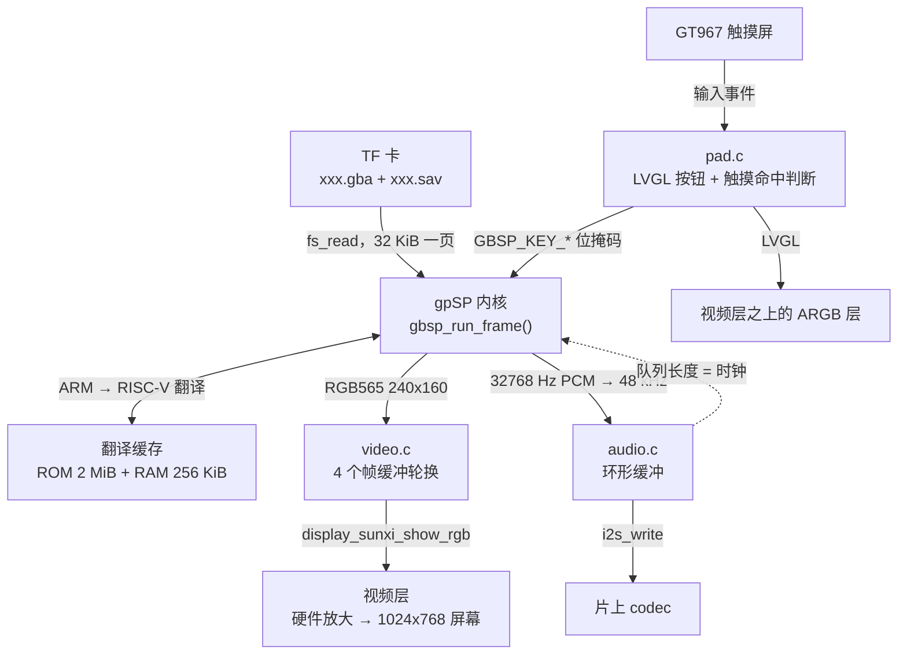
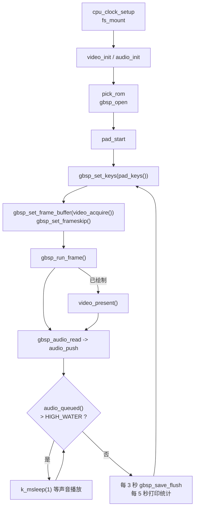

用 [gpSP](https://github.com/libretro/gpsp) 内核在板子上运行 Game Boy Advance 游戏，带 <strong>RISC-V 动态重编译器</strong>：游戏的 ARM 代码在运行时被翻译成 RISC-V 代码并原生执行，而不是逐条解释。ROM 从 TF 卡读取，240×160 的游戏画面交给显示引擎的视频层并放大到整个屏幕，声音经片上 codec 走 I2S 输出，屏幕上叠加一层用 LVGL 画的半透明按钮，用触摸屏操作。代码在 `zephyr-components/gbsp`（GPL-2.0-or-later），示例是 `samples/gbsp_player`。

它是 [mGBA](mgba.md) 之外的第二个 GBA 内核。接口相同（`gbsp_*` 函数与 mGBA 的 `gba_*` 函数含义一致），示例选项和主循环也相同，所以可以在同一个游戏上对比两个内核，也可以把两者链接进同一个镜像。同一个 ROM 上 gpSP 每帧耗时约为 mGBA 的 1/2.4 到 1/2.7（见[与 mGBA 的速度对比](#与-mgba-的速度对比)）。只支持 GBA ROM；Game Boy / Game Boy Color 请用 mGBA。



这里没有单独的定时器：模拟器每完成一帧就检查声音队列，堆积太多就 `k_msleep(1)` 等待，所以<strong>声音输出的速度决定游戏速度</strong>。

开始之前，请先完成[配置开发环境](../zephyr-setup-env.md)和[获取 Zephyr 代码](../zephyr-get-source.md)。

## 准备

<strong>ROM 需要自己准备；本页和仓库都不提供任何游戏文件。</strong>请只使用你合法拥有的游戏（例如从自己的卡带转储出来的文件）。

| 项目 | 说明 |
| --- | --- |
| ROM 文件 | `.gba`。示例的文件选择也接受 `.gb` / `.gbc` 文件名（只在没有 `.gba` 时才会选到），但本内核不能运行 Game Boy ROM，`gbsp_open()` 会失败 |
| 放在哪里 | TF 卡的<strong>根目录</strong> |
| 选哪一个 | `CONFIG_SAMPLE_GBA_ROM`（默认 `/SD:/Pokemon-FireRed.gba`）；不存在时取根目录下第一个大小不超过 `CONFIG_GBSP_MAX_ROM_SIZE_MB`（示例为 32）的文件，`.gba` 优先 |
| 存档 | 与 ROM 同目录、同主文件名、扩展名 `.sav`（`xxx.gba` → `xxx.sav`）；启动时若存在则读入，存档内存有变化时每 3 秒写回。它是内核自己的存档内存（最多 128 KiB，末尾的 `0xff` 省略），<strong>不是</strong> mGBA 的存档格式 |
| BIOS | 不需要，内置开源 BIOS（`core/bios/`）；卡根目录有 `gba_bios.bin` 时会使用它 |
| 文件系统 | FAT 或 exFAT，支持长文件名 |

内核是带 RISC-V 后端（`core/riscv/`）的 libretro 版 gpSP 的拷贝，已改到可以在这里编译。它已经在仓库里，不需要拉取子模块。

## 编译

在工作区里执行：

```sh
. ~/f101-zephyr/env.sh
cd ~/f101-zephyr
west build -b yuzukineko -d build/gbsp zephyr-components/gbsp/samples/gbsp_player
```

输出是 `build/gbsp/zephyr/zephyr.bin`，链接在 `0x40000000`。示例的 `CMakeLists.txt` 通过 `ZEPHYR_EXTRA_MODULES` 引入该组件，命令行不需要再传参数。`boards/yuzukineko.conf` 会自动合并：它打开 I2C 和 INPUT 以支持触摸屏（5 点触控，输入线程优先级 4，高于模拟线程，这样一帧运行期间手指不会丢）。

示例的 `prj.conf` 有 `CONFIG_MINIMAL_LIBC=y`、`CONFIG_CPP=y` 和 `CONFIG_STD_CPP17=y`（内核有两个源文件是 C++）；你自己的应用使用这个模块时也必须设置。

## 运行

用[编译与运行](../zephyr-build-run.md)里的任一方式下载；控制台是 UART1（PB00/PB01，115200 8N1）。

- 调试用<strong>方式一</strong>：`xfel ddr f101-s3`、`xfel write 0x40000000 build/gbsp/zephyr/zephyr.bin`、`xfel exec 0x40000000`。
- 独立运行用<strong>方式三</strong>：`mkuf2.py app build/gbsp/zephyr/zephyr.bin -o out/gbsp.uf2`，再拖到 `F101BOOT` 盘上。

:::caution
板子只有一个 USB-C 口，它既是 xfel 下载口也是 UF2 盘口。先下载，再接其他设备。
:::

先把放好 ROM 的 TF 卡插进卡槽，再上电下载。只能用触摸屏操作：L、R 在上方两角，方向键在左下，A、B 在右下，SELECT 和 START 在底部中间。最多跟踪 5 根手指，所以可以同时按住方向和 A/B；被按下的按钮变成橙色。

### 运行后的输出

串口依次打印：`display_sunxi` 和 `gt967` 两行（屏幕和触摸屏，与其他播放器相同）、`ROM <路径>, save <路径>`，之后每 5 秒一行统计：

```text
gba: <frames> frames, emulation <n> us/frame, sound <n> frames pushed, queued <n>, underruns <n>, ring empty <n>, slab full <n>, skipped <n>
```

| 字段 | 含义 |
| --- | --- |
| `frames` | 这 5 秒模拟的帧数；满速约 300 |
| `emulation … us/frame` | 每帧平均模拟耗时（含绘制）；超过 16700 µs 就跟不上实时 |
| `sound … frames pushed` | 放进声音环的立体声帧数；48 kHz 下每 5 秒约 240000 |
| `queued` | 等待播放的立体声帧数 |
| `underruns` | I2S 欠载重启次数；应保持 0 |
| `ring empty` | 声音线程发现环里不足一块的次数 |
| `slab full` | 声音线程没能立刻拿到空闲块的次数（模拟比播放快时属于正常） |
| `skipped` | 跳过绘制的帧数 |

报告问题的行有：`cannot mount the SD card: <err>`、`no .gba/.gb/.gbc file on the card`、`cannot start <路径>: <err>`（`gbsp_open()` 的错误码）和 `video or audio not available`。设置了 `CONFIG_SAMPLE_GBA_CPU_MHZ` 时，`cpu: <n> MHz refused` 或 `cpu: <n> MHz BAD` 表示时钟没能升上去。

在板子上用《口袋妖怪 火红》实测（960 MHz，每帧都绘制）：每帧模拟 4 到 6 ms，声音无欠载。

## 与 mGBA 的速度对比

同一个循环，不限速，1200 帧，CPU 960 MHz（`CONFIG_SAMPLE_GBA_BENCH`）：

| ROM | mGBA | gpSP | 倍数 |
| --- | --- | --- | --- |
| Zelda（8 MiB） | 13166 µs/帧 | 5464 µs/帧 | 2.4× |
| FireRed（16 MiB；mGBA 按需分页，gpSP 8 MiB 在内存 + 文件） | 14104 µs/帧 | 5181 µs/帧 | 2.7× |

两个内核的画面校验和在最初几帧相同（FireRed 的第 600、1200 帧也相同）；Zelda 后来会不同，因为两个内核对事件的计时方式不完全一样。最慢的一帧 gpSP 为 51 到 54 ms（一批新代码要翻译），mGBA 为 31 到 57 ms。

## 接口：`gbsp.h`

`include/gbsp_zephyr/gbsp.h` 就是模块的全部公共接口。它一次只驱动<strong>一台模拟的主机</strong>；ROM 和存档通过 Zephyr 文件系统读写，画面是 RGB565，声音是有符号 16 位立体声，采样率由你指定。示例在主线程里调用全部接口。

| 函数 | 作用 |
| --- | --- |
| `gbsp_open(rom, save, rate)` | 加载 ROM 并启动主机 |
| `gbsp_close()` | 写存档并释放所有资源 |
| `gbsp_set_frame_buffer(buf)` | 之后的帧画到哪里 |
| `gbsp_set_frameskip(skip)` | 画一帧，然后跳过 `skip` 帧 |
| `gbsp_set_keys(keys)` | 按钮状态 |
| `gbsp_run_frame()` | 模拟到下一帧完成 |
| `gbsp_frame(&w, &h)` | 最近的帧缓冲及其大小 |
| `gbsp_audio_read(out, frames)` | 取出重采样后的声音 |
| `gbsp_audio_available()` | 内核里已准备好的立体声帧数 |
| `gbsp_save_flush()` | 存档内存有变化时写存档文件 |
| `gbsp_get_stats(&st)` | 用来分析慢场景的计数器 |

常量：`GBSP_WIDTH` 240、`GBSP_HEIGHT` 160、`GBSP_FPS_X1000` 59727（主机的 16777216 / 280896 Hz），以及 `GBSP_FRAME_BYTES`，即一个帧缓冲的大小。

### `gbsp_open()`

```c
int gbsp_open(const char *rom_path, const char *save_path, unsigned int out_rate);
```

分配内核所需内存，加载 BIOS（有 `/SD:/gba_bios.bin` 就用它，否则用内置的），打开 ROM，复位主机并读入存档。`save_path` 可以是 `NULL`（不用存档）。`out_rate` 是 `gbsp_audio_read()` 输出的采样率（示例用 48000 或 44100）。ROM 是按需读取的：内存里常驻 `GBSP_ROM_BUFFER_MB` 大小，其余部分按页从文件读取。

成功返回 0，否则返回负的 errno：文件不存在时是 `fs_stat()` 的错误码，文件为空或超过 `CONFIG_GBSP_MAX_ROM_SIZE_MB` 时 `-EFBIG`，内核内存分配失败时 `-ENOMEM`，文件不是内核接受的 ROM 时 `-EINVAL`，已经有一台主机打开时 `-EALREADY`。

### `gbsp_set_frame_buffer()` 与 `GBSP_FRAME_BYTES`

```c
void gbsp_set_frame_buffer(uint16_t *buf);
#define GBSP_FRAME_BYTES ((GBSP_WIDTH) * ((GBSP_HEIGHT) + 1) * 2)
```

内核把之后的帧画进 `buf`：RGB565，每行 240 像素（行距 480 字节），共 160 行。<strong>缓冲必须有 `GBSP_FRAME_BYTES` 这么长</strong>（画面再加一行临时行，对象窗口通道会用到）；只有 240×160 像素的缓冲会越界 480 字节。轮换缓冲时，像示例那样在每次 `gbsp_run_frame()` 之前都设置一次。

### `gbsp_set_frameskip()`

```c
void gbsp_set_frameskip(int skip);
```

画一帧，然后跳过 `skip` 帧，如此循环；0 表示每帧都画。被跳过的帧仍会运行模拟和声音，只是不运行渲染器，所以更省时间。它只影响画面，不影响声音。

### `gbsp_set_keys()`

```c
void gbsp_set_keys(uint32_t keys);
```

设置下一帧的按钮状态，值是 `GBSP_KEY_*` 的或：

| 位 | 按钮 | 位 | 按钮 |
| --- | --- | --- | --- |
| `BIT(0)` | `GBSP_KEY_A` | `BIT(5)` | `GBSP_KEY_LEFT` |
| `BIT(1)` | `GBSP_KEY_B` | `BIT(6)` | `GBSP_KEY_UP` |
| `BIT(2)` | `GBSP_KEY_SELECT` | `BIT(7)` | `GBSP_KEY_DOWN` |
| `BIT(3)` | `GBSP_KEY_START` | `BIT(8)` | `GBSP_KEY_R` |
| `BIT(4)` | `GBSP_KEY_RIGHT` | `BIT(9)` | `GBSP_KEY_L` |

这些位就是主机按键寄存器的位，其他位会被忽略。它传的是状态而不是事件：每帧都要用当前所有按住的按钮调用一次。

### `gbsp_run_frame()`

```c
int gbsp_run_frame(void);
```

模拟到下一帧完成，再把这一帧的声音转换到输出采样率并放入队列。画面已画进帧缓冲时返回 1；该帧被跳过（由 `gbsp_set_frameskip()` 决定）或没有打开的主机时返回 0。耗时都在这个调用里（火红为 4 到 6 ms），需要时它也负责从卡里读 ROM 页。

### `gbsp_frame()`

```c
const uint16_t *gbsp_frame(unsigned int *width, unsigned int *height);
```

返回最近设置的帧缓冲，并写出画面大小，这个内核上始终是 240×160。在返回 1 的 `gbsp_run_frame()` 之后，它里面就是新的一帧。

### `gbsp_audio_read()` 与 `gbsp_audio_available()`

```c
size_t gbsp_audio_read(int16_t *out, size_t frames);
size_t gbsp_audio_available(void);
```

内核产生 32768 Hz 的声音；每次 `gbsp_run_frame()` 都用 16.16 定点线性重采样器把它转成 `out_rate`，放进内部 8192 个立体声帧的环。`gbsp_audio_read()` 最多拷出 `frames` 个立体声帧（左右交错的 `int16_t`）并返回实际个数；`gbsp_audio_available()` 返回环里等待的帧数。每帧之后要循环调用 `gbsp_audio_read()` 直到它返回 0，否则环会满，新的声音就被丢掉。

### `gbsp_save_flush()`

```c
int gbsp_save_flush(void);
```

存档内存自上次写入后有变化（比较 CRC）时写存档文件，写了返回 1；没有可写的内容、没有存档路径或写入失败时返回 0。写入的长度是 128 KiB 存档内存中用到的部分，向上取整到 512 字节，末尾的 `0xff` 省略。`gbsp_close()` 会调用它，但断电时不会，所以要像示例那样每隔几秒（3 秒）调用一次。

### `gbsp_get_stats()`

```c
struct gbsp_stats {
	uint32_t rom_loads;	/* 从卡里读的 ROM 页数 */
	uint32_t rom_load_us;	/* 模拟线程为此花的时间 */
	uint32_t rom_hits;	/* 其中由预读缓冲命中的 */
	uint32_t translations;	/* 翻译的 ARM / Thumb 代码块数 */
	uint32_t rom_flushes;	/* ROM 翻译缓存被清空的次数 */
	uint32_t ram_flushes;	/* 从 RAM 运行的代码的缓存被清空的次数 */
};
void gbsp_get_stats(struct gbsp_stats *st);
```

游戏启动以来的计数器；两次读数相减就是一个场景的代价。`rom_loads` 和 `rom_load_us` 反映 ROM 分页的代价，`translations` 反映新代码的多少，两个 flush 计数则说明翻译缓存是否太小。基准测试每 200 帧打印一次。

### 最小播放器

```c
gbsp_open("/SD:/game.gba", "/SD:/game.sav", 48000);

while (1) {
	int16_t pcm[2 * 1024];
	size_t n;

	gbsp_set_keys(keys);                    /* 按住的按钮的 GBSP_KEY_* */
	gbsp_set_frame_buffer(frame);           /* GBSP_FRAME_BYTES，64 字节对齐 */
	if (gbsp_run_frame()) {
		show(frame, 240, 160);
	}
	while ((n = gbsp_audio_read(pcm, 1024)) > 0) {
		play(pcm, n);                   /* 声音队列满时阻塞：这就是定速 */
	}
}
```

## 画面输出路径

`gbsp_run_frame()` 画进 `video_acquire()` 给出的缓冲；返回 1 时主循环调用 `video_present(240, 160)`，`video` 线程把画面交给 `display_sunxi_show_rgb()`，后者把它放到显示引擎的缩放视频层上：硬件把 240×160 放大到屏幕大小，LVGL 按钮在它上面的 ARGB 层。`samples/gbsp_player/src/app.h` 里的函数：

| 函数 | 作用 |
| --- | --- |
| `video_init()` | 分配 4 个帧缓冲（`GBSP_FRAME_BYTES` 向上取整到 64，64 字节对齐）并启动 `video` 线程 |
| `video_acquire()` | 返回模拟器可以画进去的缓冲 |
| `video_present(w, h)` | 把缓冲从数据缓存写回，并交给视频线程 |

显示一张画面可能要等下一次刷新，而这不能拖住由声音定速的模拟。所以画面经过四个缓冲的交接，`video` 线程只显示最新的一张。每个缓冲恰好处于一种状态：模拟器正在画（`drawing`）、已交出（`ready`）、视频线程正在显示（`inflight`）、刚显示过且还在被扫描输出（`shown`）。`video_acquire()` 不会返回后三种状态的缓冲；否则 60 fps 下卡顿之后模拟器可能连续跑好几帧，画进正在被扫描输出的那张画面。

## 声音输出路径

`audio.c` 把 `gbsp_audio_read()` 取出的立体声帧变成给片上 codec 的 I2S 块：主循环调用 `audio_push()`，`audio` 线程（优先级 3）把环切成块，用 `i2s_write()` 写出。codec 以固定速率消耗，所以环满就把模拟减速到实时。

| 常量（`audio.c`） | 值 | 含义 |
| --- | --- | --- |
| `BLOCK_FRAMES` | 512 | 每块的立体声帧数，48 kHz 下 10.7 ms |
| `SLAB_BLOCKS` | 6 | 交给 I2S 的块数 |
| `PREFILL` | 3 | 启动 I2S 之前先写入的块数 |
| `RING_BLOCKS` | 8 | 环能容纳 8 块 |
| `HIGH_WATER`（`main.c`） | `RATE / 15` | 队列超过这么多帧（48 kHz 下 3200 帧，约 67 ms）模拟就等待 |

`i2s_write()` 返回 `-EIO` 表示流断了；线程会记一次欠载，`PREPARE` 该流再重新填充。音量用 codec 的 `AUDIO_PROPERTY_OUTPUT_VOLUME` 在 `audio.c` 里设置（`.vol = 150`，范围 0 到 255）；静音和左右声道分别调节见 [MP4 播放器](mp4-player.md#在哪里调整音量)。

追赶声音：队列低于 `SKIP_BELOW`（1500 帧）时，主循环每四帧只画一帧（`SKIP_COUNT` 为 3），直到队列重新涨到 `SKIP_RESUME`（2800 帧）以上。两个阈值之间的间隔，是为了避免队列一恢复就立刻回到正常速率——繁重的场景撑不住正常速率。

## 屏幕按钮

`pad.c`（215 行）把十个按钮画成 ARGB 层上的半透明 LVGL 按钮，并自己读取触摸屏。LVGL 的指针输入一次只识别一根手指，而玩游戏需要同时按方向和 A/B，所以 `pad.c` 直接读取 Zephyr 输入子系统的多点触控事件（`INPUT_ABS_MT_SLOT`、`ABS_X`、`ABS_Y`、`BTN_TOUCH`）存进 `fingers[5]`，每 16 ms 在 `touch_scan()` 里把每根手指与每个按钮比对（外扩 12 px 的容差），LVGL 按钮的按下状态只用来显示。手指离开后按钮还会保持按下 50 ms，因为控制器偶尔会在手指仍压在玻璃上时报告一帧“没有手指”。结果是放在 `atomic_t` 里的位掩码，主循环每帧读取一次。

| 函数（`app.h`） | 作用 |
| --- | --- |
| `pad_start()` | 启动 `pad` 线程（优先级 7）：创建按钮，然后每 16 ms 扫描触摸并运行 `lv_timer_handler()` |
| `pad_keys()` | 当前被按下的按钮的 `GBSP_KEY_*` 掩码 |

布局是按 1024×600 的屏幕画的；`dy`（屏幕高度减 600）会在更高的屏幕（比如 1024×768）上把底部的按钮下移：

| 按钮 | 位置 (x, y)，大小 |
| --- | --- |
| 方向 左 / 右 | (30, 330+dy) / (210, 330+dy)，90×90 |
| 方向 上 / 下 | (120, 240+dy) / (120, 420+dy)，90×90 |
| A / B | (830, 360+dy) / (720, 430+dy)，100×100，圆形 |
| L / R | (20, 20) / (864, 20)，140×70 |
| SELECT / START | (380, 520+dy) / (524, 520+dy)，120×60 |

要改布局，修改 `pad_main()` 里的 `key_add(x, y, w, h, text, bit, radius)` 调用；上限是 `MAX_KEYS`（10）。没有选定 `zephyr,touch` 节点时 `HAS_TOUCH` 为假，按钮改为响应 LVGL 的单指针。

## 线程

| 线程 | 优先级 | 作用 |
| --- | --- | --- |
| `audio` | 3 | 从环里取块写给 I2S |
| input（系统） | 4 | 触摸事件回调 |
| `video` | 5 | `display_sunxi_show_rgb()`，可能等刷新 |
| main（模拟） | 6 | 主循环 |
| `pad` | 7 | LVGL 刷新与触摸扫描 |
| 预读 | 11 | 仅在 `GBSP_ROM_PREFETCH` 打开时 |

## 内核如何工作

### 翻译缓存

一块 ARM 或 Thumb 代码第一次运行时被翻译成 RISC-V 代码，放进翻译缓存；之后直接跳进去执行。有两个缓存：`GBSP_ROM_CACHE_KB`（从 ROM 运行的代码，2048 KiB）和 `GBSP_RAM_CACHE_KB`（从 RAM 运行的代码，256 KiB）。重编译器要求写入代码的内存可执行（板子上是可执行的），并且在代码运行前把数据缓存写回；内核在 `platform_cache_sync()` 里完成，而且只同步上次同步之后写入的那一段。C 与翻译代码之间的过渡例程（`core/riscv/riscv_stubs.c`）在启动时用同一个发射器生成，所以没有汇编文件。

### ROM 内存

`GBSP_ROM_BUFFER_MB`（默认 6 MiB）的 ROM 常驻内存，其余部分在游戏用到时按 32 KiB 一页从卡里读。一次缺页约 2 ms，所以需要 30 页的场景切换会产生一帧约 60 ms 的卡顿。这就是 16 MiB ROM 上剩下的卡顿来源，唯一的解法是给 ROM 更多内存。内存很紧：内核的数组使镜像约 6.1 MB，翻译缓存再占 1.25 MB，ROM 缓冲最多 8 MB，16 MB 下没有余量。

## 配置选项

模块选项（`zephyr-components/gbsp/Kconfig`；`CONFIG_GBSP=y` 启用模块）：

| 选项 | 默认 | 说明 |
| --- | --- | --- |
| `GBSP_DYNAREC` | y | 重编译器；关闭则运行解释器 |
| `GBSP_ROM_CACHE_KB` | 2048 | ROM 代码的翻译缓存 |
| `GBSP_RAM_CACHE_KB` | 256 | 从 RAM 运行的代码的翻译缓存 |
| `GBSP_ROM_BUFFER_MB` | 6 | ROM 占用的内存，范围 1–32；其余按 32 KiB 页读取 |
| `GBSP_MAX_ROM_SIZE_MB` | 32 | 接受的最大 ROM，范围 1–32 |
| `GBSP_OPT_LEVEL` | `-O3` | 内核的优化级别 |
| `GBSP_RVV` | `SUN252I_F101_RVV` 打开时为 y | 4 位图块行的向量版本（约快 1%）；应用必须打开 `SUN252I_F101_RVV`，上下文切换时才会保存向量寄存器 |
| `GBSP_ROM_PREFETCH` | 关 | 后台预读 ROM 页，见下文；线程优先级 `GBSP_ROM_PREFETCH_PRIORITY`（11） |

示例选项（`samples/gbsp_player/Kconfig`，与 mGBA 示例共用）：

| 选项 | 默认 | 说明 |
| --- | --- | --- |
| `SAMPLE_GBA_ROM` | `/SD:/Pokemon-FireRed.gba` | 首选 ROM 路径 |
| `SAMPLE_GBA_RATE` | 48000 | 声音输出采样率，48000 或 44100 |
| `SAMPLE_GBA_VIDEO_DIV` | 2（`prj.conf` 设为 1） | 每 N 帧画一帧，范围 1–4；2 即 30 fps。被跳过的帧仍运行模拟和声音 |
| `SAMPLE_GBA_CPU_MHZ` | 0（`prj.conf` 设为 960） | CPU 频率，单位 MHz；0 保持引导时的 600 MHz。`cpu_clock_setup()` 以 72 MHz 为一步升频，每步后运行一个带校验的内存循环，失败则退回；不改电压 |
| `SAMPLE_GBA_BENCH`、`_BENCH_FRAMES`、`_BENCH_FRAMESKIP` | 关、1200、0 | 不限速、不显示地运行固定帧数，每 200 帧打印用时、画面 CRC 和 `gbsp_get_stats()` 计数器 |
| `SAMPLE_GBA_PROFILE`、`_PROFILE_DELAY_S` | 关、4 | 采样模拟线程的程序计数器并打印直方图，延迟后再采样，便于先进入要看的场景 |
| `SAMPLE_GBA_ROM_DIAG` | 关 | 打印卡上 ROM 的大小、末尾填充和随机读取速度，然后停止 |

在自己的应用里使用：

```cmake
list(APPEND ZEPHYR_EXTRA_MODULES /path/to/zephyr-components/gbsp)   # 在 find_package(Zephyr) 之前
```

```ini
CONFIG_GBSP=y
CONFIG_MINIMAL_LIBC=y
CONFIG_CPP=y            # 有两个源文件是 C++
CONFIG_STD_CPP17=y
```

示例 `prj.conf` 的其余部分与 mGBA 播放器相同：TF 卡（`SDHC`，FAT/exFAT 加长文件名）、`FPU`、`I2S`/`AUDIO_CODEC`、给按钮用的 `DISPLAY_SUNXI_ARGB8888` 和 32 位色的 `LVGL`、`MAIN_STACK_SIZE=16384`（内核调用链很深）、`COMMON_LIBC_MALLOC_ARENA_SIZE=-1`（ROM 缓冲从剩余内存里分配），以及关掉不用的驱动。

## 时间花在哪里

在 Zelda 上用 `CONFIG_SAMPLE_GBA_PROFILE`（960 MHz）：翻译后的代码 26%，渲染器约 40%（文本背景扫描线 16%，颜色特效合并 10%，精灵 7%），翻译代码调用的内存处理函数 7%，其余是定时器、声音和帧循环。内核几乎不用浮点，所以 FPU 没有可加速的地方。

试过的方法：

- `-O3` 代替 `-O2`：快 1.6%，校验和不变。
- 只在 `-march` 里加 `v`：没有变化。
- 以颜色索引绘制的 4 位图块行用向量实现（`GBSP_RVV`）：画面相同，5630 → 5578 µs/帧，约 1%。
- 混合/亮度合并通道的向量版本：画面相同但慢了 11%，因为这颗核上索引加载很慢。已放弃。

### 慢场景

用 `gbsp_get_stats()` 的计数器分析，对象是 Kirby 的演示画面：

- 以前每翻译一块都从翻译缓存开头同步指令缓存，代价随缓存填充增长。现在只同步新写入的范围：99 ms → 61 ms/帧。
- 1 MiB 的 ROM 翻译缓存每两帧就被清空一次（每次重新翻译 1360 块）。2 MiB 时永远填不满：11 到 13 ms/帧，原来是 30 到 100 ms。
- 从 flash 窗口运行时（NekoBox），帧与定时器循环、块查找和重编译器还在 flash 里，约占该场景采样的 30%。现在它们被复制到 RAM：14 到 16.5 ms → 10 到 14.7 ms/帧。

### ROM 预读

`CONFIG_GBSP_ROM_PREFETCH`（关）会启动一个后台线程，在缺页之后预取后续页（`GBSP_ROM_READAHEAD`、`GBSP_ROM_STAGE_PAGES`）。在 Kirby（16 MiB ROM，5 MiB 常驻，9000 帧）上画面校验和不变，平均从 7688 降到 7543 µs，但最差的一帧反而变差，50 ms → 119 ms：缺页大多不是顺序的，投机读取还会和必须的读取争抢卡。保留在代码里，供顺序访问的卡或游戏使用。

## 范围

- 只支持 GBA ROM；不支持 Game Boy / Game Boy Color（用 mGBA），不读压缩包（`.zip`），不扫描子目录。
- 存档状态、金手指、联机线和震动输出没有接到示例里；存档文件是内核自己的格式，不是 mGBA 的。
- 暂停、复位和换游戏都需要重启。
- 只有一种缩放：保持宽高比放大到整屏，由 `display_sunxi_show_rgb()` 完成。
- 内核的寄存器文件（`reg`、`spsr`、`reg_mode`）故意放在单独的段里：散落在 `.bss` 中时同样的代码慢 8%（与热数组产生数据缓存冲突）。请保持这个布局。
- 计时细节与 mGBA 不同，所以在某些游戏里两个内核的画面过一段时间会分叉。
- 代码是 GPL-2.0-or-later（gpSP），模块的胶水代码属于同一模块，所以包含它的镜像也是 GPL。

## 故障排查

| 现象 | 原因与处理 |
| --- | --- |
| `cannot mount the SD card` | TF 卡没有挂载上；检查是否插到位、是否为 FAT / exFAT |
| `no .gba/.gb/.gbc file on the card` | 根目录里没有可用文件，或都大于 `CONFIG_GBSP_MAX_ROM_SIZE_MB` |
| `cannot start …: -22` | `gbsp_open()` 拒绝了该文件（不是 GBA ROM，例如 Game Boy 文件） |
| `cannot start …: -27` | ROM 超过 `CONFIG_GBSP_MAX_ROM_SIZE_MB` 或者为空 |
| `emulation` 超过 16700 µs | 该场景模拟跟不上实时；主循环会跳帧以保住声音。可看 `gbsp_get_stats()` 的计数器判断是 ROM 分页还是新代码 |
| 切换场景时画面卡顿 | 帧中间要从卡里读 ROM 页；给 ROM 更多内存（`GBSP_ROM_BUFFER_MB`） |
| `underruns` 不为 0 | I2S 欠载；声音线程会重新准备并预填充 |

## 代码结构

| 路径 | 内容 |
| --- | --- |
| `include/gbsp_zephyr/gbsp.h` | 上面介绍的公共接口 |
| `src/gbsp_player.c` | 内核之上的 `gbsp_*` 函数：通过 `fs_*` 读写 ROM 和存档、帧缓冲、跳帧、声音重采样与环 |
| `core/` | gpSP 内核（libretro 版）；`core/riscv/` 是 RISC-V 后端，`core/bios/` 是开源 BIOS，`core/rom_prefetch.c` 是预读 |
| `samples/gbsp_player/src/main.c` | 主循环：CPU 时钟、挂载、选 ROM、运行模拟、声音定速、存档、统计 |
| `samples/gbsp_player/src/video.c` | 帧缓冲轮换与视频层输出 |
| `samples/gbsp_player/src/audio.c` | 声音环、I2S 与 codec |
| `samples/gbsp_player/src/pad.c` | LVGL 屏幕按钮与触摸命中判断 |
| `samples/gbsp_player/src/profile.c` | `SAMPLE_GBA_PROFILE` 用的程序计数器采样 |

### 执行流程

`main()` 依次做的事：

1. `cpu_clock_setup()` 提升 CPU 时钟。
2. `fs_mount()` 把 TF 卡挂载到 `/SD:`；失败时打印 `cannot mount the SD card` 并退出。
3. `video_init()` 分配帧缓冲并启动 `video` 线程；`audio_init()` 启动 `audio` 线程；任一失败都会退出。
4. `pick_rom()` 选 ROM 并确定存档路径。
5. `gbsp_open()` 加载 ROM 和存档并创建主机；`pad_start()` 启动 `pad` 线程。
6. 主循环：`gbsp_set_keys(pad_keys())` → `gbsp_set_frame_buffer(video_acquire())` → 根据声音队列决定跳帧 → `gbsp_run_frame()` → 画了就 `video_present()` → `gbsp_audio_read()` 送进 `audio_push()` → 队列高于 `HIGH_WATER` 就等待 → 每 3 秒 `gbsp_save_flush()` → 每 5 秒打印一行统计。


