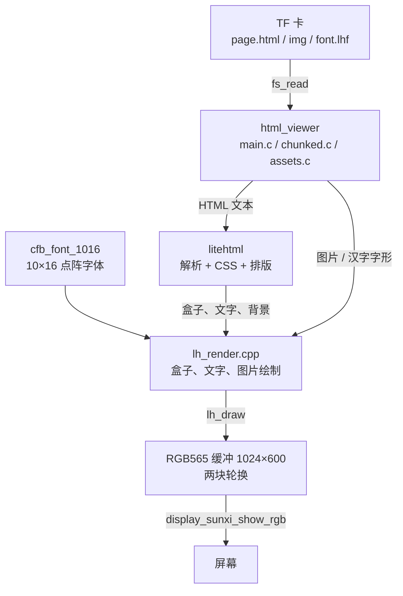
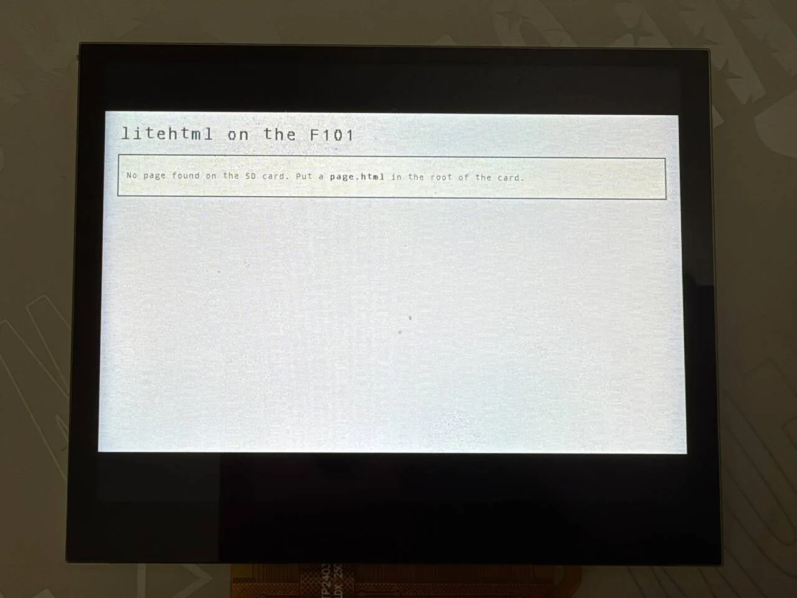
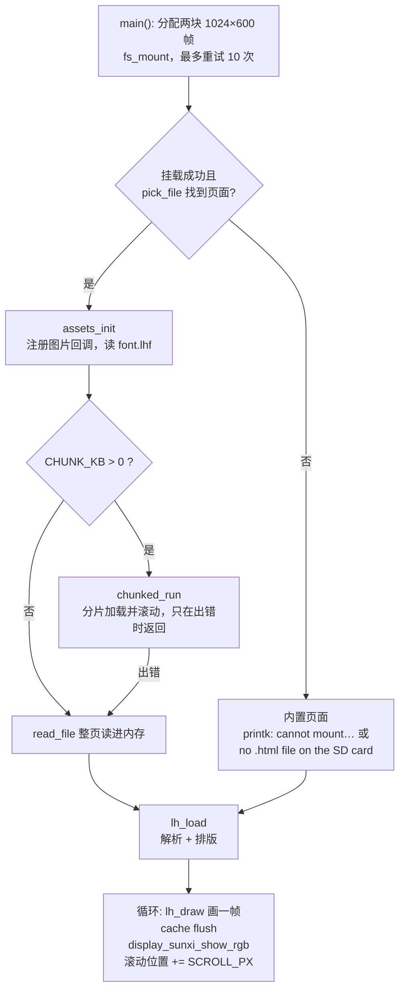

把 TF 卡上的 HTML 页面画到屏幕上。[litehtml](https://github.com/litehtml/litehtml)（v0.9）负责解析 HTML、套 CSS、排版，板子上的渲染层（`lh_render.cpp`）把排好的盒子画进一块 RGB565 缓冲，再交给显示引擎。组件是 `zephyr-components/litehtml`，示例是 `samples/html_viewer`。

没有浏览器内核：<strong>不跑 JavaScript，不联网，没有触摸或按键输入</strong>。页面太长时自己往下滚，滚到头再回来。



开始前请先完成 [配置开发环境](../zephyr-setup-env.md) 和 [获取 Zephyr 代码](../zephyr-get-source.md)。

## 准备

页面、图片、字体都放在 TF 卡上，板子端不需要联网。

### 页面

示例按下面的顺序找页面（`main.c` 的 `pick_file()`，77–100 行）：

1. `CONFIG_SAMPLE_HTML_FILE`，默认 `/SD:/page.html`。
2. 上一条的文件不存在，就取卡根目录里<strong>第一个</strong> `.html` 或 `.htm` 文件（不区分大小写，顺序是目录里的存放顺序，不一定是字母序；不进子目录）。
3. 都没有，显示编译进固件的内置页面。

```c
static bool pick_file(char *path, size_t size)
{
	struct fs_dirent ent;
	struct fs_dir_t dir;

	strncpy(path, CONFIG_SAMPLE_HTML_FILE, size - 1);
	path[size - 1] = '\0';
	if (fs_stat(path, &ent) == 0) {
		return true;
	}
	fs_dir_t_init(&dir);
	if (fs_opendir(&dir, "/SD:") != 0) {
		return false;
	}
	while (fs_readdir(&dir, &ent) == 0 && ent.name[0] != '\0') {
		if (ent.type == FS_DIR_ENTRY_FILE && name_is_html(ent.name)) {
			snprintk(path, size, "/SD:/%s", ent.name);
			fs_closedir(&dir);
			return true;
		}
	}
	fs_closedir(&dir);
	return false;
}
```

组件自带一个测试页 `samples/html_viewer/page.html`（4.4 KB，覆盖文字样式、颜色块、列表、表格、嵌套盒子、长文本）。TF 卡是 FAT 或 exFAT，支持长文件名。最简单的试法：

```sh
cp ~/f101-zephyr/zephyr-components/litehtml/samples/html_viewer/page.html /path/to/SD/page.html
```

页面按 UTF-8 读。编码、`<meta charset>` 之类声明不影响这里：读进来的字节直接交给 litehtml。

### 图片

`` 和 CSS 的 `background-image` 都走同一个加载回调，但<strong>只认自定义的 `.lhi` 文件</strong>，不支持 PNG、JPEG、GIF、WebP、SVG 直接引用。

- 页面里写相对路径，例如 ``。路径相对<strong>页面所在目录</strong>解析（`assets.c` 的 `image_cb()` 把 `dir + "/" + src` 拼起来读文件），没有 URL、`data:` 之类的处理。
- `.lhi` 文件格式：`"LHI1"`，16 位宽，16 位高（小端），后面是宽×高个 RGB565 像素（小端）。没有透明通道。
- 找不到文件、魔数不对、长度不够，都当作“没有这张图”：元素没有尺寸，不画。失败的结果也会缓存，不会反复读卡。
- 缓存最多 40 个条目、合计 6 MiB（`CACHE_ENTRIES`、`CACHE_LIMIT`），超出时丢掉最久没用的。

没有现成的转换命令行工具，下面的脚本，逻辑和 `tools/scrape_page.py` 里的 `to_lhi()`、`make_font()` 一致（需要 Pillow，Zephyr 的 venv 里有）：

```python
#!/usr/bin/env python3
"""用法：
  mk-lh-assets.py img  输入图片 输出.lhi [最大宽 最大高]
  mk-lh-assets.py font 字体文件 输出.lhf 页面.html
"""
import html, struct, sys
from PIL import Image, ImageDraw, ImageFont


def to_lhi(src, dst, max_w=640, max_h=360):
    img = Image.open(src)
    if img.mode in ("RGBA", "LA", "P"):          # 透明部分垫白底
        img = img.convert("RGBA")
        bg = Image.new("RGBA", img.size, (255, 255, 255, 255))
        bg.alpha_composite(img)
        img = bg
    img = img.convert("RGB")
    img.thumbnail((max_w, max_h), Image.LANCZOS)  # 只缩小，不放大
    w, h = img.size
    out = bytearray(struct.pack("<4sHH", b"LHI1", w, h))
    px = img.tobytes()
    for i in range(0, len(px), 3):
        r, g, b = px[i], px[i + 1], px[i + 2]
        out += struct.pack("<H", ((r & 0xf8) << 8) | ((g & 0xfc) << 3) | (b >> 3))
    open(dst, "wb").write(out)
    print(dst, w, "x", h, len(out), "bytes")


def to_lhf(fontfile, dst, page, cell=16):
    text = html.unescape(open(page, encoding="utf-8").read())
    codes = sorted(c for c in set(map(ord, text)) if c >= 0x80 and c not in (0x200b, 0xfeff))
    font = ImageFont.truetype(fontfile, cell)
    keep, glyphs = [], []
    for c in codes:
        im = Image.new("L", (cell, cell), 0)
        ImageDraw.Draw(im).text((0, -1), chr(c), font=font, fill=255)
        if im.getbbox() is None:
            continue
        keep.append(c)
        glyphs.append(im.tobytes())
    with open(dst, "wb") as f:
        f.write(struct.pack("<4sIII", b"LHF1", len(keep), cell, 0))
        f.write(b"".join(struct.pack("<I", c) for c in keep))
        f.write(b"".join(glyphs))
    print(dst, len(keep), "glyphs")


if sys.argv[1] == "img":
    to_lhi(sys.argv[2], sys.argv[3], *map(int, sys.argv[4:6]))
else:
    to_lhf(sys.argv[2], sys.argv[3], sys.argv[4])
```

```sh
. ~/f101-zephyr/env.sh
python3 mk-lh-assets.py img photo.png SD/img/photo.lhi
```

页面里写 ``，图片会缩放到元素的尺寸（最近邻）。图片是原样放进内存的 RGB565，一张 640×360 的图占 450 KiB，注意缓存上限。

### 字体和汉字

屏幕上的字来自两处：

| 来源 | 范围 | 说明 |
| --- | --- | --- |
| `cfb_font_1016` | ASCII 32–126 | Zephyr 字符帧缓冲自带的 10×16 点阵字体，编进固件 |
| `font.lhf` | 你指定的字符 | 放在页面同一目录，16×16 的 8 位透明度字形，启动时一次读进内存 |

`font.lhf` 格式：`"LHF1"`，32 位字形个数，32 位字格大小（16），32 位保留，后面是按码点升序排列的 32 位码点表，最后是每个字形 16×16 字节的透明度（从上到下的行）。上面脚本的 `font` 子命令会扫描页面里出现的所有非 ASCII 字符，按给定字体渲染：

```sh
python3 mk-lh-assets.py font /usr/share/fonts/opentype/noto/NotoSansCJK-Regular.ttc SD/font.lhf SD/page.html
```

（字体路径换成你机器上有的；`.ttc` 集合文件 Pillow 默认取第一个字体。）

没有 `font.lhf`，或者页面里的字不在里面，非 ASCII 字符画成 `?`。<strong>字体是固定的</strong>：`font-family` 不起作用，不能加载 TTF/OTF/WOFF，也不支持 `@font-face`。

## 编译

以下命令都在工作区里执行。组件依赖 litehtml 子模块，第一次要拉：

```sh
cd ~/f101-zephyr/zephyr-components
git submodule update --init litehtml/litehtml
```

不拉的话 `litehtml/litehtml` 是空目录，CMake 会报 `litehtml sources missing, run: git submodule update --init`。然后编译示例：

```sh
. ~/f101-zephyr/env.sh
cd ~/f101-zephyr
west build -b yuzukineko -d build/html zephyr-components/litehtml/samples/html_viewer
```

<div class="asciinema-cast" data-src="assets/casts/zephyr/apps-html/build.cast" data-speed="6"></div>

产物是 `build/html/zephyr/zephyr.bin`，链接地址 `0x40010000`。`prj.conf` 里已经有 `CONFIG_CPP`、`CONFIG_STD_CPP17`、`CONFIG_LITEHTML`，不需要加 `-D`。

示例的 `CMakeLists.txt` 自己把组件加进模块路径，不用另外设 `ZEPHYR_EXTRA_MODULES`：

```cmake
list(APPEND ZEPHYR_EXTRA_MODULES ${CMAKE_CURRENT_SOURCE_DIR}/../..)

find_package(Zephyr REQUIRED HINTS $ENV{ZEPHYR_BASE})
project(html_viewer)

target_sources(app PRIVATE src/main.c src/chunked.c src/assets.c)
```

litehtml 是 C++ 库，而镜像用的是精简 C 库，所以组件的 `CMakeLists.txt` 用 `ExternalProject` 单独编一遍（`ext/`），只用 libstdc++ 里纯头文件的部分，关闭异常，标准流（`iostream` 等）用空壳头文件顶替，编成静态库再链进镜像。缺的几个 C 库函数在 `src/litehtml_libc.c`。在自己的应用里用：把模块加进 `ZEPHYR_EXTRA_MODULES`，`prj.conf` 里写 `CONFIG_CPP=y`、`CONFIG_STD_CPP17=y`、`CONFIG_LITEHTML=y`。

## 运行

### 下载并启动

1. 第一次运行先不放页面：TF 卡根目录里没有 `.html` 文件，板子显示内置页面。要显示自己的页面时，把 `page.html`（以及 `img/`、`font.lhf`）拷到 TF 卡根目录，插进板子。
2. 用 [编译与运行](../zephyr-build-run.md) 里的任一种方式下载，控制台是 UART1（PB00/PB01，115200 8N1）。调试用<strong>方式一</strong>：`xfel ddr f101-s3`、`xfel write 0x40010000 build/html/zephyr/zephyr.bin`、`xfel exec 0x40010000`。每次先给板子断电再上电。

:::caution
板子只有一个 USB-C 口，既是 xfel 下载口，也是 UF2 盘的口。先下载，再接别的设备。
:::

画面是 1024×600 的 RGB565 帧，用 `display_sunxi_show_rgb()` 送到显示引擎的视频层，缩放规则与视频帧相同：保持长宽比，铺满宽度。屏幕是 1024×768，所以上下有黑边。

### 运行后的输出

#### 卡上没有 .html：显示内置页面

卡已挂载、根目录里没有 `.html` 文件时，串口输出：

```text
*** Booting Zephyr OS build b6f3dfe1a1f4 ***
heap: 13620 KiB free at the start
no .html file on the SD card
page: built in
page: "litehtml", 177 px high, parsed and laid out in 17 ms
heap: page and library use 2500 KiB (11120 KiB of the normal heap free)
assets: 0 KiB of images cached, 0 loaded, 0 dropped
page: drawn in 11 ms
```

屏幕显示内置页面。它 177 px 高，不比屏幕高，所以不滚动，每秒重画一次。挂载失败时打印的是 `cannot mount the SD card: <错误码>`，见 [排错](#排错)。



照片里是内置页面：标题 `litehtml on the F101`，下面一个带边框的框，写着 `No page found on the SD card. Put a page.html in the root of the card.`。画面在面板中间，上下是黑边。

#### 卡上有页面：加载页面、图片、汉字

要显示自己的页面时，卡根目录放好 `page.html`、`font.lhf` 和 `img/a.lhi` 后启动，串口输出：

```text
*** Booting Zephyr OS build b6f3dfe1a1f4 ***
heap: 13620 KiB free at the start
assets: extra glyphs from /SD:/font.lhf (4 KiB)
assets: images from /SD:/img
chunked: /SD:/page.html, 35 KiB in 3 pieces of about 12 KiB, scanned in 14 ms, 1425 bytes of css
chunk 0/3: 12643 bytes, 8431 px high, loaded in 410 ms
chunked: piece 0 y 0 drawn in 37 ms
```

这几行依次表示：`font.lhf` 读入、图片目录登记、页面被分成 3 片（每片约 12 KiB）、第 0 片加载完成，之后每帧约 37 ms。屏幕上显示页面的第一屏。

#### 自动滚动与分片切换

页面比屏幕高时自动往下滚。每 60 帧打印一次 `y`，相邻两行差 120 px，即每帧 2 px，等于 `CONFIG_SAMPLE_HTML_SCROLL_PX=2`。滚到片尾附近时，输出如下：

```text
chunked: piece 0 y 7200 drawn in 39 ms
chunk 1/3: 12351 bytes, 8006 px high, loaded in 392 ms
chunked: piece 0 y 7320 drawn in 37 ms
...
chunked: piece 0 y 7920 drawn in 61 ms
chunked: piece 0 y 8040 drawn in 61 ms
chunked: piece 0 y 8160 drawn in 61 ms
chunked: piece 0 y 8280 drawn in 60 ms
chunked: piece 0 y 8400 drawn in 61 ms
chunked: piece 1 y 89 drawn in 37 ms
```

- 第 0 片滚过 `y=7231`（离片尾 8431 不到两屏）时提前加载第 1 片，用了 392 ms。加载是同步的，那一帧会停顿约 0.4 秒。
- 越过 `y=7831`，也就是片尾前一屏，开始同时画两片（`lh_draw_over()`），每帧涨到约 61 ms。
- 越过 8431 后切到第 1 片，`piece 1 y 89`，帧时间回到 37 ms。

## 渲染流程



### 主程序

`main()` 在 `samples/html_viewer/src/main.c` 的 350–472 行。要点：

- 两块帧缓冲 `fbs[2]` 各 1024×600×2 字节，用 `aligned_alloc(64, …)` 从普通堆分配（373–379 行）。屏幕上显示的那一块永远不被写，画下一帧画到另一块，不然扫描输出会看到画到一半的帧。
- 卡上电后要等一会儿，挂载最多试 10 次、每次间隔 300 ms（381–388 行）。
- 成功后调 `assets_init(path)`，再按 `CONFIG_SAMPLE_HTML_CHUNK_KB` 决定走分片显示（397–413 行）：

```c
	if (mounted != 0) {
		printk("cannot mount the SD card: %d\n", mounted);
	} else if (!pick_file(path, sizeof(path))) {
		printk("no .html file on the SD card\n");
	} else {
		assets_init(path);
#if CONFIG_SAMPLE_HTML_CHUNK_KB > 0
		/* returns only when the page cannot be shown piece by piece */
		chunked_run(path, &font, disp, fbs);
		printk("chunked viewer failed, trying the page as a whole\n");
#endif
		html = read_file(path);
		if (html != NULL) {
			source = path;
		}
	}
```

- 整页模式：`read_file()` 读文件，`lh_load()` 解析排版，然后无限循环画帧（436–471 行）。页面不比屏幕高、或者 `SCROLL_PX` 为 0，每秒重画一次；否则每帧滚动 `CONFIG_SAMPLE_HTML_SCROLL_PX` 像素，到底后停 2 秒掉头往回滚，到顶再停 2 秒。

```c
	while (true) {
		uint16_t *fb = fbs[cur];
		struct display_sunxi_rgb img = {
			.data = fb, .width = W, .height = H, .stride = W * 2,
		};
		int max_scroll = MAX(0, height - H);
		int ret;

		t0 = k_uptime_get();
		draw_page(page, fb, scroll);
		sys_cache_data_flush_range(fb, W * H * sizeof(uint16_t));
		if (scroll == 0 || scroll >= max_scroll) {
			printk("page: drawn in %d ms\n", (int)(k_uptime_get() - t0));
		}
		/* returns when the new frame is on the screen: the other one is free again */
		ret = display_sunxi_show_rgb(disp, &img);
```

### 分片显示（默认走这条）

默认 `CONFIG_SAMPLE_HTML_CHUNK_KB=12`，所以<strong>只要卡上有页面，就走 `chunked.c`</strong>，哪怕页面只有 4 KB。它的做法：

1. `lh_index_scan()` 把文件从头到尾读一遍，找到 `<body>` 每个子元素的结尾，以及 `<head>` 里的 `<style>` 文本位置。
2. 把相邻子元素合成大约 12 KiB 一片；只有屏幕上的那一片和下一片在内存里，每一片是一个独立的页面：`<html><head><meta charset="utf-8"><style>` + 全部 CSS + `</style></head>` + 原来的 `<body …>` 标签 + 这一片的文本 + `</body></html>`。
3. 滚动越过一片的末尾时，丢掉当前片、换下一片，同时提前加载再下一片。接缝处用 `lh_draw_over()` 把下一片画在同一帧的下半部分。
4. 滚到最后一片的末尾，等 2 秒，从第一片重新开始（不会往回滚）。

分片的限制：

- 标记必须写规整，所有非空元素都要有结束标签。`<body>` 的一个直接子元素不会被切开，一个子元素本身特别大，这一片就特别大。
- 跨片的兄弟选择器（`+`、`~`、`:nth-child` 之类）不生效，因为每一片是独立的页面。
- 样式表只从 `<head>` 里的 `<style>` 收集（`struct lh_index` 的 `css[]`，最多 16 个）。外部样式表本来就不支持。

只想按整页渲染：编译时把 `CONFIG_SAMPLE_HTML_CHUNK_KB` 设成 0。整页模式要把整个文档树放进堆里，页面大了会失败。组件还提供 `LITEHTML_PAGED_HEAP`（按需换页、以 TF 卡上的 `swap.bin` 做后备存储，配置见 `samples/html_viewer/paged.conf`）。

### 渲染层

`ext/src/lh_render.cpp` 里的 `canvas_container` 实现 litehtml 的 `document_container` 接口。对外接口在 `include/litehtml_zephyr/lh.h`：

| 函数 | 作用 |
| --- | --- |
| `lh_load(font, html, width, height)` | 解析并按视口宽度排版，返回页面对象。`height` 只用于 `vh` 单位和媒体查询 |
| `lh_content_height(page)` | 排版后页面的总高度（像素） |
| `lh_title(page)` | `<title>` 的文字 |
| `lh_draw(page, fb, stride, w, h, scroll_y, bg)` | 先用 `bg` 清空，再把从 `scroll_y` 行开始的一屏画进 RGB565 缓冲 |
| `lh_draw_over(…)` | 不清空，叠画（分片接缝用） |
| `lh_set_image_loader(fn, user)` | 注册图片回调，返回 RGB565 像素 |
| `lh_set_cjk_font(data, size)` | 注册 `font.lhf` 的内容，数据要一直有效 |
| `lh_free(page)` | 释放 |
| `lh_index_scan(read, user, size, target, out)` | 分片扫描 |

`lh_load()` 和 `lh_draw()` 就这么几行（`lh_render.cpp` 567–601 行）：

```cpp
struct lh_page *lh_load(const struct lh_font *font, const char *html, int width, int height)
{
	auto *p = new lh_page(font, width, height);

	p->doc = litehtml::document::createFromString(html, &p->container);
	if (!p->doc) {
		delete p;
		return nullptr;
	}
	p->doc->render(width);
	p->content_h = p->doc->height();
	return p;
}
```

```cpp
void lh_draw(struct lh_page *page, uint16_t *fb, int stride, int w, int h, int scroll_y, uint16_t bg)
{
	for (int y = 0; y < h; y++) {
		std::fill(fb + (size_t)y * stride, fb + (size_t)y * stride + w, bg);
	}
	page->container.begin(fb, stride, w, h);

	litehtml::position clip(0, 0, w, h);

	page->doc->draw(0, 0, -scroll_y, &clip);
}
```

文字怎么画：`create_font()` 把 CSS 字号当作字高，字宽按 10:16 的比例缩放（`cell_w = size * 10 / 16`，至少 1），粗体（权重 ≥ 600）宽度加 1 并往右多涂一列；`draw_glyph()` 用最近邻把 10×16 点阵缩放到目标尺寸，斜体按行错位。下划线、删除线、上划线直接画线。

```cpp
f->size = std::max(size, 6);
f->weight = weight;
f->italic = italic == litehtml::font_style_italic;
f->decoration = decoration;
f->cell_w = std::max(1, (f->size * font_->cell_w + font_->cell_h / 2) / font_->cell_h);
if (weight >= 600) {
	f->cell_w++;
}
```

`font.lhf` 里的汉字按字号缩成 `size × size`，字间距就是字号。

## 支持的 HTML / CSS 范围

分两层看：litehtml 能排版什么，和这块渲染层能画什么。下面只写能从源码确认的。

### 能用

| 类别 | 内容 |
| --- | --- |
| HTML | gumbo 解析（HTML5 容错解析器）；标题、段落、`div`、`span`、`b`、`i`、`u`、`s`、`code`、`a`、`ul`/`ol`/`li`、`table`、`img`、`br` 等常见标签 |
| 盒模型 | `margin`、`padding`、`border`（宽度、颜色，<strong>只画实线</strong>）、`width`/`height`、`box-sizing` |
| 布局 | 块、行内、`inline-block`、`float`、`position`（`relative`/`absolute`/`fixed`）、`display: table` 和 `<table>`、`display: flex`/`inline-flex` |
| 文字 | `font-size`、`font-weight`、`font-style`、`text-align`、`text-decoration`、`text-transform`（仅 ASCII 字母）、`white-space`、`vertical-align`、`line-height` |
| 单位 | `px`、`%`、`em`、`rem`、`pt` 等、`vw`/`vh`/`vmin`/`vmax` |
| 颜色 | 十六进制、`rgb()`、`rgba()`、颜色名；`rgba` 的透明度会和已有像素混合 |
| 背景 | `background-color`；`background-image` 取 `.lhi`，支持 `repeat`/`repeat-x`/`repeat-y`、位置、尺寸 |
| 列表标记 | 圆点、空心方块（`circle`）、实心方块，数字编号（`1.` 样式） |
| 其他 | `overflow` 裁剪（矩形）；`<style>` 内联样式表；选择器；`@media` 里 `width`、`height`、`screen` 等基本条件（视口固定为 1024×600）；CSS 变量 `var()`（litehtml 的 `style.cpp` 里处理了 `var(`） |

### 不支持

| 内容 | 实际情况 |
| --- | --- |
| JavaScript | <strong>不支持</strong>，`<script>` 不执行 |
| 链接点击、表单、输入 | <strong>不支持</strong>。`on_anchor_click()`、`set_cursor()` 是空函数，板子上没有输入设备 |
| 外部样式表 | <strong>不支持</strong>。`import_css()` 是空函数，`<link rel="stylesheet">` 和 `@import` 都不会加载，样式要写进 `<style>` |
| 图片格式 | 只有 `.lhi`；PNG/JPEG/GIF/WebP/SVG、`data:` 地址<strong>不支持</strong> |
| 字体 | 只有 ASCII 10×16 点阵（缩放）和 `font.lhf` 里的字形；`font-family`、`@font-face`、TTF/WOFF <strong>不支持</strong>，也没有抗锯齿 |
| 渐变 | <strong>不支持</strong>，渲染层只画纯色填充 |
| 圆角 | <strong>不支持</strong>，`border-radius` 被忽略 |
| 边框样式 | 虚线、点线、双线、凹凸等都画成实线（`draw_borders()` 只判断是不是 `none`/`hidden`） |
| `calc()` | <strong>不支持</strong>，litehtml 的 `css_length.cpp` 里是 `TODO: Make support for calc`，遇到 `calc(…)` 按默认值处理 |
| CSS Grid | <strong>不支持</strong>。组件说明里明确写了 litehtml 没有 grid |
| 阴影、透明度属性、变换、动画、过渡 | <strong>不支持</strong>：渲染层没有对应的绘制，litehtml 也没有解析这些属性 |
| 滚动交互 | <strong>不支持</strong>：只有自动滚动，不能手动滚；`overflow: scroll` 的元素不能滚 |

页面如果来自网页，需要经过 `tools/scrape_page.py` 重写，见下一节。

### 把网页转成能显示的页面

`tools/scrape_page.py URL OUTDIR [--font FONT]` 会抓一个网页：去掉脚本和事件属性，把样式表内联（`@media` 先按视口宽度求值，`display:grid` 改成 flex 换行），图片转 `.lhi`，页面里出现的汉字渲染成 `font.lhf`。`OUTDIR` 整个拷到 TF 卡，显示里面的 `index.html`。它依赖 Pillow，也需要联网。排版仍然只是近似。`tools/host_preview/host_main.cpp` 是同一个渲染层的 PC 版，用来不接板子看结果。

## 怎么改页面内容

不需要重新编译：

1. 改 TF 卡上的 `page.html`，重新上电。
2. 页面里加图片：转成 `.lhi`，放进 `img/`，用 ``。
3. 页面里有汉字：重新生成 `font.lhf`，放在页面同一目录。
4. 页面比较大：保持标记规整（见分片的限制）。

最小的页面：

```html
<!DOCTYPE html>
<html>
<head>
<meta charset="utf-8">
<title>hello</title>
<style>
  body { margin: 24px; background: #f4f6fb; color: #222; }
  h1 { color: #1a4fa0; }
  .box { background: #fff; border: 2px solid #1a4fa0; padding: 12px; }
</style>
</head>
<body>
<h1>Hello</h1>
<div class="box"><p>A <b>bold</b> word.</p></div>
</body>
</html>
```

## 功能与修改位置

| 功能 | 位置 | 怎么改 |
| --- | --- | --- |
| 页面路径 | `main.c` 的 `pick_file()`，`CONFIG_SAMPLE_HTML_FILE` | 编译时改，见 [配置选项](#配置选项) |
| 滚动速度 | `CONFIG_SAMPLE_HTML_SCROLL_PX` | 每帧像素数，0 关闭滚动 |
| 视口大小 | `main.c` 和 `chunked.c` 开头各有一份 `#define W 1024`、`#define H 600` | 两个文件要一起改；`lh_load()` 的宽度、帧缓冲大小、`display_sunxi_show_rgb()` 都用它 |
| 背景色 | 两个文件里的 `#define BG 0xffff` | RGB565，页面没盖到的地方是这个颜色 |
| 内置页面 | `main.c` 的 `builtin_page[]`（43–49 行） | 改字符串，找不到页面时显示它 |
| 字体 | `main.c` 的 `font` 结构（`cfb_font_1016`，10×16） | 换成别的同格式点阵（`struct lh_font`，每个字形 20 字节） |
| 图片缓存 | `assets.c` 的 `CACHE_ENTRIES`、`CACHE_LIMIT` | 改宏 |
| 分片大小 | `CONFIG_SAMPLE_HTML_CHUNK_KB` | 0 关闭分片 |
| 手动滚动、翻页 | <strong>示例没有实现</strong> | 需要自己在 `main()` 的循环里接输入，改 `scroll` 变量 |

### 加手动滚动

示例里的 `scroll` 只由 `SCROLL_PX` 驱动。要接输入设备，思路是改 `main.c` 末尾的循环：去掉自动增减，改成由按键或触摸事件改 `scroll`，范围限制在 `0` 到 `max_scroll`。这只适用于整页模式（`CHUNK_KB=0`）；分片模式的滚动在 `chunked.c` 的 `y += CONFIG_SAMPLE_HTML_SCROLL_PX` 那一行。示例没有实现。

### 在自己的程序里用

渲染层不依赖示例的文件读取，只要有 HTML 字符串和一块 RGB565 缓冲：

```c
#include <litehtml_zephyr/lh.h>

extern const uint8_t cfb_font_1016[95][20];

static const struct lh_font font = {
	.glyphs = cfb_font_1016, .first = 32, .last = 126, .cell_w = 10, .cell_h = 16,
};

struct lh_page *page = lh_load(&font, "<h1>hi</h1>", 1024, 600);

lh_draw(page, fb, 1024, 1024, 600, 0, 0xffff);
/* fb 是 1024*600 个 uint16_t 的 RGB565 缓冲；画完要 sys_cache_data_flush_range() */
lh_free(page);
```

## 配置选项

示例（`samples/html_viewer/Kconfig`）：

| 选项 | 默认 | 说明 |
| --- | --- | --- |
| `CONFIG_SAMPLE_HTML_FILE` | `"/SD:/page.html"` | 要显示的页面；不存在时取卡根目录第一个 `.html`/`.htm` |
| `CONFIG_SAMPLE_HTML_SCROLL_PX` | `2` | 每帧滚动的像素数，0 为不滚动 |
| `CONFIG_SAMPLE_HTML_CHUNK_KB` | `12` | 分片大小（KiB），0 为整页排版 |
| `CONFIG_SAMPLE_HTML_BENCH` | 关 | 依次加载卡上所有 `page_*.html`（从小到大），打印耗时和内存，之后再进正常显示 |
| `CONFIG_SAMPLE_HTML_PAGED_MB` | `200` | 换页堆的虚拟大小（MiB），仅在 `LITEHTML_PAGED_HEAP` 时有效 |

覆盖的写法：

```sh
west build -b yuzukineko -d build/html zephyr-components/litehtml/samples/html_viewer -- \
  -DCONFIG_SAMPLE_HTML_FILE='"/SD:/web/index.html"' -DCONFIG_SAMPLE_HTML_SCROLL_PX=4
```

组件（`zephyr-components/litehtml/Kconfig`）：

| 选项 | 说明 |
| --- | --- |
| `CONFIG_LITEHTML` | 编译 litehtml 并链进镜像；依赖 `CPP` 和 `RISCV` |
| `CONFIG_LITEHTML_PAGED_HEAP` | `malloc` 系列改由按需换页的区域提供，换出页写到 TF 卡的文件；依赖 `DEMAND_PAGING`、`BACKING_STORE_SWAP`、`FILE_SYSTEM`。用法见 `samples/html_viewer/paged.conf`：`-DEXTRA_CONF_FILE=paged.conf` |

示例 `prj.conf` 里和渲染相关的选项：

| 选项 | 作用 |
| --- | --- |
| `CONFIG_CPP` | 启用 C++ 支持 |
| `CONFIG_STD_CPP17` | C++17 |
| `CONFIG_LITEHTML` | 启用组件 |
| `CONFIG_STATIC_INIT_GNU` | 运行 C++ 全局对象的构造函数 |
| `CONFIG_SDHC` | SD 主机控制器驱动 |
| `CONFIG_DISK_ACCESS` | 磁盘访问层 |
| `CONFIG_DISK_DRIVER_SDMMC` | 把 SD/MMC 卡作为磁盘 |
| `CONFIG_FILE_SYSTEM` | 文件系统框架 |
| `CONFIG_FAT_FILESYSTEM_ELM` | FatFs |
| `CONFIG_FS_FATFS_EXFAT` | 支持 exFAT 卡 |
| `CONFIG_FS_FATFS_LFN` | 支持长文件名 |
| `CONFIG_FS_FATFS_LFN_MODE_STACK` | 长文件名缓冲放栈上 |
| `CONFIG_DISPLAY` | 显示驱动 |
| `CONFIG_CHARACTER_FRAMEBUFFER` | 字符帧缓冲，只为了拿到 `cfb_font_1016` |
| `CONFIG_CHARACTER_FRAMEBUFFER_USE_DEFAULT_FONTS` | 编入默认字体 |
| `CONFIG_FPU` | 硬件浮点 |
| `CONFIG_FPU_SHARING` | 多线程共用浮点 |
| `CONFIG_MAIN_STACK_SIZE=65536` | 主线程栈 64 KiB，litehtml 递归排版需要较深的栈 |
| `CONFIG_COMMON_LIBC_MALLOC_ARENA_SIZE=-1` | `malloc` 区域用剩余的全部内存 |
| `CONFIG_HEAP_MEM_POOL_SIZE=262144` | 内核堆 256 KiB |

## 代码结构

| 文件 | 内容 |
| --- | --- |
| `samples/html_viewer/src/main.c` | 选页面、读文件、整页显示循环、内置页面、基准模式 |
| `samples/html_viewer/src/chunked.c` | 分片显示 |
| `samples/html_viewer/src/assets.c` | 图片缓存与 `font.lhf` 读取 |
| `ext/src/lh_render.cpp` | 渲染层：字体、背景、边框、图片、裁剪 |
| `ext/src/lh_index.c` | 分片扫描器 |
| `ext/src/lh_stubs.cpp`、`ext/shim/` | 标准库适配（无异常、无流） |
| `src/litehtml_libc.c` | 补缺的 C 库函数 |
| `src/litehtml_paged_heap.c` | 换页堆 |
| `include/litehtml_zephyr/lh.h` | 对外接口 |
| `tools/scrape_page.py` | 抓网页并转换 |
| `tools/host_preview/` | PC 版预览 |
| `litehtml/litehtml/` | litehtml 子模块 |

## 功能范围

- 文字是固定的 10×16 点阵缩放，没有字体选择和抗锯齿；非 ASCII 字符需要 `font.lhf`，否则显示 `?`。
- 不支持渐变、圆角、阴影，边框只画实线；不支持 CSS Grid、`calc()`。
- 图片只认 `.lhi`，没有透明通道。
- 不支持 JavaScript、链接跳转、表单、动画、外部样式表。
- 没有输入设备，只能自动滚动；需要手动滚动时见 [加手动滚动](#加手动滚动)。页面不比屏幕高时不滚动（`max_scroll` 为 0，循环里每秒重画一次）。
- 分片模式下滚动速度约 33 px/s：每帧画 37 ms，再加等显示和打印的时间。想快就加大 `CONFIG_SAMPLE_HTML_SCROLL_PX`。
- 屏幕画面固定 1024×600，屏幕是 1024×768，上下有黑边。
- 页面大到放不进内存时必须分片；分片模式下跨片的选择器和需要看整页的规则不起作用，翻到新的一片有停顿。
- 网页需要先用 `tools/scrape_page.py` 转换，转换后的版式是近似的。


## 排错

| 现象 | 原因与处理 |
| --- | --- |
| 编译时报 `litehtml sources missing, run: git submodule update --init` | 子模块没拉：`cd zephyr-components && git submodule update --init litehtml/litehtml` |
| `display not ready` | 显示设备没起来，确认编译的是 `yuzukineko` 板级 |
| `cannot mount the SD card: <错误码>` | 10 次挂载都失败：卡没插好，或者不是 FAT/exFAT |
| `no .html file on the SD card` | 卡已经挂载上了，但根目录里没有 `page.html`，也没有别的 `.html`/`.htm`，显示内置页面。把页面拷到根目录 |
| 显示的是别的页面 | 没有 `page.html` 时取的是根目录第一个 `.html`，顺序是目录顺序，不是字母序。把想看的页面命名成 `page.html` |
| 图片不显示 | 文件不在 `<页面目录>/<src>`，或者不是 `.lhi` |
| 汉字显示成 `?` | 没有 `font.lhf`，或者页面里这个字没有生成进去 |
| `chunked viewer failed, trying the page as a whole` | 分片扫描或加载失败（标记不规整、内存不够等），改走整页模式 |
| `lh_load failed` | 内存不够；把页面拆小，或使用分片 |
| `no memory for the frames` | 两块帧缓冲分配失败，堆太小 |
| `show_rgb failed: <错误码>` | 显示驱动不接受这帧 |

