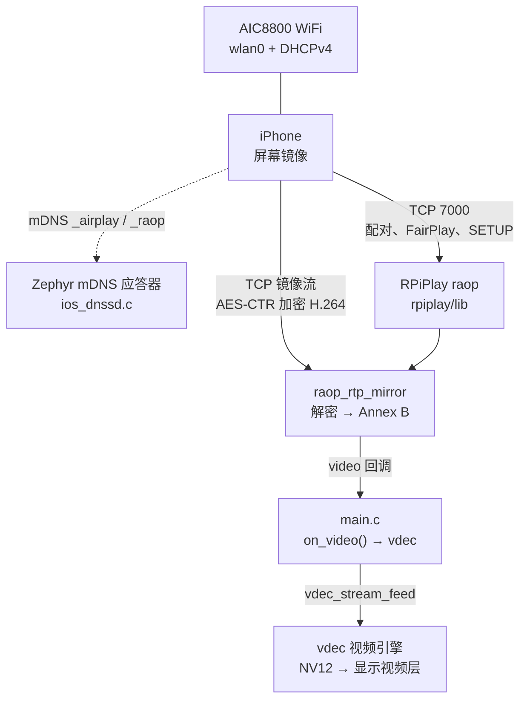
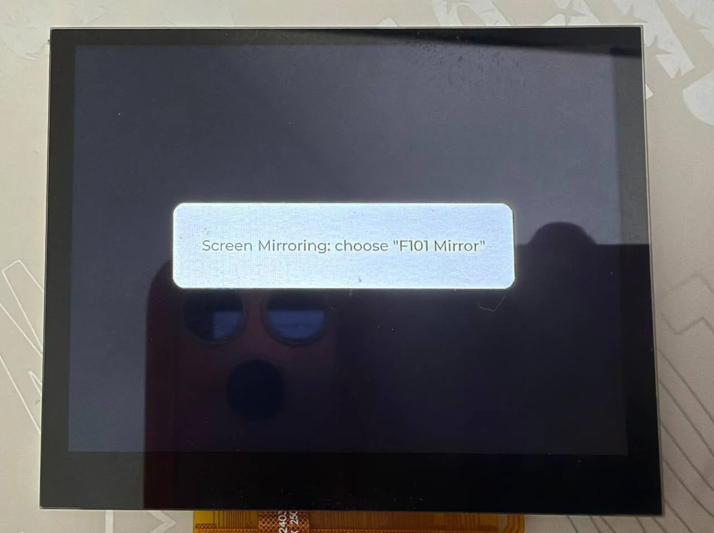
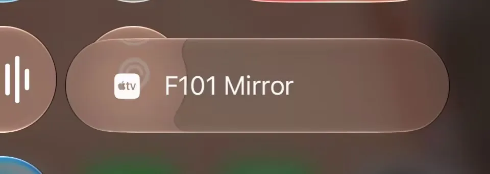
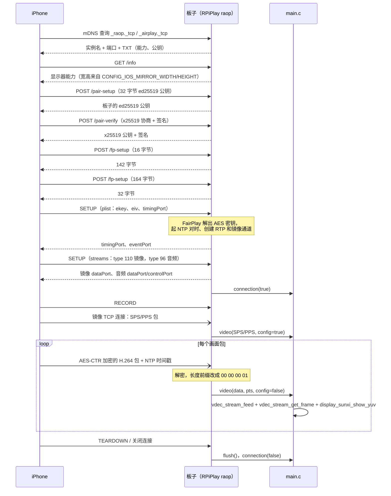
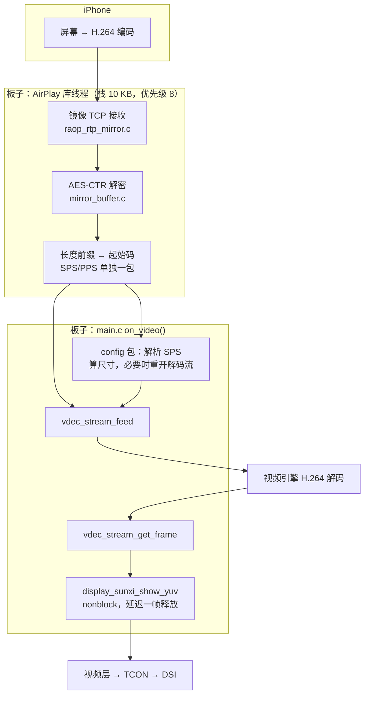

把 iPhone 的屏幕投到板子上：板子加入 WiFi，以 AirPlay 接收端的身份出现在 iPhone“控制中心 - 屏幕镜像”的列表里，iPhone 选中它以后，把屏幕内容编码成 H.264 流发过来，板子用片上视频引擎解码，直接送到显示的视频层。示例是 `zephyr-components/ios-screen-mirror/samples/ios_player`。

组件 `ios-screen-mirror` 的协议部分来自 [RPiPlay](https://github.com/FD-/RPiPlay)（AirPlay 镜像接收端，含 FairPlay 握手），作为 git 子模块放在 `rpiplay/`。原库依赖的 OpenSSL、Bonjour（mDNSResponder）、libplist 在这里分别换成了 mbedTLS、Zephyr 自带的 DNS-SD 应答器和一个很小的二进制 plist 读写器（`src/plist.c`）。



只镜像画面。AirPlay 流里的音频会被接收，但示例的音频回调是空函数，直接丢掉，板子不出声，见 [功能范围](#功能范围)。

开始前请先完成 [配置开发环境](../zephyr-setup-env.md) 和 [获取 Zephyr 代码](../zephyr-get-source.md)。

:::caution[许可证：GPL-3.0]
RPiPlay 的许可证是 GPL-3.0，所以整个 `ios-screen-mirror` 组件按 GPL-3.0 对待（`Kconfig` 的帮助文字、`CMakeLists.txt`、示例的源码头都写着 `GPL-3.0-or-later`；`src/ios_dnssd.c` 等少数文件头是 Apache-2.0，但它们和 RPiPlay 链接在同一个镜像里）。编进镜像并分发的固件，需要按 GPL-3.0 提供对应的源码。只想用其他协议的投屏，不要打开 `CONFIG_IOS_MIRROR`，不会链入这部分代码。
:::

## 准备

### 取得 RPiPlay 子模块

`rpiplay/` 是子模块，没有拉取时目录是空的，编译会找不到 `rpiplay/lib`。在 `zephyr-components` 里拉一下：

```sh
cd ~/f101-zephyr/zephyr-components
git submodule update --init ios-screen-mirror/rpiplay
```

### 需要的东西

| 项 | 说明 |
| --- | --- |
| 板子 | `yuzukineko`，带 AIC8800 WiFi 模块和 1024×768 的 MIPI-DSI 屏 |
| TF 卡 | FAT 或 exFAT。示例用它读 WiFi 配置 `/SD:/wifi.cfg`；卡里没有这个文件时只能用编译时写进去的 SSID/密码 |
| WiFi | 一个 2.4 GHz 或 5 GHz 的 WPA2-PSK（或开放）网络，板子和 iPhone 必须在<strong>同一个二层网络</strong>里，因为发现靠组播 mDNS |
| iPhone | 带“屏幕镜像”的 iOS 设备。不需要装任何 App |

### WiFi 配置

板子的 WiFi 是 AIC8800，驱动和接口详见 [AIC8800 WIFI](../components/aic8800-wifi.md)，这里只说示例怎么用它。示例取 SSID 和密码的顺序（`main.c` 105–134 行 `wifi_load()`）：

1. 读 TF 卡上的 `/SD:/wifi.cfg`：<strong>第一行是 SSID，第二行是密码</strong>，纯文本，每行以换行结束。SSID 最长 32 字节，密码最长 64 字节。
2. 读不到文件，或第一行为空，就用编译选项 `CONFIG_SAMPLE_IOS_WIFI_SSID` 和 `CONFIG_SAMPLE_IOS_WIFI_PSK`。
3. 两处都没有 SSID：屏幕显示 `No WiFi: put wifi.cfg on the card`，示例退出。

密码为空时按开放网络连接，否则按 WPA2-PSK（`WIFI_SECURITY_TYPE_PSK`）。不支持 WPA3，原因见 AIC8800 那一页。

`wifi.cfg` 示例（两行，不要有多余空行或引号）：

```text
MyHomeWiFi
my-password-123
```

:::note
`wifi.cfg` 和 Android 投屏示例（`android-screen-mirror`）是同一种格式，那个示例会把配置写在 TF 卡上，iOS 示例读同一个文件，两个示例可以共用一张卡。
:::

:::caution
AIC8800 驱动在加入网络时会把 SSID 和密码用 `aic8800` 的日志明文打在串口上（`Connect Wi-Fi: …`、`SET_NETWORK 0 psk "…"`）。串口日志贴给别人之前先把这几行抹掉。
:::

## 编译

在工作区里执行：

```sh
. ~/f101-zephyr/env.sh
cd ~/f101-zephyr
west build -b yuzukineko -d build/ios-mirror zephyr-components/ios-screen-mirror/samples/ios_player
```

<div class="asciinema-cast" data-src="assets/casts/zephyr/apps-ios-mirror/build.cast" data-speed="6"></div>

产物是 `build/ios-mirror/zephyr/zephyr.bin`，约 3.6 MB，链接地址 `0x40000000`，RAM 占用 21.67%。示例的 `CMakeLists.txt` 自己把组件（往上两级目录）和同级的 `aic8800` 加进 `ZEPHYR_EXTRA_MODULES`，不需要手工指定。

示例的 `prj.conf` 里选了 `CONFIG_MINIMAL_LIBC=y`：AIC8800 和 RPiPlay 的适配头文件是按最小 C 库写的，自己的应用用这个组件时也要选。

## 运行

用 [编译与运行](../zephyr-build-run.md) 里的任一种方式下载，控制台是 UART1（PB00/PB01，115200 8N1）。调试时用<strong>方式一</strong>：

```sh
xfel ddr f101-s3
xfel write 0x40000000 build/ios-mirror/zephyr/zephyr.bin
xfel exec 0x40000000
```

### 运行后的输出

#### 1. 启动和加入 WiFi

下载并执行后，屏幕中央出现状态卡片 `Joining the WiFi`。串口依次输出：显示和触摸屏初始化；`ios: Joining the WiFi`；AIC8800 识别为 D80（`chip_id=c3`）并下载固件；读到 TF 卡上的 `wifi.cfg` 后加入网络，出现 `WPA enter FHOST_WPA_STATE_CONNECTED`；DHCP 拿到地址，打印 `ios: address …`。

#### 2. AirPlay 服务启动

拿到地址后，串口输出 `airplay: Initialized server socket(s)`、`airplay: "F101 Mirror" on port 7000`、`ios: Screen Mirroring: choose "F101 Mirror"`，屏幕卡片变成 `Screen Mirroring: choose "F101 Mirror"`。`ios: mDNS group joined: -120` 是 `EALREADY`，表示应答器在接口起来时已经加入了组播组，不是故障，见 [启动流程](#启动流程)。

```text
*** Booting Zephyr OS build b6f3dfe1a1f4 ***
[00:00:00.493,000] <inf> display_sunxi: 1024x768 @ 60 Hz, fb 0x40384180, video plane 0
[00:00:00.564,000] <inf> gt967: GT967 firmware 0x1040, 1024x768
ios: Joining the WiFi
[00:00:01.597,000] <inf> aic8800: aicwf chipid: USE AIC8800D80
[00:00:03.022,000] <inf> aic8800: sdio card up: 2 functions
[00:00:03.024,000] <inf> aic8800: chip_id=c3, chip_sub_id=2
[00:00:03.024,000] <inf> aic8800: ### Upload firmware, @ = 120000
[00:00:04.219,000] <inf> aic8800: aic_wifi_init ok
[00:00:04.219,000] <inf> aic8800: Connect Wi-Fi: <SSID>, <PSK>
[00:00:08.439,000] <inf> aic8800: WPA enter FHOST_WPA_STATE_CONNECTED
ios: address 192.168.x.x
ios: mDNS group joined: -120
airplay: Initialized server socket(s)
airplay: "F101 Mirror" on port 7000
ios: Screen Mirroring: choose "F101 Mirror"
```

日志节选，SSID、密码、MAC 和 IP 已用占位符替换（驱动在 `Connect Wi-Fi` 和 `SET_NETWORK` 行里会明文打印 SSID 和密码）。



板子屏幕中央是状态卡片，写着 `Screen Mirroring: choose "F101 Mirror"`，等待 iPhone 来连。

#### 3. 在 iPhone 上发现并投屏

1. iPhone 连到<strong>和板子同一个 WiFi</strong>（同一个网段，路由器不要开“AP 隔离”或“客户端隔离”，否则组播和单播都过不去）。
2. 从屏幕右上角下拉（有 Home 键的机型从底部上划）打开<strong>控制中心</strong>，点<strong>屏幕镜像</strong>。
3. 列表里出现 <strong>F101 Mirror</strong>（名字由 `CONFIG_IOS_MIRROR_NAME` 决定），点它。
4. 手机屏幕开始往板子上投。再次打开屏幕镜像，点<strong>停止镜像</strong>结束。



控制中心的屏幕镜像列表里，`F101 Mirror` 带着 Apple TV 的图标，点它开始投屏。

#### 4. 板子上的画面

手机选中 F101 Mirror 后，串口依次输出 `ios: phone connected`、`ios: stream profile …`、`ios: first picture <W>x<H>`，之后每 5 秒一行统计，各行含义见 [控制台输出](#控制台输出)。

手机竖屏时，镜像流大约是 448×972，板子屏幕是 1024×768，画面按长宽比缩放后居中，两侧留黑边。第一帧画出来，状态卡片就自动隐藏；手机停止镜像或断开，卡片重新出现 `Waiting for the phone`。


左边是 iPhone，右边是板子的屏幕：手机竖屏，画面按比例缩放后居中，两侧留黑。

## 协议流程

### 发现：mDNS / DNS-SD

iPhone 不靠手输 IP 找接收端，靠 Bonjour（组播 DNS-SD）。板子要做的是应答这两个服务类型：

| 服务 | 实例名 | 端口 | 作用 |
| --- | --- | --- | --- |
| `_raop._tcp` | `<12 位 MAC 十六进制>@<名字>` | `CONFIG_IOS_MIRROR_PORT` | iOS 在“屏幕镜像”列表里找的是这个 |
| `_airplay._tcp` | `<名字>` | 同上 | AirPlay 服务本身 |

`src/ios_dnssd.c` 用 Zephyr 的 `STRUCT_SECTION_ITERABLE(dns_sd_rec, …)` 静态定义这两条记录，名字和 TXT 数据在 `airplay_start()` 运行时填进去。两条记录的 TXT 里放的是设备能力：`et`（加密类型）、`cn`（音频编码）、`ft`/`features`（功能位）、`pk`（公钥）、`deviceid`（MAC）等，取值全部来自 RPiPlay，写在 `rpiplay/lib/dnssdint.h`。

### 连接：配对、FairPlay、SETUP

iPhone 选中板子后，向板子的 TCP 端口发 HTTP/RTSP 请求，`raop.c` 按方法和路径分发到处理函数：



要点：

- `/pair-setup`、`/pair-verify` 用 ed25519 和 x25519（`src/ed25519_ops.c`、`src/ios_crypto.c`，基于 mbedTLS 和一份 ed25519 实现）。
- `/fp-setup` 是 FairPlay 握手（`rpiplay/lib/playfair/`，这是 RPiPlay 里的 playfair 实现）。它的作用是让板子从 `ekey` 里解出 AES 密钥，之后画面数据才能解密。
- 镜像画面数据走单独的 TCP 连接（SETUP 里 `type=110` 的 `dataPort`），每包用 AES-CTR 加密，密钥由 FairPlay 的结果、x25519 的共享密钥和 `streamConnectionID` 做 SHA-512 派生（`mirror_buffer.c`）。
- 时间戳：`raop_ntp.c` 在 `timingPort` 上和手机对时，`raop_rtp_mirror.c` 把包里的 NTP 时间戳换算成板子本地时间，作为 `pts` 交给回调。

### 数据流：从手机的像素到屏幕



从 AirPlay 库到应用的接口只有 `include/ios_zephyr/airplay.h` 里这几个回调，见 [接口](#接口)。

## 功能与修改位置

| 功能 | 位置 | 怎么改 |
| --- | --- | --- |
| 读 WiFi 配置 | `main.c` 105–134 行 `wifi_load()` | 改 `wifi.cfg` 路径或格式 |
| 加入 WiFi、等地址 | `main.c` 136–168 行 `wifi_join()` | 改超时（30 秒）、安全类型 |
| 状态卡片 | `main.c` 40–75 行 `ui_build()`、`status()` | 改文字、大小、颜色 |
| 解码流参数 | `main.c` 195–207 行 `stream_open()` | 改 `buffer_size`、`holding_frames` |
| 收到一包画面数据 | `main.c` 359–435 行 `on_video()` | 解码、显示、统计 |
| 手机连上或断开 | `main.c` 437–447 行 `on_connection()` | 断开时关闭解码流、显示等待文字 |
| 手机停止镜像 | `main.c` 449–455 行 `on_flush()` | 关闭解码流 |
| 启动 AirPlay | `main.c` 494–500 行，`airplay_start()` | 改名字、端口 |
| 通告的屏幕尺寸 | `CMakeLists.txt` 里替换 `raop_handlers.h` 的 `1920`/`1080` | 改 `CONFIG_IOS_MIRROR_WIDTH/HEIGHT` |
| 音频 | `src/airplay.c` 20–23 行 `audio_process()` | 目前是空函数，见 [功能范围](#功能范围) |

### 启动流程

`main()`（`main.c` 457–511 行）按顺序：

1. `ui_build()` 建状态卡片；检查视频引擎、显示和 WiFi 接口（`net_if_get_first_wifi()`）是否就绪。
2. 最多 5 次 `fs_mount()` 挂载 TF 卡（间隔 1 秒），失败只打印，不退出，因为还可以用编译选项里的 SSID。
3. `wifi_join()`：读配置，`NET_REQUEST_WIFI_CONNECT`，等连接结果（30 秒）和 IPv4 地址（30 秒）。
4. 手动 `net_ipv4_igmp_join()` 加入 mDNS 组播组 `224.0.0.251`。mDNS 应答器在接口 up 时加组，但示例里接口 up 在应答器启动之前，所以这里补一次；已经加入时返回 `-EALREADY`（-120），日志里的 `mDNS group joined: -120` 就是这样来的。
5. 把 WiFi 网卡的 MAC 填进 `cfg.hw_addr`，调 `airplay_start(&cfg)`。
6. 卡片文字改成 `Screen Mirroring: choose "<名字>"`，然后循环调用 `lv_timer_handler()` 刷新状态卡片。

```c
memcpy(cfg.hw_addr, net_if_get_link_addr(iface)->addr, sizeof(cfg.hw_addr));
ret = airplay_start(&cfg);
if (ret != 0) {
    printk("ios: cannot start AirPlay: %d\n", ret);
    status("Cannot start AirPlay");
    return 0;
}
```

### 收到画面：on_video()

AirPlay 线程每解出一包 H.264，就调 `on_video()`（`main.c` 359–435 行），它在一把互斥锁里：

- `config == true`：这包是 SPS/PPS。`read_sps()` 解析 SPS 取宽高，估算解码器要的内存 `宽 × 高 × 3/2 × (2 + HOLD_FRAMES)`，超过 `CONFIG_VDEC_SUNXI_MAX_MEMORY_KB - 512` KB 就关掉解码流，屏幕显示 `Unsupported resolution WxH`；没超就关掉旧流（尺寸可能变了），重新 `stream_open()`。
- 否则按 `vdec_stream_feed()` 喂数据；喂不进（`-EAGAIN`）就先 `drain()` 取帧再重试。
- `drain()`（222–259 行）取出每一帧，调 `display_sunxi_show_yuv()` 显示（`nonblock = true`，`bt709 = true`），上上一帧延迟一帧再释放，防止还在被扫描输出的帧被改写。第一帧显示时把状态卡片隐藏。
- 每 5 秒打印一行统计。

注意：画面按<strong>解出来就显示</strong>，示例没有拿 `pts` 去等时间（`pts` 只是原样交给解码器），所以没有音画同步，也没有丢帧逻辑，延迟取决于解码速度。

## 配置选项

### 组件（`ios-screen-mirror/Kconfig`）

| 选项 | 默认 | 说明 |
| --- | --- | --- |
| `CONFIG_IOS_MIRROR` | n | 打开 iOS 投屏组件。依赖网络、TCP 和 UDP，自动选上 mDNS 应答器、DNS-SD 和 mbedTLS（SHA-512、AES CTR/CBC） |
| `CONFIG_IOS_MIRROR_NAME` | `"F101 Mirror"` | 在“屏幕镜像”列表里显示的名字 |
| `CONFIG_IOS_MIRROR_PORT` | 7000 | AirPlay 服务器的 TCP 端口，0 表示任意空闲端口 |
| `CONFIG_IOS_MIRROR_WIDTH` | 1920 | 通告给手机的显示宽度（像素），手机按它决定流的尺寸，编译时替换进 RPiPlay 的 `raop_handlers.h` |
| `CONFIG_IOS_MIRROR_HEIGHT` | 1080 | 通告给手机的显示高度 |
| `CONFIG_IOS_MIRROR_THREAD_STACK` | 10240 | AirPlay 库每个线程的栈（字节），最忙的 HTTP/RTSP 线程约用 6 KB |
| `CONFIG_IOS_MIRROR_THREAD_PRIORITY` | 8 | AirPlay 库线程的优先级 |

### 示例（`samples/ios_player/Kconfig`）

| 选项 | 默认 | 说明 |
| --- | --- | --- |
| `CONFIG_SAMPLE_IOS_WIFI_SSID` | `""` | 没有 `/SD:/wifi.cfg` 时使用的 SSID |
| `CONFIG_SAMPLE_IOS_WIFI_PSK` | `""` | 没有 `/SD:/wifi.cfg` 时使用的 WPA2 密码 |
| `CONFIG_SAMPLE_IOS_HOLD_FRAMES` | 4 | 解码器在两个工作帧之外多保留的帧数。每帧在竖屏流下约 650 KB；少了解码器会没有帧可用而卡住，值为 2 会死锁 |

例子，把 SSID 和名字写进编译：

```sh
west build -b yuzukineko -d build/ios-mirror zephyr-components/ios-screen-mirror/samples/ios_player -- \
  -DCONFIG_SAMPLE_IOS_WIFI_SSID='"MyHomeWiFi"' \
  -DCONFIG_SAMPLE_IOS_WIFI_PSK='"my-password-123"' -DCONFIG_IOS_MIRROR_NAME='"Board A"'
```

### `prj.conf` 里和投屏有关的选项

| 选项 | 作用 |
| --- | --- |
| `CONFIG_AIC8800` | WiFi 驱动，见 [AIC8800 WIFI](../components/aic8800-wifi.md) |
| `CONFIG_WIFI`、`CONFIG_NET_L2_WIFI_MGMT` | Zephyr WiFi 管理接口，示例用它发起连接 |
| `CONFIG_NET_DHCPV4` | 取地址 |
| `CONFIG_NET_IPV4_IGMP` | 加入 mDNS 组播组 `224.0.0.251` |
| `CONFIG_NET_IPV6=n` | 只用 IPv4 |
| `CONFIG_NET_HOSTNAME="f101-mirror"` | 主机名，mDNS 应答器用它做 `.local` 名字 |
| `CONFIG_MDNS_RESOLVER_BUF_SIZE=1024` | mDNS 报文缓冲 |
| `CONFIG_NET_PKT_RX_COUNT=64`、`CONFIG_NET_BUF_RX_COUNT=128` 等 | 视频流需要的网络缓冲，默认池太小 |
| `CONFIG_NET_TCP_MAX_RECV_WINDOW_SIZE=32768` | TCP 接收窗口 |
| `CONFIG_NET_CONTEXT_REUSEADDR`、`CONFIG_NET_CONTEXT_REUSEPORT` | 套接字复用，AirPlay 库重新监听时用 |
| `CONFIG_DYNAMIC_THREAD*` | AirPlay 库在运行时创建线程，栈从堆里分 |
| `CONFIG_VDEC` | 视频引擎驱动 |
| `CONFIG_DISPLAY_SUNXI_ARGB8888`、`CONFIG_LVGL`、`CONFIG_LV_COLOR_DEPTH_32` | 状态卡片画在 ARGB 层上，盖在视频层之上 |
| `CONFIG_FAT_FILESYSTEM_ELM`、`CONFIG_FS_FATFS_EXFAT`、`CONFIG_FS_FATFS_LFN` | 读 TF 卡上的 `wifi.cfg` |
| `CONFIG_HEAP_MEM_POOL_SIZE=262144` | 堆 |
| `CONFIG_FPU`、`CONFIG_FPU_SHARING` | 硬件浮点 |

`boards/yuzukineko.conf` 和 `boards/yuzukineko.overlay` 打开了 GT967 触摸屏并把它注册成 LVGL 的指针输入，`main.c` 没有处理触摸，状态卡片只用来显示。

## 代码结构

| 文件 | 内容 |
| --- | --- |
| `samples/ios_player/src/main.c` | 示例：WiFi、状态卡片、解码和显示 |
| `include/ios_zephyr/airplay.h`、`src/airplay.c` | 对应用的接口：`airplay_start()`、`airplay_stop()`，把 RPiPlay 的回调转成应用回调 |
| `src/ios_dnssd.c` | 用 Zephyr DNS-SD 应答器实现 RPiPlay 的 `dnssd_*` 接口 |
| `src/ios_crypto.c`、`src/ed25519_ops.c` | 用 mbedTLS 实现 RPiPlay 要的 AES-CTR/CBC、x25519、ed25519、SHA-512 |
| `src/plist.c`、`include/plist/plist.h` | 一个小的二进制 plist 读写器，替代 libplist |
| `src/ios_posix.c`、`shim/` | POSIX 适配：线程、`gettimeofday`、`clock_gettime`、`sscanf`、套接字封装、缺失的头文件 |
| `rpiplay/lib/` | RPiPlay：`raop`（RTSP/HTTP 服务）、`raop_rtp_mirror`（镜像数据流）、`raop_ntp`、`pairing`、`playfair`（FairPlay） |

## 接口

`include/ios_zephyr/airplay.h`：

```c
struct airplay_config {
	/** Name in the Screen Mirroring list */
	const char *name;
	/** Address that identifies the receiver (the MAC of the network interface) */
	uint8_t hw_addr[6];
	/** TCP port, 0 for any free one */
	uint16_t port;
	/**
	 * One piece of the H.264 stream, Annex B; config is set for the SPS/PPS (a new one means
	 * the picture size may have changed). Called from the connection thread: do not block.
	 */
	void (*video)(const uint8_t *data, size_t size, uint64_t pts_us, bool config, void *arg);
	/** An iPhone connected (true) or went away (false) */
	void (*connection)(bool up, void *arg);
	/** The phone stopped mirroring: the picture should go */
	void (*flush)(void *arg);
	void *arg;
};

/** Starts the server and registers the services; 0 or a negative errno */
int airplay_start(const struct airplay_config *cfg);

void airplay_stop(void);
```

| 项 | 说明 |
| --- | --- |
| `video` | 在连接线程里调用，不要阻塞太久。`config` 为真时这包是 SPS/PPS；`pts_us` 是换算成板子本地时间的微秒时间戳 |
| `connection` | 手机连上（`true`）或离开（`false`） |
| `flush` | 手机停止镜像，应用应该撤掉画面 |
| `airplay_start()` | 返回 0 或负的 errno：`-EALREADY` 已经启动；`-ENOMEM` 分配失败；`-EIO` 监听失败 |

没有音频回调：`src/airplay.c` 里把 RPiPlay 的 `audio_process` 设成了空函数。

## 控制台输出

下面是各条输出的格式，来自 `main.c` 和 `src/airplay.c`：

| 输出 | 含义 |
| --- | --- |
| `ios: Joining the WiFi` | 开始加入 WiFi |
| `ios: address <IP>` | 拿到 DHCP 地址 |
| `airplay: "<名字>" on port <端口>` | AirPlay 服务已启动 |
| `ios: phone connected` / `ios: phone disconnected` | 手机连上、离开 |
| `ios: stream profile <p> level <l>, <n> reference frames, <W>x<H>` | 收到 SPS，解析出的流参数 |
| `ios: <W>x<H> does not fit the decoder (<N> KB)` | 流太大，解码器放不下 |
| `ios: first picture <W>x<H>` | 第一帧画出来 |
| `ios: <n> packets (<n>/s), <n> shown, <n> KB/s, decode <n> ms per <n> ms` | 每 5 秒一行统计：包数、显示帧数、码率、解码耗时 |
| `ios: decoder has no free picture buffer` | 解码器没有空闲帧缓冲，每秒最多打一次 |
| `ios: decoder not taking data (...)` | 解码器长时间不收数据 |
| `ios: feed error <错误码>` | 喂数据出错 |

## 功能范围

- <strong>只显示画面，不支持声音</strong>；需要声音时在 `audio_process()` 里接 I2S/codec。`src/airplay.c` 的 `audio_process()` 是空函数，AirPlay 音频数据被接收后直接丢弃，板子不播放。
- <strong>分辨率受解码器内存限制</strong>。`Kconfig` 里写明：手机竖屏流（约 448×972）可以，横屏 1920×1080 会被拒绝，屏幕显示 `Unsupported resolution`。判据是 `宽 × 高 × 3/2 × (2 + HOLD_FRAMES)` 不超过 `CONFIG_VDEC_SUNXI_MAX_MEMORY_KB - 512` KB（该选项当前为 8192）。
- <strong>没有音画同步，也没有时间戳调度</strong>：画面解出来就显示。
- <strong>没有触摸回传</strong>：iPhone 的画面只能看，不能在板子上点。
- <strong>只用 IPv4</strong>，发现靠组播 mDNS，手机和板子必须在同一个二层网络。
- <strong>一台手机</strong>：示例的解码流和显示只有一路，同时连两台手机不支持。
- <strong>不支持 WPA3</strong>（AIC8800 的限制，见 [AIC8800 WIFI](../components/aic8800-wifi.md)）。
- <strong>手机兼容性</strong>：协议部分沿用 RPiPlay 的实现（伪装成 `AppleTV2,1`，`srcvers` 220.68）。
- <strong>许可证</strong>：GPL-3.0，见页首。

## 排错

| 现象 | 原因与处理 |
| --- | --- |
| 编译报 `rpiplay/lib` 找不到文件 | 子模块没拉，见 [取得 RPiPlay 子模块](#取得-rpiplay-子模块) |
| 屏幕 `No WiFi: put wifi.cfg on the card` | 卡里没有 `wifi.cfg`，也没设 `CONFIG_SAMPLE_IOS_WIFI_SSID`。格式：第一行 SSID，第二行密码 |
| `Cannot join the WiFi` | 密码错、信号弱、AP 只开了 WPA3，或 30 秒内没拿到地址 |
| `Cannot start AirPlay` | 监听端口失败（端口被占用）或内存不足，串口里有 `ios: cannot start AirPlay: <错误码>` |
| 手机的屏幕镜像列表里没有 F101 Mirror | 手机和板子不在同一网段；路由器开了客户端隔离或过滤组播；板子的 mDNS 没入组播组 |
| 选了以后连接失败 | 看串口是否有 `airplay:` 开头的错误行；确认是 iOS 的屏幕镜像，而不是“投屏视频” |
| `Unsupported resolution WxH` | 流太大，解码器放不下；手机竖屏使用，或降低 `CONFIG_SAMPLE_IOS_HOLD_FRAMES`（值太小会卡死，不建议低于 4） |
| `ios: decoder has no free picture buffer` 反复出现 | 解码器帧缓冲耗尽，调大 `CONFIG_SAMPLE_IOS_HOLD_FRAMES`（同时要有足够的 `CONFIG_VDEC_SUNXI_MAX_MEMORY_KB`） |
