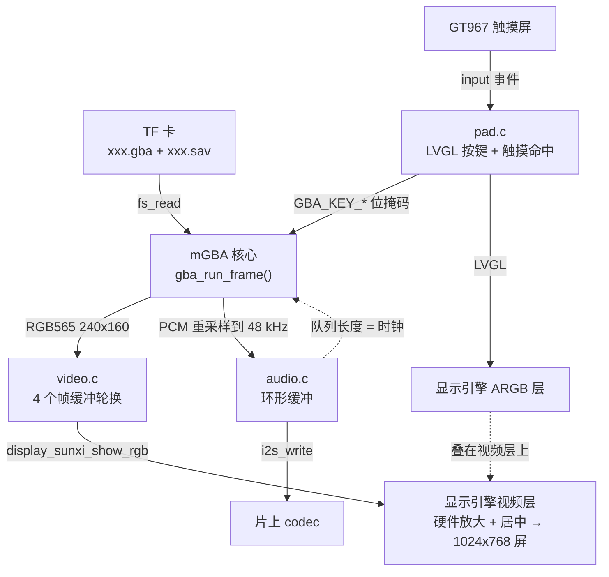
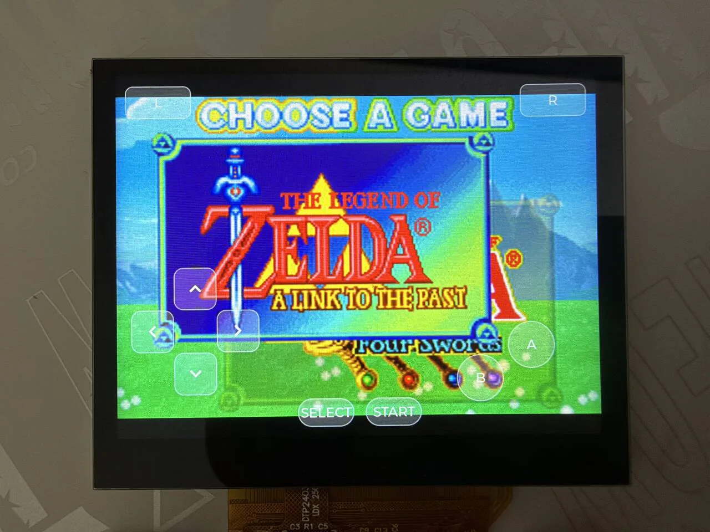
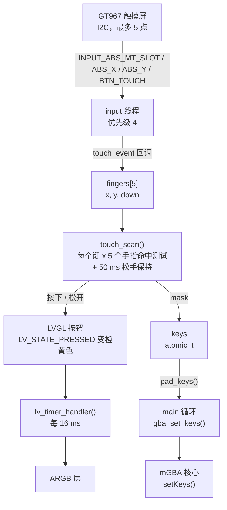
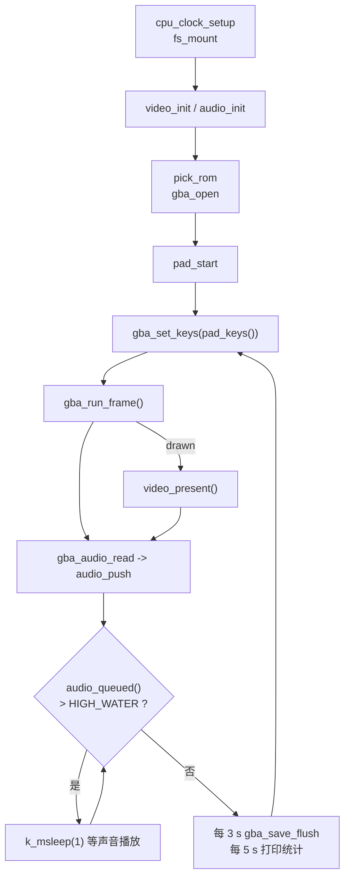

在板子上运行 Game Boy Advance 游戏（也能跑 Game Boy / Game Boy Color）：模拟器核心是 [mGBA](https://github.com/mgba-emu/mgba)，ROM 从 TF 卡读取；游戏画面 240×160 交给显示引擎的视频层放大到整块屏幕；声音经 I2S 从片上 codec 输出；屏幕上叠一层 LVGL 画的半透明按键，用触摸屏操作。示例是 `zephyr-components/mgba/samples/gba_player`，mGBA 本体是组件里的 git 子模块（MPL-2.0），不需要 BIOS 文件。



没有单独的定时器：模拟器每算完一帧，就检查声音队列，队列里积的声音多了就 `k_msleep(1)` 等一等，所以<strong>声音输出的速度决定游戏速度</strong>。

开始前请先完成 [配置开发环境](../zephyr-setup-env.md) 和 [获取 Zephyr 代码](../zephyr-get-source.md)。

## 准备

### ROM 和 TF 卡

<strong>ROM 需要自备，本文和仓库都不提供任何游戏文件。</strong>请只使用你自己合法拥有的游戏（例如自己的卡带转出来的文件）。

| 项 | 说明 |
| --- | --- |
| ROM 文件 | `.gba`（GBA）、`.gb`、`.gbc`（Game Boy / Color）；扩展名大小写都认（`.gba` 或 `.GBA`），核心按扩展名选 |
| 放哪里 | TF 卡<strong>根目录</strong> |
| 选哪个 | 先找 `CONFIG_SAMPLE_GBA_ROM`（默认 `/SD:/game.gba`）；不存在就取根目录里第一个大小不超过 `CONFIG_MGBA_MAX_ROM_SIZE_MB`（示例设为 10 MiB）的文件，`.gba` 优先，其次 `.gb` / `.gbc` |
| 存档 | 和 ROM 同目录、同主文件名、扩展名 `.sav`（`xxx.gba` 对应 `xxx.sav`）；文件存在就读入，游戏存档内容有变化时每 3 秒写回一次 |
| BIOS | <strong>不需要</strong>，用 mGBA 内置的替代 BIOS；<strong>不支持</strong>从文件加载真 BIOS |
| 文件系统 | FAT 或 exFAT，支持长文件名 |

ROM 整个读进内存，所以大小受 `CONFIG_MGBA_MAX_ROM_SIZE_MB` 限制。超过 10 MiB 的 ROM（最大 32 MiB）需要打开按需分页：编译时加 `-DEXTRA_CONF_FILE=…/paged.conf`，让 ROM 作为文件映射、用到哪一页才从卡里读，见 [配置选项](#配置选项)。`paged.conf` 不改 ROM 的选法，仍然是 `game.gba` 或根目录第一个文件。

### 拉取 mGBA 子模块

mGBA 本体是组件里的 git 子模块，第一次编译前要拉下来：

```sh
cd ~/f101-zephyr/zephyr-components/mgba
git submodule update --init mgba
```

## 编译

在工作区里执行：

```sh
. ~/f101-zephyr/env.sh
cd ~/f101-zephyr
west build -b yuzukineko -d build/mgba zephyr-components/mgba/samples/gba_player
```

<div class="asciinema-cast" data-src="assets/casts/zephyr/apps-mgba/build.cast" data-speed="6"></div>

产物是 `build/mgba/zephyr/zephyr.bin`，约 4.98 MB，链接地址 `0x40000000`。

示例的 `prj.conf` 里有 `CONFIG_MINIMAL_LIBC=y`：`shim/` 里的头文件按 Zephyr 的最小 C 库写，自己的应用引用这个模块时也要选它。

示例的 `CMakeLists.txt` 用 `ZEPHYR_EXTRA_MODULES` 把上两级目录的组件模块引进来，所以不用另外指定：

```cmake
# the mGBA module is two directories up
list(APPEND ZEPHYR_EXTRA_MODULES ${CMAKE_CURRENT_SOURCE_DIR}/../..)
```

## 运行

用 [编译与运行](../zephyr-build-run.md) 里的任一种方式下载，控制台是 UART1（115200 8N1）。

- 调试时用<strong>方式一</strong>：`xfel ddr f101-s3`、`xfel write 0x40000000 build/mgba/zephyr/zephyr.bin`、`xfel exec 0x40000000`。
- 脱机运行用<strong>方式三</strong>：`mkuf2.py app build/mgba/zephyr/zephyr.bin -o out/mgba.uf2`，拖进 `F101BOOT` 盘。

:::caution
板子只有一个 USB-C 口，既是 xfel 下载口，也是 UF2 盘的口。先下载，再接别的设备。
:::

先把装好 ROM 的 TF 卡插进卡槽，再上电下载。

### 运行后的输出

串口控制台依次打印下面的内容（TF 卡里是一个 8 MiB 的 `.gba`，日志里的文件名写作 `game`；之后每 5 秒一行统计）：

```text
*** Booting Zephyr OS build b6f3dfe1a1f4 ***
[00:00:00.493,000] <inf> display_sunxi: 1024x768 @ 60 Hz, fb 0x4011c180, video plane 0
[00:00:00.564,000] <inf> gt967: GT967 firmware 0x1040, 1024x768
[00:00:00.569,000] <inf> gt967: configuration 0x63: 1024 x 768, up to 5 point(s), module switch 0x04
ROM /SD:/game.gba, save /SD:/game.sav
[00:00:02.252,000] <inf> gba: ROM /SD:/game.gba, 8388608 bytes
gba: 306 frames, emulation 4224 us/frame, sound 244898 frames pushed, queued 2722, underruns 0, ring empty 36, slab full 462, skipped 157
gba: 300 frames, emulation 11407 us/frame, sound 241097 frames pushed, queued 3179, underruns 0, ring empty 36, slab full 932, skipped 150
```

### 显示和触摸屏初始化

`display_sunxi` 报 `1024x768 @ 60 Hz`，说明视频层可用；`gt967` 报固件版本和 `up to 5 point(s)`，说明触摸屏可以同时识别 5 个手指。

### TF 卡和 ROM 读取

控制台打印 `ROM /SD:/game.gba, save /SD:/game.sav`，随后 `gba: ROM …, 8388608 bytes`：TF 卡挂载完成，ROM 选定并整个读入内存。随后游戏画面出现在屏幕上，半透明按键叠在上面。

### 模拟速度和声音队列

之后每 5 秒一行统计。5 秒里模拟约 300 帧（约 60 fps），送进声音缓冲约 24 万个立体声帧（48 kHz × 5 秒），`underruns` 为 0。`emulation` 一项每帧耗时随游戏场景变化，两个 5 秒窗口分别是 4224 μs 和 11407 μs，都在 16700 μs 的帧时间之内。

各字段的含义：

| 字段 | 含义 |
| --- | --- |
| `frames` | 这 5 秒模拟的帧数，满速是约 300 |
| `emulation … us/frame` | 每帧模拟平均耗时，超过 16700 μs 就赶不上实时 |
| `sound … frames pushed` | 送进声音环形缓冲的立体声帧数 |
| `queued` | 当前缓冲里等待播放的帧数 |
| `underruns` | I2S 断流重启的次数 |
| `ring empty` | 声音线程发现环形缓冲不够一块的次数 |
| `slab full` | 声音线程等不到空闲块的次数（模拟比播放快时出现，正常） |
| `skipped` | 跳过绘制的帧数，默认每两帧画一帧 |

### 屏幕上的画面

游戏画面放大后显示在面板中间，叠在上面的是半透明屏幕按键；手指按住某个键，该键变成橙黄色。



照片里是《塞尔达传说：众神的三角力量 & 四把剑》的选择画面。按键的位置：L、R 在左上角和右上角，方向键在左下，A、B 在右下，SELECT、START 在底部中间。

## 缩放与输出路径

### 画面

画面一路都是 RGB565，不做 CPU 缩放，放大交给显示引擎的视频层：

1. 核心把一帧画进 `video_acquire()` 给的缓冲，大小 240×160×2 字节。
2. `video_present()` 把缓冲的数据缓存刷回内存，唤醒 `video` 线程。
3. `video` 线程调 `display_sunxi_show_rgb()`，视频层从这块内存直接读，硬件放大。
4. 同时，LVGL 的 ARGB 层画在视频层上面，所以屏幕按键不占用游戏画面的带宽。

`video.c` 用 4 块缓冲（`NBUF 4`）轮流用：核心画下一帧时，视频层还在扫描上一帧，所以不能写同一块。`video_present()` 只把最新一帧的编号放进 `ready_idx`，`video` 线程等显示（可能要等下一次刷新）的时候，核心不会被卡住；如果来不及，旧画面直接被新的盖掉。

`video.c` 第 45–66 行：

```c
static void video_main(void *a, void *b, void *c)
{
	bool warned = false;

	while (true) {
		struct display_sunxi_rgb img = {.width = 0};
		int idx, ret;

		k_sem_take(&frame_sem, K_FOREVER);
		idx = atomic_get(&ready_idx);
		img.data = buf[idx];
		img.width = ready_w;
		img.height = ready_h;
		img.stride = STRIDE;
		img.nonblock = false;
		ret = display_sunxi_show_rgb(disp, &img);
		if (ret != 0 && !warned) {
			printk("video: show_rgb failed: %d\n", ret);
			warned = true;
		}
	}
}
```

### 缩放规则

缩放在驱动 `zephyr/drivers/display/sunxi/display_sunxi.c` 的 `display_sunxi_show_rgb()` 里：<strong>保持宽高比，放到刚好塞进整屏</strong>，居中，宽高取偶数。

```c
if ((uint64_t)data->width * img->height <= (uint64_t)data->height * img->width) {
	dw = data->width;
	dh = (uint64_t)img->height * data->width / img->width;
} else {
	dh = data->height;
	dw = (uint64_t)img->width * data->height / img->height;
}
dw &= ~1U;
dh &= ~1U;
```

目标屏幕是 1024×768：

| 游戏 | 源画面 | 放大后 | 位置 |
| --- | --- | --- | --- |
| GBA | 240×160 | 1024×682 | 水平铺满，垂直居中，上下各约 43 像素黑边 |
| Game Boy / Color | 160×144 | 853×768 | 垂直铺满，水平居中，左右留黑边 |

源画面尺寸来自 `gba_frame()` 返回的 `width` 和 `height`（核心自己报），不是写死的。放大是线性插值，不支持整数倍缩放（像素风）和滤镜，不能在应用里选缩放模式。

### 跳帧

画面默认每两帧画一帧（`CONFIG_SAMPLE_GBA_VIDEO_DIV=2`，约 30 fps）。跳过的帧只跑模拟和声音，不跑渲染器，给负载重的场景留时间。主循环里还有第二层：声音队列低于 `SKIP_BELOW`（1500 帧）时进入“追赶”，至少每四帧画一帧，直到队列涨回 `SKIP_RESUME`（2800 帧）。`main.c` 第 311–329 行：

```c
while (true) {
	uint32_t c0 = k_cycle_get_32();
	size_t n;

	gba_set_keys(pad_keys());
	gba_set_frame_buffer(video_acquire());
	/* behind the sound: draw less until it has caught up */
	{
		size_t queued = audio_queued();

		if (queued < SKIP_BELOW) {
			catching_up = true;
		} else if (queued > SKIP_RESUME) {
			catching_up = false;
		}
		gba_set_frameskip(catching_up ? MAX(SKIP_COUNT, SKIP_BASE) : SKIP_BASE);
	}
	drawn = gba_run_frame();

	...
}
```

## 声音

核心产生的声音采样率由游戏决定，`gba_player.c` 的 `resample()`（第 142–174 行）用 16.16 定点的线性插值转成输出采样率（`CONFIG_SAMPLE_GBA_RATE`，默认 48000，也可设 44100），输出 16 位有符号立体声。

主循环把 PCM 放进 `audio.c` 的环形缓冲，`audio` 线程切成 512 帧一块，交给 I2S 播放，片上 codec 输出到耳机和功放。codec 的音量在 `audio.c` 第 59–62 行设置：

```c
audio_codec_start_output(ctl);
/* small speaker: digital volume raised from the default */
audio_codec_set_property(ctl, AUDIO_PROPERTY_OUTPUT_VOLUME, AUDIO_CHANNEL_ALL,
				(audio_property_value_t){.vol = 150});
```

`.vol` 范围 0–255。想改音量改这个数；静音、左右声道分别设置的写法见 [MP4 播放器](mp4-player.md#在哪里调整音量)，两个应用用的是同一套 codec 接口。

`audio.c` 的几个常量决定缓冲大小：

| 常量 | 值 | 含义 |
| --- | --- | --- |
| `BLOCK_FRAMES` | 512 | 一块的立体声帧数，48 kHz 下约 10.7 ms |
| `SLAB_BLOCKS` | 6 | 交给 I2S 的内存块数 |
| `PREFILL` | 3 | 先送 3 块再启动 I2S |
| `RING_BLOCKS` | 8 | 环形缓冲能装 8 块 |
| `HIGH_WATER`（`main.c`） | `RATE / 15` | 队列超过这么多帧（48 kHz 下 3200 帧，约 67 ms）模拟就等待 |

I2S 写入返回 `-EIO` 说明流断了，`audio_main()` 会重新 `PREPARE` 并重新预填，这就是统计行里 `underruns` 的来源。

## 屏幕按键：界面与事件的实现

屏幕按键由 `src/pad.c` 实现，只有这一个文件，215 行。设计上有两个要点：

- <strong>画面用 LVGL，触摸不用 LVGL 的输入。</strong>LVGL 的指针输入一次只认一个手指，而玩游戏要同时按方向键和 A/B。所以 `pad.c` 直接读 Zephyr 输入子系统的多点触摸事件，自己判断每个手指落在哪个按键上；LVGL 的按钮只负责显示。
- <strong>按键状态是一个位掩码</strong>（`GBA_KEY_*`），触摸线程写，模拟线程每帧读一次。



### 创建控件

每个键是一个 `lv_button`，里面一个 `lv_label`（方向键用 LVGL 内置符号，其余是文字）。`key_add()` 同时做两件事：创建并设置样式；把它的位置和键位记进数组 `pad_keys_tbl`，触摸时用来命中测试。`pad.c` 第 140–167 行：

```c
static void key_add(int x, int y, int w, int h, const char *text, uint32_t bit, int radius)
{
	lv_obj_t *b = lv_button_create(lv_screen_active());
	lv_obj_t *l = lv_label_create(b);

	lv_obj_set_size(b, w, h);
	lv_obj_align(b, LV_ALIGN_TOP_LEFT, x, y);
	lv_obj_set_style_radius(b, radius, 0);
	lv_obj_set_style_bg_color(b, lv_color_white(), 0);
	lv_obj_set_style_bg_opa(b, LV_OPA_30, 0);
	lv_obj_set_style_bg_color(b, lv_color_make(255, 200, 60), LV_STATE_PRESSED);
	lv_obj_set_style_bg_opa(b, LV_OPA_70, LV_STATE_PRESSED);
	lv_obj_set_style_border_color(b, lv_color_white(), 0);
	lv_obj_set_style_border_opa(b, LV_OPA_50, 0);
	lv_obj_set_style_border_width(b, 2, 0);
	lv_obj_set_style_shadow_width(b, 0, 0);
	lv_obj_set_style_text_font(l, &lv_font_montserrat_28, 0);
	lv_obj_set_style_text_color(l, lv_color_white(), 0);
	lv_label_set_text(l, text);
	lv_obj_center(l);
	lv_obj_add_event_cb(b, key_event, LV_EVENT_ALL, (void *)(uintptr_t)bit);

	if (nkeys < MAX_KEYS) {
		pad_keys_tbl[nkeys++] = (struct pad_key){
			.obj = b, .x = x, .y = y, .w = w, .h = h, .bit = bit,
		};
	}
}
```

- 参数：位置 `x, y`（相对屏幕左上角）、大小 `w, h`、显示文字 `text`、对应的 GBA 键位 `bit`、圆角 `radius`（`LV_RADIUS_CIRCLE` 是圆形）。
- 样式：平时是 30% 不透明的白色加 50% 不透明的白色边框，透出后面的游戏画面；按下状态（`LV_STATE_PRESSED`）变成 70% 不透明的橙黄色 `(255, 200, 60)`。
- 最多 `MAX_KEYS`（10）个键，正好是 GBA 的 10 个键，再加要先改这个宏。
- 字体用 `lv_font_montserrat_28`，所以 `prj.conf` 里开了 `CONFIG_LV_FONT_MONTSERRAT_28=y`；`LV_SYMBOL_LEFT` 等符号也在这个字体里。

屏幕背景要透明，否则会盖住视频层。这在 `pad_main()` 第一行：

```c
lv_obj_set_style_bg_opa(lv_screen_active(), LV_OPA_TRANSP, 0);
```

### LVGL 自己的事件

按钮上还挂着一个 `key_event` 回调，处理 LVGL 自己产生的按下和松开事件（比如接了 LVGL 指针输入时）。它只响应三种事件：`LV_EVENT_PRESSED` 置位，`LV_EVENT_RELEASED` 和 `LV_EVENT_PRESS_LOST` 清位，其他事件（绘制、样式变化、`PRESSING` 等，按住期间会不断到来）一律忽略。`pad.c` 第 122–138 行：

```c
static void key_event(lv_event_t *e)
{
	uint32_t bit = (uint32_t)(uintptr_t)lv_event_get_user_data(e);

	/* only these events change a key: drawing and style events arrive while it is held */
	switch (lv_event_get_code(e)) {
	case LV_EVENT_PRESSED:
		atomic_or(&keys, bit);
		break;
	case LV_EVENT_RELEASED:
	case LV_EVENT_PRESS_LOST:
		atomic_and(&keys, ~bit);
		break;
	default:
		break;
	}
}
```

示例没有配置 LVGL 的指针输入设备，所以这个回调在示例里不会被触发；有触摸屏时，`keys` 每 16 ms 被 `touch_scan()` 的结果整个覆盖。

### 触摸事件到 GBA 键位

触摸屏是设备树里 `chosen` 的 `zephyr,touch`（`yuzukineko` 上是 GT967，在 I2C1）。`pad.c` 用 `INPUT_CALLBACK_DEFINE` 注册回调，每一个触摸事件进来都会调到它。多点触摸的事件序列是“先选槽位，再给该槽位的坐标和按下状态”，所以回调里用 `cur_slot` 记当前槽位。第 54–80 行：

```c
#define TOUCH_SLOTS	5

static struct {
	int x, y;
	bool down;
} fingers[TOUCH_SLOTS];
static int cur_slot;

static void touch_event(struct input_event *evt, void *user_data)
{
	switch (evt->code) {
	case INPUT_ABS_MT_SLOT:
		cur_slot = CLAMP(evt->value, 0, TOUCH_SLOTS - 1);
		break;
	case INPUT_ABS_X:
		fingers[cur_slot].x = evt->value;
		break;
	case INPUT_ABS_Y:
		fingers[cur_slot].y = evt->value;
		break;
	case INPUT_BTN_TOUCH:
		fingers[cur_slot].down = evt->value != 0;
		break;
	}
}
INPUT_CALLBACK_DEFINE(DEVICE_DT_GET(DT_CHOSEN(zephyr_touch)), touch_event, NULL);
```

触摸屏坐标是 1024×768，和屏幕像素一一对应（设备树里 `screen-width = <1024>`，`screen-height = <768>`），所以不用换算，直接和按键矩形比较。

然后 `touch_scan()` 对每个键逐个检查 5 个手指（第 83–119 行）：

```c
static uint32_t touch_scan(void)
{
	uint32_t mask = 0;
	uint32_t now = k_uptime_get_32();

	for (int k = 0; k < nkeys; k++) {
		struct pad_key *key = &pad_keys_tbl[k];
		bool pressed = false;

		for (int f = 0; f < TOUCH_SLOTS; f++) {
			if (fingers[f].down && fingers[f].x >= key->x - HIT_MARGIN &&
			    fingers[f].x < key->x + key->w + HIT_MARGIN &&
			    fingers[f].y >= key->y - HIT_MARGIN &&
			    fingers[f].y < key->y + key->h + HIT_MARGIN) {
				pressed = true;
			}
		}
		if (pressed) {
			key->hold_until = now + RELEASE_HOLD_MS;
		} else if ((int32_t)(now - key->hold_until) < 0) {
			pressed = true;
		}
		if (pressed) {
			mask |= key->bit;
		}
		if (pressed != key->shown) {
			if (pressed) {
				lv_obj_add_state(key->obj, LV_STATE_PRESSED);
			} else {
				lv_obj_remove_state(key->obj, LV_STATE_PRESSED);
			}
			key->shown = pressed;
		}
	}

	return mask;
}
```

- <strong>命中范围</strong>：按键矩形四边各扩大 `HIT_MARGIN`（12 像素），所以相邻的键（比如方向键之间）的判定区域会有重叠，手指落在缝隙里可能同时按下两个键，对斜向操作有用。
- <strong>松手保持</strong>：触摸控制器偶尔会有一帧报告没有手指、但手指其实还在玻璃上，这会被当成“松开再按下”。所以键在手指离开后再保持 `RELEASE_HOLD_MS`（50 ms）。
- <strong>同步显示</strong>：键的状态变化时，同时给 LVGL 按钮加或去掉 `LV_STATE_PRESSED`，按钮变色。LVGL 自己不知道有手指，颜色全由这里驱动。
- 返回值是按下的所有键的位掩码。

键位值来自 `include/mgba_zephyr/gba.h`，和 GBA 硬件的 `KEYINPUT` 寄存器位序一致：

| 键 | 宏 | 位 |
| --- | --- | --- |
| A | `GBA_KEY_A` | `BIT(0)` |
| B | `GBA_KEY_B` | `BIT(1)` |
| SELECT | `GBA_KEY_SELECT` | `BIT(2)` |
| START | `GBA_KEY_START` | `BIT(3)` |
| 右 | `GBA_KEY_RIGHT` | `BIT(4)` |
| 左 | `GBA_KEY_LEFT` | `BIT(5)` |
| 上 | `GBA_KEY_UP` | `BIT(6)` |
| 下 | `GBA_KEY_DOWN` | `BIT(7)` |
| R | `GBA_KEY_R` | `BIT(8)` |
| L | `GBA_KEY_L` | `BIT(9)` |

### 线程与状态传递

`pad_start()` 起一个叫 `pad` 的线程（优先级 7，栈 4096 字节），`pad_main()` 里先建按键，再进入循环：每 16 ms 扫描一次触摸、写入 `keys`、调用一次 `lv_timer_handler()` 让 LVGL 刷新。第 193–199 行：

```c
while (true) {
#if HAS_TOUCH
	atomic_set(&keys, touch_scan());
#endif
	lv_timer_handler();
	k_msleep(16);
}
```

模拟线程（`main()` 所在的线程）每帧开头调用 `pad_keys()` 取 `keys`，再 `gba_set_keys()` 交给核心。`keys` 是 `atomic_t`，两个线程之间不用加锁。

输入事件在 Zephyr 的 input 线程里处理，优先级由 `boards/yuzukineko.conf` 抬到 4，比模拟线程（主线程优先级 6）和 `pad` 线程（7）都高，这样一帧模拟算得久的时候也不会丢手指：

```ini
CONFIG_INPUT=y
CONFIG_INPUT_GT967_MAX_TOUCH_POINTS=5
CONFIG_INPUT_THREAD_PRIORITY_OVERRIDE=y
CONFIG_INPUT_THREAD_PRIORITY=4
CONFIG_INPUT_QUEUE_MAX_MSGS=64
```

### 默认布局

布局是按 1024×600 的屏画的，用 `dy = 屏高 - 600` 把下半部分的键下移，所以高屏幕上摇杆和按钮仍然贴着屏幕下边。`yuzukineko` 屏高 768，`dy = 168`。`pad_main()` 第 177–191 行：

```c
const int dy = lv_display_get_vertical_resolution(NULL) - 600;

key_add(30, 330 + dy, 90, 90, LV_SYMBOL_LEFT, GBA_KEY_LEFT, 20);
key_add(210, 330 + dy, 90, 90, LV_SYMBOL_RIGHT, GBA_KEY_RIGHT, 20);
key_add(120, 240 + dy, 90, 90, LV_SYMBOL_UP, GBA_KEY_UP, 20);
key_add(120, 420 + dy, 90, 90, LV_SYMBOL_DOWN, GBA_KEY_DOWN, 20);

key_add(830, 360 + dy, 100, 100, "A", GBA_KEY_A, LV_RADIUS_CIRCLE);
key_add(720, 430 + dy, 100, 100, "B", GBA_KEY_B, LV_RADIUS_CIRCLE);

key_add(20, 20, 140, 70, "L", GBA_KEY_L, 16);
key_add(864, 20, 140, 70, "R", GBA_KEY_R, 16);

key_add(380, 520 + dy, 120, 60, "SELECT", GBA_KEY_SELECT, 30);
key_add(524, 520 + dy, 120, 60, "START", GBA_KEY_START, 30);
```

在 768 高的屏上的实际坐标（`x, y, 宽 × 高`）：

| 键 | 位置 | 大小 |
| --- | --- | --- |
| 左 | 30, 498 | 90 × 90 |
| 右 | 210, 498 | 90 × 90 |
| 上 | 120, 408 | 90 × 90 |
| 下 | 120, 588 | 90 × 90 |
| A | 830, 528 | 100 × 100（圆形） |
| B | 720, 598 | 100 × 100（圆形） |
| L | 20, 20 | 140 × 70 |
| R | 864, 20 | 140 × 70 |
| SELECT | 380, 688 | 120 × 60 |
| START | 524, 688 | 120 × 60 |

按键叠在画面上：画面放大后水平铺满 1024（见 [缩放规则](#缩放规则)）。

### 怎么改布局

| 想改什么 | 改哪里 |
| --- | --- |
| 移动、放大某个键 | `pad.c` 的 `pad_main()` 里对应那行 `key_add(x, y, w, h, …)`，坐标是屏幕像素，原点在左上角 |
| 换键上的文字 | `key_add()` 的 `text` 参数；方向键用的是 `LV_SYMBOL_*`，普通文字要用字体里有的字符 |
| 改颜色、透明度 | `key_add()` 里的 `lv_obj_set_style_bg_*` 几行。平时是 `LV_OPA_30` 白色，按下是 `LV_OPA_70` 的橙黄色 |
| 改字体大小 | `lv_font_montserrat_28`，换成 `lv_font_montserrat_16` 等，同时在 `prj.conf` 里打开对应的 `CONFIG_LV_FONT_MONTSERRAT_*` |
| 换成 Game Boy 的布局（没有 L、R） | 删掉 `L`、`R` 两行 `key_add`；`gba_set_keys()` 对 GB 核心同样有效，多出的位会被忽略 |
| 加一个键 | 先把 `MAX_KEYS` 加大，再 `key_add(…, GBA_KEY_xxx, …)` |
| 让触摸更好按或更不容易误触 | `HIT_MARGIN`（命中范围外扩，默认 12 像素） |
| 调整松手保持时间 | `RELEASE_HOLD_MS`（默认 50 ms） |
| 不要屏幕按键 | 删掉 `main.c` 里的 `pad_start()`（第 271 行）；这样 `pad_keys()` 永远是 0，游戏收不到任何输入 |

加键示例：把 START 左边加一个可以按住加速的“快进”键（这只是演示按键怎么加，示例本身没有快进功能）需要在 `gba.h` 里有对应的键位，GBA 只有上表那 10 个，所以多出的键要自己在 `main()` 里解释。

### 限制

- <strong>只支持触摸屏</strong>。没有 `zephyr,touch` 的板子，`HAS_TOUCH` 为 0，按键只能被 LVGL 的指针输入驱动，但示例没有配置 LVGL 指针输入，所以那样的板子上没有可用的输入。不支持物理按键、手柄和 USB 键盘。
- 没有暂停、快进、存档位（save state）、金手指和菜单。存档只有游戏自己的电池存档（`.sav`）。

## 功能与修改位置

| 功能 | 位置 | 怎么改 |
| --- | --- | --- |
| 选 ROM | `main.c` `pick_rom()`（第 122 行）、`CONFIG_SAMPLE_GBA_ROM` | 编译时指定路径，或把文件命名为 `game.gba` |
| 存档文件名 | `pick_rom()` 末尾，把 ROM 扩展名换成 `.sav` | 改拼接规则 |
| 存档写回间隔 | `main.c` `SAVE_MS`（3000 ms） | 改宏 |
| 声音输出采样率 | `CONFIG_SAMPLE_GBA_RATE` | 48000 或 44100 |
| 音量 | `audio.c` 第 60–62 行的 `.vol` | 0–255 |
| 画面帧率 | `CONFIG_SAMPLE_GBA_VIDEO_DIV` | 1 为每帧都画，2 为 30 fps，最大 4 |
| 追赶阈值 | `main.c` 的 `SKIP_BELOW`、`SKIP_RESUME`、`SKIP_COUNT` | 改宏 |
| 屏幕按键 | `pad.c` | 见上一节 |
| 缩放方式 | 显示驱动 `display_sunxi_show_rgb()` | 在驱动里改，应用里没有选项 |
| CPU 主频 | `main.c` `cpu_clock_setup()` + `CONFIG_SAMPLE_GBA_CPU_MHZ` | 见配置选项 |

`cpu_clock_setup()` 以 72 MHz 为一步把 CPU 主频往目标值抬，每抬一步用一段带校验的循环自检，自检出错就退回上一步的频率，电压不改。示例设为 1008 MHz，没有成功抬到时会在日志里打印 `cpu: … MHz refused` 或 `cpu: … MHz BAD`。

## 配置选项

示例选项（`samples/gba_player/Kconfig`）：

| 选项 | 默认 | 说明 |
| --- | --- | --- |
| `CONFIG_SAMPLE_GBA_ROM` | `"/SD:/game.gba"` | 首选 ROM 路径，不存在时取根目录第一个合适的文件 |
| `CONFIG_SAMPLE_GBA_RATE` | 48000 | 声音输出采样率，48000 或 44100 |
| `CONFIG_SAMPLE_GBA_VIDEO_DIV` | 2 | 每 N 帧画一帧，范围 1–4 |
| `CONFIG_SAMPLE_GBA_CPU_MHZ` | 0（`prj.conf` 里设为 1008） | CPU 主频，0 表示保持引导程序设的值 |
| `CONFIG_SAMPLE_GBA_BENCH` | 关 | 不限速、不显示地跑固定帧数，打印耗时 |
| `CONFIG_SAMPLE_GBA_BENCH_FRAMESKIP` | 0 | 基准里两个绘制帧之间跳过的帧数 |
| `CONFIG_SAMPLE_GBA_BENCH_FRAMES` | 1200 | 基准帧数，每 200 帧打印画面的 CRC |
| `CONFIG_SAMPLE_GBA_ROM_DIAG` | 关 | 打印卡里每个 ROM 的大小、尾部填充和随机读速度，然后停止 |
| `CONFIG_SAMPLE_GBA_PROFILE` | 关 | 采样模拟线程的 PC，打印直方图 |
| `CONFIG_SAMPLE_GBA_HOT_RAM` | 关 | 在 XIP 镜像里把模拟器和示例代码放进 RAM 运行 |

模块选项（`zephyr-components/mgba/Kconfig`）：

| 选项 | 默认 | 说明 |
| --- | --- | --- |
| `CONFIG_MGBA` | 关（示例打开） | 编译 mGBA 核心，只支持 RISC-V |
| `CONFIG_MGBA_RVV` | 开启 `SUN252I_F101_RVV` 时为开 | 用向量扩展加速复制、填充和背景渲染器，输出与标量版一致 |
| `CONFIG_MGBA_ROM_DEMAND_PAGED` | 关 | ROM 作为按需分页的文件映射，需要 MMU 和 `DEMAND_PAGING` |
| `CONFIG_MGBA_MAX_ROM_SIZE_MB` | 32（示例设为 10） | 整个读进内存的 ROM 的最大大小，范围 1–32 |

`prj.conf` 和 `boards/yuzukineko.conf` 里与播放有关的主要选项：

| 选项 | 作用 |
| --- | --- |
| `CONFIG_SDHC`、`CONFIG_DISK_DRIVER_SDMMC` | TF 卡 |
| `CONFIG_FAT_FILESYSTEM_ELM`、`CONFIG_FS_FATFS_EXFAT`、`CONFIG_FS_FATFS_LFN` | FAT / exFAT 与长文件名 |
| `CONFIG_FPU`、`CONFIG_FPU_SHARING` | 硬件浮点，多线程共用 |
| `CONFIG_I2S`、`CONFIG_AUDIO`、`CONFIG_AUDIO_CODEC` | 声音输出和音量 |
| `CONFIG_DISPLAY`、`CONFIG_DISPLAY_SUNXI_ARGB8888` | 显示，ARGB 叠加层放屏幕按键 |
| `CONFIG_LVGL`、`CONFIG_LV_COLOR_DEPTH_32` | LVGL，32 位色深以支持透明度 |
| `CONFIG_LV_Z_MEM_POOL_SIZE=131072` | LVGL 内存池 128 KiB |
| `CONFIG_LV_Z_VDB_SIZE=4` | LVGL 绘图缓冲，占屏幕的 4% |
| `CONFIG_LV_FONT_MONTSERRAT_16`、`CONFIG_LV_FONT_MONTSERRAT_28` | 按键文字用的字体 |
| `CONFIG_INPUT`、`CONFIG_I2C` | 触摸屏控制器在 I2C 上 |
| `CONFIG_INPUT_GT967_MAX_TOUCH_POINTS=5` | 同时识别 5 个手指 |
| `CONFIG_INPUT_THREAD_PRIORITY=4` | input 线程优先级，比模拟线程高 |
| `CONFIG_INPUT_QUEUE_MAX_MSGS=64` | input 队列深度 |
| `CONFIG_MAIN_STACK_SIZE=16384` | 主线程栈，核心的调用深度大 |
| `CONFIG_HEAP_MEM_POOL_SIZE=262144` | 内核堆 |
| `CONFIG_COMMON_LIBC_MALLOC_ARENA_SIZE=-1` | C 库 malloc 用掉全部剩余内存，ROM 缓冲从这里分配 |
| `CONFIG_SUN252I_F101_RVV=y` | 内核支持向量寄存器的保存 |
| `CONFIG_VDEC=n`、`CONFIG_G2D=n` 等 | 关掉不用的驱动 |

## 功能范围

- ROM 只认裸 ROM 文件，不支持压缩包（`.zip`、`.7z`）；文件放在 TF 卡根目录，不扫描子目录。
- 整读的 ROM 最大 10 MiB（示例设置）；更大的 ROM 用按需分页，见 [配置选项](#配置选项)。
- 不支持外部 BIOS、存档状态（save state）、金手指、连线（link cable）、红外和太阳能传感器。
- 不支持运行中切换游戏、暂停、快进、重置；换游戏需要重启。
- 缩放只有一种：保持宽高比放大到满屏；需要整数倍或滤镜时改显示驱动。
- 统计行里 `emulation … us/frame` 超过 16700 时模拟跟不上实时，主循环通过跳帧追赶，画面帧率下降，声音以不断流为优先。

## 排错

| 现象 | 原因与处理 |
| --- | --- |
| 打印 `cannot mount the SD card` | TF 卡没挂上；检查卡是否插好、是否为 FAT / exFAT |
| 打印 `no .gba/.gb/.gbc file on the card` | 根目录没有可用的 ROM；把文件放到 TF 卡根目录，大小不超过 `CONFIG_MGBA_MAX_ROM_SIZE_MB` |
| 统计行 `emulation` 超过 16700 μs | 模拟跟不上实时，主循环自动跳帧；可调大 `CONFIG_SAMPLE_GBA_VIDEO_DIV` |
| `underruns` 不为 0 | I2S 断流，`audio_main()` 会重新准备并预填 |

## 代码结构

| 文件 | 内容 |
| --- | --- |
| `zephyr-components/mgba/include/mgba_zephyr/gba.h` | 对外接口：`gba_open()`、`gba_run_frame()`、`gba_audio_read()`、`gba_set_keys()`、`gba_save_flush()` 和 `GBA_KEY_*` |
| `zephyr-components/mgba/src/gba_player.c` | 把 mGBA 核心包成上面的接口：读 ROM 和存档、重采样声音、帧缓冲 |
| `zephyr-components/mgba/src/gba_memory.c`、`src/renderers/` | mGBA 文件的修改版（MPL-2.0），按需分页、向量渲染器 |
| `zephyr-components/mgba/src/mgba_libc.c`、`shim/` | 补 C 库缺少的函数和头文件 |
| `samples/gba_player/src/main.c` | 主循环：选 ROM、跑模拟、声音节拍、存档 |
| `samples/gba_player/src/video.c` | 帧缓冲轮换和视频层输出 |
| `samples/gba_player/src/audio.c` | 声音环形缓冲、I2S 和 codec |
| `samples/gba_player/src/pad.c` | LVGL 屏幕按键和触摸命中 |

### 运行流程

`main()` 做的事，按顺序：

1. `cpu_clock_setup()` 抬 CPU 主频。
2. `fs_mount()` 挂载 TF 卡到 `/SD:`，失败就打印 `cannot mount the SD card` 并退出。
3. `video_init()` 分配 4 块帧缓冲并起 `video` 线程；`audio_init()` 起 `audio` 线程；任一失败就退出。
4. `pick_rom()` 选 ROM 并决定存档路径；找不到就打印 `no .gba/.gb/.gbc file on the card` 并退出。
5. `gba_open()` 读入 ROM 和存档，创建核心；`pad_start()` 起 `pad` 线程。
6. 进入主循环：取键 → 设置帧缓冲和跳帧 → `gba_run_frame()` → 画面交给 `video_present()` → 把声音放进环形缓冲 → 声音队列满了就等 → 每 3 秒保存一次 → 每 5 秒打印一行统计。



线程和优先级（数值越小越优先）：

| 线程 | 优先级 | 作用 |
| --- | --- | --- |
| `audio` | 3 | 从环形缓冲取块送 I2S |
| input（系统） | 4 | 触摸事件回调 |
| `video` | 5 | 调 `display_sunxi_show_rgb()`，可能等下一次刷新 |
| main（模拟） | 6 | 主循环 |
| `pad` | 7 | LVGL 刷新和触摸扫描 |
