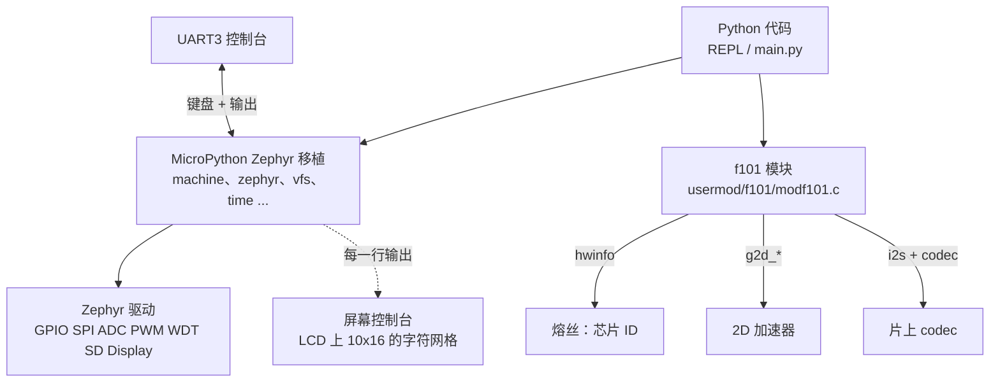

在板子上运行 [MicroPython](https://micropython.org/)：控制台上有 Python REPL，用 `machine` 访问引脚和外设，TF 卡作为文件系统挂载，可以驱动 LCD，另有一个 `f101` 模块，提供 MicroPython 没有通用绑定的硬件（芯片 ID、2D 加速器和音频输出）。应用是<strong>未经修改的 MicroPython Zephyr 移植</strong>（git 子模块，MIT）；`zephyr-components/micropython` 补充了板级配置、Zephyr 模块胶水和 `f101` 模块。它为 `yuzukineko` 板编译，REPL 在控制台上，即 UART1（PB0/PB1），115200。



开始之前，请先完成[配置开发环境](../zephyr-setup-env.md)和[获取 Zephyr 代码](../zephyr-get-source.md)。

## 能用的功能

下表是在应用迁到 `yuzukineko` 之前在 F101 EVB 上验证的；现在已为 `yuzukineko` 编译通过，但还没有在上面重新运行。两块板子不同的条目已标出。

| MicroPython | 硬件 |
| --- | --- |
| `machine.Pin(('gpiod', 5), Pin.OUT)` | GPIO 组 `gpioa` 到 `gpiof` |
| `machine.SPI('spi0')` | SPI0 |
| `machine.ADC(('adc', n))` | GPADC；通道 0 到 3 在 `conf/f101.overlay` 里声明 |
| `machine.PWM(('pwm', 2), freq=..., duty_ns=...)` | PD22 上的 PWM0-2，即屏幕背光输出（EVB 上是 PB0 到 PB3 的 `pwm_bl`） |
| `machine.WDT(timeout=...)`、`machine.reset()` | 看门狗；复位也是用看门狗（约 1 s） |
| `zephyr.DiskAccess`、`/sd` | TF 卡，由 `_boot.py` 挂载，FAT |
| `zephyr.Display(0)` | LCD，RGB565 1024×768：`write(buf, x, y, w, h)`、`as_framebuf()` |
| `f101.unique_id()` | 128 位芯片 ID |
| `f101.g2d_fill / g2d_blit / g2d_blend` | 作用于 `bytearray` 表面的 2D 加速器 |
| `f101.Audio(rate)` | 片上 codec 输出 |

I2C 不在列表里：`i2c1` 是触摸屏，`i2c0` 是关闭的。需要的话在自己的 overlay 里启用一个控制器及其 `pinctrl`。

## 准备

只有 `/sd` 才需要 TF 卡。它在启动时由移植自带的 `_boot.py` 挂载（FAT），并成为当前目录，`/sd/lib` 会加进 `sys.path`；卡上有 `main.py` 时，像标准 Zephyr 移植一样在启动时运行。

编译需要子模块：

```sh
git submodule update --init
git -C zephyr-components/micropython/micropython submodule update --init --depth 1 \
	lib/oofatfs lib/littlefs lib/micropython-lib
```

## 编译

```sh
. ./env.sh
zephyr-components/micropython/build.sh [build/upy] [-DCONFIG_MICROPY_HEAP_SIZE=...]
```

`build.sh` 先用交叉工具链配置，然后在<strong>不设置</strong> `CROSS_COMPILE` 的情况下编译：编译过程还会为主机编译 `mpy-cross`，设了 `CROSS_COMPILE` 就会把它编成 RISC-V 版，链接失败。它背后是下面这条 `west` 命令，应用是 `micropython/ports/zephyr`：

```sh
west build -b yuzukineko -d build/upy --cmake-only micropython/ports/zephyr -- \
	-DZEPHYR_EXTRA_MODULES=<本目录> \
	-DEXTRA_CONF_FILE=conf/f101.conf \
	-DEXTRA_DTC_OVERLAY_FILE=conf/f101.overlay \
	-DUSER_C_MODULES=usermod/f101/micropython.cmake
```

镜像链接在 `0x40000000`，与其他示例相同。构建目录之后的额外参数会传给 CMake。

| 文件 | 内容 |
| --- | --- |
| `conf/f101.conf` | `MICROPY_HEAP_SIZE` 1 MiB，内核堆 256 KiB，主栈 8 KiB，关闭网络/shell/日志，`/sd` 用的 `SDHC`/`DISK_ACCESS`，`f101.Audio` 用的 `I2S`/`AUDIO`/`AUDIO_CODEC`，`f101.unique_id()` 用的 `HWINFO` |
| `conf/f101.overlay` | 给 `machine.WDT` 用的 `watchdog0` 别名，以及列在 `zephyr,user` 的 `io-channels` 里的四个 ADC 通道（12 位、增益 1、内部参考），按顺序对应 `ADC(0)` 到 `ADC(3)` |
| `shim/` | 最小 C 库缺的 `alloca.h`、`math.h`、`unistd.h` |
| `src/f101_libc.c` | 工具链 libm 需要的 `__errno()`；模块链接 `-lm` |
| `src/screen_console.c` | LCD 上的控制台，见下文 |
| `usermod/f101/` | `f101` 模块 |

## 运行

用[编译与运行](../zephyr-build-run.md)里的任一方式下载；REPL 在控制台 UART1（115200）上。调试用方式一：`xfel ddr f101-s3`、`xfel write 0x40000000 build/upy/zephyr/zephyr.bin`、`xfel exec 0x40000000`。

```text
>>> import f101
>>> f101.unique_id().hex()
'…'
>>> from machine import Pin
>>> led = Pin(('gpiod', 5), Pin.OUT)
>>> led.toggle()
```

:::caution
板子只有一个 USB-C 口，它既是 xfel 下载口也是 UF2 盘口。先下载，再接其他设备。
:::

### 屏幕控制台

开启 `CONFIG_F101_MICROPY_SCREEN_CONSOLE`（有显示设备时默认 y）后，MicroPython 打印的所有内容也会画进帧缓冲层上的字符网格：10×16 像素的单元格，黑底绿字，最多 128 列 40 行，支持常见的光标处理和 `ESC [` 序列。UART 仍然是键盘，也仍然收到全部输出。做法是在链接时包装移植的 `mp_hal_stdout_tx_strn()`（`-Wl,--wrap=mp_hal_stdout_tx_strn`）。

## `machine` 与 `zephyr` 模块

这是标准 MicroPython Zephyr 移植的模块；设备名就是 Zephyr 设备名，所以引脚写成 `(组标签, 编号)`。这里验证过的用法：

```python
from machine import Pin, SPI, ADC, PWM, WDT
import machine, zephyr

Pin(('gpiod', 5), Pin.OUT).value(1)              # GPIO，组 gpioa .. gpiof
spi = SPI('spi0')                                # SPI0
adc = ADC(('adc', 0)); adc.read_u16()            # overlay 里的 GPADC 通道 0..3
pwm = PWM(('pwm', 2), freq=1000, duty_ns=500_000)   # PD22 上的 PWM0-2，请用 duty_ns
wdt = WDT(timeout=2000)                          # 看门狗
machine.reset()                                  # 看门狗复位，约 1 s
```

`machine.PWM(..., duty_u16=...)` 在周期超过约 130 µs 时会溢出 32 位（移植里把 `duty_u16` 乘以周期），所以请用 `duty_ns`。

`zephyr.Display(0)` 是 LCD（RGB565，1024×768）。`write(buf, x, y, w, h)` 从缓冲画一个矩形；`as_framebuf()` 返回与 `framebuf` 兼容的对象。MicroPython 的堆（1 MiB）放不下完整的 1024×768 RGB565 一帧（1.5 MB），请分条绘制。

## `f101` 模块

模块是 `usermod/f101/modf101.c`。凡依赖某个设备的部分，只有在设备树里该节点启用（`g2d`、`audio_codec`、`codec_analog`）时才会编译，所以没有它们的构建里就没有对应的名字。驱动返回的错误会以 `OSError(errno)` 抛出。

### `f101.unique_id()`

```python
f101.unique_id() -> bytes
```

128 位芯片 ID（16 字节，熔丝字 0 到 3），同一颗芯片每次读取、每次启动都相同。读不出时抛出 `OSError`。

### 2D 加速器

表面是普通缓冲（`bytearray`、`memoryview` 或任何支持缓冲协议的对象），里面是单平面的紧凑像素；平面格式（NV12、I420、YUYV）会被拒绝并抛出 `ValueError`。因为加速器直接读写内存，缓冲必须在 1:1 映射的内存里，这个配置下所有 RAM 都是（内核没有启用 MMU）。缓冲比 `width * height * 每像素字节数` 短时抛出 `ValueError("buffer too small")`。矩形是元组 `(x, y, w, h)`；`None` 表示整个表面。

像素格式（模块常量）：`ARGB8888`、`ABGR8888`、`RGBA8888`、`BGRA8888`、`XRGB8888`、`XBGR8888`、`RGB888`、`BGR888`、`RGB565`、`BGR565`。翻转标志：`FLIP_H`、`FLIP_V`。

```python
f101.g2d_fill(dst, width, height, format, color, rect=None)
```

用 `color` 填充 `dst` 的 `rect`，`color` 是 ARGB8888 值（`0xAARRGGBB`），不论 `dst` 是什么格式，由加速器负责转换。

```python
f101.g2d_blit(src, sw, sh, sfmt, dst, dw, dh, dfmt,
              src_rect=None, dst_rect=None, rotate=0, flags=0)
```

把 `src_rect` 拷贝到 `dst_rect` 并转换格式。两个矩形的大小决定缩放；`rotate` 为 0、90、180 或 270 度（90 和 270 时目标尺寸是旋转后的源尺寸）；`flags` 是 `FLIP_H`、`FLIP_V` 或两者。先旋转，再翻转。

```python
f101.g2d_blend(fg, fw, fh, ffmt, dst, dw, dh, dfmt, alpha=255, fg_rect=None, dst_rect=None)
```

把 `fg` 叠加到 `dst` 上，原地完成（source-over）。`alpha` 小于 255 时，会乘上前景的像素 alpha。

```python
W, H = 64, 64
a = bytearray(W * H * 4); b = bytearray(W * H * 4)
f101.g2d_fill(a, W, H, f101.ARGB8888, 0xFF0000FF)                 # 不透明蓝色
f101.g2d_fill(b, W, H, f101.ARGB8888, 0x80FF0000, (0, 0, 32, 64)) # 半透明红色，左半边
f101.g2d_blend(b, W, H, f101.ARGB8888, a, W, H, f101.ARGB8888)
```

### `f101.Audio`

```python
a = f101.Audio(rate=48000)
```

打开片上 codec 做输出：16 位立体声 I2S，`rate` 在 8000 到 48000 之间（请用 48000 或 44100）。同时只能打开一个 `Audio` 对象（否则 `OSError(EBUSY)`）。输出以 20 ms 为一块写出（池里 6 块，流启动前先写 3 块）。

| 方法 | 作用 |
| --- | --- |
| `write(buf)` | 排入 S16LE 立体声帧（每帧 4 字节）；全部排入后返回字节数，所以池满时会阻塞。最后不足一块的部分用静音补齐 |
| `tone(hz, ms, amp=12000)` | 播放 `hz` 的正弦波 `ms` 毫秒，阻塞；`hz` 必须在 1 到 rate/2 之间 |
| `volume(v)` | 输出音量 0 到 255（`AUDIO_PROPERTY_OUTPUT_VOLUME`） |
| `close()` | 让已排入的块播完，停止输出并释放（`__del__` 也会做） |

```python
a = f101.Audio(48000)
a.volume(150)
a.tone(440, 500)
a.close()
```

44.1 kHz 和 48 kHz 不能在同一次启动里混用（一个音频 PLL 只服务一族采样率）：先用到的采样率一直有效，直到下次复位。

## 限制与说明

- MicroPython 的堆是静态数组 `CONFIG_MICROPY_HEAP_SIZE`（这里为 1 MiB），会被填充进平铺镜像，所以堆越大 xfel 下载越慢。
- 屏幕背光由显示驱动在 PWM0-2 上控制；在 Python 里用 `PWM(('pwm', 2), ...)` 会改动同一个输出。
- `conf/f101.conf` 里关闭了网络；配置时出现的 NET 符号 Kconfig 警告，是板级默认值被覆盖造成的。
- G2D 调用是同步的：加速器完成后才返回，否则抛出 `OSError`。
- 屏幕控制台只是方便的镜像；REPL 本身运行在 UART 上。

## 代码结构

| 路径 | 内容 |
| --- | --- |
| `micropython/` | 未修改的 MicroPython（git 子模块）；应用是 `micropython/ports/zephyr` |
| `build.sh` | 上面介绍的配置 + 编译 |
| `conf/f101.conf`、`conf/f101.overlay` | 板级配置 |
| `usermod/f101/modf101.c` | `f101` 模块（`unique_id`、`g2d_*`、`Audio`） |
| `usermod/f101/micropython.cmake` | `USER_C_MODULES` 入口 |
| `src/`、`shim/` | libc 缺口与屏幕控制台 |
| `CMakeLists.txt`、`Kconfig`、`zephyr/module.yml` | Zephyr 模块胶水，`F101_MICROPY_SCREEN_CONSOLE` |
