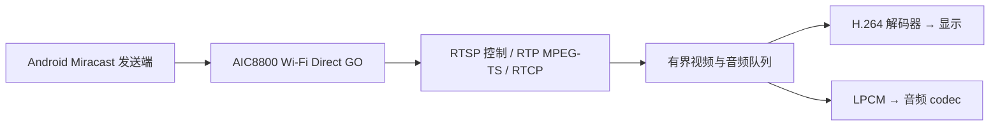

Miracast 接收器支持具有 Miracast 功能的 Android 手机的**无线显示／屏幕镜像**。它使用 AIC8800 Wi-Fi Direct、F101 H.264 解码器、显示视频层及音频 codec，不需要在手机上安装应用或开启 ADB 调试。只提供 Google Cast 的手机不能发送此协议；仅凭厂商的菜单名称不能确定是否支持。

## 版本与验证

接收器与 NekoBox 集成同时存在于 4.2.2 组件基线和独立的 4.5 分支。按[版本指南](../zephyr-4-5.md)选择配套分支。主机协议、P2P 控制和 NekoBox 生命周期测试已通过；4.5 样例的 RAM 与 XIP 配置均已构建。Android 发现、协商、实际画面、声音、重连及长时间播放仍需实体手机验证。

## 从 NekoBox 连接

1. 打开 [NekoBox](nekobox.md) 首页的 **Miracast**，页面自动开始接收。
2. 打开手机的**无线显示／屏幕镜像**，选择 **NekoBox Miracast**。
3. 必要时使用页面的停止、重试按钮。离开页面会停止接收器，恢复普通 Wi-Fi 和原先启用的 DLNA 服务。

Miracast 运行时独占无线接口，不能同时保留 STA 连接或 DLNA 接收器，不需要 TF 卡。等待连接时会反复打开 WPS 按键配对窗口，因此请在准备连接手机时再启动接收。

| NekoBox 配置 | 默认值 | 用途 |
| --- | --- | --- |
| `CONFIG_NEKOBOX_FEATURE_MIRACAST` | `y` | 接收器、首页磁贴和页面；设为 `n` 移除功能 |
| `CONFIG_NEKOBOX_MIRACAST_NAME` | `NekoBox Miracast` | 设备名，1–32 个可打印 ASCII 字节 |

## 构建独立接收器

激活所选版本的环境，默认样例在 RAM 运行：

```sh
west build -b yuzukineko -d build/miracast zephyr-components/miracast/samples/receiver
```

XIP 使用独立输出目录：

```sh
west build -b yuzukineko -d build/miracast-xip zephyr-components/miracast/samples/receiver -- \
  -DEXTRA_CONF_FILE=xip.conf -DDTC_OVERLAY_FILE=boards/yuzukineko_xip.overlay
```

4.5 请将这些输出放在 `build/zephyr-4.5.0/` 下。按[编译与运行](../zephyr-build-run.md)选择对应镜像流程：XIP 应用写入 NOR `0x80000`，当前版本的 FEL loader 在 RAM `0x20000` 运行；保留 NOR 启动区和采样参数。

等待串口出现 `Miracast: discoverable`，再在手机上选择 **YuzukiNeko Miracast**。样例通过串口报告会话状态和解码帧数；手机断开后移除组并重新准备接收。

| 样例配置 | 默认值 | 用途 |
| --- | --- | --- |
| `CONFIG_SAMPLE_WFD_NAME` | `YuzukiNeko Miracast` | 广播设备名，1–32 个可打印 ASCII 字节 |
| `CONFIG_SAMPLE_WFD_720P` | `n` | 额外提供 1280×720p30，需要更多解码内存和吞吐量 |
| `CONFIG_SAMPLE_WFD_PEER` | 空 | 通过已有链路进行传输测试，跳过 P2P 建组 |

默认提供必选的 640×480p60、constrained-baseline H.264 level 3.1 以及 LPCM 48 kHz、16 位立体声。协商时序不代表板子能按该帧率交付每一帧。

## 协议与应用接口



核心覆盖 RTSP M1–M7、暂停／继续、TEARDOWN、保活和 IDR 请求；RTP payload type 33 承载 MPEG-TS，解析 PAT/PMT、PES 与 PTS。支持 RTCP 接收报告和 BYE；丢包或不连续触发恢复，媒体按配置的源地址和协商端口校验。

将 `miracast/` 加入 `ZEPHYR_EXTRA_MODULES`，启用 `CONFIG_MIRACAST` 并包含 `<miracast/miracast.h>`。`miracast_receiver_start()` 异步启动，start/stop 应在应用线程调用，不能在回调内调用。回调缓冲仅在返回前有效，应复制到有界队列后再解码。F101 播放器需启用 `CONFIG_MIRACAST_PLAYER`，包含 `<miracast/player.h>`，先启动播放器，再将 `miracast_player_media` 传给接收器；停止时先停接收器，再停播放器。NekoBox 的 UI 与播放器控制归 UI 线程。

尚未实现 HDCP／受保护内容、UIBC／触摸回传、TCP 交织媒体、RTP FEC、包重排、STA/GO 并存或 P2P group-client。样例提供 LPCM；核心可选的 AAC 处理需要应用提供解码器。

## 主机检查

```sh
sh zephyr-components/miracast/tests/host/run.sh
sh zephyr-components/aic8800/tests/p2p/run.sh
sh zephyr-components/nekobox/tests/miracast/run.sh
```

需要 GCC、Python 3 和带 libx264 的 FFmpeg。ASan/UBSan 检查覆盖分片 RTSP 与传输流、错误报文、媒体限制、丢包恢复、RTCP、保活、多次 socket 清理和应用生命周期。P2P 测试使用无线接口桩，不验证手机上的 Wi-Fi 发现。
