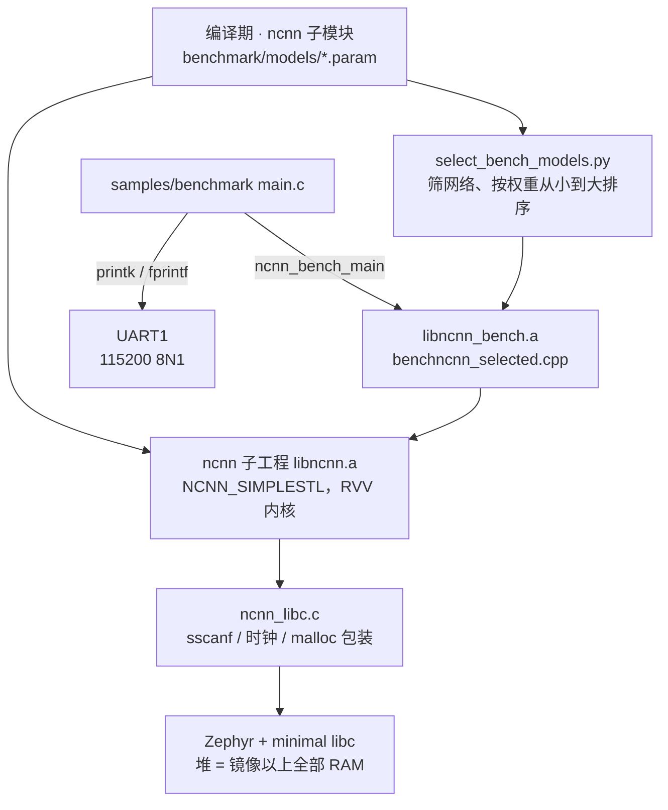

[ncnn](https://github.com/Tencent/ncnn) 是腾讯开源的轻量神经网络推理框架。`zephyr-components/ncnn` 把它做成一个 Zephyr 模块：ncnn 本身是子模块 `ncnn/ncnn`，用它自己的 CMake 工程另外编成静态库，再链进固件。F101 的 C907 核带 RISC-V 向量扩展（RVV 1.0，VLEN 128 位），模块在固件打开向量扩展时让 ncnn 使用它自带的 RVV 内核。

组件自带一个 benchmark 示例 `samples/benchmark`：把 ncnn 的 `benchncnn` 编进固件，在板子上依次跑几个内置网络，从串口打印每个网络的单次推理耗时。<strong>这个示例不加载真实模型文件，也不输出识别结果</strong>，它测的是“这块板子跑某个网络要多久”。



开始前请先完成 [配置开发环境](../zephyr-setup-env.md) 和 [获取 Zephyr 代码](../zephyr-get-source.md)。

## 准备：ncnn 源码和模型

### 拉子模块

ncnn 是 `zephyr-components` 的 git 子模块，没拉的话目录是空的，编译会直接报 `ncnn sources missing`：

```sh
cd ~/f101-zephyr/zephyr-components
git submodule update --init ncnn/ncnn
```

### 模型是怎么“放进固件”的

这个示例没有 SD 卡、没有文件系统，<strong>网络描述（`.param`）在编译时转成 C 头文件，直接编进固件</strong>：

1. `ext/CMakeLists.txt` 遍历 `ncnn/ncnn/benchmark/models/*.param`，对每个文件调 ncnn 自带的 `ncnn_generate_param_header.cmake`，生成 `param/<名字>.hex.h`，里面是 `.param` 文本的字节数组。
2. 同一个文件再用 `benchncnn_param_data.h.in` 生成 `benchncnn_param_data.h`，把所有头文件 `#include` 进来。
3. `benchncnn.cpp` 调 `benchmark("名字", 输入, opt, 名字_param_data)`，用 `Net::load_param_mem()` 从内存读网络结构。
4. <strong>权重没有放进固件</strong>。`benchncnn` 用 `DataReaderFromEmpty` 做权重来源，所以示例只测速度，网络没有真实的识别能力。

ncnn 在这个模块里<strong>只能从内存加载网络</strong>，`fopen()` 一类函数在 `ncnn_libc.c` 里是桩，永远失败。要在自己的程序里跑真实模型，需要把 `.param` 和 `.bin` 都作为数组编进固件（或自己从别处读到内存），再调 `ncnn::Net` 的内存加载接口。`ncnn/ncnn/src/net.h` 里这几个接口的声明是：

```cpp
int load_param_mem(const char* mem);
size_t load_param(const unsigned char* mem);
size_t load_model(const unsigned char* mem);
```

`load_param_mem()` 接收以 `\0` 结尾的文本 `.param`；`load_param()` / `load_model()` 接收二进制的 `.param.bin` 和 `.bin`。真实权重必须是 fp32：模块用 `NCNN_INT8=OFF` 编译，没有 int8 内核。

### 选哪些模型

选择由两个 Kconfig 选项决定，筛选和排序由 `select_bench_models.py` 在编译期完成（`ext/CMakeLists.txt` 里 `execute_process` 调用它）：

| 选项 | 作用 |
| --- | --- |
| `CONFIG_NCNN_BENCHMARK_MODELS` | 要跑的网络名，逗号分隔；留空表示全部 |
| `CONFIG_NCNN_BENCHMARK_MAX_WEIGHTS_MB` | fp32 权重超过这个大小（MB）的网络直接不跑；0 表示不限制，默认 5 |

脚本做了四件事：

- 去掉名字以 `_int8` 结尾的网络；
- 从 `.param` 里累加卷积、反卷积、全连接层的权重个数，乘 4 得到 fp32 字节数，大于 `MAX_WEIGHTS_MB` 的去掉；
- 剩下的按权重大小<strong>从小到大</strong>重排，这样放不下的大网络不会抢走它后面网络的内存；
- 在每个结果的 `fprintf` 前面插一个 `if (!ncnn_zephyr_oom_seen())`，期间有 `malloc()` 失败的网络<strong>不打印结果</strong>。

筛选部分是这样（`select_bench_models.py` 59–63 行、77–78 行）：

```python
if (want is None or name in want) and not name.endswith("_int8"):
    size = weight_mb(name)
    if max_mb <= 0 or size <= max_mb:
        calls.append((size, name, line))
continue
```

```python
calls.sort()
out[first] = "".join(l for _, _, l in calls)
```

编译时脚本会往 stderr 打出最终入选的网络和权重大小。这是 ncnn 子模块 `benchmark/models` 里全部非 int8 网络的 fp32 权重和输入尺寸（从小到大）：

| 网络 | 权重 | 输入 | 网络 | 权重 | 输入 |
| --- | --- | --- | --- | --- | --- |
| `blazeface` | 0.3 MB | 128×128 | `proxylessnasnet` | 16.2 MB | 224×224 |
| `FastestDet` | 0.9 MB | 352×352 | `mobilenet` | 16.8 MB | 224×224 |
| `yolo-fastestv2` | 1.0 MB | 352×352 | `regnety_400m` | 17.2 MB | 224×224 |
| `yolo-fastest-1.1` | 1.3 MB | 320×320 | `mnasnet` | 17.4 MB | 224×224 |
| `nanodet_m` | 3.7 MB | 320×320 | `mobilenet_yolo` | 20.2 MB | 416×416 |
| `squeezenet` | 4.9 MB | 227×227 | `mobilenet_v3` | 20.5 MB | 224×224 |
| `shufflenet` | 7.2 MB | 224×224 | `efficientnet_b0` | 20.9 MB | 224×224 |
| `shufflenet_v2` | 9.0 MB | 224×224 | `squeezenet_ssd` | 22.1 MB | 300×300 |
| `vision_transformer` | 9.4 MB | 384×384 | `mobilenet_ssd` | 23.1 MB | 300×300 |
| `mobilenet_v2` | 13.9 MB | 224×224 | `yolov4-tiny` | 24.2 MB | 416×416 |
| `mobilenetv2_yolov3` | 14.8 MB | 352×352 | `googlenet` | 28.0 MB | 224×224 |
| `efficientnetv2_b0` | 28.3 MB | 224×224 | `resnet18` | 46.7 MB | 224×224 |
| `resnet50` | 102.0 MB | 224×224 | `alexnet` | 243.8 MB | 227×227 |
| `vgg16` | 553.4 MB | 224×224 | | | |

板子只有 16 MB PSRAM，堆约 13 MB，而层在初始化时会把权重再复制一份，所以 5 MB 的默认上限已经是比较大的网络了。<strong>ncnn 不检查大部分内存分配</strong>，权重放不下时网络会失败或直接崩溃，不要把 `MAX_WEIGHTS_MB` 设成 0 去试大网络。

指定网络的例子：只跑 `blazeface` 和 `yolo-fastestv2`：

```sh
west build -b yuzukineko -d build/ncnn zephyr-components/ncnn/samples/benchmark -- \
    '-DCONFIG_NCNN_BENCHMARK_MODELS="blazeface,yolo-fastestv2"'
```

## 编译

```sh
. ~/f101-zephyr/env.sh
cd ~/f101-zephyr
west build -b yuzukineko -d build/ncnn zephyr-components/ncnn/samples/benchmark
```

<div class="asciinema-cast" data-src="assets/casts/zephyr/apps-ncnn/build.cast" data-speed="8"></div>

产物是 `build/ncnn/zephyr/zephyr.bin`，约 1.16 MB，链接地址 `0x40000000`。

:::note
示例的 `prj.conf` 里已经打开了 `CONFIG_MINIMAL_LIBC=y`，不用再从命令行传。ncnn 子工程的工具链文件 `toolchain.cmake.in` 里写死用 Zephyr 精简 C 库（minimal libc）的头文件，`ncnn_libc.c` 也只实现了精简库缺的那几个函数。`yuzukineko` 的默认 C 库是 picolibc，它把 `feof` 定义成宏，`ncnn_libc.c` 里的 `int feof(FILE *f)` 就会报 `expected ')' before '*' token`。在自己的应用里用 ncnn 模块时，也要在 `prj.conf` 里加这一项。
:::

第一次编译要把整个 ncnn 编一遍（`BUILD_ALWAYS ON`，每次 west build 都会进 ncnn 子工程检查，没改动时很快）。

## 运行

用 [编译与运行](../zephyr-build-run.md) 里的任一种方式下载，控制台是 UART1（PB00/PB01，115200 8N1）。调试用方式一：

```sh
xfel ddr f101-s3
xfel write 0x40000000 build/ncnn/zephyr/zephyr.bin
xfel exec 0x40000000
```

不需要 TF 卡、WiFi 或任何外设。没有屏幕输出，跑完后串口会打印 `ncnn benchmark done`。

本文的日志是在板子上真实跑出来的（`DISPLAY`、`GPIO`、`SPI` 等驱动在 `prj.conf` 里都关了，省出内存给网络）：

```text
*** Booting Zephyr OS build b6f3dfe1a1f4 ***
ncnn: vector extension on, VLEN 128 bits
ncnn: free heap is all RAM above the image, starting
loop_count = 4
num_threads = 1
powersave = 0
gpu_device = -1
cooling_down = 0
           blazeface  min =  175.92  max =  177.27  avg =  176.52
          FastestDet  min =  710.23  max =  710.70  avg =  710.43
      yolo-fastestv2  min =  670.47  max =  674.43  avg =  671.97
    yolo-fastest-1.1  min =  759.50  max =  761.41  avg =  760.05
ncnn benchmark done, ret 0
```

### 输出怎么看

| 行 | 含义 |
| --- | --- |
| `ncnn: vector extension on, VLEN 128 bits` | `main.c` 读 `vlenb` 寄存器得到向量寄存器宽度。固件没开向量扩展时这里是 `ncnn: no vector extension` |
| `loop_count = 4` | 每个网络正式计时的次数，对应 `args[1]` |
| `num_threads = 1` | ncnn 线程数。模块用 `NCNN_THREADS=OFF` 编译，只能是 1 |
| `powersave = 0` | 大小核策略，C907 是单核，没作用 |
| `gpu_device = -1` | 不使用 Vulkan GPU |
| `cooling_down = 0` | 为 0 才不会在每个网络前睡 10 秒“降温” |
| `<网络>  min / max / avg` | 一次完整前向推理（建立 Extractor、输入、取输出）的耗时，<strong>单位毫秒</strong>，4 次计时里的最小、最大、平均 |
| `ncnn benchmark done, ret 0` | `ncnn_bench_main()` 返回值，0 表示正常结束 |

`benchncnn` 对每个网络先做 8 次不计时的预热，再计时 4 次。输入用 0.01 填充，权重是空数据，因此耗时只反映网络结构和内核实现，不反映任何识别结果。

日志里默认入选的 6 个网络（`blazeface`、`FastestDet`、`yolo-fastestv2`、`yolo-fastest-1.1`、`nanodet_m`、`squeezenet`）只打印了前 4 个。`nanodet_m` 和 `squeezenet` 没有出现：按上面的规则，没有结果行说明这两个网络运行期间有 `malloc()` 返回了 NULL，结果被丢弃。

## RVV 加速

### 怎么打开

两处缺一不可：

| 位置 | 内容 |
| --- | --- |
| `prj.conf` | `CONFIG_SUN252I_F101_RVV=y`。它选上 `RISCV_ISA_EXT_V`，编译器得到 `-march=rv32imafdcv…`，并让每个中断和异常帧保存向量寄存器 |
| `CMakeLists.txt` | `CONFIG_RISCV_ISA_EXT_V` 为真时 `NCNN_USE_RVV=ON`，传给 ncnn 子工程的 `NCNN_RVV` |

子工程用的是和固件相同的 `-mabi/-march`（`CMakeLists.txt` 从 `TOOLCHAIN_C_FLAGS` 里取出来），ncnn 的 `src/layer/riscv/` 下的内核（卷积、全连接、池化、激活等，共 170 多个文件，例如 `convolution_riscv.cpp`、`innerproduct_riscv.cpp`）随之编进 `libncnn.a`。ncnn 的 RVV 内核是编译期选择，没有运行时切换。

### 两处必要的补丁

- <strong>向量单元检测</strong>：ncnn 只会在 Linux 下通过辅助向量检测向量单元，在其他系统上一律报告“没有向量单元、向量长度 0”，这会让张量内存布局（pack 大小）算错，而内核又是按有向量单元编译的，两边不一致。`ext/riscv_cpu.cpp` 重新定义了这两个函数：

```cpp
int cpu_support_riscv_v()
{
    return 1;
}

int cpu_riscv_vlenb()
{
    int vlenb;

    asm volatile("csrr %0, vlenb" : "=r"(vlenb));
    return vlenb;
}
```

  `ext/weaken.cmake` 在编译完后用 `objcopy --redefine-sym` 把 `libncnn.a` 里 `cpu.cpp.obj` 的原版同名符号改名，保证链接时用的是上面这份。
- <strong>线程栈</strong>：开了向量扩展后每个线程栈要能放下一个中断帧（VLEN 128 时约 560 字节），所以示例把主线程栈加到了 32 KiB（`CONFIG_MAIN_STACK_SIZE=32768`）。

### 向量和标量对比

用同样的命令、`CONFIG_SUN252I_F101_RVV=n` 另外编一份固件（二进制约 1.0 MB，`ncnn: no vector extension`），在同一块板上跑，单线程，毫秒：

| 网络 | 标量 avg | 向量 avg | 倍数 |
| --- | --- | --- | --- |
| `blazeface` | 399.13 | 176.52 | 2.26 |
| `yolo-fastestv2` | 1083.18 | 671.97 | 1.61 |
| `yolo-fastest-1.1` | 1562.98 | 760.05 | 2.06 |

标量版的原始日志：

```text
*** Booting Zephyr OS build b6f3dfe1a1f4 ***
ncnn: no vector extension
ncnn: free heap is all RAM above the image, starting
loop_count = 4
num_threads = 1
powersave = 0
gpu_device = -1
cooling_down = 0
           blazeface  min =  398.72  max =  399.32  avg =  399.13
      yolo-fastestv2  min = 1082.95  max = 1083.44  avg = 1083.18
    yolo-fastest-1.1  min = 1562.09  max = 1564.48  avg = 1562.98
ncnn benchmark done, ret 0
```

表里每个数只有一次上电的结果。标量版没有打印 `FastestDet`、`nanodet_m` 和 `squeezenet`，同样是因为这三个网络运行期间有 `malloc()` 失败（标量和向量布局的内存用量不同，所以失败的网络不一样）。

## 功能与修改位置

| 功能 | 位置 | 怎么改 |
| --- | --- | --- |
| 选网络 | `CONFIG_NCNN_BENCHMARK_MODELS` | 命令行 `-D` 或 `prj.conf`，见上 |
| 权重大小上限 | `CONFIG_NCNN_BENCHMARK_MAX_WEIGHTS_MB` | 同上 |
| 循环次数、线程、省电、GPU、降温 | `samples/benchmark/src/main.c` 的 `args[]` | 改字符串，见下 |
| 向量扩展开关 | `prj.conf` 的 `CONFIG_SUN252I_F101_RVV` | `y` / `n` |
| 堆大小 | `prj.conf` 的 `CONFIG_COMMON_LIBC_MALLOC_ARENA_SIZE` | `-1` 表示镜像以上全部 RAM |
| 加载自己的模型 | 自己的应用，通过 `ZEPHYR_EXTRA_MODULES` 引入模块 | 见下 |
| 子工程的 ncnn 编译选项 | `ext/CMakeLists.txt` | 改 `set(NCNN_xxx …)` |

### 改计时参数

`main()` 里的参数就是 `benchncnn` 的命令行（`main.c` 14–32 行）：

```c
int main(void)
{
	char *args[] = {"benchncnn", "4", "1", "0", "-1", "0", NULL};

#ifdef CONFIG_RISCV_ISA_EXT_V
	unsigned long vlenb;

	__asm__ volatile("csrr %0, vlenb" : "=r"(vlenb));
	printk("ncnn: vector extension on, VLEN %lu bits\n", vlenb * 8);
#else
	printk("ncnn: no vector extension\n");
#endif
	printk("ncnn: free heap is all RAM above the image, starting\n");

	int ret = ncnn_bench_main(6, args);

	printk("ncnn benchmark done, ret %d\n", ret);
	return 0;
}
```

`args[1..5]` 依次是 `loop_count`、`num_threads`、`powersave`、`gpu_device`、`cooling_down`，`ncnn_bench_main(6, args)` 的 6 是参数个数。想多计几次取平均，把 `"4"` 改成 `"20"`。`benchncnn` 还支持 `param=…` 和 `shape=…` 形式的第 7 个以后的参数，用来测外部 `.param` 文件，但这里 `fopen()` 总是失败，所以不能用。

`ncnn_bench_main()` 的实现在 `ext/bench_entry.cpp`，只是把 `benchncnn.cpp` 的 `main` 用宏改名后转调：

```cpp
/* the main() of benchncnn is built under another name, C++ linkage */
extern int ncnn_bench_main_cpp(int argc, char** argv);

extern "C" int ncnn_bench_main(int argc, char** argv)
{
    return ncnn_bench_main_cpp(argc, argv);
}
```

### 在自己的应用里用 ncnn

不用 benchmark 示例，直接把模块引进自己的应用。`CMakeLists.txt` 里在 `find_package(Zephyr)` 之前加：

```cmake
list(APPEND ZEPHYR_EXTRA_MODULES /path/to/zephyr-components/ncnn)
```

`prj.conf`：

```ini
CONFIG_CPP=y
CONFIG_NCNN=y
CONFIG_SUN252I_F101_RVV=y
CONFIG_FPU=y
```

再加上 `CONFIG_MINIMAL_LIBC=y`。把 `CONFIG_NCNN_BENCHMARK` 设为 `n` 就不会编 benchncnn，只链 `libncnn.a`。之后在 C++ 里包含 `net.h`、用 `ncnn::Net` 加载并推理即可。堆和线程栈的要求同上。

## 配置选项

| 选项 | 默认 | 说明 |
| --- | --- | --- |
| `CONFIG_NCNN` | n | 编 ncnn 并链入固件。依赖 `CPP` 和 `RISCV` |
| `CONFIG_NCNN_BENCHMARK` | y | 编 benchncnn，入口 `ncnn_bench_main(argc, argv)`，网络内置、权重为空 |
| `CONFIG_NCNN_BENCHMARK_MODELS` | 空 | 要跑的网络，逗号分隔；空表示全部。int8 网络永远不跑 |
| `CONFIG_NCNN_BENCHMARK_MAX_WEIGHTS_MB` | 5 | 权重超过这个大小（MB，fp32）的网络不跑；0 表示不限 |

`prj.conf` 里和本示例有关的主要选项：

| 选项 | 作用 |
| --- | --- |
| `CONFIG_CPP=y` | C++ 支持（ncnn 是 C++） |
| `CONFIG_NCNN=y` | 打开 ncnn 模块 |
| `CONFIG_NCNN_BENCHMARK=y` | 编 benchncnn |
| `CONFIG_SUN252I_F101_RVV=y` | 打开向量扩展，ncnn 使用 RVV 内核 |
| `CONFIG_FPU=y` | 硬件浮点 |
| `CONFIG_FPU_SHARING=y` | 多线程共用浮点寄存器 |
| `CONFIG_PRINTK=y` | 用 `printk` 输出 |
| `CONFIG_LOG=n` | 关掉日志子系统，省内存 |
| `CONFIG_SHELL=n` | 关掉 shell |
| `CONFIG_DEVMEM_SHELL=n` | 关掉 devmem shell |
| `CONFIG_MAIN_STACK_SIZE=32768` | 主线程栈 32 KiB（含向量寄存器的中断帧） |
| `CONFIG_COMMON_LIBC_MALLOC_ARENA_SIZE=-1` | 镜像以上的全部 RAM 作为 `malloc` 堆 |
| `CONFIG_HEAP_MEM_POOL_SIZE=262144` | 内核堆 256 KiB |
| `CONFIG_DISPLAY=n` | 关显示，省 1.2 MB 帧缓冲 |
| `CONFIG_PWM=n`、`CONFIG_DMA=n`、`CONFIG_GPIO=n`、`CONFIG_WATCHDOG=n` | 关用不到的驱动 |
| `CONFIG_G2D=n`、`CONFIG_USB_PHY_SUNXI=n`、`CONFIG_ADC=n` | 同上 |
| `CONFIG_SPI=n`、`CONFIG_I2C=n`、`CONFIG_MIPI_DBI=n`、`CONFIG_WDT_SUNXI=n` | 同上 |

## 代码结构

| 文件 | 内容 |
| --- | --- |
| `zephyr-components/ncnn/CMakeLists.txt` | 模块入口：算出架构选项，用 `ExternalProject_Add` 编 ncnn 子工程，把生成的库作为导入库链入 |
| `zephyr-components/ncnn/toolchain.cmake.in` | 子工程工具链文件：交叉编译器、`-march/-mabi`、精简 C 库头文件、`shim/` |
| `zephyr-components/ncnn/ext/CMakeLists.txt` | 子工程：关掉不用的 ncnn 特性，embed `.param`，调用 `select_bench_models.py`，生成 `libncnn_bench.a` |
| `zephyr-components/ncnn/ext/weaken.cmake` | 编完后改库里的符号：`operator new/delete` 弱化，向量检测符号改名 |
| `zephyr-components/ncnn/ext/riscv_cpu.cpp` | 向量单元检测的替代实现 |
| `zephyr-components/ncnn/ext/bench_entry.cpp` | `ncnn_bench_main()` 入口 |
| `zephyr-components/ncnn/select_bench_models.py` | 编译期筛选、排序 benchncnn 里的网络 |
| `zephyr-components/ncnn/ncnn_libc.c` | ncnn 需要而精简 C 库没有的函数 |
| `zephyr-components/ncnn/shim/` | 补齐的头文件（`setjmp.h`、`fenv.h`、`math.h`、`sys/time.h` 等） |
| `zephyr-components/ncnn/samples/benchmark/` | 示例：`prj.conf`、`CMakeLists.txt`、`src/main.c` |

### ncnn_libc.c 提供了什么

ncnn 用到、而精简 C 库没有的 C 函数都在这里：

- `sscanf()`：网络描述解析器用，支持 `%d %i %f %s %[集合] %n %%`、宽度、`*` 和 `l`；
- 时钟（`gettimeofday` 一类）和 `usleep()`（转 `k_usleep()`）；
- `fopen`、`fclose`、`feof`、`fgetc`、`fgets`、`fscanf` 等文件函数：全是桩，永远失败；
- `__errno()`：给工具链的 libm 用；
- `__wrap_malloc()`：链接时用 `-Wl,--wrap=malloc` 把 `malloc` 包起来，失败时记一个标志，供 benchmark 判断“这个网络是不是内存不够”。

后一项的代码：

```c
extern void *__real_malloc(size_t size);

static volatile int oom_seen;

void *__wrap_malloc(size_t size)
{
	void *p = __real_malloc(size);

	if (p == NULL && size != 0) {
		oom_seen = 1;
	}
	return p;
}

void ncnn_zephyr_oom_clear(void)
{
	oom_seen = 0;
}

int ncnn_zephyr_oom_seen(void)
{
	return oom_seen;
}
```

### 内存

- 权重是 fp32，放在 RAM 里；层在 `create_pipeline` 时会再复制一份（有的还会转成 pack 布局）。
- `CONFIG_COMMON_LIBC_MALLOC_ARENA_SIZE=-1` 把镜像以上的全部 RAM 给堆；16 MB PSRAM 的板子上约 13 MB，能装下几 MB 参数量级的网络。
- ncnn 不检查这些分配，装不下的网络会失败或崩溃，所以 benchmark 才按权重大小设了上限并排序。

## 已知限制

- <strong>不支持 int8</strong>：`NCNN_INT8=OFF`，名字带 `_int8` 的网络一律不跑。
- <strong>不支持文件加载</strong>：只能从内存加载网络，`fopen()` 永远返回 NULL。
- <strong>不支持多线程</strong>：`NCNN_THREADS=OFF`、`NCNN_OPENMP=OFF`，`num_threads` 只能是 1。
- <strong>不支持 Vulkan/GPU</strong>：`NCNN_VULKAN=OFF`。
- <strong>不支持 fp16 内核</strong>：`NCNN_ZFH=OFF`，`NCNN_XTHEADVECTOR=OFF`。
- <strong>benchmark 没有真实权重</strong>，不能得到分类或检测结果，只有耗时。
- 内存紧：堆约 13 MB，大网络（权重几十 MB 以上）放不下；默认上限 5 MB 的网络中，`nanodet_m`、`squeezenet` 在向量版固件里也因为 `malloc()` 失败没有结果。
- 必须用精简 C 库（`CONFIG_MINIMAL_LIBC=y`），见编译一节。

## 排错

| 现象 | 原因 |
| --- | --- |
| `ncnn sources missing, run: git submodule update --init` | 子模块没拉，见开头 |
| 编译 `ncnn_libc.c` 报 `expected ')' before '*' token`（`feof`） | 应用的 `prj.conf` 里没有 `CONFIG_MINIMAL_LIBC=y`，默认的 C 库是 picolibc |
| 某个网络没有结果行 | 运行期间有 `malloc()` 失败，结果被丢弃；缩小 `MAX_WEIGHTS_MB` 或用 `MODELS` 指定网络 |
| 串口没有任何输出 | 确认下载方式和 UART1 接线，见 [编译与运行](../zephyr-build-run.md) |
| 结果比表里慢很多 | 检查启动日志是不是 `no vector extension`，以及 `cooling_down` 是否为 0 |
