NekoBox 是 YuzukiNeko 的媒体与游戏应用：触摸界面（LVGL，1024×768），有带时钟的主屏、TF 卡文件浏览器、视频播放器（MP4 H.264 + AAC）、支持双指缩放的照片查看器、NES / Game Boy / Game Boy Color / Game Boy Advance 游戏、计算器、USB 副屏、带网络校时的 Wi-Fi，以及设置界面。它是一个应用而不是模块，并且<strong>直接在 SPI NOR flash 中原地运行</strong>（XIP）。代码在 `zephyr-components/nekobox`。

每个功能都是一个有独立开关的<strong>特性</strong>（`CONFIG_NEKOBOX_FEATURE_*`）。关掉的特性不会被编译，也不会留下磁贴、设置行或文件类型；`main()` 里没有对应的 `#ifdef`。特性把自己提供的东西（界面、主屏磁贴、设置行、文件类型、启动步骤）登记在由链接器收集的记录里，所以新增特性只是新增一个目录，其他地方都不用改。

| 特性 | 开关 | 说明 |
| --- | --- | --- |
| 主屏 | 始终有 | 时钟（点击可设置时间）和各特性的磁贴 |
| 文件浏览器 | `NEKOBOX_FEATURE_FILES` | 浏览 TF 卡；视频、照片、游戏从这里打开 |
| 设置 | `NEKOBOX_FEATURE_SETTINGS` | 其他特性往里添加设置行的界面 |
| 亮度、主题 | `NEKOBOX_FEATURE_BRIGHTNESS`、`NEKOBOX_FEATURE_THEME_PICKER` | 设置行：背光、深色/浅色、强调色 |
| 视频 | `NEKOBOX_FEATURE_VIDEO` | MP4（H.264 + AAC）和裸 H.264，拖动、音量、续播、最近列表 |
| 照片 | `NEKOBOX_FEATURE_PHOTOS` | JPEG 和 PNG，双指缩放 |
| 计算器 | `NEKOBOX_FEATURE_CALCULATOR` | 四则运算口袋计算器 |
| 游戏 | `NEKOBOX_FEATURE_GAMES` | NES（nofrendo）、Game Boy / Color（mGBA，从 flash 窗口运行）、Game Boy Advance（带 RISC-V 重编译器的 gpSP，ROM 最大 32 MiB） |
| USB 副屏 | `NEKOBOX_FEATURE_USB_DISPLAY` | 电脑的扩展屏，带触摸 |
| 网络 | `NEKOBOX_FEATURE_NET` | Wi-Fi（AIC8800，保存密码）和 NTP 校时 |
| 蓝牙 | `NEKOBOX_FEATURE_BT` | 启动时检查一次，然后随芯片一起关闭；结果显示在设置里 |

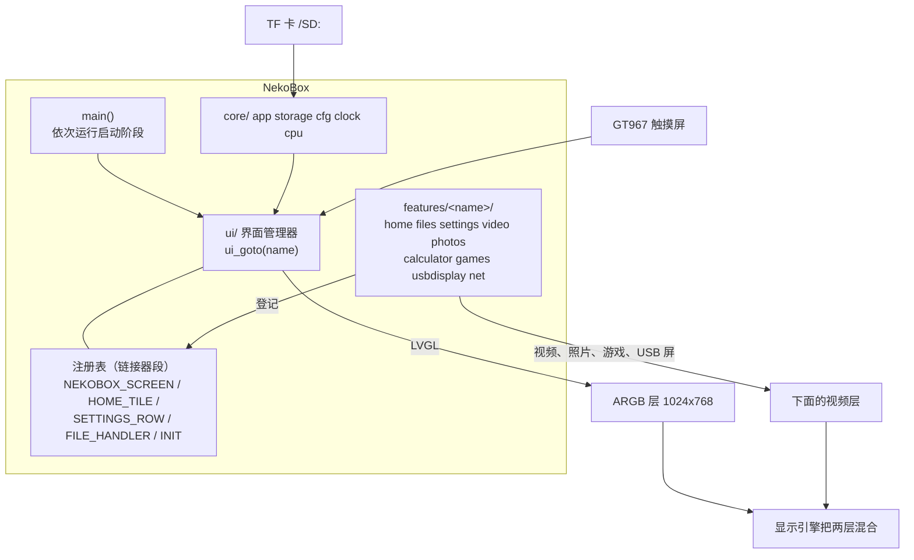

LVGL 把界面画在 ARGB 帧缓冲层上。视频、照片、游戏和 USB 屏走视频引擎或缩放通路，输出到下面的视频层，再由显示引擎把两层混合。在显示视频层的界面上，没有东西可画时界面层会被关掉（`ui_overlay_set()`），把内存带宽还给解码器。

开始之前，请先完成[配置开发环境](../zephyr-setup-env.md)和[获取 Zephyr 代码](../zephyr-get-source.md)。

## 准备

把文件放在 TF 卡上（FAT 或 exFAT，支持长文件名）。播放器不会格式化卡。

| 内容 | 文件 |
| --- | --- |
| 视频 | H.264 视频 + AAC 音频（44.1 或 48 kHz）的 `.mp4`；也支持裸 H.264 流 |
| 照片 | JPEG（视频引擎解码的基线 4:2:0）和 PNG |
| 游戏 | `.nes`；`.gb`、`.gbc`；`.gba`（最大 32 MiB）。ROM 需要自己准备，仓库里没有 |
| 设置 | 播放器写入 `/SD:/.nekobox_settings`（主题、强调色、亮度、Wi-Fi） |
| 最近视频 | 写入 `/SD:/.nekobox_recent`（最近 20 个视频的位置） |
| 存档 | 与游戏同目录，扩展名 `.sav` |

要快速拖动视频，请让编码器每一到两秒放一个关键帧（`-g 30`）：拖动要从目标位置之前的关键帧开始解码，只有开头一个关键帧的文件拖动一次要几秒。

卡槽没有插卡检测信号，所以有个线程每 3 秒尝试挂载缺失的卡，并发现不再响应的卡。播放器没有卡也能启动，卡出现后会自动接上（界面随后从卡里重新读取保存的主题和亮度）。

## 编译

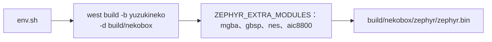

```sh
. ~/f101-zephyr/env.sh
cd ~/f101-zephyr
west build -b yuzukineko -d build/nekobox zephyr-components/nekobox
```

顶层 `CMakeLists.txt` 通过 `ZEPHYR_EXTRA_MODULES` 加入放在应用旁边的模拟器和 Wi-Fi 模块（`../mgba`、`../gbsp`、`../nes`、`../aic8800`），命令行不需要再传参数。输出是 `build/nekobox/zephyr/zephyr.bin`；镜像链接在 XIP 窗口，而不是像其他示例那样链接在 `0x40000000`。

## 运行：从 flash 原地执行

镜像在 SPI NOR flash 中原地运行：它被链接进 SPIF 控制器的窗口（`CONFIG_XIP`、`boards/yuzukineko.overlay`，`0x0e000000` 起 6 MiB）。代码和只读数据从 flash 取，RAM 里只有 `.data`、`.bss` 和堆。窗口必须在第一条指令之前映射好，这由 SyterKit 的应用 `xip-boot` 完成：它初始化 PSRAM（312 MHz；252 MHz 时，与显示共用总线的视频解码器在繁重场景下会丢 540p/30 fps 影片的画面）和 flash，把 flash 从偏移 `0x80000` 映射到 `0x0e000000`，然后跳过去。控制台是 UART1（PB0/PB1），115200 8N1。

### 开发时

引导桩不写进 flash，所以板子每次上电都会进入 FEL，加载器从 RAM 运行。板子处于 FEL 模式时：


```sh
xfel spinor write 0x80000 build/nekobox/zephyr/zephyr.bin
xfel write 0x20000 zephyr-components/nekobox/tools/xip-boot_fel.bin
xfel exec 0x20000
```

`tools/xip-boot_fel.bin` 是带保存采样点的加载器（没有这个的旧版本启动时没有任何输出，所以不要用旧版本覆盖它）。采样点保存在 flash 的参数区，这个流程不会动它。

### 完整 flash 镜像

`tools/mkimage.py` 把引导桩（`xip-boot_spi.bin`）放在 flash 开头、应用放在 `0x80000`，合成一个文件；应用之前的所有内容都会被覆盖。

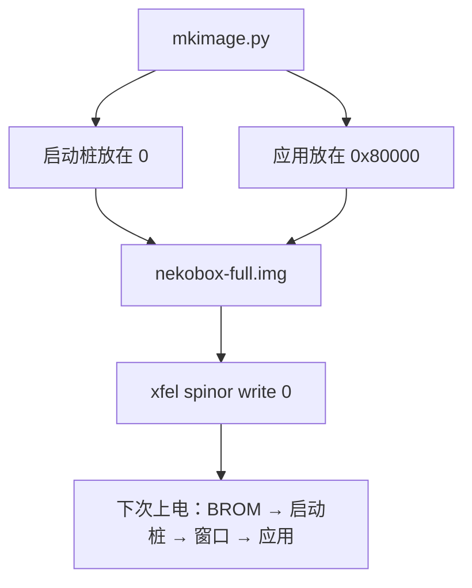

```sh
python3 zephyr-components/nekobox/tools/mkimage.py \
    --boot out/syterkit/build/yuzukineko/app_sram/xip-boot/xip-boot_spi.bin \
    --app build/nekobox/zephyr/zephyr.bin -o nekobox-full.img
# 板子处于 FEL 模式（上电时按住 FEL 键）
xfel spinor write 0 nekobox-full.img
```

下次上电后，BROM 从 flash 启动引导桩，由它映射窗口并跳进应用。只更新应用时，像上面那样把 `zephyr.bin` 写到 `0x80000`（仍需 FEL 模式，板子不再自己进入 FEL）。

| flash 范围 | 内容 |
| --- | --- |
| `0 .. 128 KiB` | 引导桩 |
| `128 .. 192 KiB` | 参数区：引导桩把采样训练的结果存在这里，所以只有第一次启动要训练（之后每次启动少约 0.55 s） |
| `512 KiB (0x80000)` 到镜像末尾 | 应用 |

:::caution
镜像从 `0x80000` 起占用 flash，与 [UF2 下载器](../zephyr-uf2.md)的应用区（`0x200000`）重叠，二者只能用其一。
:::

板子只有一个 USB-C 口，它既是 xfel 下载口，也是 USB 副屏口。先下载，再接其他设备。

### 运行后的输出

控制台先打印 `nekobox: boot <ms> ms: main starts`，然后每个启动步骤一行（`nekobox: boot <ms> ms: <名称>`，名称见下面的启动步骤表），再是第一张画面和屏幕尺寸：

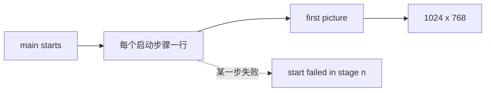

```text
nekobox: boot <ms> ms: main starts
nekobox: boot <ms> ms: <step name>
...
nekobox: boot <ms> ms: first picture
nekobox: 1024 x 768
```

运行中，当某次重绘超过 8 ms（需 `CONFIG_NEKOBOX_DEBUG`），每 5 秒会打印 `ui: worst redraw <n> ms, <n> slower than 30 ms`。启动步骤失败会打印 `nekobox: start failed in stage <n>`。

## 使用

- <strong>主屏</strong>：上方是时钟和日期，下面是磁贴（视频、文件、照片、USB 副屏、NES、Game Boy、计算器、设置）。点击时钟可设置时间。
- <strong>文件</strong>：一次显示一个目录，滑动滚动，点名字打开。“视频”这样的磁贴打开的浏览器只列这一类文件。
- <strong>视频</strong>：播放/暂停、拖动条、音量、前后跳 10 秒；控制条 4 秒后隐藏，点一下再出来。最近播放的 20 个视频连同离开时的位置被记下，再次打开会接着播。
- <strong>照片</strong>：滑动或用两侧按钮切换；双指缩放，单指平移，双击切换缩放，点一下隐藏控件。
- <strong>游戏</strong>：画面上叠半透明屏幕按键，可多指同时按（游戏代码跟踪 5 个触摸槽；本配置的触摸驱动报告 2 个点）。游戏存档每 3 秒写一次。
- <strong>设置</strong>：时间、Wi-Fi、蓝牙、校时、亮度、深色/浅色、强调色、关于。

游戏运行时后台活动会被暂停：Wi-Fi 芯片关闭、卡扫描等待，让模拟器用上全部 CPU。

## 它是怎么做的

这一部分按模块讲 NekoBox，每个模块都附上真正干活的代码。特性会用到的头文件都在 `src/` 下，以 `"core/…"`、`"ui/…"`、`"features/…"` 的形式包含。

| 模块 | 文件 | 作用 |
| --- | --- | --- |
| 启动流程 | `src/main.c`、`src/core/app.[ch]` | 阶段和步骤，由各模块自己登记 |
| 注册表 | `src/ui/registry.h`、`sections-rom.ld` | 界面、主屏磁贴、设置行、文件类型，由链接器收集 |
| 界面管理 | `src/ui/ui.c` | 按名字找界面、叠加层开关、换主题后重建 |
| 核心服务 | `src/core/` | 存储卡、设置文件、时钟、CPU 频率、显示启动 |
| 主题与控件 | `src/ui/theme.c`、`widgets.c` | 调色板、强调色、亮度 |
| 绘图加速 | `src/gfx/` | LVGL 的向量混合、2D 引擎绘制单元 |
| 主屏、文件、设置 | `src/features/home`、`files`、`settings` | 由注册表生成的界面 |
| 视频 | `src/features/video/` | 播放界面、续播、最近列表、播放引擎 |
| 照片 | `src/features/photos/` | JPEG 和 PNG，双指缩放和平移 |
| 游戏 | `src/features/games/` | NES、Game Boy、Game Boy Color、Game Boy Advance |
| 网络 | `src/features/net/` | 不用时就关闭的 Wi-Fi、校时、蓝牙检查 |
| USB 副屏 | `src/features/usbdisplay/` | 给 PC 用的 motion-JPEG 显示器和触摸屏 |

### 启动流程

`main()` 按顺序运行四个阶段，然后显示第一张画面。它不知道每个阶段里有什么：

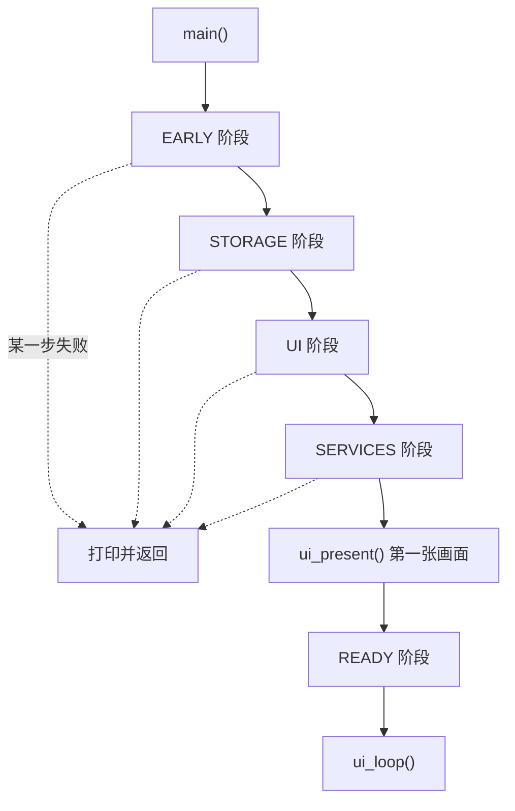

```c
int main(void)
{
	static const enum nekobox_stage stages[] = {
		NEKOBOX_STAGE_EARLY, NEKOBOX_STAGE_STORAGE, NEKOBOX_STAGE_UI, NEKOBOX_STAGE_SERVICES,
	};

	printk("nekobox: boot %u ms: main starts\n", k_uptime_get_32());
	for (int i = 0; i < ARRAY_SIZE(stages); i++) {
		if (nekobox_run_stage(stages[i]) != 0) {
			printk("nekobox: start failed in stage %d\n", stages[i]);
			return 0;
		}
	}
	ui_present();
	nekobox_run_stage(NEKOBOX_STAGE_READY);
	ui_loop();

	return 0;
}
```

步骤是各模块用一个宏放进链接段的记录。没有任何地方集中列出它们：

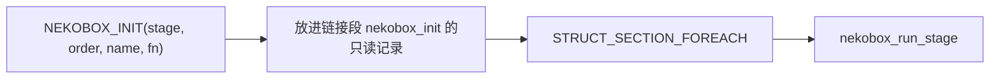

```c
struct nekobox_init {
	enum nekobox_stage stage;
	int order;		/**< steps of a stage run by ascending order */
	const char *name;	/**< printed with the time since the start of the system */
	int (*fn)(void);	/**< 0 on success; a failure in the UI stage ends the start */
};

#define NEKOBOX_INIT(_stage, _order, _name, _fn)                                                     \
	static const STRUCT_SECTION_ITERABLE(nekobox_init, nekobox_init_##_fn) = {                       \
		.stage = (_stage), .order = (_order), .name = (_name), .fn = (_fn),              \
	}
```


```text
/* src/core/sections-rom.ld */
ITERABLE_SECTION_ROM(nekobox_init, Z_LINK_ITERABLE_SUBALIGN)
```

`nekobox_run_stage()` 收集一个阶段的记录，按 `order` 排序（插入排序：`order` 相同的步骤保持链接顺序）再逐个调用。每一步之后它打印时间，启动日志里的行就是这样来的：

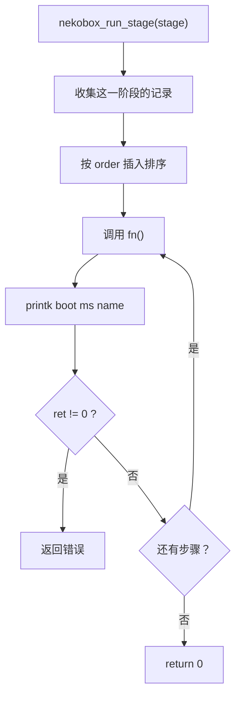

```c
int nekobox_run_stage(enum nekobox_stage stage)
{
	const struct nekobox_init *steps[MAX_STEPS];
	int n = 0;

	STRUCT_SECTION_FOREACH(nekobox_init, step) {
		if (step->stage == stage && n < MAX_STEPS) {
			int at = n++;

			while (at > 0 && steps[at - 1]->order > step->order) {
				steps[at] = steps[at - 1];
				at--;
			}
			steps[at] = step;
		}
	}
	for (int i = 0; i < n; i++) {
		int ret = steps[i]->fn();

		printk("nekobox: boot %u ms: %s%s\n", k_uptime_get_32(), steps[i]->name,
		       ret != 0 ? " FAILED" : "");
		if (ret != 0) {
			return ret;
		}
	}

	return 0;
}
```

| 阶段 | 运行时机 | 树里的步骤（阶段，order） |
| --- | --- | --- |
| `NEKOBOX_STAGE_EARLY` | 什么都还不需要时 | 显示线程（0）、CPU 时钟（10）、向量混合（20） |
| `NEKOBOX_STAGE_STORAGE` | 存储卡已挂载、设置已读取 | 存储卡（0）、设置（10） |
| `NEKOBOX_STAGE_UI` | 显示已就绪 | 显示就绪 + LVGL（0）、g2d（10）、主题（15）、界面（20） |
| `NEKOBOX_STAGE_SERVICES` | 后台服务 | 网络（10） |
| `NEKOBOX_STAGE_READY` | 第一张画面之后 | 自测、游戏自动启动（50） |

显示在第一个阶段里由单独的线程启动，因为点亮面板和显示引擎要花时间，CPU 时钟、向量自检和存储卡可以利用这段时间。UI 阶段会等它：

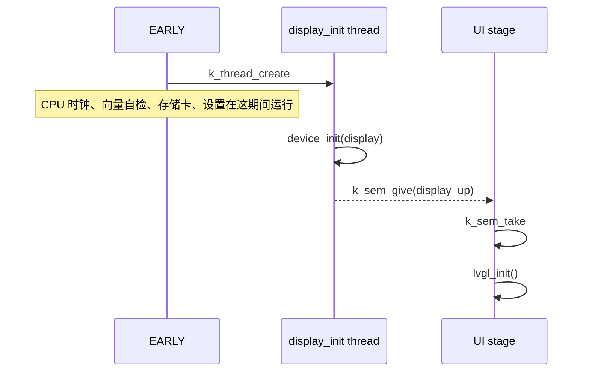

```c
static int display_start(void)
{
	k_thread_create(&display_init_thread, display_init_stack, K_THREAD_STACK_SIZEOF(display_init_stack),
			display_init_main, NULL, NULL, NULL, 5, 0, K_NO_WAIT);

	return 0;
}
NEKOBOX_INIT(NEKOBOX_STAGE_EARLY, 0, "display thread", display_start);

static int display_wait_and_lvgl(void)
{
	k_sem_take(&display_up, K_FOREVER);
	if (display_ret != 0 || !device_is_ready(DEVICE_DT_GET(DT_CHOSEN(zephyr_display)))) {
		return -ENODEV;
	}

	return lvgl_init();
}
NEKOBOX_INIT(NEKOBOX_STAGE_UI, 0, "display up, LVGL", display_wait_and_lvgl);
```

### 后台挂起

游戏需要全部 CPU，所以在后台运行的服务必须在游戏期间让开。服务登记一个函数，挂起开始和结束时会被通知；启动得晚的服务可以一直等到挂起结束：

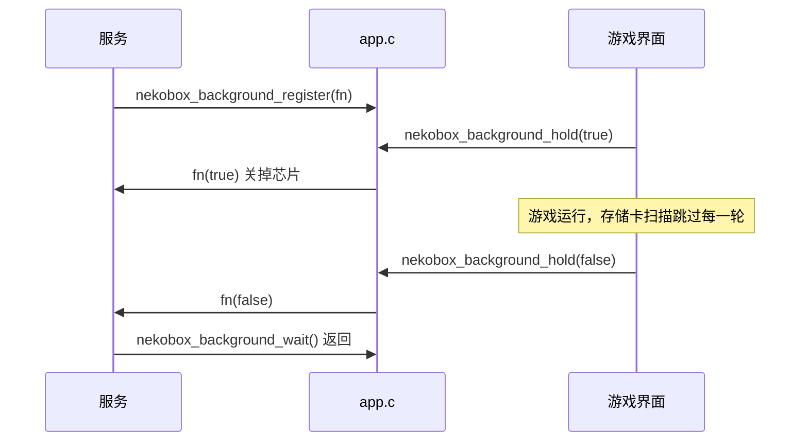

```c
void nekobox_background_register(void (*fn)(bool hold))
{
	for (int i = 0; i < MAX_HOOKS; i++) {
		if (hooks[i] == NULL) {
			hooks[i] = fn;
			return;
		}
	}
}

void nekobox_background_hold(bool hold)
{
	if (atomic_set(&held, hold ? 1 : 0) == (hold ? 1 : 0)) {
		return;
	}
	for (int i = 0; i < MAX_HOOKS && hooks[i] != NULL; i++) {
		hooks[i](hold);
	}
}

void nekobox_background_wait(void)
{
	while (nekobox_background_held()) {
		k_msleep(200);
	}
}
```

游戏界面在开始时调用 `nekobox_background_hold(true)`，离开时调用 `false`。网络登记了一个关掉 Wi-Fi 芯片的函数；存储卡扫描查看 `nekobox_background_held()` 并跳过这一轮。

## 注册表

界面没有界面列表、磁贴列表、设置行列表或文件类型列表。每个特性登记自己的，作为 flash 里的只读记录，框架遍历链接段：

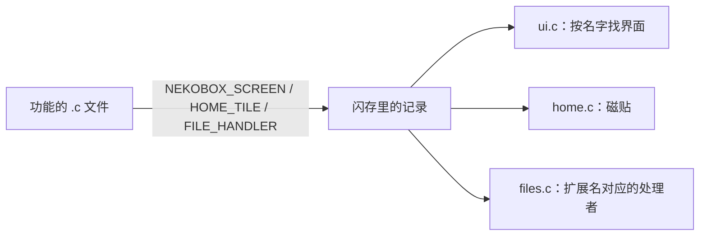

```c
struct nekobox_screen {
	const char *name;
	lv_obj_t *(*create)(void);
	void (*enter)(void *arg);	/**< every time the screen is shown; arg of ui_goto_arg() */
	void (*leave)(void);
};

#define NEKOBOX_SCREEN(_sym, _name, _create, _enter, _leave)                                         \
	const STRUCT_SECTION_ITERABLE(nekobox_screen, nekobox_screen_##_sym) = {                         \
		.name = (_name), .create = (_create), .enter = (_enter), .leave = (_leave),      \
	}

struct nekobox_home_tile {
	int order;
	const char *symbol, *title, *subtitle;
	uint32_t color_top, color_bottom;
	const char *screen;	/* a screen to open ... */
	const char *kind;	/* ... or a kind of file to browse */
};

struct nekobox_file_handler {
	const char *kind, *title, *symbol;
	const uint32_t *color;		/* a field of ui_pal, so that it follows the theme */
	const char *const *exts;	/* lower case, with the dot, NULL terminated */
	void (*open)(const char *path);
	const char *extra_screen, *extra_label;
};
```

Zephyr 的 iterable section 以数组形式给出记录，但顺序没有意义。主屏磁贴和设置行有 `order`；它们按这个顺序遍历，不需要排序缓冲，每次取比上一个大的最小 `order`：

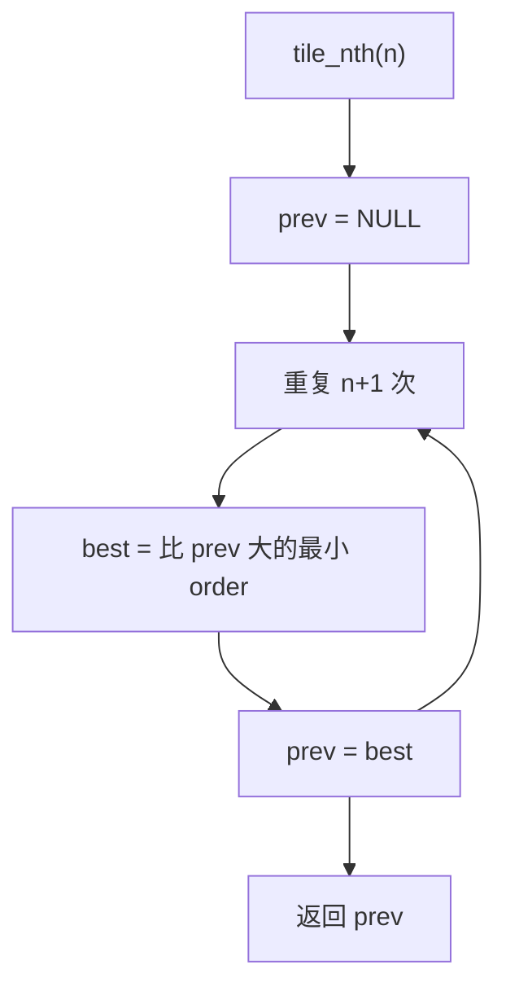

```c
static const struct nekobox_home_tile *tile_nth(int n)
{
	const struct nekobox_home_tile *prev = NULL;

	for (int k = 0; k <= n; k++) {
		const struct nekobox_home_tile *best = NULL;

		STRUCT_SECTION_FOREACH(nekobox_home_tile, t) {
			if ((prev == NULL || t->order > prev->order) &&
			    (best == NULL || t->order < best->order)) {
				best = t;
			}
		}
		prev = best;
	}

	return prev;
}
```

文件类型由文件名的扩展名找到。当某个特性登记了处理者，这一个函数就让新的文件类型带着图标和颜色出现在浏览器里：

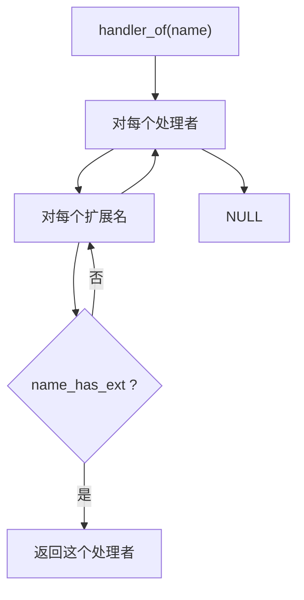

```c
static const struct nekobox_file_handler *handler_of(const char *name)
{
	STRUCT_SECTION_FOREACH(nekobox_file_handler, h) {
		for (const char *const *ext = h->exts; *ext != NULL; ext++) {
			if (name_has_ext(name, *ext)) {
				return h;
			}
		}
	}

	return NULL;
}
```

关掉的特性不会被编译，所以不留下记录，也就没有磁贴、行或文件类型。`main()` 和框架里没有任何对应的 `#ifdef`。这些记录列在两个链接脚本里（应用 CMake 里的 `zephyr_iterable_section` 到不了链接脚本）：

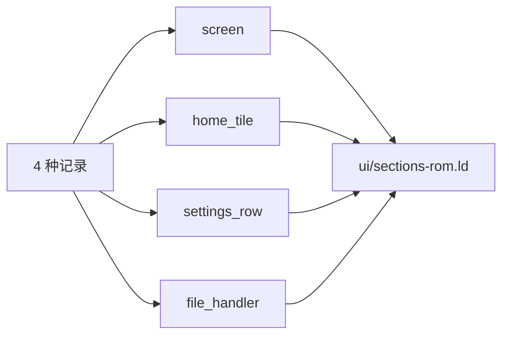

```text
/* src/ui/sections-rom.ld */
ITERABLE_SECTION_ROM(nekobox_screen, Z_LINK_ITERABLE_SUBALIGN)
ITERABLE_SECTION_ROM(nekobox_home_tile, Z_LINK_ITERABLE_SUBALIGN)
ITERABLE_SECTION_ROM(nekobox_settings_row, Z_LINK_ITERABLE_SUBALIGN)
ITERABLE_SECTION_ROM(nekobox_file_handler, Z_LINK_ITERABLE_SUBALIGN)
```

## 界面管理

界面按名字找（`ui_goto("player")`）。界面对象在第一次显示时创建，之后一直保留；每次显示时运行 `enter`，离开时运行 `leave`：

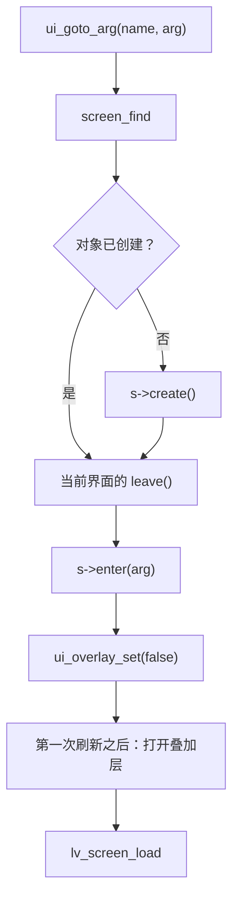

```c
void ui_goto_arg(const char *name, void *arg)
{
	const struct nekobox_screen *s = screen_find(name);
	int i;

	if (s == NULL) {
		return;
	}
	i = screen_index(s);
	if (screens[i] == NULL) {
		screens[i] = s->create();
	}
	if (current != NULL && current->leave != NULL) {
		current->leave();
	}
	current = s;
	if (s->enter != NULL) {
		s->enter(arg);
	}
	ui_overlay_set(false);
	lv_display_add_event_cb(lv_display_get_default(), screen_drawn, LV_EVENT_REFR_READY, NULL);
	lv_screen_load(screens[i]);
}
```

界面画在视频层之上的 ARGB 层。满屏的 ARGB 层在每次刷新时都要占用内存带宽，而视频解码器和显示共用这条带宽。所以当界面没有自己的内容要显示时，这一层就关掉，只在界面要绘制时才打开：

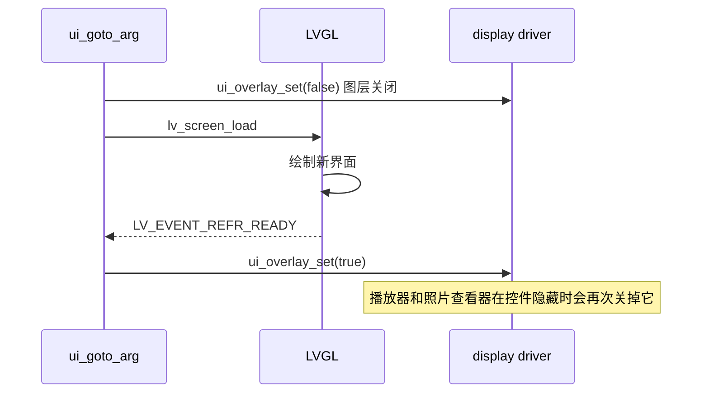

```c
void ui_overlay_set(bool show)
{
	static const struct device *const disp = DEVICE_DT_GET(DT_CHOSEN(zephyr_display));

	display_sunxi_fb_enable(disp, show);
}

/* ui_goto_arg(): off while the new screen is set up and drawn ... */
static void screen_drawn(lv_event_t *e)
{
	lv_display_remove_event_cb_with_user_data(lv_event_get_target(e), screen_drawn, NULL);
	ui_overlay_set(true);	/* ... on again after its first picture */
}
```

播放器在控件隐藏时关掉这一层（`controls_show()` 调用 `ui_overlay_set()`），照片查看器在显示不带控件的图片时也一样；这一层这时不占带宽，解码器就能用上。

换主题必须重建每一个界面，因为颜色是在创建对象时读取的。发出请求的界面本身也在要被删除之列，所以重建在它的事件结束之后再运行：

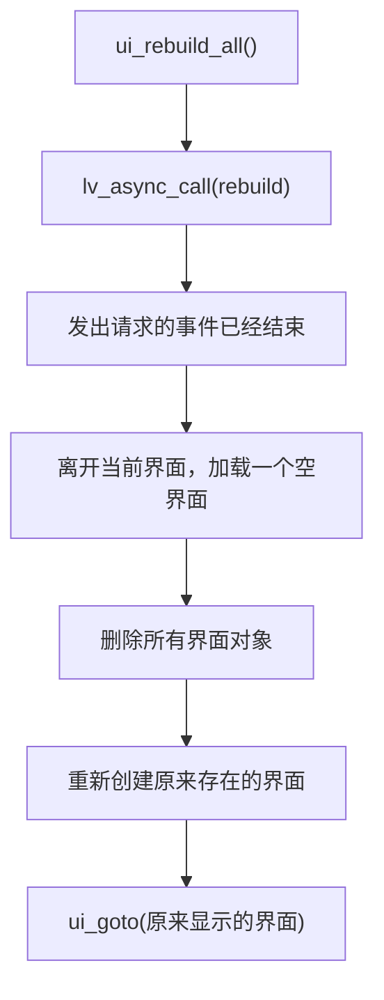

```c
static void rebuild(void *unused)
{
	const struct nekobox_screen *cur = current;
	bool made[MAX_SCREENS] = {0};
	lv_obj_t *tmp = lv_obj_create(NULL);

	if (cur != NULL && cur->leave != NULL) {
		cur->leave();
	}
	lv_screen_load(tmp);			/* nothing shows a screen that is deleted */
	STRUCT_SECTION_FOREACH(nekobox_screen, s) {
		int i = screen_index(s);

		made[i] = screens[i] != NULL;
		if (made[i]) {
			lv_obj_delete(screens[i]);
			screens[i] = NULL;
		}
	}
	/* the screens that have timers of their own must have their objects again at once */
	STRUCT_SECTION_FOREACH(nekobox_screen, s) {
		if (made[screen_index(s)]) {
			screens[screen_index(s)] = s->create();
		}
	}
	current = NULL;
	ui_goto(cur != NULL ? cur->name : "home");
	lv_obj_delete_async(tmp);
}

void ui_rebuild_all(void)
{
	lv_async_call(rebuild, NULL);
}
```

界面主循环调用 `lv_timer_handler()`，并按 LVGL 说的时间睡眠（最多 20 ms）。它也会发现晚到的存储卡：保存的主题和亮度在设置文件里，而这个文件之前读不到。

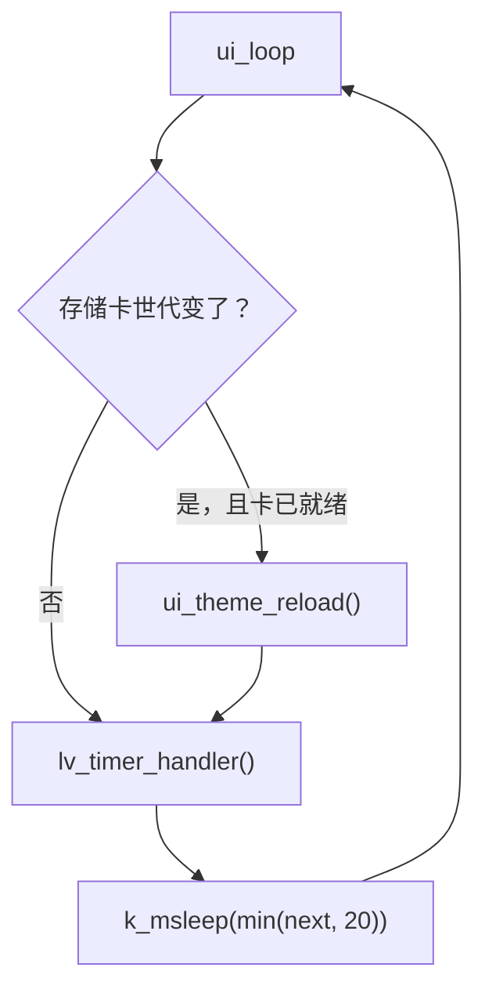

```c
void ui_loop(void)
{
	for (;;) {
		static unsigned int card_seen;
		uint32_t next;

		/* a card that came later: the saved theme and brightness are in the settings now */
		if (card_seen != storage_generation()) {
			card_seen = storage_generation();
			if (storage_ready()) {
				ui_theme_reload();
			}
		}
		next = lv_timer_handler();
		k_msleep(MIN(next, 20U));
	}
}
```

## 核心服务

### 存储卡

`storage.c` 在启动时挂载存储卡，之后由一个线程监视它。卡槽没有插卡检测信号，所以没有卡时每 3 秒尝试一次，已挂载的卡每两轮扫描读一次（扇区 0）。连续两次读失败就认为卡不在了：卸载它并改变世代计数，所有显示卡上数据的界面据此重新查看：

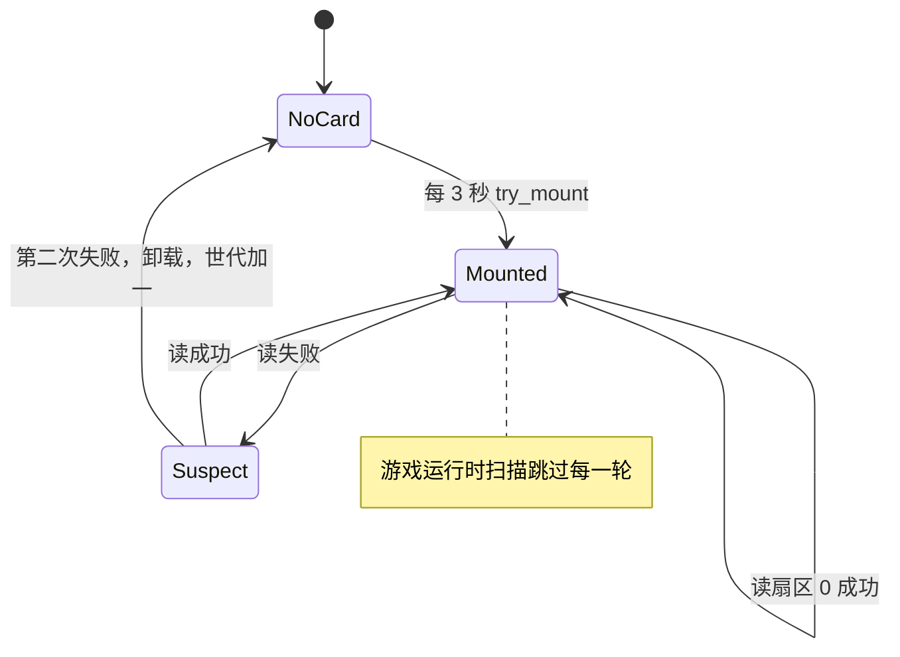

```c
static int try_mount(bool first)
{
	int ret;

	k_mutex_lock(&mount_lock, K_FOREVER);
	ret = mounted ? 0 : fs_mount(&mp);
	if (ret == 0 && !mounted) {
		mounted = true;
		generation++;
		if (!first) {
			cfg_load();	/* a card that came late: its settings now */
		}
	}
	k_mutex_unlock(&mount_lock);

	return ret;
}

static void check_card(void)
{
	static uint8_t sector0[512] __aligned(64);
	static int failed;

	if (disk_access_read("SD", sector0, 0, 1) == 0) {
		failed = 0;
		return;
	}
	if (++failed < 2) {
		return;
	}
	failed = 0;
	k_mutex_lock(&mount_lock, K_FOREVER);
	mounted = false;
	generation++;
	(void)fs_unmount(&mp);
	k_mutex_unlock(&mount_lock);
}

static void storage_watch(void *a, void *b, void *c)
{
	unsigned int scan = 0;

	for (;;) {
		k_msleep(SCAN_MS);
		if (nekobox_background_held()) {
			continue;	/* a game runs: the card scan waits */
		}
		if (!mounted) {
			(void)try_mount(false);
		} else if (++scan % HEALTH_SCANS == 0) {
			check_card();
		}
	}
}
```

### 设置文件

`cfg.c` 是一个很小的键值存储，文件是 `/SD:/.nekobox_settings`，每行一个 `key value`，最多 28 项。每次 `cfg_set()` 都重写整个文件。没有卡时修改的设置不会丢：卡出现时，其间设置的值优先于文件里的值，然后文件被重新写入：

```mermaid
flowchart TD
    A["cfg_load()"] --> B["kept = 没有卡时设置的条目数"]
    B --> C["读取设置文件"]
    C --> D["对每一行：key value"]
    D --> E{"key 已在前 kept 个条目里？"}
    E -- "是：以内存为准" --> D
    E -- "否" --> F["加入"]
    F --> D
    D --> G{"kept > 0 ?"}
    G -- "是" --> H["save()"]
```

```c
void cfg_load(void)
{
	char buf[3072];
	int n, kept;

	k_mutex_lock(&lock, K_FOREVER);
	/* settings that were changed while there was no card win over the ones in the file */
	kept = count;
	n = storage_ready() ? file_read_text(CFG_FILE, buf, sizeof(buf)) : -1;
	if (n > 0) {
		for (char *line = buf, *next; line != NULL && *line != '\0' && count < CFG_MAX; line = next) {
			char *sp;

			next = strchr(line, '\n');
			if (next != NULL) {
				*next++ = '\0';
			}
			sp = strchr(line, ' ');
			if (sp == NULL || sp == line || (sp - line) >= KEY_LEN) {
				continue;
			}
			*sp++ = '\0';
			if (cfg_find(line, kept) >= 0) {
				continue;	/* changed in memory meanwhile */
			}
			/* add key and value */
		}
	}
	if (kept > 0 && n >= 0) {
		save();
	}
	k_mutex_unlock(&lock);
}
```

### 时钟

板子上有 RTC，但电池没有保证。`clock.c` 只检查一次 RTC：如果它从未设置，或者年月早于镜像的编译时间，就把它设为编译时间。编译时间从 `__DATE__` 和 `__TIME__` 解析，用公历日期算法转换（不用 libc 的时间函数）：

```mermaid
flowchart TD
    A["check()"] --> B{"RTC 就绪？"}
    B -- "否" --> X["rtc_ok = false"]
    B -- "是" --> C["由 __DATE__ 和 __TIME__ 得到编译时间"]
    C --> D{"RTC 读不出或早于编译时间？"}
    D -- "是" --> E["rtc_set_time(build time)"]
    D -- "否" --> F["保持 RTC 不变"]
```

```c
static void check(void)
{
	struct rtc_time t, b;

	if (checked) {
		return;
	}
	checked = true;
	rtc_ok = device_is_ready(rtc);
	if (!rtc_ok) {
		return;
	}
	rtc_from_build(&b);
	if (rtc_get_time(rtc, &t) != 0 || t.tm_year < b.tm_year ||
	    (t.tm_year == b.tm_year && t.tm_mon < b.tm_mon)) {
		/* never set, or the power was gone */
		printk("clock: the rtc is not set, using the build time\n");
		rtc_set_time(rtc, &b);
	}
}
```

### CPU 频率

引导程序让 CPU 保持在 600 MHz。`NEKOBOX_CPU_MHZ`（默认 960）是以 72 MHz 为步长到达的。每一步之后运行一次内存测试；电压不变，所以让内存返回错误数据的那一步会立即撤销：

```mermaid
flowchart TD
    A["cpu_clock_setup"] --> B["rate = 600 MHz"]
    B --> C{"rate < target ?"}
    C -- "否" --> Z["完成"]
    C -- "是" --> D["next = min(rate + 72 MHz, target)"]
    D --> E["clock_control_set_rate"]
    E -- "被拒绝" --> Z
    E --> F{"cpu_selftest ?"}
    F -- "失败" --> G["恢复旧频率，结束"]
    F -- "通过" --> H["rate = next"] --> C
```

```c
void cpu_clock_setup(void)
{
	const struct device *cctl = DEVICE_DT_GET(DT_NODELABEL(cctl));
	uint32_t rate, target = CONFIG_NEKOBOX_CPU_MHZ * 1000000U;

	clock_control_get_rate(cctl, (clock_control_subsys_t)CLK_CPU, &rate);
	while (target != 0U && rate < target) {
		uint32_t next = MIN(rate + 72000000U, target);

		if (clock_control_set_rate(cctl, (clock_control_subsys_t)CLK_CPU,
					   (clock_control_subsys_rate_t)next) != 0) {
			break;
		}
		if (!cpu_selftest()) {
			printk("cpu: %u MHz BAD\n", next / 1000000U);
			clock_control_set_rate(cctl, (clock_control_subsys_t)CLK_CPU,
					       (clock_control_subsys_rate_t)rate);
			return;
		}
		rate = next;
	}
	printk("cpu: %u MHz\n", rate / 1000000U);
}
```

测试从 malloc 区取 64 KiB，用哈希序列填满，折叠 50 次；每次折叠必须得到相同的和。

## 主题与控件

颜色是一个全局调色板 `ui_pal`，宏 `C_BG`、`C_TEXT`、`C_ACCENT` ……都从它读取。深色或浅色加上六种强调色之一生成调色板；两者都保存在设置文件里：

```mermaid
flowchart LR
    A["深色或浅色"] --> C["palette_make"]
    B["强调色 0..5"] --> C
    C --> D["ui_pal"]
    D --> E["C_BG, C_TEXT, C_ACCENT ..."]
    F["ui_theme_set"] --> C
    F --> G["cfg_set theme, accent"]
    F --> H["ui_rebuild_all"]
```

```c
struct palette {
	uint32_t bg, surface, surface2, border, text, dim, accent, accent2, ok, warn, pink;
};
extern struct palette ui_pal;
#define C_BG		(ui_pal.bg)
#define C_ACCENT	(ui_pal.accent)

static void palette_make(bool dark, int accent)
{
	theme_dark = dark;
	theme_accent = CLAMP(accent, 0, UI_ACCENTS - 1);
	if (dark) {
		ui_pal = (struct palette){
			.bg = 0x0B0F17, .surface = 0x151B28, .surface2 = 0x1F2740, .border = 0x2A3350,
			.text = 0xE8ECF4, .dim = 0x8B95A8,
			.ok = 0x3DDC97, .warn = 0xFFB547, .pink = 0xFF6C9B,
		};
	} else {
		ui_pal = (struct palette){
			.bg = 0xF1F3F9, .surface = 0xFFFFFF, .surface2 = 0xDFE5F2, .border = 0xCBD3E4,
			.text = 0x1B2233, .dim = 0x5C687F,
			.ok = 0x1FA97A, .warn = 0xD9830A, .pink = 0xE0457B,
		};
	}
	ui_pal.accent = accents[theme_accent].accent;
	ui_pal.accent2 = accents[theme_accent].accent2;
}

void ui_theme_set(bool dark, int accent)
{
	char buf[8];

	palette_make(dark, accent);
	cfg_set("theme", dark ? "dark" : "light");
	snprintf(buf, sizeof(buf), "%d", theme_accent);
	cfg_set("accent", buf);
	ui_rebuild_all();		/* colours are read when an object is made */
}
```

文件处理者保存的是指向 `ui_pal` 字段的指针（`.color = &ui_pal.accent`），而不是颜色本身，所以它的图标跟随主题，不用再登记一次。亮度直接送到显示驱动，在手指松开时才保存，所以拖动滑块的每一步都不会写文件：

```mermaid
sequenceDiagram
    participant S as 滑块
    participant T as theme.c
    participant D as display
    participant C as cfg
    S->>T: ui_brightness_set(v, false) 拖动时
    T->>D: display_set_brightness
    S->>T: ui_brightness_set(v, true) 松手时
    T->>D: display_set_brightness
    T->>C: cfg_set brightness
```

```c
void ui_brightness_set(int value, bool save)
{
	static const struct device *const disp = DEVICE_DT_GET(DT_CHOSEN(zephyr_display));
	char buf[8];

	brightness = CLAMP(value, 10, 255);
	display_set_brightness(disp, brightness);
	if (save) {
		snprintf(buf, sizeof(buf), "%d", brightness);
		cfg_set("brightness", buf);
	}
}

/* brightness_row.c: the slider calls it while moving and when released */
static void brightness_changed(lv_event_t *e)
{
	lv_obj_t *s = lv_event_get_target(e);

	ui_brightness_set(lv_slider_get_value(s), lv_event_get_code(e) == LV_EVENT_RELEASED);
}
```

## 绘图加速

### 向量混合

LVGL 的软件渲染器负责绘制界面。它的 ARGB8888 混合函数可以用宏替换，`lv_rvv.h` 把它们指向使用 RISC-V 向量单元的版本：

```mermaid
flowchart LR
    A["LVGL 软件渲染器"] --> B["LV_DRAW_SW_*_TO_ARGB8888 宏"]
    B --> C["lv_rvv_*"]
    C --> D{"向量打开？"}
    D -- "是" --> E["RVV 循环"]
    D -- "否" --> F["LV_RESULT_INVALID → LVGL 自己的代码"]
```

```c
#ifdef CONFIG_NEKOBOX_GFX_RVV
#define LV_DRAW_SW_COLOR_BLEND_TO_ARGB8888(dsc)				lv_rvv_color_fill(dsc)
#define LV_DRAW_SW_COLOR_BLEND_TO_ARGB8888_WITH_OPA(dsc)		lv_rvv_color_opa(dsc)
#define LV_DRAW_SW_COLOR_BLEND_TO_ARGB8888_WITH_MASK(dsc)		lv_rvv_color_mask(dsc)
#define LV_DRAW_SW_COLOR_BLEND_TO_ARGB8888_MIX_MASK_OPA(dsc)		lv_rvv_color_mask_opa(dsc)
#define LV_DRAW_SW_ARGB8888_BLEND_NORMAL_TO_ARGB8888(dsc)		lv_rvv_argb_normal(dsc)
#define LV_DRAW_SW_ARGB8888_BLEND_NORMAL_TO_ARGB8888_WITH_OPA(dsc)	lv_rvv_argb_opa(dsc)
#define LV_DRAW_SW_ARGB8888_BLEND_NORMAL_TO_ARGB8888_WITH_MASK(dsc)	lv_rvv_argb_mask(dsc)
#define LV_DRAW_SW_ARGB8888_BLEND_NORMAL_TO_ARGB8888_MIX_MASK_OPA(dsc)	lv_rvv_argb_mask_opa(dsc)
#endif
```

向量代码关闭时，每个函数返回 `LV_RESULT_INVALID`，LVGL 就运行自己的代码。核心是一次混合八个或更多像素，写成和 LVGL 的 `lv_color_32_32_mix()` 逐位相同的结果。它的开头几行展示了常见情况（所有像素不透明或透明）如何跳过运算：

```mermaid
flowchart TD
    A["mix(fg, a, bg, vl)"] --> B["掩码：不透明、透明、背景不透明"]
    B --> C{"所有通道都不透明？"}
    C -- "是" --> D["返回前景"]
    C -- "否" --> E{"所有通道不透明或透明？"}
    E -- "是" --> F["vmerge"]
    E -- "否" --> G["alpha、权重、3 个通道：mix_channel"]
    G --> H["权重大于 252 取前景，小于 3 取背景"]
```

```c
static inline vuint32m2_t mix(vuint32m2_t fg, vuint32m2_t a, vuint32m2_t bg, size_t vl)
{
	vuint32m2_t bga = __riscv_vsrl_vx_u32m2(bg, 24, vl);
	vbool16_t m_fg = __riscv_vmor_mm_b16(__riscv_vmsgtu_vx_u32m2_b16(a, 252, vl),
					     __riscv_vmsleu_vx_u32m2_b16(bga, 2, vl), vl);
	vbool16_t m_tr = __riscv_vmandn_mm_b16(__riscv_vmsleu_vx_u32m2_b16(a, 2, vl), m_fg, vl);
	vuint32m2_t fgpx = __riscv_vor_vv_u32m2(__riscv_vand_vx_u32m2(fg, 0xffffff, vl),
						__riscv_vsll_vx_u32m2(a, 24, vl), vl);

	/* the common cases need none of the arithmetic below: every lane is opaque, or transparent */
	if ((size_t)__riscv_vcpop_m_b16(m_fg, vl) == vl) {
		return fgpx;
	}
	/* ... otherwise: result alpha, the weight, the three channels, the 253/2 limits ... */
}

/* one colour channel: ((fg * w + bg * (255 - w)) * 0x8081) >> 23 */
static inline vuint32m2_t mix_channel(vuint32m2_t fg, vuint32m2_t bg, vuint32m2_t w, vuint32m2_t iw,
				      size_t vl)
{
	vuint32m2_t t = __riscv_vadd_vv_u32m2(__riscv_vmul_vv_u32m2(fg, w, vl),
					      __riscv_vmul_vv_u32m2(bg, iw, vl), vl);

	return __riscv_vsrl_vx_u32m2(__riscv_vmul_vx_u32m2(t, 0x8081U, vl), 23, vl);
}
```

对一行的循环向硬件询问一次能处理多少通道（`vsetvl`），所以同一份代码可以在任何向量长度上运行，不需要处理尾部的代码：

```mermaid
flowchart TD
    A["一行 dest_w 个像素"] --> B["vl = vsetvl(dest_w - x)"]
    B --> C["取不透明度、掩码或两者"]
    C --> D["mix(color, a, VLD32(d + x))"]
    D --> E["VST32(d + x)"]
    E --> F["x += vl"]
    F --> B
```

```c
for (int32_t x = 0; x < dsc->dest_w;) {
	size_t vl = __riscv_vsetvl_e32m2(dsc->dest_w - x);
	vuint32m2_t a = /* the opacity, the mask or both */;

	VST32(&d[x], mix(__riscv_vmv_v_x_u32m2(rgb, vl), a, VLD32(&d[x], vl), vl), vl);
	x += vl;
}
```

向量代码只有在启动时的自检之后才被信任。它运行 320 次随机大小、颜色、alpha 和掩码的混合，一次用 LVGL 自己的代码，一次用向量代码，比较每个像素，包括行与行之间的填充。有任何差异就关闭向量代码：

```mermaid
flowchart TD
    A["rvv_step (EARLY, 20)"] --> B["lv_rvv_selftest"]
    B --> C["320 次随机混合：LVGL 代码对比向量代码"]
    C --> D{"每个像素都相同，行间填充也一样？"}
    D -- "是" --> E["向量保持打开"]
    D -- "否" --> F["lv_rvv_enable(false)"]
```

```c
static int rvv_step(void)
{
	if (!lv_rvv_selftest()) {
		printk("nekobox: the vector blends differ from LVGL, switched off\n");
		lv_rvv_enable(false);
	}

	return 0;
}
NEKOBOX_INIT(NEKOBOX_STAGE_EARLY, 20, "vector blends", rvv_step);
```

### 2D 引擎作为绘制单元

`lv_g2d.c` 把 2D 加速器注册成 LVGL 的一个绘制单元，用来处理大块纯色矩形。它默认关闭（`NEKOBOX_GFX_G2D`）：在板子上实测，这些填充一个接一个地运行，处理器在等待，占用同一条内存总线，主屏连续十次完整重绘用了 1281 ms，而不是 810 ms。代码留下来作为绘制单元的示例：

```mermaid
flowchart TD
    A["g2d_evaluate(task)"] --> B{"纯色不透明填充、无圆角、无渐变、ARGB8888？"}
    B -- "否" --> X["0 交给 LVGL"]
    B -- "是" --> C{"面积 ≥ 20000 像素？"}
    C -- "否" --> X
    C -- "是" --> D["preferred_draw_unit_id = G2D"]
    D --> E["g2d_dispatch: 缓存写回，g2d_fill，缓存失效"]
```

```c
static int32_t g2d_evaluate(lv_draw_unit_t *u, lv_draw_task_t *t)
{
	const lv_draw_fill_dsc_t *dsc = t->draw_dsc;
	lv_area_t a;

	if (t->type != LV_DRAW_TASK_TYPE_FILL || dsc->radius != 0 || dsc->opa < LV_OPA_MAX ||
	    dsc->grad.dir != LV_GRAD_DIR_NONE ||
	    ((lv_draw_dsc_base_t *)dsc)->layer->color_format != LV_COLOR_FORMAT_ARGB8888) {
		return 0;			/* not a plain opaque fill: LVGL does it */
	}
	if (!lv_area_intersect(&a, &t->area, &t->clip_area) ||
	    lv_area_get_width(&a) * lv_area_get_height(&a) < CONFIG_NEKOBOX_GFX_G2D_MIN_PIXELS) {
		return 0;			/* too small: the setup costs more than the fill */
	}
	t->preferred_draw_unit_id = G2D_UNIT_ID;

	return 1;
}

/* dispatch: the cache lines of the area go out, the accelerator fills, the lines come back */
cache_rows(buf, &a);
g2d_fill(g2d, &dst, &r, (uint32_t)c.alpha << 24 | (uint32_t)c.red << 16 | (uint32_t)c.green << 8 | c.blue);
cache_rows(buf, &a);
```

## 主屏

主屏没有自己的磁贴。它遍历注册表，每行放四个磁贴。按下磁贴就打开它所指的界面，或者它所指的文件类型的浏览器：

```mermaid
flowchart TD
    A["home_create"] --> B["时钟卡片"]
    A --> C["对每个磁贴"]
    C --> D{"i % 4 == 0 ?"}
    D -- "是" --> E["新建一行"]
    D -- "否" --> F["tile_create(row, tile_nth(i))"]
    E --> F
    G["tile_clicked"] --> H{"t->screen ?"}
    H -- "有" --> I["ui_goto(screen)"]
    H -- "NULL" --> J["ui_files_open(NULL, kind)"]
```

```c
/* the functions, four to a row */
row = NULL;
for (int i = 0; i < tile_count(); i++) {
	const struct nekobox_home_tile *t = tile_nth(i);

	if (i % 4 == 0) {
		row = lv_obj_create(scr);
		lv_obj_remove_style_all(row);
		lv_obj_set_size(row, LV_PCT(100), TILE_H);
		lv_obj_set_flex_flow(row, LV_FLEX_FLOW_ROW);
		lv_obj_set_style_pad_column(row, TILE_GAP, 0);
	}
	tile_create(row, t);
}

static void tile_clicked(lv_event_t *e)
{
	const struct nekobox_home_tile *t = lv_event_get_user_data(e);

	if (t->screen == NULL) {
		ui_files_open(NULL, t->kind);	/* "Videos": the browser for videos only */
	} else {
		ui_goto(t->screen);
	}
}
```

一个每秒触发的 LVGL 定时器根据 `clock_now()` 更新时钟标签，并在存储卡世代变化时更新存储卡容量那一行：

```mermaid
flowchart LR
    A["lv_timer 每秒"] --> B["clock_refresh: clock_now → labels"]
    A --> C{"存储卡世代变了？"}
    C -- "是" --> D["storage_refresh: 剩余 / 总量"]
```

```c
static void clock_timer(lv_timer_t *t)
{
	static unsigned int card_seen;

	clock_refresh();
	if (card_seen != storage_generation()) {
		card_seen = storage_generation();
		storage_refresh();
	}
}
```

## 文件浏览器

一张卡的一个目录里可能有几百个文件。浏览器把一个目录读进一个排好序的数组（最多 512 项），只保留 13 个行对象（`POOL`），在列表滚动时重复使用。一个很高的不可见占位对象让滚动条有整个列表的长度：

```mermaid
flowchart TD
    A["entry_add(dirent)"] --> B{"隐藏、太长、超过 512、类型不符？"}
    B -- "是" --> X["跳过"]
    B -- "否" --> C["复制名字，非 ASCII 换成 ?"]
    C --> D["找位置：目录在前，然后按名字"]
    D --> E["memmove + insert"]
```

```c
static void entry_add(const struct fs_dirent *d)
{
	struct entry e = {.size = d->size, .dir = d->type == FS_DIR_ENTRY_DIR};
	int at = count;

	if (count >= MAX_ENTRIES || d->name[0] == '.' || strlen(d->name) >= NAME_MAX_LEN ||
	    !shown_by_filter(d)) {
		return;			/* hidden files, over the limits, or not the kind that is browsed */
	}
	/* ... copy the name, replacing what the font cannot draw by '?' ... */
	while (at > 0 && before(&e, &entries[at - 1])) {	/* directories first, then by name */
		at--;
	}
	memmove(&entries[at + 1], &entries[at], (count - at) * sizeof(e));
	entries[at] = e;
	count++;
}
```

第 `n` 行总是放在池槽 `n % POOL` 上，所以滚动一行只改一个槽的文字并移动它，而不是改全部十三个：

```mermaid
flowchart TD
    A["rows_update"] --> B["first = scroll_y / ROW_H"]
    B --> C["对 13 个槽位 i"]
    C --> D["idx = first + ((i - first % 13) + 13) % 13"]
    D --> E{"idx >= count ?"}
    E -- "是" --> F["隐藏这一行"]
    E -- "否" --> G["set_y(idx × ROW_H)"]
    G --> H{"row_idx[i] == idx ?"}
    H -- "是" --> I["无需更改"]
    H -- "否" --> J["这个条目的图标、名字、大小"]
```

```c
static void rows_update(void)
{
	int first = MAX(0, lv_obj_get_scroll_y(list) / ROW_H);

	for (int i = 0; i < POOL; i++) {
		lv_obj_t *row = rows[i];
		/* a row keeps its slot: entry n is always on row n % POOL */
		int idx = first + ((i - first % POOL) + POOL) % POOL;

		if (idx >= count) {
			lv_obj_add_flag(row, LV_OBJ_FLAG_HIDDEN);
			row_idx[i] = -1;
			continue;
		}
		lv_obj_remove_flag(row, LV_OBJ_FLAG_HIDDEN);
		lv_obj_set_y(row, idx * ROW_H);
		if (row_idx[i] == idx) {
			continue;		/* already shows this entry */
		}
		row_idx[i] = idx;
		/* set the icon (from the handler), the name and the size of entries[idx] */
	}
}
```

点击一项会打开目录（浏览器加载它），对文件则调用与其扩展名匹配的处理者的 `open` 函数。浏览器自己不认识任何文件类型：

```mermaid
flowchart TD
    A["row_clicked"] --> B{"是目录？"}
    B -- "是" --> C["dir_load()"]
    C -- "出错" --> D["path_up, 重新加载原目录"]
    C --> E["list_show()"]
    B -- "否" --> F["handler_of(name)"]
    F --> G["h->open(path)"]
```

```c
static void row_clicked(lv_event_t *e)
{
	int idx = row_idx[(int)(uintptr_t)lv_event_get_user_data(e)];
	char path[PATH_MAX_LEN];

	path_join(path, sizeof(path), dir_path, entries[idx].name);
	if (entries[idx].dir) {
		strcpy(dir_path, path);
		if (dir_load() != 0) {
			path_up(dir_path);
			dir_load();
		}
		list_show();
	} else {
		const struct nekobox_file_handler *h = handler_of(entries[idx].name);

		if (h != NULL && h->open != NULL) {
			h->open(path);		/* the player, the photo viewer, a game ... */
		}
	}
}
```

## 设置

设置界面是一个列表，每一行都来自注册表。模块用 `NEKOBOX_SETTINGS_ROW(sym, order, create, refresh)` 添加一行；`refresh` 在界面显示期间每秒调用一次：

```mermaid
flowchart LR
    A["time 10"] --> S["设置界面"]
    B["网络各行 20..40"] --> S
    C["brightness 50"] --> S
    D["dark 60"] --> S
    E["accent 70"] --> S
    F["about 90"] --> S
```

```c
NEKOBOX_SETTINGS_ROW(time, 10, time_row, time_refresh);
NEKOBOX_SETTINGS_ROW(brightness, 50, brightness_row, NULL);
NEKOBOX_SETTINGS_ROW(dark, 60, dark_row, NULL);
NEKOBOX_SETTINGS_ROW(accent, 70, accent_row, NULL);
NEKOBOX_SETTINGS_ROW(about, 90, about_row, NULL);
```

`order` 留有空隙（10、50、60、70、90）：网络特性把自己的几行（Wi-Fi、校时、蓝牙）放在中间，其他地方都不用修改。行的通用外观是一个函数，行再在旁边加上自己的控件：

```mermaid
flowchart TD
    A["rows_each(fn)"] --> B["按 order 升序遍历注册表"]
    B --> C["row_make → r->create(list)"]
    D["每秒定时器"] --> E["row_refresh → r->refresh()"]
```

```c
lv_obj_t *settings_row_create(lv_obj_t *parent, const char *symbol, const char *title,
			      lv_obj_t **value, lv_event_cb_t cb);

static void accent_row(lv_obj_t *list)
{
	lv_obj_t *value;
	lv_obj_t *row = settings_row_create(list, LV_SYMBOL_IMAGE, "Accent color", &value, NULL);

	lv_obj_add_flag(value, LV_OBJ_FLAG_HIDDEN);
	for (int i = 0; i < UI_ACCENTS; i++) {
		lv_obj_t *dot = lv_button_create(row);

		lv_obj_set_size(dot, 48, 48);
		lv_obj_set_style_radius(dot, LV_RADIUS_CIRCLE, 0);
		lv_obj_set_style_bg_color(dot, lv_color_hex(ui_theme_accent_color(i)), 0);
		lv_obj_add_event_cb(dot, accent_clicked, LV_EVENT_CLICKED, (void *)(uintptr_t)i);
	}
}
```

## 视频

### 播放界面

`ui_player.c` 是播放引擎周围的界面。`enter` 时它打开文件，显示时长和格式，设置滑块范围，并且**从视频上次停下的位置继续**，除非那是在开头 5 秒内或结尾前 10 秒内：

```mermaid
flowchart TD
    A["player_enter(path)"] --> B["player_open"]
    B -- "出错" --> C["提示：无法播放"]
    B -- "成功" --> D["滑块范围、时长、格式"]
    D --> E["history_find(path)"]
    E --> F{"位置大于下限且不靠近结尾？"}
    F -- "是" --> G["player_seek(pos)"]
    F -- "否" --> H["从头开始"]
    G --> I["controls_show, 打开定时器"]
    H --> I
```

```c
static void player_enter(void *arg)
{
	const char *path = arg != NULL ? arg : CONFIG_NEKOBOX_VIDEO_DEFAULT;
	struct player_info info;
	int ret;

	/* ... title, state ... */
	ret = player_open(path, &info);
	if (ret != 0) {
		lv_label_set_text_fmt(message, LV_SYMBOL_WARNING "\nCannot play this file (%d)", ret);
		return;
	}
	duration_ms = info.duration_ms;
	lv_slider_set_range(seek_slider, 0, MAX(duration_ms, 1U));
	{
		/* go on from where the video was left, unless that was the start or the end */
		const struct history_entry *h = history_find(path);

		if (h != NULL && h->pos_ms > RESUME_MIN_MS && h->pos_ms + RESUME_END_MS < duration_ms) {
			player_seek(h->pos_ms);
		}
	}
	controls_show(true);
	lv_timer_resume(tick);
}
```

一个 100 ms 的 LVGL 定时器跟随播放器：移动滑块（除非手指按着它）、改变播放/暂停符号、在播放器因错误停止时显示错误提示、每 10 秒保存一次位置，并在播放 4 秒没有触摸后隐藏控件：

```mermaid
flowchart TD
    A["tick_cb 100 ms"] --> B{"秒数变了且没在拖动？"}
    B -- "是" --> C["滑块、时间标签"]
    A --> D{"状态变了？"}
    D -- "是" --> E["播放、暂停或重播符号"]
    A --> F{"播放中且距上次保存 10 秒？"}
    F -- "是" --> G["history_save"]
    A --> H{"播放中、控件可见、4 秒无触摸？"}
    H -- "是" --> I["controls_show(false)"]
```

```c
static void tick_cb(lv_timer_t *t)
{
	enum player_state st = player_state();
	uint32_t pos = player_position_ms();

	if (!dragging && pos / 1000 != shown_seconds) {
		shown_seconds = pos / 1000;
		lv_slider_set_value(seek_slider, pos, LV_ANIM_OFF);
		/* ... the time label ... */
	}
	if (st != shown_state) {
		shown_state = st;
		lv_label_set_text(play_icon, st == PLAYER_PLAYING ? LV_SYMBOL_PAUSE :
					     st == PLAYER_ENDED ? LV_SYMBOL_REFRESH : LV_SYMBOL_PLAY);
		if (st != PLAYER_PLAYING) {
			controls_show(true);	/* a stopped picture keeps its controls */
		}
	}
	if (st == PLAYER_PLAYING && k_uptime_get() - saved_ms > SAVE_EVERY_MS) {
		history_save();
	}
	if (st == PLAYER_PLAYING && controls_visible && !dragging &&
	    k_uptime_get() - last_touch_ms > HIDE_AFTER_MS) {
		controls_show(false);
	}
}
```

滑块在松手时才跳转；拖动时只有时间标签跟随，所以拖动不会让播放器在每个像素上都从新的关键帧开始解码：

```mermaid
stateDiagram-v2
    [*] --> Idle
    Idle --> Dragging: PRESSED
    Dragging --> Dragging: VALUE_CHANGED 只更新时间标签
    Dragging --> Idle: RELEASED → player_seek
```

```c
static void seek_event(lv_event_t *e)
{
	lv_event_code_t code = lv_event_get_code(e);
	uint32_t value = lv_slider_get_value(seek_slider);

	last_touch_ms = k_uptime_get();
	if (code == LV_EVENT_PRESSED) {
		dragging = true;
	}
	if (code == LV_EVENT_VALUE_CHANGED) {
		/* only the time label */
	} else if (code == LV_EVENT_RELEASED || code == LV_EVENT_PRESS_LOST) {
		dragging = false;
		player_seek(value);
	}
}
```

### 续播和最近列表

`history.c` 把最近的 20 个视频连同它们停下的位置保存在 `/SD:/.nekobox_recent` 里，每行一条 `位置 时长 路径`。更新时把这一项移到最前面并写文件：

```mermaid
flowchart TD
    A["history_update(path, pos, dur)"] --> B["查找路径"]
    B --> C{"找到？"}
    C -- "否" --> D["新槽位，20 个里最旧的被挤掉"]
    C -- "是" --> E["at = 它的下标"]
    D --> F["memmove(list + 1, list, at)"]
    E --> F
    F --> G["list[0] = 新条目"]
    G --> H["save() 每行 pos dur path"]
```

```c
void history_update(const char *path, uint32_t pos_ms, uint32_t dur_ms)
{
	int at = -1;
	struct history_entry e;

	(void)history_count();			/* loads the file the first time */
	for (int i = 0; i < count; i++) {
		if (strcmp(list[i].path, path) == 0) {
			at = i;
			break;
		}
	}
	if (at < 0) {
		at = count < HISTORY_MAX ? count++ : HISTORY_MAX - 1;	/* the oldest falls out */
	}
	memmove(&list[1], &list[0], at * sizeof(list[0]));
	strcpy(e.path, path);
	e.pos_ms = pos_ms;
	e.dur_ms = dur_ms;
	list[0] = e;
	save();
}
```

播放结束的视频，位置存为 0（`history_save()`），所以会从头开始。“最近”界面为每一项画一行，带位置与时长之比的进度条；点击就用这个路径打开播放器。把“视频”放到主屏上的那个登记，同时也把“最近”按钮放进了视频浏览器的标题栏：

```mermaid
flowchart LR
    A["NEKOBOX_FILE_HANDLER(video)"] --> B["扩展名 mp4、h264、264"]
    A --> C["open = ui_player_open"]
    A --> D["最近按钮 → recent 界面"]
    E["NEKOBOX_HOME_TILE(videos)"] --> F["类型 video：只显示视频的浏览器"]
```

```c
NEKOBOX_FILE_HANDLER(video, .kind = "video", .title = "Videos", .symbol = LV_SYMBOL_VIDEO,
		 .color = &ui_pal.accent, .exts = video_exts, .open = video_file_open,
		 .extra_screen = "recent", .extra_label = LV_SYMBOL_LIST "  Recent");
NEKOBOX_HOME_TILE(videos, .order = 10, .symbol = LV_SYMBOL_VIDEO, .title = "Videos",
	      .subtitle = "MP4 and H.264", .color_top = 0x6C8CFF, .color_bottom = 0x4A5DE8,
	      .kind = "video");
```

### 播放引擎

`player.c`、`player_video.c`、`player_audio.c` 和 `player_raw.c` 里的引擎在 [Bilibili 页面](bilibili.md)里讲了（带序号的请求、音频时钟、`pl_wait_for`、会话循环、显示线程），因为那个应用用的是同样的文件。只有 NekoBox 才需要讲的是会话里的音频部分。AAC 解码器在 CPU 上运行；每个解码好的块通过 I2S 驱动送到 codec。跳转之后的第一帧被丢弃（解码器需要它前面的一帧），时钟基准由它的时间戳设置，声音在视频到达这个位置之前不会开始：

```mermaid
flowchart TD
    A["下一个 AAC 采样"] --> B["pl_file_read → PVMP4AudioDecodeFrame"]
    B --> C{"seek 之后的第一帧？"}
    C -- "是" --> D["设置时钟基准，丢弃输出"]
    C -- "否" --> E["i2s_write(PCM block)"]
    E -- "-EIO" --> F["断流：新基准，PREPARE，queued = 0"]
    E --> G{"已排 6 块且未运行？"}
    G -- "是" --> H["等待视频就绪"]
    H --> I["i2s_trigger(START)"]
```

```c
while (!pl_req_changed(r->seq) && mp4_next(t, &it, &s) == 0) {
	void *blk;

	pl_file_read(&pl_afile, s.offset, buf, s.size);
	ext->pInputBuffer = buf;
	ext->inputBufferCurrentLength = s.size;
	ret = PVMP4AudioDecodeFrame(ext, dec);
	if (ret != MP4AUDEC_SUCCESS) {
		continue;
	}
	if (priming) {		/* the sample before the position: its output is thrown away */
		priming = false;
		pl_audio_base_us = (s.pts - t->media_start) * 1000000 / t->timescale +
				   (int64_t)AAC_FRAMES * 1000000 / t->sample_rate;
		continue;
	}
	k_mem_slab_alloc(&pcm_slab, &blk, K_SECONDS(2));
	memcpy(blk, pcm, PCM_BLOCK);
	ret = i2s_write(pl_codec_i2s, blk, PCM_BLOCK);
	if (ret == -EIO) {
		/* the stream ran dry: start it again where it was */
		pl_audio_base_us = pl_audio_clock_us();
		pl_audio_running = false;
		k_mem_slab_free(&pcm_slab, blk);
		i2s_trigger(pl_codec_i2s, I2S_DIR_TX, I2S_TRIGGER_PREPARE);
		queued = 0;
		continue;
	}
	if (!pl_audio_running && ++queued >= PREFILL) {
		/* the video has to get from its key frame to the position first */
		while (!pl_req_changed(r->seq) && pl_video_ready_seq != r->seq) {
			k_msleep(1);
		}
		i2s_trigger(pl_codec_i2s, I2S_DIR_TX, I2S_TRIGGER_START);
		pl_audio_running = true;
	}
}
```

## 照片

照片由视频引擎解码：JPEG（基线 4:2:0）解出 NV12，原样送到视频层；PNG 解出 RGBA，转换成 XRGB8888，再经缩放的 RGB 路径显示。文件先整个读进内存（最多 6 MiB）：

```mermaid
flowchart TD
    A["photo_show(idx)"] --> B["file_read ≤ 6 MiB"]
    B --> C{"PNG？"}
    C -- "否：JPEG" --> D["vdec_decode_image → NV12"]
    D --> E["display_sunxi_show_yuv"]
    C -- "是" --> F["vdec_decode_image → RGBA"]
    F --> G["rgba_to_xrgb"]
    G --> H["display_sunxi_show_rgb"]
```

```c
ret = file_read(path, &data, &len);
if (ret == 0) {
	bool png = is_png(names[idx]);
	struct vdec_frame f;

	ret = vdec_decode_image(vdec_dev, png ? VDEC_CODEC_PNG : VDEC_CODEC_JPEG, data, len,
				png ? VDEC_FORMAT_RGBA8888 : VDEC_FORMAT_NV12, &f);
	free(data);
	if (ret == 0 && !png) {
		struct display_sunxi_yuv yuv = {
			.y = f.plane[0], .uv = f.plane[1], .width = f.width, .height = f.height,
			.stride_y = f.stride[0], .stride_uv = f.stride[1], .full_range = true,
		};

		frame = f;			/* kept: zooming crops this same picture */
		have_frame = true;
		display_sunxi_show_yuv(disp, &yuv);
	} else if (ret == 0) {
		rgba_to_xrgb(&f);		/* the PNG */
		display_sunxi_show_rgb(disp, &img);
	}
}
```

### 双指缩放、平移和双击

LVGL 提供点击和滑动，但不提供双指。所以照片界面直接读取触摸驱动：一个输入回调保存每个手指的位置（多点触摸协议的五个槽），一个 33 ms 的定时器把手指变成缩放和平移：

```mermaid
flowchart LR
    A["触摸驱动"] -- "INPUT_CALLBACK_DEFINE" --> B["touch_event"]
    B --> C["fingers[5] x, y, down"]
    B --> D{"两个手指，或放大时一个手指？"}
    D -- "是" --> E["suppress_until = now + 300 ms"]
    E --> F["忽略 LVGL 的点击和滑动"]
    C --> G["view_tick 33 ms"]
```

```c
static struct {
	int x, y;
	bool down;
} fingers[TOUCH_SLOTS];

static void touch_event(struct input_event *evt, void *user_data)
{
	switch (evt->code) {
	case INPUT_ABS_MT_SLOT:
		cur_slot = CLAMP(evt->value, 0, TOUCH_SLOTS - 1);
		return;
	case INPUT_ABS_X:
		fingers[cur_slot].x = evt->value;
		break;
	case INPUT_ABS_Y:
		fingers[cur_slot].y = evt->value;
		break;
	case INPUT_BTN_TOUCH:
		fingers[cur_slot].down = evt->value != 0;
		break;
	}
	/* the clicks and swipes the user interface derives from such a touch are not wanted */
	if (down >= 2 || (zoomed && down >= 1)) {
		suppress_until = k_uptime_get_32() + SUPPRESS_MS;
	}
}
INPUT_CALLBACK_DEFINE(DEVICE_DT_GET(DT_CHOSEN(zephyr_touch)), touch_event, NULL);
```

缩放让手指下面的那个点保持不动：在缩放系数改变之前先算出中点下面的图片坐标，再移动视图中心，让缩放之后同一个坐标仍在同一个屏幕点下面：

```mermaid
flowchart TD
    A["view_zoom_at(factor, mx, my)"] --> B["手指下的图片坐标：px、py"]
    B --> C["zoom = clamp(zoom × factor, 1, 8)"]
    C --> D["新的缩放比"]
    D --> E["移动中心，使 px、py 重新位于 mx、my 下"]
    E --> F["view_clamp"]
```

```c
static void view_zoom_at(float factor, float mx, float my)
{
	float s = scale_now();
	float px = view_cx + (mx - SCREEN_W / 2.0f) / s;	/* the picture point under the fingers */
	float py = view_cy + (my - SCREEN_H / 2.0f) / s;

	zoom = CLAMP(zoom * factor, 1.0f, ZOOM_MAX);
	s = scale_now();
	view_cx = px - (mx - SCREEN_W / 2.0f) / s;
	view_cy = py - (my - SCREEN_H / 2.0f) / s;
	view_clamp();
	view_dirty = true;
}
```

在定时器里，两个手指按距离之比改变缩放，按中点的移动平移；一个手指在已放大的图片上平移；两次距离很近的短按则放大或还原：

```mermaid
flowchart TD
    A["view_tick"] --> B{"按下的手指"}
    B -- "2" --> C["按距离之比缩放"]
    C --> D["按中点的移动平移"]
    B -- "1 个且已放大" --> E["按手指移动平移"]
    B -- "连续两次点击" --> F{"zoomed ?"}
    F -- "是" --> G["view_reset"]
    F -- "否" --> H["在点击处放大 3 倍"]
```

```c
if (n == 2) {
	float dist = sqrtf(dx * dx + dy * dy);
	float mx = (fingers[idx[0]].x + fingers[idx[1]].x) / 2.0f;
	float my = (fingers[idx[0]].y + fingers[idx[1]].y) / 2.0f;

	if (last_n == 2 && last_dist > 20.0f && dist > 20.0f) {
		view_zoom_at(dist / last_dist, mx, my);		/* pinch */
		s = scale_now();
		view_cx -= (mx - last_mx) / s;			/* the midpoint moving pans */
		view_cy -= (my - last_my) / s;
		view_clamp();
	}
} else if (n == 1 && zoomed && last_n == 1) {
	view_cx -= (x - last_x) / scale_now();			/* one finger pans */
	view_cy -= (y - last_y) / scale_now();
	view_clamp();
}
/* a double tap: two taps within 400 ms and 60 px */
if (zoomed) {
	view_reset();
} else {
	view_zoom_at(ZOOM_DOUBLE, down_x, down_y);
}
```

显示通过**裁剪**来表现缩放：图片不由 CPU 缩放，显示引擎读取视图所覆盖的那一部分图片，并把它缩放到屏幕大小：

```mermaid
flowchart LR
    A["view_cx, view_cy, zoom"] --> B["图片像素中的裁剪矩形"]
    B --> C["display_sunxi_show_yuv(crop_x, crop_y, crop_w, crop_h)"]
    C --> D["显示引擎读取这一部分并缩放"]
```

```c
float s = scale_now();
float w = MIN((float)pic_w, SCREEN_W / s), h = MIN((float)pic_h, SCREEN_H / s);
uint16_t cx = (uint16_t)MAX(view_cx - w / 2, 0.0f), cy = (uint16_t)MAX(view_cy - h / 2, 0.0f);

struct display_sunxi_yuv yuv = {
	.y = frame.plane[0], .uv = frame.plane[1], .width = frame.width, .height = frame.height,
	.stride_y = frame.stride[0], .stride_uv = frame.stride[1], .full_range = true,
	.crop_x = cx, .crop_y = cy, .crop_width = (uint16_t)w, .crop_height = (uint16_t)h,
	.nonblock = true,
};

display_sunxi_show_yuv(disp, &yuv);
```

## 游戏

### 一个界面，三个模拟器

游戏界面运行 NES（nofrendo）、Game Boy 和 Game Boy Color（mGBA）以及 Game Boy Advance（带 RISC-V 重编译器的 gpSP）。两个 Game Boy 内核的函数相同，只是名字不同，所以界面把它们放在一张函数指针表里，按 ROM 的扩展名选择。存档文件是 ROM 的名字加 `.sav`：

```mermaid
flowchart TD
    A["game_enter(rom)"] --> B{"扩展名"}
    B -- ".nes" --> C["CORE_NES nofrendo"]
    B -- ".gba" --> D["CORE_GBA gb = ops_gpsp"]
    B -- ".gb .gbc" --> E["CORE_GB gb = ops_mgba"]
    D --> F["gb->open(rom, save, 48000)"]
    E --> F
```

```c
struct gb_ops {
	int (*open)(const char *rom, const char *save, unsigned int rate);
	void (*close)(void);
	int (*run_frame)(void);
	void (*set_frame_buffer)(uint16_t *buf);
	void (*set_frameskip)(int skip);
	void (*set_keys)(uint32_t keys);
	size_t (*audio_read)(int16_t *out, size_t frames);
	int (*save_flush)(void);
	int skip;	/* frames skipped between two drawn ones in normal running */
};

static const struct gb_ops ops_mgba = {
	gba_open, gba_close, gba_run_frame, gba_set_frame_buffer, gba_set_frameskip, gba_frame,
	gba_set_keys, gba_audio_read, gba_save_flush, 1,
};
static const struct gb_ops ops_gpsp = {
	gbsp_open, gbsp_close, gbsp_run_frame, gbsp_set_frame_buffer, gbsp_set_frameskip, gbsp_frame,
	gbsp_set_keys, gbsp_audio_read, gbsp_save_flush, 0,
};

/* game_enter() */
core = ext_is(rom_path, ".nes") ? CORE_NES : ext_is(rom_path, ".gba") ? CORE_GBA : CORE_GB;
gb = core == CORE_GBA ? &ops_gpsp : &ops_mgba;
```

游戏开始时创建三个线程，把 Wi-Fi 和存储卡扫描挂起，离开时等线程结束并释放一切：

```mermaid
sequenceDiagram
    participant U as 界面
    participant G as game screen
    participant T as 3 个线程
    participant B as background
    U->>G: game_enter
    G->>T: 创建 video 5、audio 3、emulator 9
    G->>B: hold(true)
    U->>G: game_leave
    G->>T: quit = true, k_thread_join ×3
    G->>B: hold(false)
    G->>G: 隐藏图层，释放 4 个缓冲
```

```c
static void game_enter(void *arg)
{
	/* ... core, save path, four picture buffers ... */
	k_thread_create(&game_video_thread, game_video_stack, K_THREAD_STACK_SIZEOF(game_video_stack), video_main,
			NULL, NULL, NULL, 5, 0, K_NO_WAIT);
	k_thread_create(&game_audio_thread, game_audio_stack, K_THREAD_STACK_SIZEOF(game_audio_stack), audio_main,
			NULL, NULL, NULL, 3, 0, K_NO_WAIT);
	k_thread_create(&emu_thread, game_emu_stack, K_THREAD_STACK_SIZEOF(game_emu_stack), emu_main, NULL,
			NULL, NULL, EMU_PRIO, 0, K_NO_WAIT);
	nekobox_background_hold(true);		/* the emulator gets all of the CPU */
}

static void game_leave(void)
{
	quit = true;
	k_thread_join(&emu_thread, K_SECONDS(5));
	k_thread_join(&game_audio_thread, K_SECONDS(5));
	k_thread_join(&game_video_thread, K_SECONDS(5));
	nekobox_background_hold(false);
	display_sunxi_hide_yuv(disp);
	for (int i = 0; i < NBUF; i++) {
		free(buf[i]);
	}
}
```

### 帧循环

模拟器线程一次运行一帧。**声音优先于画面**：音频环就是节拍。环里不足 1500 帧时，模拟器开始跳过绘制（四帧里三帧），直到环里又有 2800 帧才恢复（回滞，这样不会每帧都切换）；环超过高水位时，模拟器就等待。模拟和声音始终全速运行，丢掉的只有绘制：

```mermaid
flowchart TD
    A["一帧"] --> B["pad_mask → set_keys"]
    B --> C["set_frame_buffer(video_acquire)"]
    C --> D{"声音队列"}
    D -- "< 1500" --> E["catching_up = true"]
    D -- "> 2800" --> F["catching_up = false"]
    E --> G["set_frameskip(3)"]
    F --> H["set_frameskip(skip)"]
    G --> I["run_frame"]
    H --> I
    I --> J["已绘制：video_present"]
    J --> K["audio_read → ring"]
    K --> L{"环超过高水位？"}
    L -- "是" --> M["k_msleep(1)"] --> L
    L -- "否" --> N{"距上次存档 3 秒？"}
    N -- "是" --> O["save_flush"]
```

```c
while (!quit) {
	uint32_t keys = pad_mask();
	size_t queued = audio_queued();

	gb->set_keys(keys_gba(keys));
	gb->set_frame_buffer(video_acquire());
	if (queued < SKIP_BELOW) {
		catching_up = true;
	} else if (queued > SKIP_RESUME) {
		catching_up = false;
	}
	gb->set_frameskip(catching_up ? 3 : gb->skip);
	drawn = gb->run_frame();
	if (drawn) {
		gb->frame(&w, &h);
		video_present(w, h);
	}
	while ((n = gb->audio_read(pcm, ARRAY_SIZE(pcm) / 2)) > 0) {
		/* put the samples in the ring */
	}
	while (audio_queued() > HIGH_WATER && !quit) {
		k_msleep(1);			/* the sound is ahead: this is what paces the emulation */
	}
	if (k_uptime_get() - t_save >= SAVE_MS) {
		gb->save_flush();		/* the save file is written every 3 s */
		t_save = k_uptime_get();
	}
}
```

### 画面和声音

四个画面缓冲在模拟器、一个交接槽和显示线程之间轮转，所以模拟器从不画进正在送往屏幕或正在屏幕上的画面。自旋锁只在修改下标时持有：

```mermaid
flowchart LR
    A["emulator"] -- "video_acquire" --> B["既不是 ready、inflight，也不是 shown 的缓冲"]
    B --> C["画进去"]
    C -- "video_present: cache flush, ready = idx" --> D["frame_sem"]
    D --> E["video_main"]
    E --> F["inflight = idx, show_rgb, shown = idx"]
```

```c
static uint16_t *video_acquire(void)
{
	int pick = 0;

	K_SPINLOCK(&own_lock) {
		for (int i = 0; i < NBUF; i++) {
			if (i != ready && i != inflight && i != shown) {
				pick = i;
				break;
			}
		}
		drawing = pick;
	}

	return (uint16_t *)buf[pick];
}

static void video_present(unsigned int w, unsigned int h)
{
	sys_cache_data_flush_range(buf[drawing], stride * h);
	K_SPINLOCK(&own_lock) {
		ready = drawing;
	}
	k_sem_give(&frame_sem);		/* the video thread shows it with display_sunxi_show_rgb() */
}
```

声音是模拟器和音频线程之间的一个环。音频线程每次从环里取一块写给 codec；码流断流时它重新准备，并在排满三块后再启动：

```mermaid
flowchart TD
    A["audio_main"] --> B{"环里够一块？"}
    B -- "否" --> C["k_msleep(1)"] --> B
    B -- "是" --> D["从环取一块放进 slab 块"]
    D --> E["i2s_write"]
    E -- "-EIO" --> F["started = false，PREPARE"]
    E -- "成功" --> G{"已排 3 块？"}
    G -- "是" --> H["i2s_trigger(START)"]
```

```c
while (!quit) {
	void *blk;

	if (ring_buf_size_get(&ring) < BLOCK_BYTES) {
		k_msleep(1);
		continue;
	}
	k_mem_slab_alloc(&slab, &blk, K_MSEC(200));
	ring_buf_get(&ring, blk, BLOCK_BYTES);
	ret = i2s_write(i2s, blk, BLOCK_BYTES);
	if (ret == -EIO) {
		/* the stream ran dry: start it again */
		started = false;
		queued = 0;
		k_mem_slab_free(&slab, blk);
		i2s_trigger(i2s, I2S_DIR_TX, I2S_TRIGGER_PREPARE);
		continue;
	}
	if (!started && ++queued >= PREFILL && i2s_trigger(i2s, I2S_DIR_TX, I2S_TRIGGER_START) == 0) {
		started = true;
	}
}
```

### 屏幕上的按键

按键是画在画面之上的 LVGL 按钮，但它们不是通过 LVGL 按下的：LVGL 一次只报告一个手指，而游戏需要同时按几个。按键面板自己读五个触摸槽，用每个手指去测每个按键（留 12 像素的余量），并在手指离开之后把按键保持 50 ms，所以手指在两个按键之间滑动时，第一个键不会掉线一帧：

```mermaid
flowchart TD
    A["pad_mask"] --> B["对每个按键"]
    B --> C["对 5 个手指"]
    C --> D{"按下且在按键 ± 12 像素内？"}
    D -- "是" --> E["pressed, hold_until = now + 50 ms"]
    D -- "否，但在上次按下 50 ms 内" --> E
    E --> F["mask |= BIT(k)"]
    F --> G["atomic_set(pad_bits)"]
```

```c
static uint32_t pad_mask(void)
{
	uint32_t mask = 0, now = k_uptime_get_32();

	for (int k = 0; k < K_COUNT; k++) {
		struct pad_key *key = &keytab[k];
		bool pressed = false;

		for (int f = 0; f < TOUCH_SLOTS; f++) {
			if (fingers[f].down && fingers[f].x >= key->x - HIT_MARGIN &&
			    fingers[f].x < key->x + key->w + HIT_MARGIN &&
			    fingers[f].y >= key->y - HIT_MARGIN &&
			    fingers[f].y < key->y + key->h + HIT_MARGIN) {
				pressed = true;
			}
		}
		if (pressed) {
			key->hold_until = now + RELEASE_HOLD_MS;
		} else if ((int32_t)(now - key->hold_until) < 0) {
			pressed = true;
		}
		if (pressed) {
			mask |= BIT(k);
		}
	}
	atomic_set(&pad_bits, mask);

	return mask;
}
```

模拟器线程在每一帧开始时调用 `pad_mask()`，一个 33 ms 的 LVGL 定时器只负责根据 `pad_bits` 绘制按钮的按下状态。内核把通用的按键位翻译成自己的（`keys_gba()`、`keys_nes()`）。

## 网络

### 一个线程，一个队列，一个多数时候关着的芯片

Wi-Fi 芯片和里面的蓝牙耗电也占内存，而射频很少需要。所以 `net.c` 让芯片保持**关闭**，在有事要做时（扫描、连接、校时）启动它，在 30 秒没有请求之后以及游戏期间再关掉它。这一切由一个从队列取请求的线程完成；界面只投递请求和读取状态：

```mermaid
stateDiagram-v2
    [*] --> LINK_OFF
    LINK_OFF --> LINK_STARTING: 请求需要芯片
    LINK_STARTING --> LINK_IDLE: aic8800_start
    LINK_STARTING --> LINK_NONE: 没有模块
    LINK_IDLE --> LINK_SCANNING: CMD_SCAN
    LINK_SCANNING --> LINK_IDLE
    LINK_IDLE --> LINK_CONNECTING: CMD_CONNECT
    LINK_CONNECTING --> LINK_CONNECTED: 已关联
    LINK_CONNECTED --> LINK_ONLINE: DHCP
    LINK_CONNECTING --> LINK_FAILED
    LINK_CONNECTED --> LINK_FAILED
    LINK_ONLINE --> LINK_OFF: 空闲 30 秒或游戏开始
```

```c
enum link_state {
	LINK_NONE,		/* no module */
	LINK_OFF,		/* the module is off, it is started when it is needed */
	LINK_STARTING,
	LINK_IDLE,		/* module ready, no network joined */
	LINK_SCANNING,
	LINK_CONNECTING,
	LINK_CONNECTED,		/* joined, waiting for the address */
	LINK_ONLINE,		/* has an address */
	LINK_FAILED,
};

enum command { CMD_SCAN, CMD_CONNECT, CMD_DISCONNECT, CMD_SYNC, CMD_PAUSE };

K_MSGQ_DEFINE(requests, sizeof(struct request), 4, 4);

static bool radio_on(void)
{
	if (radio_up) {
		return true;
	}
	link = LINK_STARTING;
	if (aic8800_start() != 0) {
		link = LINK_NONE;
		return false;
	}
	radio_up = true;
	link = LINK_IDLE;
	last_use = k_uptime_get();

	return true;
}

static void radio_off(void)
{
	if (!radio_up) {
		return;
	}
	aic8800_stop();			/* tasks stopped, chip off, memory back in the arena */
	radio_up = false;
	link = LINK_OFF;
}
```

```mermaid
flowchart TD
    A["net 线程循环"] --> B["k_msgq_get(requests, 2 s)"]
    B -- "超时" --> C{"芯片开着且空闲 30 秒？"}
    C -- "是" --> D["radio_off"]
    B -- "收到请求" --> E{"cmd"}
    E -- "SCAN / CONNECT" --> F["radio_on → do_scan 或 do_connect"]
    E -- "DISCONNECT" --> G["忘记网络和密码"]
    E -- "PAUSE" --> D
    E -- "SYNC" --> H["必要时连接，time_sync"]
```

```c
for (;;) {
	if (k_msgq_get(&requests, &req, K_SECONDS(2)) != 0) {
		/* nothing asked for 2 s: switch the chip off when it has been idle for 30 s */
		if (radio_up && k_uptime_get() - last_use > IDLE_OFF_S * 1000) {
			radio_off();
		}
		continue;
	}
	last_use = k_uptime_get();
	switch (req.cmd) {
	case CMD_SCAN:       if (radio_on()) { do_scan(iface); } break;
	case CMD_CONNECT:    if (radio_on()) { do_connect(iface, req.ssid, req.psk); } break;
	case CMD_DISCONNECT: /* forget the network and its password */ break;
	case CMD_PAUSE:      radio_off(); break;	/* a game runs */
	case CMD_SYNC:       /* join the saved network if needed, then ask the time server */ break;
	}
}
```

启动时线程把芯片启动一次，检查蓝牙（`bt_probe()`），连接保存的网络看它是否可用，然后再把芯片关掉；设置界面显示的就是这个结果。游戏通过登记的钩子把芯片挂起（`net_hold()` 投递 `CMD_PAUSE`）。

### 扫描、连接和事件

Zephyr 的 Wi-Fi 管理把结果以事件的形式报告。处理函数收集扫描结果（每个网络名一项，信号最强的优先），并给等待的线程信号量：

```mermaid
sequenceDiagram
    participant N as net thread
    participant W as Wi-Fi 协议栈
    participant H as 事件处理函数
    N->>W: net_mgmt(WIFI_SCAN)
    W-->>H: SCAN_RESULT ×n
    H->>H: ap_add 每个名字取最强信号
    W-->>H: SCAN_DONE
    H-->>N: k_sem_give(scan_done)
    N->>W: net_mgmt(WIFI_CONNECT)
    W-->>H: CONNECT_RESULT
    H-->>N: k_sem_give(connect_done)
```

```c
static void wifi_event(struct net_mgmt_event_callback *cb, uint64_t event, struct net_if *iface)
{
	switch (event) {
	case NET_EVENT_WIFI_SCAN_RESULT:
		ap_add(cb->info);
		break;
	case NET_EVENT_WIFI_SCAN_DONE:
		k_sem_give(&scan_done);
		break;
	case NET_EVENT_WIFI_CONNECT_RESULT:
		connect_status = ((const struct wifi_status *)cb->info)->status;
		k_sem_give(&connect_done);
		break;
	case NET_EVENT_WIFI_DISCONNECT_RESULT:
		if (link == LINK_CONNECTED || link == LINK_ONLINE) {
			link = LINK_IDLE;
		}
		break;
	}
}
```

`do_connect()` 分两次等待来连接：等关联（25 秒）和等 DHCP 地址（20 秒）。密码错误和没有响应由连接结果的状态区分，不起作用的密码不会被保存。成功时网络和密码保存到设置里：

```mermaid
flowchart TD
    A["do_connect"] --> B["离开另一个网络"]
    B --> C["net_mgmt(CONNECT)"]
    C --> D{"25 秒内 connect_done，状态为 0？"}
    D -- "否" --> E["断开，FAILED，密码错误则忘记"]
    D -- "是" --> F{"20 秒内 got_ip？"}
    F -- "否" --> G["FAILED: 没有 DHCP 地址"]
    F -- "是" --> H["LINK_ONLINE"]
    H --> I["保存 ssid、psk、每个网络的 key"]
    I --> J["time_sync"]
```

```c
static void do_connect(struct net_if *iface, const char *ssid, const char *psk)
{
	/* ... leave another network first ... */
	link = LINK_CONNECTING;
	k_sem_reset(&connect_done);
	k_sem_reset(&got_ip);
	if (net_mgmt(NET_REQUEST_WIFI_CONNECT, iface, &p, sizeof(p)) != 0) {
		fail("Connect request failed");
		return;
	}
	if (k_sem_take(&connect_done, K_SECONDS(CONNECT_WAIT_S)) != 0 || connect_status != 0) {
		net_mgmt(NET_REQUEST_WIFI_DISCONNECT, iface, NULL, 0);
		fail(connect_status != 0 ? "Wrong password or no answer" : "No answer from the network");
		if (connect_status != 0) {
			psk_key(ssid, key, sizeof(key));
			cfg_set(key, NULL);		/* a password that did not work is not kept */
		}
		return;
	}
	link = LINK_CONNECTED;
	if (k_sem_take(&got_ip, K_SECONDS(DHCP_WAIT_S)) != 0) {
		fail("No address from DHCP");
		return;
	}
	link = LINK_ONLINE;
	cfg_set("wifi_ssid", ssid);
	cfg_set("wifi_psk", psk);
	cfg_set(key, psk);			/* the password of this network, for the list */
	time_sync();
}
```

每个连接成功的网络的密码，用从它的名字做的哈希（FNV-1a）生成的键保存，所以在列表里点一个已知的网络，不用键盘就能连接：

```mermaid
flowchart LR
    A["ssid"] --> B["FNV-1a 哈希"]
    B --> C["key = wp + 8 hex"]
    C --> D["cfg_set(key, psk)"]
    E["点击已知网络"] --> F["cfg_get(key)"]
    F --> G["不用键盘直接连接"]
```

```c
static void psk_key(const char *ssid, char *key, size_t size)
{
	uint32_t h = 2166136261U;

	for (const char *p = ssid; *p != '\0'; p++) {
		h = (h ^ (uint8_t)*p) * 16777619U;
	}
	snprintf(key, size, "wp%08x", (unsigned int)h);
}
```

### 从网络取得时间

每次成功连接之后，时钟都从 SNTP 服务器设置。三个服务器各试三次。回答是 UTC 秒数；本地时间用 `NEKOBOX_UTC_OFFSET_MIN` 和公历日期算法算出，再设置到 RTC：

```mermaid
flowchart TD
    A["time_sync"] --> B["3 个服务器：aliyun、cn.pool、pool"]
    B --> C["每个 3 次，3 秒"]
    C --> D{"sntp_simple ok?"}
    D -- "否" --> E["k_msleep(500)"] --> C
    D -- "是" --> F["clock_from_unix: + UTC offset"]
    F --> G["civil_from_days → clock_set_tm"]
```

```c
static bool time_sync(void)
{
	static const char *const servers[] = {CONFIG_NEKOBOX_NTP_SERVER, "cn.pool.ntp.org", "pool.ntp.org"};
	struct sntp_time ts;

	for (int i = 0; i < ARRAY_SIZE(servers); i++) {
		for (int n = 0; n < SYNC_RETRIES; n++) {
			if (sntp_simple(servers[i], 3000, &ts) == 0) {
				clock_from_unix((int64_t)ts.seconds);
				return true;
			}
			k_msleep(500);
		}
	}

	return false;
}

static void clock_from_unix(int64_t unix_s)
{
	int64_t local = unix_s + (int64_t)CONFIG_NEKOBOX_UTC_OFFSET_MIN * 60;
	int y, m, d;

	civil_from_days(local / 86400, &y, &m, &d);
	/* hour, minute, second from local % 86400, then clock_set_tm() */
}
```

### 蓝牙

蓝牙控制器在同一块芯片里。NekoBox 只检查它是否有响应：启用协议栈，广播 300 ms，再关掉；设置界面显示“Works, off when not used”或“Not available”：

```mermaid
sequenceDiagram
    participant N as net thread
    participant B as Bluetooth
    N->>B: bt_enable
    N->>B: bt_le_adv_start
    Note over N: 300 毫秒
    N->>B: bt_le_adv_stop
    N->>B: bt_disable
    N->>N: 状态：可用或失败，显示在设置里
```

```c
void bt_probe(void)
{
	int err = bt_enable(NULL);

	if (err != 0) {
		bt_state = BT_FAILED;
		return;
	}
	err = bt_le_adv_start(BT_LE_ADV_NCONN, adv_data, ARRAY_SIZE(adv_data), NULL, 0);
	if (err == 0) {
		k_msleep(300);
		bt_le_adv_stop();
	}
	bt_disable();
	bt_state = err == 0 ? BT_WORKS : BT_FAILED;
}
```

## USB 副屏

### 设备

开发板把自己变成 PC 的显示器。它是一个复合 USB 设备：接口 0 是显示（Windows 虚拟显示器驱动绑定的厂商接口），接口 1 是五指 HID 触摸屏。驱动应该使用的尺寸、帧率和质量通过**产品字符串**告诉它：

```mermaid
flowchart LR
    A["面板大小、质量、帧率、上限"] --> B["产品字符串 cherryusb_R..."]
    B --> C["PC 驱动读取它"]
    D["2 帧缓冲 34 × 16 KiB"] --> E["usbd_display_init_intf"]
    F["usb_touch_descriptor"] --> G["复合设备：显示 + 触摸"]
    E --> G
    G --> H["usbd_initialize"]
```

```c
snprintk(product_string, sizeof(product_string), "cherryusb_R%ux%u_Ejpg%u_Fps%u_Bl%u",
	 caps.x_resolution, caps.y_resolution, QUALITY_TOLD, FPS_TOLD, FRAME_LIMIT_KB);

for (int i = 0; i < FRAME_COUNT; i++) {
	frame_pool[i].frame_buf = aligned_alloc(64, FRAME_BUF_SIZE);
	frame_pool[i].frame_bufsize = FRAME_BUF_SIZE;
}
usb_touch_descriptor(config_descriptor + USB_CONFIG_SIZE, USB_TOUCH_INTERFACE);
usbd_desc_register(0, &usb_descriptors);
usbd_add_interface(0, usbd_display_init_intf(&display_intf, DISPLAY_OUT_EP, DISPLAY_IN_EP,
					    frame_pool, FRAME_COUNT));
usb_touch_init(0);
usbd_initialize(0, usb_sunxi_otg_base(), usbd_event_handler);
```

### 帧

PC 把桌面作为 JPEG 帧通过批量端点送进两个缓冲之一。一个线程取出缓冲，检查 JPEG 是否完整（以 `FFD8` 开头，在去掉零填充之后以 `FFD9` 结尾），把它作为 motion-JPEG 码流里的一张图送给视频引擎，再交还缓冲。图片大小变化时，码流会被关闭并重新打开：

```mermaid
flowchart TD
    A["usb_main"] --> B["usbd_display_dequeue"]
    B --> C["handle_frame"]
    C --> D{"是 JPEG 且完整：FFD8 ... FFD9？"}
    D -- "否" --> E["frames_bad++"]
    D -- "是" --> F["show_jpeg"]
    F -- "出错" --> E
    F -- "成功" --> G["frames_ok++, STREAMING"]
    C --> H["usbd_display_enqueue 缓冲空闲"]
```

```c
static void handle_frame(struct usbd_display_frame *frame)
{
	struct usbd_disp_frame_header *h = (struct usbd_disp_frame_header *)frame->frame_buf;
	const uint8_t *d = frame->frame_buf + sizeof(*h);
	uint32_t n = frame->frame_size;

	if (frame->frame_format != USBD_DISPLAY_TYPE_JPG || n == 0) {
		return;
	}
	if (!jpeg_complete(d, n) || show_jpeg(d, n, h->width, h->height) != 0) {
		frames_bad++;
		return;
	}
	frames_ok++;
	link = LINK_STREAMING;
}

static void usb_main(void *a, void *b, void *c)
{
	while (!quit) {
		struct usbd_display_frame *frame;

		if (usbd_display_dequeue(&frame, 100) >= 0) {
			handle_frame(frame);
			usbd_display_enqueue(frame);	/* the buffer is free for the next frame */
		}
	}
}
```

`show_jpeg()` 让解码器保持打开（一个常驻的码流，最多保留三张图），等解码好的图片，再把它放到视频层。屏幕上的图片在显示期间不能被释放，所以显示过的图片晚一步才释放：

```mermaid
sequenceDiagram
    participant J as show_jpeg
    participant V as vdec
    participant D as display
    J->>V: vdec_stream_feed
    J->>V: get_frame，重试 20 次 × 1 ms
    V-->>J: NV12
    J->>D: display_sunxi_show_yuv
    J->>V: 释放两步之前的画面
    Note over J: older = shown, shown = new
```

```c
ret = vdec_stream_feed(vdec_dev, jpeg_stream, jpeg, len, 0, &used);
for (int tries = 0; tries < 20; tries++) {
	ret = vdec_stream_get_frame(vdec_dev, jpeg_stream, &f);
	if (ret != -EBUSY && ret != -EAGAIN) {
		break;
	}
	k_msleep(1);
}
yuv.y = f.plane[0];
yuv.uv = f.plane[1];
yuv.nonblock = jpeg_hold >= 2;
ret = display_sunxi_show_yuv(disp, &yuv);
if (jpeg_hold >= 2) {
	if (older.priv) {
		vdec_frame_release(vdec_dev, &older);	/* two steps back: safe to release */
	}
	older = shown;
} else if (shown.priv) {
	vdec_frame_release(vdec_dev, &shown);
}
shown = f;
```

`stream_open()` 先试保留三张，再试两张，再试一张：内存紧张时就用更少的。

### 给 PC 的触摸屏

面板的触摸事件作为 HID 多点触摸屏送给 PC。面板偶尔会丢一下手指，这会让 PC 上的拖选或长按中断，所以只有手指离开 50 ms 之后才报告抬起，而手指按着期间每 20 ms 重复报告一次，这是 PC 对触摸屏的期望。坐标缩放到 0..32767，并旋转 180 度，以匹配面板相对于 PC 画面的安装方向：

```mermaid
flowchart TD
    A["面板触摸事件"] --> B["slot[id] x, y, down"]
    B --> C["抬起：up_at = 现在 + 50 ms"]
    B --> D["k_work_reschedule(touch_work)"]
    D --> E["touch_beat"]
    E --> F{"手指丢失 50 ms？"}
    F -- "是" --> G["lifted"]
    E --> H["缩放到 0..32767，旋转 180 度"]
    H --> I["usb_touch_send"]
    I --> J{"还有手指按下？"}
    J -- "是" --> K["20 ms 后再来"]
```

```c
static void touch_beat(struct k_work *work)
{
	struct usb_touch_point out[USB_TOUCH_MAX_CONTACTS] = {0};
	uint32_t now = k_uptime_get_32();
	bool any = false;
	int count = 0;

	key = k_spin_lock(&touch_lock);
	for (int i = 0; i < USB_TOUCH_MAX_CONTACTS; i++) {
		if (slot[i].down && slot[i].up_at != 0 && (int32_t)(now - slot[i].up_at) >= 0) {
			slot[i].down = false;		/* lost for 50 ms: it is lifted */
			slot[i].lifted = true;
			slot[i].up_at = 0;
		}
		out[i].id = i;
		if (slot[i].down || slot[i].lifted) {
			out[i].down = slot[i].down;
			out[i].x = USB_TOUCH_MAX - MIN(slot[i].x, PANEL_W - 1) * USB_TOUCH_MAX / (PANEL_W - 1);
			out[i].y = USB_TOUCH_MAX - MIN(slot[i].y, PANEL_H - 1) * USB_TOUCH_MAX / (PANEL_H - 1);
			count = i + 1;
		}
		slot[i].lifted = false;
		any |= slot[i].down;
	}
	k_spin_unlock(&touch_lock, key);
	if (count != 0 && (link == LINK_CONFIGURED || link == LINK_STREAMING)) {
		for (int n = 0; usb_touch_send(out, count) == -EBUSY && n < 20; n++) {
			k_msleep(1);
		}
	}
	if (any) {
		k_work_schedule_for_queue(&touch_q, &touch_work, K_MSEC(BEAT_MS));	/* the 20 ms beat */
	}
}
```

它在自己的工作队列里运行，因为输入事件是在系统工作队列里送达的，后者不能去等 USB 端点。HID 报告描述符（`usb_touch.c`）声明了五个手指集合，每个有触摸开关、接触 id 和带物理尺寸的 X、Y，后面是接触计数；Windows 会为这样的描述符绑定自带的驱动，不需要安装。

## 计算器

计算器是一个小状态机：数字构成显示器上的文本，运算符保存第一个操作数（`acc`）和运算符本身，`=` 或下一个运算符则应用它。数字是 double，由自己的小函数解析和格式化（格式化写出九位小数，不用浮点的 `printf`）。按键是一个 LVGL 按钮矩阵，由绘制回调绘制，所以颜色跟随主题。

## 新增一个特性

一个特性就是一个目录、一个开关和几条登记。

1. `src/features/<name>/`，里面有 `Kconfig`（`config NEKOBOX_FEATURE_<NAME>`，`default y`，用 `select` 选上它需要的 Zephyr 组件）和 `CMakeLists.txt`（`target_sources_ifdef(CONFIG_NEKOBOX_FEATURE_<NAME> app PRIVATE ...)`）。
2. 在顶层 `CMakeLists.txt` 里 `add_subdirectory(src/features/<name>)`；`Kconfig` 由顶层 `Kconfig` 里的 glob 找到。
3. 在它的源文件里登记特性提供的东西：

```mermaid
flowchart LR
    A["Kconfig + CMakeLists"] --> B["一个开关和它的源文件"]
    C["NEKOBOX_SCREEN"] --> E["界面"]
    D["NEKOBOX_HOME_TILE"] --> F["主屏上的磁贴"]
    B --> G["不需要修改别处"]
    E --> G
    F --> G
```

```c
#include "ui/ui.h"

static lv_obj_t *hello_create(void)
{
	lv_obj_t *scr = ui_screen_new(false);

	ui_title_bar(scr, "Hello", back_cb);   /* back_cb calls ui_goto("home") */
	/* ... widgets, colours from C_TEXT, C_ACCENT ... */
	return scr;
}

NEKOBOX_SCREEN(hello, "hello", hello_create, NULL, NULL);
NEKOBOX_HOME_TILE(hello, .order = 66, .symbol = LV_SYMBOL_OK, .title = "Hello",
		  .subtitle = "An example", .color_top = 0x3DA5F4, .color_bottom = 0x1E6FBF,
		  .screen = "hello");
```

启动步骤、设置行和文件类型用同样的方式添加，分别用 `NEKOBOX_INIT`、`NEKOBOX_SETTINGS_ROW` 和 `NEKOBOX_FILE_HANDLER`。

## 测试与调试辅助

- `NEKOBOX_DEBUG`（默认打开）在一次重绘超过 8 ms 时，每 5 秒打印 `ui: worst redraw <n> ms, <n> slower than 30 ms`，还有每个界面到第一张画面的时间和滑动列表的帧率。
- `NEKOBOX_SELFTEST` 自己播放默认视频、跳转、暂停、恢复、改音量。`NEKOBOX_THEME_TEST` 走一遍设置、主题、Wi-Fi 和一个游戏，最后以 `PASS` 或 `FAIL` 结束。
- `NEKOBOX_SOAK` 把卡上每个视频和游戏各播放两次，每次之后打印空闲内存；内存必须回得来。`NEKOBOX_RADIO_TEST` 把 Wi-Fi 芯片启动、扫描、停止若干次，检查每次停止之后驱动的内存都回到了 arena。
- `NEKOBOX_PROFILE` 采样游戏线程把时间花在哪里，并打印最忙的代码块。

## 源码布局

```mermaid
flowchart TD
    S["src/"] --> M["main.c 运行各阶段"]
    S --> CO["core/ 没有界面的服务"]
    S --> U["ui/ 框架，不含特性"]
    S --> G["gfx/ 绘图加速"]
    S --> F["features/name/ 每个特性一个目录"]
    S --> DB["debug/ 统计和自测"]
```

```text
src/
  main.c           运行启动阶段，仅此而已
  core/            没有界面的服务
    app.[ch]         启动步骤和后台暂停
    storage cfg clock cpu fsutil boot_display
  ui/              框架，里面没有特性
    ui.[ch]          界面管理器（按名字找界面）
    registry.h       NEKOBOX_SCREEN、NEKOBOX_HOME_TILE、NEKOBOX_SETTINGS_ROW、NEKOBOX_FILE_HANDLER
    theme widgets time_dialog
  gfx/             LVGL 的绘制加速（向量混合、2D 引擎）
  features/<name>/ 每个特性一个目录：CMakeLists.txt、Kconfig、源码
  debug/           统计与自测（NEKOBOX_DEBUG）
```

特性有：`home`、`files`、`settings`（`brightness_row.c`、`theme_rows.c`）、`video`（`player*.c` 是引擎，`ui_player.c`、`recent.c`、`history.c`）、`photos`、`calculator`、`games`、`usbdisplay`、`net`（`net.c`、`wifi_ui.c`、`bt.c`）。

## 配置选项

| 选项 | 默认 | 说明 |
| --- | --- | --- |
| `NEKOBOX_FEATURE_*` | y | 开头表里的各特性；VIDEO、PHOTOS、GAMES 需要 `FILES`，`BT` 需要 `NET` |
| `NEKOBOX_CPU_MHZ` | 960 | CPU 频率；0 保持引导桩设定的 600 MHz。以 72 MHz 为一步升频，每步后做内存自检；不改电压 |
| `NEKOBOX_GFX_RVV` | y | LVGL 软件渲染器的向量混合，启动时与 C 代码对照检查，不一致就关闭 |
| `NEKOBOX_GFX_G2D` | n | 用 2D 引擎填充大块纯色矩形；实测更慢（主屏整屏重绘十次 1281 ms，对比 810 ms），所以保持关闭。`NEKOBOX_GFX_G2D_MIN_PIXELS` 为 20000 |
| `NEKOBOX_HOT_RAM` | y（XIP） | 视频解码驱动和 AAC 解码器在 RAM 里运行；否则每条不在缓存里的指令都要从 flash 窗口取 |
| `NEKOBOX_GAMES_HOT_RAM` | y（XIP） | gpSP 内核的渲染器、内存处理函数、帧循环、块查找和重编译器在 RAM 里运行。mGBA 内核仍留在 flash 窗口 |
| `NEKOBOX_VIDEO_DEFAULT` | `/SD:/video540p-ysjf.mp4` | 自测播放的文件 |
| `NEKOBOX_GAME` | 空 | 启动时自动开始的游戏 |
| `NEKOBOX_UTC_OFFSET_MIN` | 480 | 本地时间相对 UTC 的偏移 |
| `NEKOBOX_NTP_SERVER` | `ntp.aliyun.com` | 授时服务器 |
| `NEKOBOX_DEBUG` | y | 界面的统计数字（滑动列表的帧率、到第一张画面的时间） |
| `NEKOBOX_SELFTEST` | n | 自动播放默认视频、拖动、暂停、继续并调节音量 |
| `NEKOBOX_THEME_TEST` | n | 自动走一遍设置、主题、Wi-Fi 和游戏步骤；以 `PASS` 或 `FAIL` 结束 |
| `NEKOBOX_SOAK` | n | 把卡上每个视频和游戏各播两遍，每个之后打印空闲内存；`PASS` / `FAIL` |
| `NEKOBOX_RADIO_TEST` | n | 多次启动 Wi-Fi 芯片、扫描、再停止；每次停止后驱动占用的内存必须回到 arena |
| `NEKOBOX_PROFILE`、`_PROFILE_DELAY_S` | n、20 | 采样游戏线程的时间花在哪里，并打印最忙的代码块 |
| `NEKOBOX_THREAD_STATS` | n | 播放器各线程的 CPU 时间（默认关闭：打开用量统计后，曾在一次打开失败后看到调度器里出现 load access fault） |

`prj.conf` 的主要设置：`XIP`；`SDHC` / FAT / exFAT / 长文件名，并开启 `FS_FATFS_REENTRANT`（音频线程、视频线程和浏览器读同一张卡，不开的话读取会返回 `-EIO`）；`MAIN_STACK_SIZE=16384`；`COMMON_LIBC_MALLOC_ARENA_SIZE=-1`（malloc arena 是镜像之上的全部 RAM：解码器缓冲、显示和游戏的内存都从这里来）；32 位色的 LVGL 加 `DISPLAY_SUNXI_ARGB8888`；输入线程优先级 2、队列 64 条消息，这样长时间重绘不会让触摸队列溢出；`SPEED_OPTIMIZATIONS`；以及 `boards/yuzukineko.conf`（给 GT967 触摸屏用的 I2C 和 INPUT，2 个触摸点）。overlay 里禁用了 `spi0`，因为它占用 flash 的引脚 PC0..PC5。

## 范围

- 界面文字只有英文：LVGL 字体里没有中文字形。
- AAC 只播放 44.1 和 48 kHz。
- 视频：H.264 4:2:0 8 位帧图像，以 [VDEC 驱动](../drivers/vdec.md)支持的为准；照片：JPEG 基线 4:2:0 和 PNG。
- GBA 游戏的 ROM 一部分在内存里（缓冲，默认 6 MiB），一部分按页从卡里读；切换场景时可能有卡顿。见 [gpSP 页](gpsp.md)。
- 游戏期间 Wi-Fi 和蓝牙都关闭，Wi-Fi 启动约需 2.5 s。
- 没有实体按键输入，一切都靠触摸屏（本配置里触摸驱动设置为 2 个点，`CONFIG_INPUT_GT967_MAX_TOUCH_POINTS=2`）。
