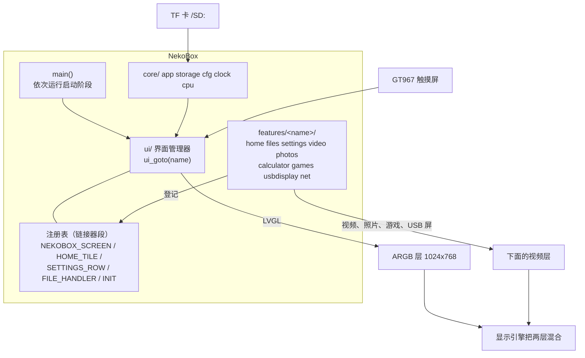

NekoBox 是 YuzukiNeko 的媒体与游戏应用：触摸界面（LVGL，1024×768），有带时钟的主屏、TF 卡文件浏览器、视频播放器（MP4 H.264 + AAC）、支持双指缩放的照片查看器、NES / Game Boy / Game Boy Color / Game Boy Advance 游戏、计算器、USB 副屏、带网络校时的 Wi-Fi，以及设置界面。它是一个应用而不是模块，并且<strong>直接在 SPI NOR flash 中原地运行</strong>（XIP）。代码在 `zephyr-components/nekobox`。

每个功能都是一个有独立开关的<strong>特性</strong>（`CONFIG_NEKOBOX_FEATURE_*`）。关掉的特性不会被编译，也不会留下磁贴、设置行或文件类型；`main()` 里没有对应的 `#ifdef`。特性把自己提供的东西（界面、主屏磁贴、设置行、文件类型、启动步骤）登记在由链接器收集的记录里，所以新增特性只是新增一个目录，其他地方都不用改。

| 特性 | 开关 | 说明 |
| --- | --- | --- |
| 主屏 | 始终有 | 时钟（点击可设置时间）和各特性的磁贴 |
| 文件浏览器 | `NEKOBOX_FEATURE_FILES` | 浏览 TF 卡；视频、照片、游戏从这里打开 |
| 设置 | `NEKOBOX_FEATURE_SETTINGS` | 其他特性往里添加设置行的界面 |
| 亮度、主题 | `NEKOBOX_FEATURE_BRIGHTNESS`、`NEKOBOX_FEATURE_THEME_PICKER` | 设置行：背光、深色/浅色、强调色 |
| 视频 | `NEKOBOX_FEATURE_VIDEO` | MP4（H.264 + AAC）和裸 H.264，拖动、音量、续播、最近列表 |
| 照片 | `NEKOBOX_FEATURE_PHOTOS` | JPEG 和 PNG，双指缩放 |
| 计算器 | `NEKOBOX_FEATURE_CALCULATOR` | 四则运算口袋计算器 |
| 游戏 | `NEKOBOX_FEATURE_GAMES` | NES（nofrendo）、Game Boy / Color（mGBA，从 flash 窗口运行）、Game Boy Advance（带 RISC-V 重编译器的 gpSP，ROM 最大 32 MiB） |
| USB 副屏 | `NEKOBOX_FEATURE_USB_DISPLAY` | 电脑的扩展屏，带触摸 |
| 网络 | `NEKOBOX_FEATURE_NET` | Wi-Fi（AIC8800，保存密码）和 NTP 校时 |
| 蓝牙 | `NEKOBOX_FEATURE_BT` | 启动时检查一次，然后随芯片一起关闭；结果显示在设置里 |



LVGL 把界面画在 ARGB 帧缓冲层上。视频、照片、游戏和 USB 屏走视频引擎或缩放通路，输出到下面的视频层，再由显示引擎把两层混合。在显示视频层的界面上，没有东西可画时界面层会被关掉（`ui_overlay_set()`），把内存带宽还给解码器。

开始之前，请先完成[配置开发环境](../zephyr-setup-env.md)和[获取 Zephyr 代码](../zephyr-get-source.md)。

## 准备

把文件放在 TF 卡上（FAT 或 exFAT，支持长文件名）。播放器不会格式化卡。

| 内容 | 文件 |
| --- | --- |
| 视频 | H.264 视频 + AAC 音频（44.1 或 48 kHz）的 `.mp4`；也支持裸 H.264 流 |
| 照片 | JPEG（视频引擎解码的基线 4:2:0）和 PNG |
| 游戏 | `.nes`；`.gb`、`.gbc`；`.gba`（最大 32 MiB）。ROM 需要自己准备，仓库里没有 |
| 设置 | 播放器写入 `/SD:/.nekobox_settings`（主题、强调色、亮度、Wi-Fi） |
| 最近视频 | 写入 `/SD:/.nekobox_recent`（最近 20 个视频的位置） |
| 存档 | 与游戏同目录，扩展名 `.sav` |

要快速拖动视频，请让编码器每一到两秒放一个关键帧（`-g 30`）：拖动要从目标位置之前的关键帧开始解码，只有开头一个关键帧的文件拖动一次要几秒。

卡槽没有插卡检测信号，所以有个线程每 3 秒尝试挂载缺失的卡，并发现不再响应的卡。播放器没有卡也能启动，卡出现后会自动接上（界面随后从卡里重新读取保存的主题和亮度）。

## 编译

```sh
. ~/f101-zephyr/env.sh
cd ~/f101-zephyr
west build -b yuzukineko -d build/nekobox zephyr-components/nekobox
```

顶层 `CMakeLists.txt` 通过 `ZEPHYR_EXTRA_MODULES` 加入放在应用旁边的模拟器和 Wi-Fi 模块（`../mgba`、`../gbsp`、`../nes`、`../aic8800`），命令行不需要再传参数。输出是 `build/nekobox/zephyr/zephyr.bin`；镜像链接在 XIP 窗口，而不是像其他示例那样链接在 `0x40000000`。

## 运行：从 flash 原地执行

镜像在 SPI NOR flash 中原地运行：它被链接进 SPIF 控制器的窗口（`CONFIG_XIP`、`boards/yuzukineko.overlay`，`0x0e000000` 起 6 MiB）。代码和只读数据从 flash 取，RAM 里只有 `.data`、`.bss` 和堆。窗口必须在第一条指令之前映射好，这由 SyterKit 的应用 `xip-boot` 完成：它初始化 PSRAM（312 MHz；252 MHz 时，与显示共用总线的视频解码器在繁重场景下会丢 540p/30 fps 影片的画面）和 flash，把 flash 从偏移 `0x80000` 映射到 `0x0e000000`，然后跳过去。控制台是 UART1（PB0/PB1），115200 8N1。

### 开发时

引导桩不写进 flash，所以板子每次上电都会进入 FEL，加载器从 RAM 运行。板子处于 FEL 模式时：

```sh
xfel spinor write 0x80000 build/nekobox/zephyr/zephyr.bin
xfel write 0x20000 zephyr-components/nekobox/tools/xip-boot_fel.bin
xfel exec 0x20000
```

`tools/xip-boot_fel.bin` 是带保存采样点的加载器（没有这个的旧版本启动时没有任何输出，所以不要用旧版本覆盖它）。采样点保存在 flash 的参数区，这个流程不会动它。

### 完整 flash 镜像

`tools/mkimage.py` 把引导桩（`xip-boot_spi.bin`）放在 flash 开头、应用放在 `0x80000`，合成一个文件；应用之前的所有内容都会被覆盖。

```sh
python3 zephyr-components/nekobox/tools/mkimage.py \
    --boot out/syterkit/build/yuzukineko/app_sram/xip-boot/xip-boot_spi.bin \
    --app build/nekobox/zephyr/zephyr.bin -o nekobox-full.img
# 板子处于 FEL 模式（上电时按住 FEL 键）
xfel spinor write 0 nekobox-full.img
```

下次上电后，BROM 从 flash 启动引导桩，由它映射窗口并跳进应用。只更新应用时，像上面那样把 `zephyr.bin` 写到 `0x80000`（仍需 FEL 模式，板子不再自己进入 FEL）。

| flash 范围 | 内容 |
| --- | --- |
| `0 .. 128 KiB` | 引导桩 |
| `128 .. 192 KiB` | 参数区：引导桩把采样训练的结果存在这里，所以只有第一次启动要训练（之后每次启动少约 0.55 s） |
| `512 KiB (0x80000)` 到镜像末尾 | 应用 |

:::caution
镜像从 `0x80000` 起占用 flash，与 [UF2 下载器](../zephyr-uf2.md)的应用区（`0x200000`）重叠，二者只能用其一。
:::

板子只有一个 USB-C 口，它既是 xfel 下载口，也是 USB 副屏口。先下载，再接其他设备。

### 运行后的输出

控制台先打印 `nekobox: boot <ms> ms: main starts`，然后每个启动步骤一行（`nekobox: boot <ms> ms: <名称>`，名称见下面的启动步骤表），再是第一张画面和屏幕尺寸：

```text
nekobox: boot <ms> ms: main starts
nekobox: boot <ms> ms: <step name>
...
nekobox: boot <ms> ms: first picture
nekobox: 1024 x 768
```

运行中，当某次重绘超过 8 ms（需 `CONFIG_NEKOBOX_DEBUG`），每 5 秒会打印 `ui: worst redraw <n> ms, <n> slower than 30 ms`。启动步骤失败会打印 `nekobox: start failed in stage <n>`。

## 使用

- <strong>主屏</strong>：上方是时钟和日期，下面是磁贴（视频、文件、照片、USB 副屏、NES、Game Boy、计算器、设置）。点击时钟可设置时间。
- <strong>文件</strong>：一次显示一个目录，滑动滚动，点名字打开。“视频”这样的磁贴打开的浏览器只列这一类文件。
- <strong>视频</strong>：播放/暂停、拖动条、音量、前后跳 10 秒；控制条 4 秒后隐藏，点一下再出来。最近播放的 20 个视频连同离开时的位置被记下，再次打开会接着播。
- <strong>照片</strong>：滑动或用两侧按钮切换；双指缩放，单指平移，双击切换缩放，点一下隐藏控件。
- <strong>游戏</strong>：画面上叠半透明屏幕按键，可多指同时按（游戏代码跟踪 5 个触摸槽；本配置的触摸驱动报告 2 个点）。游戏存档每 3 秒写一次。
- <strong>设置</strong>：时间、Wi-Fi、蓝牙、校时、亮度、深色/浅色、强调色、关于。

游戏运行时后台活动会被暂停：Wi-Fi 芯片关闭、卡扫描等待，让模拟器用上全部 CPU。

## 接口

NekoBox 自己的“API”就是特性要用到的那些头文件。它们都在 `src/` 下，以 `"core/…"`、`"ui/…"`、`"features/…"` 的形式包含。

### 启动步骤：`core/app.h`

`main()` 只按顺序运行四个阶段；每个阶段里的工作由各模块自己登记。

```c
static const enum nekobox_stage stages[] = {
	NEKOBOX_STAGE_EARLY, NEKOBOX_STAGE_STORAGE, NEKOBOX_STAGE_UI, NEKOBOX_STAGE_SERVICES,
};
/* ……依次运行，然后 ui_present(); nekobox_run_stage(NEKOBOX_STAGE_READY); ui_loop(); */
```

| 阶段 | 运行时机 | 树里的步骤（阶段，order） |
| --- | --- | --- |
| `NEKOBOX_STAGE_EARLY` | 一切开始需要之前 | 显示线程（0）、CPU 时钟（10）、向量混合（20） |
| `NEKOBOX_STAGE_STORAGE` | 卡已挂载、设置已读入 | 卡（0）、设置（10） |
| `NEKOBOX_STAGE_UI` | 显示已就绪 | 显示就绪 + LVGL（0）、g2d（10）、主题（15）、界面（20） |
| `NEKOBOX_STAGE_SERVICES` | 后台服务 | 网络（10） |
| `NEKOBOX_STAGE_READY` | 第一张画面之后 | 自测、游戏自启动（50） |

```c
#define NEKOBOX_INIT(_stage, _order, _name, _fn)
int nekobox_run_stage(enum nekobox_stage stage);
```

`NEKOBOX_INIT(stage, order, name, fn)` 登记一个启动步骤 `int fn(void)`。同一阶段的步骤按 `order` 升序运行，`fn` 成功返回 0，<strong>UI 阶段里的失败会终止启动</strong>。`nekobox_run_stage()` 每执行完一步就打印 `nekobox: boot <ms> ms: <name>`（出错时后面加 ` FAILED`），运行整个阶段，并返回第一个错误（该阶段剩下的步骤不再运行）。

```c
void nekobox_background_hold(bool hold);
bool nekobox_background_held(void);
void nekobox_background_wait(void);
void nekobox_background_register(void (*fn)(bool hold));
```

后台暂停是给游戏运行期间必须让路的服务用的。游戏界面开始时调用 `nekobox_background_hold(true)`，离开时调用 `false`。正在运行的服务用 `nekobox_background_register()` 登记一个函数（最多 4 个），暂停开始时以 `true` 调用，结束时以 `false` 调用（网络用它关闭芯片）；稍后才启动的服务调用 `nekobox_background_wait()`，它会睡到暂停解除。`nekobox_background_held()` 用来查询。

### 界面：`ui/ui.h` 与 `ui/registry.h`

```c
struct nekobox_screen {
	const char *name;
	lv_obj_t *(*create)(void);
	void (*enter)(void *arg);	/* 每次显示该界面时 */
	void (*leave)(void);
};
#define NEKOBOX_SCREEN(_sym, _name, _create, _enter, _leave)
```

`NEKOBOX_SCREEN(sym, "name", create, enter, leave)` 登记一个界面。`create()` 构建它的 LVGL 对象并返回界面对象（可用 `ui_screen_new()` 创建），第一次显示时调用，结果被保留。`enter(arg)` 每次显示时调用，参数来自 `ui_goto_arg()`；`leave()` 在被别的界面替换时调用；两者都可以是 `NULL`。最多 16 个界面。

| 函数 | 作用 |
| --- | --- |
| `ui_goto(name)` | 按名字显示界面；名字未知（特性没编译）时什么也不做 |
| `ui_goto_arg(name, arg)` | 同上，并给 `enter()` 传一个参数 |
| `ui_files_open(dir, kind)` | 在 `dir`（`NULL`：卡根目录）打开文件浏览器，列出 `kind`（`NULL`：全部）类型的文件；浏览器没编译时是空的内联桩 |
| `ui_rebuild_all()` | 重新创建所有界面（换主题后）；在当前事件处理完之后执行，所以界面可以在自己的事件回调里调用 |
| `ui_present()` | 画出第一张画面，然后打开面板 |
| `ui_loop()` | 界面线程的循环：`lv_timer_handler()` 加最多 20 ms 的睡眠；不会返回 |

界面第一次绘制时，ARGB 层保持关闭直到画完整屏，所以新界面不会出现从顶部刷下来的现象。

### 主屏磁贴、设置行和文件类型：`ui/registry.h`

```c
struct nekobox_home_tile {
	int order;
	const char *symbol, *title, *subtitle;
	uint32_t color_top, color_bottom;
	const char *screen;	/* 要打开的界面 */
	const char *kind;	/* 或：打开这一类文件的浏览器（NULL：全部文件） */
};
#define NEKOBOX_HOME_TILE(_sym, ...)
```

主屏的一个磁贴，按 `order` 排序。它打开界面 `screen`；`screen` 为 `NULL` 时打开列出 `kind` 类型文件的文件浏览器。树里的磁贴：

| order | 磁贴 | 打开 |
| --- | --- | --- |
| 10 | 视频 | 文件浏览器，kind `video` |
| 20 | 文件 | `files` |
| 30 | 照片 | 文件浏览器，kind `photo` |
| 40 | USB 副屏 | `usb` |
| 50 | NES | 文件浏览器，kind `nes` |
| 60 | Game Boy | 文件浏览器，kind `gb`（也含 `.gba`） |
| 65 | 计算器 | `calculator` |
| 70 | 设置 | `settings` |

```c
struct nekobox_settings_row {
	int order;
	void (*create)(lv_obj_t *list);
	void (*refresh)(void);	/* 界面显示期间每秒一次；可为 NULL */
};
#define NEKOBOX_SETTINGS_ROW(_sym, _order, _create, _refresh)

lv_obj_t *settings_row_create(lv_obj_t *parent, const char *symbol, const char *title,
			      lv_obj_t **value, lv_event_cb_t cb);   /* features/settings/settings.h */
```

设置界面的一行，按 `order` 排序。`create(list)` 在给定的列表里构建这一行，通常用 `settings_row_create()`：图标、标题、右侧的值标签（指针写入 `*value`，可为 `NULL`）和点击回调（可为 `NULL`）。`refresh()` 更新值标签。树里的行：时间 10、Wi-Fi 20、蓝牙 30、校时 40、亮度 50、深色/浅色 60、强调色 70、关于 90。

```c
struct nekobox_file_handler {
	const char *kind, *title, *symbol;
	const uint32_t *color;		/* ui_pal 的某个字段，所以会跟随主题 */
	const char *const *exts;	/* 小写，带点，以 NULL 结尾 */
	void (*open)(const char *path);
	const char *extra_screen, *extra_label;	/* 标题栏里打开另一个界面的按钮 */
};
#define NEKOBOX_FILE_HANDLER(_sym, ...)
```

一类文件：哪些名字属于它（`exts`）、它在列表里的图标和颜色，以及用什么打开（`open(path)`；返回时回到文件浏览器）。只有为某一类打开浏览器时，才只列出这一类的文件。树里的类型：`video`、`photo`、`nes`、`gb`（`.gb .gbc .gba`）。

### 文件里的设置：`core/cfg.h`

```c
void cfg_load(void);
const char *cfg_get(const char *key);
void cfg_set(const char *key, const char *value);
```

断电后仍保留的设置，每项在 `/SD:/.nekobox_settings` 里占一行 `key value`（最多 28 项，键最长 15 个字符，值最长 95 个字符）。`cfg_load()` 在卡挂载后读入文件（“settings” 启动步骤会做）；`cfg_get()` 返回值或 `NULL`；`cfg_set()` 设置一个键（`NULL` 表示删除）并立即写文件。使用中的键：`theme`、`accent`、`brightness`、`wifi_ssid`、`wifi_psk`，以及 `wp<网络名的哈希>`，用来保存每个连过的网络的密码。

### 主题与控件：`ui/theme.h`、`ui/widgets.h`

```c
extern struct palette ui_pal;   /* bg surface surface2 border text dim accent accent2 ok warn pink */
#define C_BG / C_SURFACE / C_SURFACE2 / C_BORDER / C_TEXT / C_DIM / C_ACCENT / C_ACCENT2 / C_OK / C_WARN / C_PINK
bool ui_theme_dark(void);   int ui_theme_accent(void);   /* UI_ACCENTS = 6 */
void ui_theme_set(bool dark, int accent);   /* 设置、保存、重建所有界面 */
void ui_theme_reload(void);                 /* 重新取保存的主题和亮度 */
int  ui_brightness(void);                   /* 10..255 */
void ui_brightness_set(int value, bool save);
```

颜色在每次创建界面时从 `ui_pal`（`C_*` 宏）读取，所以换主题后再调用 `ui_rebuild_all()` 就能全部重新着色；`ui_theme_set()` 两件事都做。卡晚到时界面循环会调用 `ui_theme_reload()`，因为保存的主题在卡上。

```c
lv_obj_t *ui_screen_new(bool transparent);   /* 背景色界面；显示视频的界面用透明的 */
lv_obj_t *ui_icon_button(lv_obj_t *parent, const char *symbol, int32_t size);
lv_obj_t *ui_title_bar(lv_obj_t *parent, const char *title, lv_event_cb_t on_back);
void ui_set_time_dialog(void (*done)(void));
void ui_overlay_set(bool show);              /* 打开或关闭视频之上的界面层 */
```

### 服务：`core/storage.h`、`core/clock.h`、`core/fsutil.h`

| 函数 | 作用 |
| --- | --- |
| `storage_ready()` | 卡已挂载（挂载点 `NEKOBOX_MOUNT_POINT` = `/SD:`） |
| `storage_generation()` | 挂载和卸载的计数；显示卡内容的界面把它与自己上次看到的值比较 |
| `storage_space(&total, &free)` | 总字节数和空闲字节数；未挂载时返回 false |
| `clock_now(&tm)`、`clock_set(h, m)`、`clock_set_tm(&tm)`、`clock_valid()` | 实时时钟的日期和时间（年份自 1900，月 0..11）；没有可用 RTC 时 `clock_valid()` 为 false |
| `name_cmp(a, b)`、`name_has_ext(name, ext)` | 不区分大小写的文件名辅助函数（`ext` 带点） |
| `file_read_text(path, buf, size)` | 读小文件的开头并以 NUL 结尾；返回字节数，失败为负值 |

### 视频播放器：`features/video/player.h`

“视频”界面下面的引擎；一次打开一个文件，画面输出到视频层。

```c
int  player_open(const char *path, struct player_info *info);  /* 打开并开始播放 */
void player_close(void);
void player_play(void);   void player_pause(void);
void player_seek(uint32_t ms);
enum player_state player_state(void);   /* IDLE PLAYING PAUSED ENDED ERROR */
uint32_t player_position_ms(void);      /* 屏幕上画面的时间戳 */
void player_set_volume(int percent);    int player_volume(void);   /* 0 为静音，随时可调 */
```

`player_info` 给出 `duration_ms`、`width`、`height`、`has_audio` 和 `raw`（没有容器的 H.264 文件：长度是估计值）。播放、暂停、拖动的做法一样：请求一个从某位置开始的新会话。视频线程和音频线程盯着请求的序号，序号变了就重新开始；暂停的会话显示它位置上的画面并停住，会话的声音在第一张画面解码出来时才开始，这样声音不会跑到需要从关键帧开始解码的视频前面。`history.h` 在 `/SD:/.nekobox_recent` 里保存最近 20 个视频及离开时的位置（`history_load`、`history_get`、`history_find`、`history_update`）。

### 游戏：`features/games/game.h`

```c
void ui_game_open(const char *path, const char *from);
```

启动一个游戏并显示 `game` 界面；该界面的叉号回到名为 `from` 的界面。内核按扩展名选择：`.nes` → nofrendo，`.gba` → gpSP（见 [gpSP 页](gpsp.md)），`.gb` / `.gbc` → mGBA（见 [mGBA 页](mgba.md)）。游戏打开期间有三个线程：模拟（优先级 9，低于界面线程，保证界面线程总能得到运行机会）、音频（3）和视频（5）；声音像独立播放器里一样给模拟定速，画面输出到显示引擎的缩放层，按键是画面上半透明的 LVGL 按钮，直接从触摸事件读取，每个触摸槽一根手指（L 和 R 只在 Game Boy Advance 下出现）。内存放不下的 ROM 会被拒绝并给出提示（`This game is too large for the memory` / `Not enough memory for this game`）。`CONFIG_NEKOBOX_GAME` 可以指定启动时自动开始的游戏，用于不用手点的检查。

### 网络：`features/net/net.h`、`features/net/bt.h`

| 函数 | 作用 |
| --- | --- |
| `app_net_available()` | 板子上有 Wi-Fi 模块并且它有应答 |
| `app_net_scan()`、`app_net_scanning()`、`app_net_scan_results(out, max)` | 开始扫描；拷出目前找到的接入点，信号强的在前（`struct net_ap`：`ssid`、`rssi`、`secured`） |
| `app_net_connect(ssid, psk)`、`app_net_disconnect()`、`app_net_connected()` | 加入（开放网络 `psk` 为空，成功后保存）、断开、查询 |
| `app_net_saved_psk(ssid, psk, size)` | 之前连过的网络保存的密码 |
| `app_net_sync_time()` | 向 NTP 服务器（`CONFIG_NEKOBOX_NTP_SERVER`，默认 `ntp.aliyun.com`）请求时间并设置时钟；时钟显示本地时间（`CONFIG_NEKOBOX_UTC_OFFSET_MIN`，默认 480） |
| `app_net_status(buf, size)`、`app_net_sync_status(buf, size)` | 给设置界面用的一行：连接状态 / 上次校时 |
| `bt_probe()`、`bt_status(buf, size)` | 检查一次蓝牙（控制器有应答，短暂广播）/ 一行结果 |

芯片只在使用时才开着。启动后会加入保存的网络并校准时钟，然后把芯片彻底关闭（任务停止、芯片断电、内存还给 arena）。扫描、加入或校时请求会再次启动它（约 2.5 s）；30 秒没有请求，或者进入游戏，就把它关掉。所有等待都在一个工作线程里进行；界面只查询状态和下命令。

### USB 副屏：`features/usbdisplay/`

`usb` 界面让板子成为电脑的虚拟显示器：电脑把桌面作为 JPEG 帧通过批量端点发来，视频引擎按 Motion-JPEG 流解码，画面输出到视频层。设备是复合设备（PID `0x2986`）：接口 1 是 5 指 HID 多点触摸屏，`usb_touch_send(points, count)` 发送一份最多 `USB_TOUCH_MAX_CONTACTS`（5）根手指的报告（`struct usb_touch_point`：`id`、`down`，`x`、`y` 取值 0..`USB_TOUCH_MAX` = 32767），上一份报告还在发送时返回 `-EBUSY`；角上的叉号会停止 USB 设备并归还解码器。另见 [USB 副屏](usb-display.md)页。

### 新增一个特性

1. 建 `src/features/<name>/`，里面有 `Kconfig`（`config NEKOBOX_FEATURE_<NAME>`，`default y`，用 `select` 选上它需要的 Zephyr 选项）和 `CMakeLists.txt`（`target_sources_ifdef(CONFIG_NEKOBOX_FEATURE_<NAME> app PRIVATE ...)`）。
2. 在顶层 `CMakeLists.txt` 里 `add_subdirectory(src/features/<name>)`；`Kconfig` 由顶层 `Kconfig` 的通配符找到。
3. 在源码里登记特性提供的东西：

```c
#include "ui/ui.h"

static lv_obj_t *hello_create(void)
{
	lv_obj_t *scr = ui_screen_new(false);

	ui_title_bar(scr, "Hello", back_cb);   /* back_cb 里调用 ui_goto("home") */
	/* ……控件，颜色用 C_TEXT、C_ACCENT…… */
	return scr;
}

NEKOBOX_SCREEN(hello, "hello", hello_create, NULL, NULL);
NEKOBOX_HOME_TILE(hello, .order = 66, .symbol = LV_SYMBOL_OK, .title = "Hello",
		  .subtitle = "An example", .color_top = 0x3DA5F4, .color_bottom = 0x1E6FBF,
		  .screen = "hello");
```

注册表是 flash 里的只读记录，由链接器通过 `src/core/sections-rom.ld` 和 `src/ui/sections-rom.ld` 收集；新增一种注册表必须列在那里（应用 CMake 里的 `zephyr_iterable_section` 到不了链接脚本）。

## 源码布局

```text
src/
  main.c           运行启动阶段，仅此而已
  core/            没有界面的服务
    app.[ch]         启动步骤和后台暂停
    storage cfg clock cpu fsutil boot_display
  ui/              框架，里面没有特性
    ui.[ch]          界面管理器（按名字找界面）
    registry.h       NEKOBOX_SCREEN、NEKOBOX_HOME_TILE、NEKOBOX_SETTINGS_ROW、NEKOBOX_FILE_HANDLER
    theme widgets time_dialog
  gfx/             LVGL 的绘制加速（向量混合、2D 引擎）
  features/<name>/ 每个特性一个目录：CMakeLists.txt、Kconfig、源码
  debug/           统计与自测（NEKOBOX_DEBUG）
```

特性有：`home`、`files`、`settings`（`brightness_row.c`、`theme_rows.c`）、`video`（`player*.c` 是引擎，`ui_player.c`、`recent.c`、`history.c`）、`photos`、`calculator`、`games`、`usbdisplay`、`net`（`net.c`、`wifi_ui.c`、`bt.c`）。

## 配置选项

| 选项 | 默认 | 说明 |
| --- | --- | --- |
| `NEKOBOX_FEATURE_*` | y | 开头表里的各特性；VIDEO、PHOTOS、GAMES 需要 `FILES`，`BT` 需要 `NET` |
| `NEKOBOX_CPU_MHZ` | 960 | CPU 频率；0 保持引导桩设定的 600 MHz。以 72 MHz 为一步升频，每步后做内存自检；不改电压 |
| `NEKOBOX_GFX_RVV` | y | LVGL 软件渲染器的向量混合，启动时与 C 代码对照检查，不一致就关闭 |
| `NEKOBOX_GFX_G2D` | n | 用 2D 引擎填充大块纯色矩形；实测更慢（主屏整屏重绘十次 1281 ms，对比 810 ms），所以保持关闭。`NEKOBOX_GFX_G2D_MIN_PIXELS` 为 20000 |
| `NEKOBOX_HOT_RAM` | y（XIP） | 视频解码驱动和 AAC 解码器在 RAM 里运行；否则每条不在缓存里的指令都要从 flash 窗口取 |
| `NEKOBOX_GAMES_HOT_RAM` | y（XIP） | gpSP 内核的渲染器、内存处理函数、帧循环、块查找和重编译器在 RAM 里运行。mGBA 内核仍留在 flash 窗口 |
| `NEKOBOX_VIDEO_DEFAULT` | `/SD:/video540p-ysjf.mp4` | 自测播放的文件 |
| `NEKOBOX_GAME` | 空 | 启动时自动开始的游戏 |
| `NEKOBOX_UTC_OFFSET_MIN` | 480 | 本地时间相对 UTC 的偏移 |
| `NEKOBOX_NTP_SERVER` | `ntp.aliyun.com` | 授时服务器 |
| `NEKOBOX_DEBUG` | y | 界面的统计数字（滑动列表的帧率、到第一张画面的时间） |
| `NEKOBOX_SELFTEST` | n | 自动播放默认视频、拖动、暂停、继续并调节音量 |
| `NEKOBOX_THEME_TEST` | n | 自动走一遍设置、主题、Wi-Fi 和游戏步骤；以 `PASS` 或 `FAIL` 结束 |
| `NEKOBOX_SOAK` | n | 把卡上每个视频和游戏各播两遍，每个之后打印空闲内存；`PASS` / `FAIL` |
| `NEKOBOX_RADIO_TEST` | n | 多次启动 Wi-Fi 芯片、扫描、再停止；每次停止后驱动占用的内存必须回到 arena |
| `NEKOBOX_PROFILE`、`_PROFILE_DELAY_S` | n、20 | 采样游戏线程的时间花在哪里，并打印最忙的代码块 |
| `NEKOBOX_THREAD_STATS` | n | 播放器各线程的 CPU 时间（默认关闭：打开用量统计后，曾在一次打开失败后看到调度器里出现 load access fault） |

`prj.conf` 的主要设置：`XIP`；`SDHC` / FAT / exFAT / 长文件名，并开启 `FS_FATFS_REENTRANT`（音频线程、视频线程和浏览器读同一张卡，不开的话读取会返回 `-EIO`）；`MAIN_STACK_SIZE=16384`；`COMMON_LIBC_MALLOC_ARENA_SIZE=-1`（malloc arena 是镜像之上的全部 RAM：解码器缓冲、显示和游戏的内存都从这里来）；32 位色的 LVGL 加 `DISPLAY_SUNXI_ARGB8888`；输入线程优先级 2、队列 64 条消息，这样长时间重绘不会让触摸队列溢出；`SPEED_OPTIMIZATIONS`；以及 `boards/yuzukineko.conf`（给 GT967 触摸屏用的 I2C 和 INPUT，2 个触摸点）。overlay 里禁用了 `spi0`，因为它占用 flash 的引脚 PC0..PC5。

## 范围

- 界面文字只有英文：LVGL 字体里没有中文字形。
- AAC 只播放 44.1 和 48 kHz。
- 视频：H.264 4:2:0 8 位帧图像，以 [VDEC 驱动](../drivers/vdec.md)支持的为准；照片：JPEG 基线 4:2:0 和 PNG。
- GBA 游戏的 ROM 一部分在内存里（缓冲，默认 6 MiB），一部分按页从卡里读；切换场景时可能有卡顿。见 [gpSP 页](gpsp.md)。
- 游戏期间 Wi-Fi 和蓝牙都关闭，Wi-Fi 启动约需 2.5 s。
- 没有实体按键输入，一切都靠触摸屏（本配置里触摸驱动设置为 2 个点，`CONFIG_INPUT_GT967_MAX_TOUCH_POINTS=2`）。
