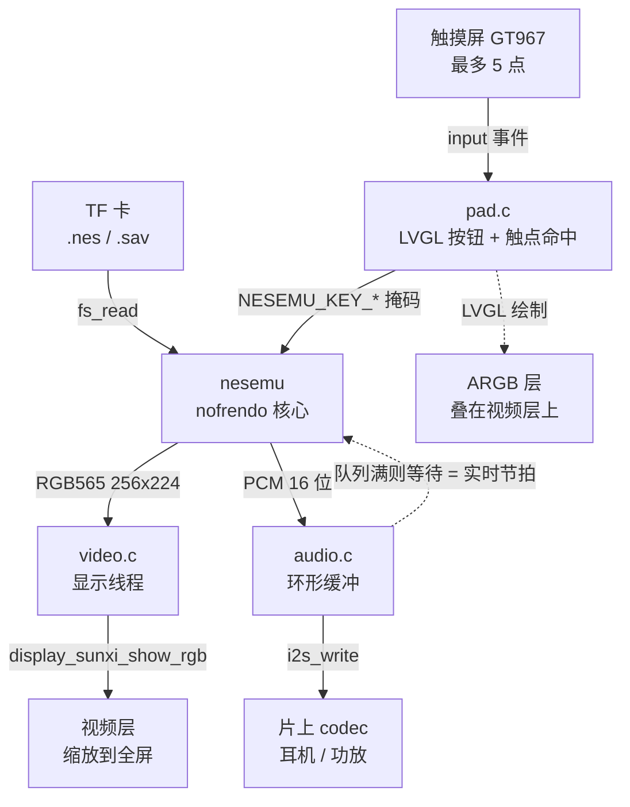
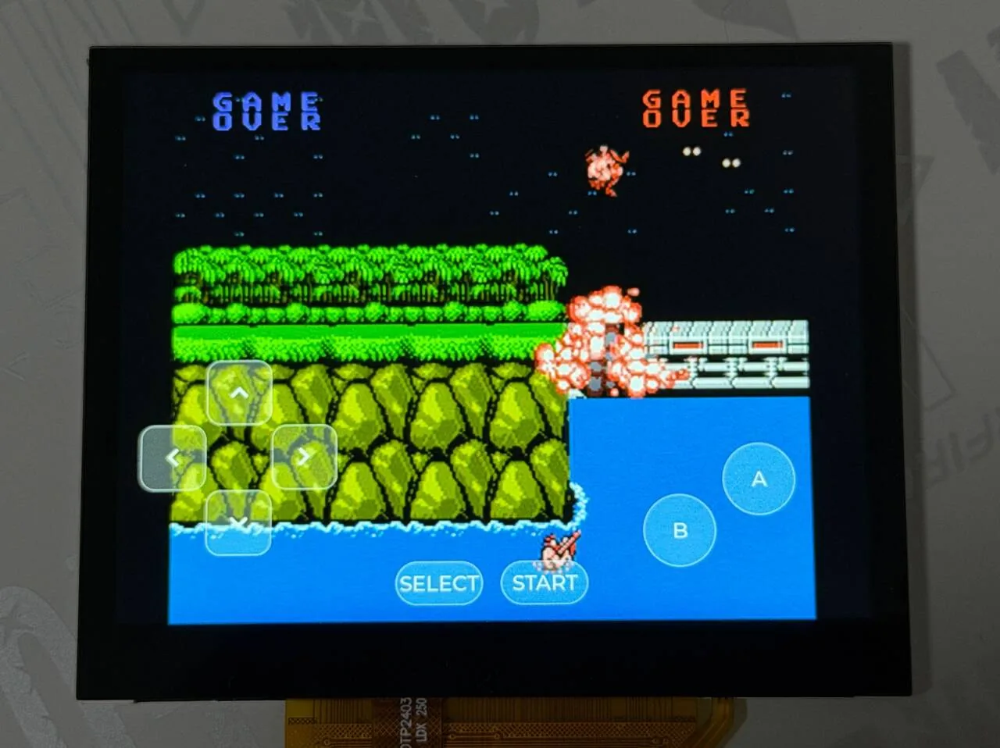
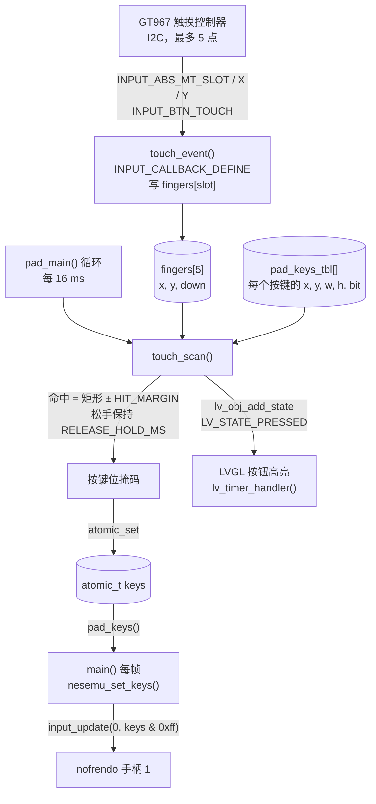

从 TF 卡读取 `.nes` 游戏并运行。模拟核心是 [nofrendo](https://github.com/ducalex/retro-go)，画面（RGB565）交给显示引擎的缩放视频层，声音经 I2S 送到片上 codec，手柄按键是画在 LVGL 上的半透明按钮，用触摸屏操作。代码在 `zephyr-components/nes`（nofrendo 加一层 Zephyr 胶水），示例是 `samples/nes_player`。



运行速度由声音决定：模拟器每跑完一帧，把这一帧的声音推进环形缓冲；缓冲里排队的声音超过 `RATE / 15` 个采样帧就暂停模拟，等 codec 播掉一部分。排队的声音少于 `RATE / 30` 时，下一帧只模拟、不画，保证声音不断。

开始前请先完成 [配置开发环境](../zephyr-setup-env.md) 和 [获取 Zephyr 代码](../zephyr-get-source.md)。

## 准备

准备一张 TF 卡和一个 `.nes` 游戏文件。ROM 需要自备，仓库不含任何游戏文件。请使用你有权使用的 ROM，比如自己拥有的卡带备份，或作者允许分发的自制游戏。

1. TF 卡格式化为 FAT 或 exFAT。
2. 把 `.nes` 文件（iNES 格式）拷到卡的根目录。
3. 启动时 `pick_rom()` 先找 `CONFIG_SAMPLE_NES_ROM`（默认 `/SD:/game.nes`），不存在就扫描根目录，用找到的第一个扩展名为 `.nes` 或 `.NES` 的文件。根目录里一个都没有，就打印 `no .nes file on the card` 后退出。
4. 带电池的游戏，存档放在 ROM 旁边，文件名是把 `.nes` 换成 `.sav`。主循环每 3 秒检查一次，存档内容变了才写，启动时有就读回。

核心对 ROM 的要求：

| 项 | 内容 |
| --- | --- |
| 文件格式 | iNES（`.nes`），其他格式不支持 |
| 文件大小 | 16 字节到 `CONFIG_NES_MAX_ROM_SIZE_KB`（默认 2048 KiB），整个读进内存 |
| Mapper | 0 1 2 3 4 5 7 9 10 11 15 16 18 19 20 21 22 23 24 30 31 32 33 34 40 41 42 46 50 64 65 66 70 71 73 74 75 76 78 79 85 87 93 94 119 160 162 176 185 191 192 193 194 195 206 228 229 231，即 `nofrendo/mappers/` 里有的。其他 mapper 装载失败，返回 `-EINVAL` 或 `-ENOTSUP` |
| 制式 | 按 ROM 自动判断 NTSC（60 Hz，画面 256×224）或 PAL（50 Hz，256×240）；文件名含 `(E)` 或 `(Europe)` 的强制按 PAL |

## 编译

在工作区里执行。示例在自己的 `CMakeLists.txt` 里用 `ZEPHYR_EXTRA_MODULES` 引入组件，不需要额外参数：

```sh
. ~/f101-zephyr/env.sh
cd ~/f101-zephyr
west build -b yuzukineko -d build/nes zephyr-components/nes/samples/nes_player
```

<div class="asciinema-cast" data-src="assets/casts/zephyr/apps-nes/build.cast" data-speed="6"></div>

产物是 `build/nes/zephyr/zephyr.bin`，约 4.5 MB，链接地址 `0x40000000`。`samples/nes_player/boards/yuzukineko.conf` 编这块板时自动合并，里面打开 I2C 和 INPUT，触摸屏才能工作。

## 运行

用 [编译与运行](../zephyr-build-run.md) 里的任一种方式下载，控制台是 UART1（PB00/PB01，115200 8N1）。

- 调试用方式一：`xfel ddr f101-s3`、`xfel write 0x40000000 build/nes/zephyr/zephyr.bin`、`xfel exec 0x40000000`。
- 脱机运行用方式三：`mkuf2.py app build/nes/zephyr/zephyr.bin -o out/nes.uf2`，拖进 `F101BOOT` 盘。

:::caution
板子只有一个 USB-C 口，既是 xfel 下载口，也是 UF2 盘的口。先下载，再接别的设备。
:::

操作只能用触摸屏，没有实体按键。左侧是方向键，右侧是 B、A 两个圆键，下方中间是 SELECT 和 START。支持多点触控（5 点），可以按着方向键同时按 A 和 B。



照片里是《魂斗罗》的画面。游戏画面放大后显示在面板中间，半透明的屏幕按键叠在上面：方向键在左下，B、A 两个圆键在右下，SELECT、START 在底部中间。按住的键颜色会变化，照片里左方向键正被按着。

### 运行后的输出

下载运行后，串口上依次是下面这些输出。日志里的游戏名写成 `<游戏名>`。

#### 触摸屏和显示初始化

启动后 `display_sunxi` 报告面板 1024×768，GT967 触摸控制器读出固件版本，配置为 1024×768、最多 5 点：

```text
*** Booting Zephyr OS build b6f3dfe1a1f4 ***
[00:00:00.493,000] <inf> display_sunxi: 1024x768 @ 60 Hz, fb 0x400a42c0, video plane 0
[00:00:00.564,000] <inf> gt967: GT967 firmware 0x1040, 1024x768
[00:00:00.570,000] <inf> gt967: configuration 0x63: 1024 x 768, up to 5 point(s), module switch 0x04
```

触摸屏分辨率与显示一致，所以触点坐标可以直接和按键的屏幕坐标比较，不需要换算。

#### TF 卡挂载和选 ROM

根目录放一个 `.nes`、不指定 `CONFIG_SAMPLE_NES_ROM` 时，日志里打印 ROM 路径和存档路径：

```text
ROM /SD:/<游戏名>.nes, save /SD:/<游戏名>.sav
```

默认的 `/SD:/game.nes` 不存在，`pick_rom()` 扫描到了根目录里的 `.nes`，存档路径把扩展名换成了 `.sav`。

#### ROM 装载

nofrendo 打印出 iNES 头解析的结果：文件大小、PRG/CHR 容量、mapper 编号、制式：

```text
NES: System initialized!
ROM: Found iNES file of size 131088.
ROM: Game found in database.
 ! ROM: prg_ram_banks mismatch! (DB: 0, ROM: 1)
ROM: CRC32:  F6035030
ROM: Mapper: 2, PRG:128K, CHR:0K, Flags: V---
MMC: Mapper UNROM (iNES 002)
MMC: PRG-ROM: 16 banks
MMC: PRG-RAM: 1 banks
MMC: CHR-RAM: 1 banks
NES: System type: NES-NTSC (NTSC-U)
NES: System reset (hard)
```

NTSC 的 UNROM（mapper 2）卡带装载成功，进入主循环。

#### 实时节拍

游戏开始后，主循环每 5 秒打印一行统计，可以据此看出声音限速的效果：

```text
nes: 310 frames, emulation 3163 us/frame, sound 248000 frames pushed, queued 2752, underruns 0, ring empty 8, slab full 471
nes: 301 frames, emulation 3310 us/frame, sound 240800 frames pushed, queued 2912, underruns 0, ring empty 8, slab full 941
```

| 字段 | 含义 |
| --- | --- |
| `frames` | 这 5 秒跑的帧数。NTSC 满速约 300 帧（60.1 fps），日志里是 301 |
| `emulation ... us/frame` | 每帧的模拟耗时，不含等待声音。要小于 16639 μs（一帧的时长）才追得上实时，这里约 3.3 ms |
| `sound ... frames pushed` | 推进环形缓冲的采样帧数，48 kHz 下 5 秒约 240000，与日志相符 |
| `queued` | 环形缓冲里排队的采样帧数，保持在 `RATE / 15`（3200）附近，说明是声音在限速 |
| `underruns` | I2S 断流重启次数，日志里是 0 |
| `ring empty` | 声音线程发现环形缓冲不够一个块的次数，日志里是 8，不再增长 |
| `slab full` | 声音线程等 I2S 块的次数。声音在限速时这个值会持续增长，不是故障 |

## 画面输出路径

模拟器把 PPU 的 8 位索引画面转成 RGB565，写进调用者给的缓冲，上下各去掉 8 行过扫描区域（NTSC 剩 224 行）。代码在 `nesemu.c` 的 `blit()`：

```c
/* the 8 bit picture of the PPU to RGB565, without the overscan lines */
static void blit(uint8 *src)
{
	nes_t *nes = nes_getptr();
	unsigned int h = nesemu_height();

	if (out_buf == NULL) {
		return;
	}
	src = NES_SCREEN_GETPTR(src, 0, nes->overscan);
	for (unsigned int y = 0; y < h; y++) {
		uint16_t *d = out_buf + y * NESEMU_WIDTH;

		for (int x = 0; x < NESEMU_WIDTH; x++) {
			d[x] = palette[src[x]];
		}
		src += NES_SCREEN_PITCH;
	}
	drawn = 1;
}
```

这块缓冲来自 `video.c`：4 个 256×240×2 字节的缓冲轮流用（`NBUF`），模拟线程画下一帧时，显示还在扫描上一帧。画完调 `video_present()`，刷缓存，用信号量叫醒显示线程：

```c
void video_present(unsigned int width, unsigned int height)
{
	cur = (cur + 1) % NBUF;
	sys_cache_data_flush_range(buf[cur], STRIDE * height);
	ready_w = width;
	ready_h = height;
	atomic_set(&ready_idx, cur);
	k_sem_give(&frame_sem);
}
```

显示线程 `video_main()` 在自己的线程里等刷新，不拖住模拟（模拟的节拍由声音决定），只显示最新的一帧：

```c
		k_sem_take(&frame_sem, K_FOREVER);
		idx = atomic_get(&ready_idx);
		img.data = buf[idx];
		img.width = ready_w;
		img.height = ready_h;
		img.stride = STRIDE;
		img.nonblock = false;
		ret = display_sunxi_show_rgb(disp, &img);
```

`display_sunxi_show_rgb()` 把 RGB565 缓冲交给显示引擎的视频层，由硬件缩放到整个屏幕。按键用的 LVGL 画在更上面的 ARGB 层，所以按键叠在游戏画面上。缩放的比例和是否保持宽高比由显示驱动决定，示例不控制。

想改缓冲个数，改 `video.c` 里的 `NBUF`。

## 声音输出路径

`nesemu_run_frame()` 末尾把这一帧的 APU 输出（单声道）复制成左右相同的立体声：

```c
	/* the sound of the frame, mono to stereo; what the caller did not take yet is dropped */
	n = MIN(apu->samples_per_frame, SAMPLE_FRAMES_MAX);
	for (int i = 0; i < n; i++) {
		pcm[2 * i] = pcm[2 * i + 1] = apu->buffer[i];
	}
```

主循环取出来推进 `audio.c` 的环形缓冲（`audio_push()`），推不进去就睡 1 ms 再试。声音线程 `audio_main()` 每凑够 512 个采样帧（一个块）就从内存槽拿一块，`i2s_write()` 送出，先预填 3 块再 `I2S_TRIGGER_START`。`i2s_write()` 返回 `-EIO` 表示 I2S 断流，计一次 `underruns`，重新预填。

音量在声音线程开始时设置，值来自 `CONFIG_SAMPLE_NES_VOLUME`：

```c
	audio_codec_start_output(ctl);
	audio_codec_set_property(ctl, AUDIO_PROPERTY_OUTPUT_VOLUME, AUDIO_CHANNEL_ALL,
				 (audio_property_value_t){.vol = CONFIG_SAMPLE_NES_VOLUME});
```

范围 0 到 255，默认 150。采样率由 `CONFIG_SAMPLE_NES_RATE` 决定，选项说明里只支持 48000 或 44100。

主循环里决定速度的几行在 `main.c`：

```c
		nesemu_set_keys(pad_keys());
		nesemu_set_frame_buffer(video_acquire());
		/* a frame that runs late is not drawn, the sound has priority */
		nesemu_set_frameskip(audio_queued() < RATE / 30 ? 1 : 0);
		if (nesemu_run_frame()) {
			video_present(NESEMU_WIDTH, nesemu_height());
		}
```

```c
		while (audio_queued() > HIGH_WATER) {
			k_msleep(1);
		}
```

`HIGH_WATER` 是 `RATE / 15`，约 67 ms 的声音。想减少按键到出声的延迟就调小它，调得太小声音会断。

## UI 与屏幕按键的实现

代码全部在 `samples/nes_player/src/pad.c`。

两条输入路径的分工：

- 按键状态只有一个来源：`touch_scan()`。它从 INPUT 子系统收到的触点算出按键掩码，`pad_main()` 每 16 ms 写进 `atomic_t keys`，主循环每帧用 `pad_keys()` 读出，交给 `nesemu_set_keys()`。
- LVGL 的按钮只负责显示，按下时变色，不产生按键。LVGL 自己的指针输入只处理一根手指，而游戏要同时按方向键和 A/B，所以没有走 LVGL 的事件。
- 设备树里没有 `zephyr,touch` 的板子（`HAS_TOUCH` 为 0）上，没有任何东西写按键掩码，按钮只画出来，不能操作。

LVGL 画在显示引擎的 ARGB 帧缓冲层上（`CONFIG_DISPLAY_SUNXI_ARGB8888`），叠在视频层之上，`pad_main()` 一开始把屏幕背景设成全透明，才能透出游戏画面。



### 创建 LVGL 控件

每个按键由 `key_add()` 建：一个 `lv_button` 加一个 `lv_label`。参数是左上角坐标、宽高、文字、对应的手柄键位、圆角。

```c
static void key_add(int x, int y, int w, int h, const char *text, uint32_t bit, int radius)
{
	lv_obj_t *b = lv_button_create(lv_screen_active());
	lv_obj_t *l = lv_label_create(b);

	lv_obj_set_size(b, w, h);
	lv_obj_align(b, LV_ALIGN_TOP_LEFT, x, y);
	lv_obj_set_style_radius(b, radius, 0);
	lv_obj_set_style_bg_color(b, lv_color_white(), 0);
	lv_obj_set_style_bg_opa(b, LV_OPA_30, 0);
	lv_obj_set_style_bg_color(b, lv_color_make(255, 200, 60), LV_STATE_PRESSED);
	lv_obj_set_style_bg_opa(b, LV_OPA_70, LV_STATE_PRESSED);
	lv_obj_set_style_border_color(b, lv_color_white(), 0);
	lv_obj_set_style_border_opa(b, LV_OPA_50, 0);
	lv_obj_set_style_border_width(b, 2, 0);
	lv_obj_set_style_shadow_width(b, 0, 0);
	lv_obj_set_style_text_font(l, &lv_font_montserrat_28, 0);
	lv_obj_set_style_text_color(l, lv_color_white(), 0);
	lv_label_set_text(l, text);
	lv_obj_center(l);

	if (nkeys < MAX_KEYS) {
		pad_keys_tbl[nkeys++] = (struct pad_key){
			.obj = b, .x = x, .y = y, .w = w, .h = h, .bit = bit,
		};
	}
}
```

- 常态是白色 30% 不透明，按下状态（`LV_STATE_PRESSED`）是橙色 70% 不透明。
- 坐标和宽高同时存进 `pad_keys_tbl[]`，触摸判断用这张表，不读 LVGL 对象的位置。最多 `MAX_KEYS`（10）个键，超出的只显示，不响应。
- 方向键的文字是 LVGL 内置符号 `LV_SYMBOL_LEFT` 等，字体 `montserrat_28`，要在 `prj.conf` 里打开 `CONFIG_LV_FONT_MONTSERRAT_28`。

### 触摸到手柄键位的映射

触摸事件先记在 `fingers[]` 里，每个触摸槽一项。`INPUT_CALLBACK_DEFINE` 把回调绑到设备树 `zephyr,touch` 指向的设备：

```c
static void touch_event(struct input_event *evt, void *user_data)
{
	switch (evt->code) {
	case INPUT_ABS_MT_SLOT:
		cur_slot = CLAMP(evt->value, 0, TOUCH_SLOTS - 1);
		break;
	case INPUT_ABS_X:
		fingers[cur_slot].x = evt->value;
		break;
	case INPUT_ABS_Y:
		fingers[cur_slot].y = evt->value;
		break;
	case INPUT_BTN_TOUCH:
		fingers[cur_slot].down = evt->value != 0;
		break;
	}
}
INPUT_CALLBACK_DEFINE(DEVICE_DT_GET(DT_CHOSEN(zephyr_touch)), touch_event, NULL);
```

`touch_scan()` 把每个按键和 5 个手指逐个比：手指落在按键矩形（四边各放大 `HIT_MARGIN` = 12 像素）里就算按下。触摸控制器偶尔会在手指没离开时报一帧“没有手指”，照实处理就是一次松开加一次重按，所以松手后还保持 `RELEASE_HOLD_MS`（50 ms）。按键状态变化时，同时给 LVGL 按钮加上或去掉 `LV_STATE_PRESSED`：

```c
/* the keys that have a finger on them; also shows the state on the buttons */
static uint32_t touch_scan(void)
{
	uint32_t mask = 0;
	uint32_t now = k_uptime_get_32();

	for (int k = 0; k < nkeys; k++) {
		struct pad_key *key = &pad_keys_tbl[k];
		bool pressed = false;

		for (int f = 0; f < TOUCH_SLOTS; f++) {
			if (fingers[f].down && fingers[f].x >= key->x - HIT_MARGIN &&
			    fingers[f].x < key->x + key->w + HIT_MARGIN &&
			    fingers[f].y >= key->y - HIT_MARGIN &&
			    fingers[f].y < key->y + key->h + HIT_MARGIN) {
				pressed = true;
			}
		}
		if (pressed) {
			key->hold_until = now + RELEASE_HOLD_MS;
		} else if ((int32_t)(now - key->hold_until) < 0) {
			pressed = true;
		}
		if (pressed) {
			mask |= key->bit;
		}
		if (pressed != key->shown) {
			if (pressed) {
				lv_obj_add_state(key->obj, LV_STATE_PRESSED);
			} else {
				lv_obj_remove_state(key->obj, LV_STATE_PRESSED);
			}
			key->shown = pressed;
		}
	}

	return mask;
}
```

命中范围比按键大一圈，手指放在相邻两个键的缝隙里会同时触发两个键，斜方向就是这样按出来的。

`pad_main()` 线程每 16 ms 做一轮：更新 `keys`，再调 `lv_timer_handler()` 让 LVGL 重绘。

```c
	while (true) {
#if HAS_TOUCH
		atomic_set(&keys, touch_scan());
#endif
		lv_timer_handler();
		k_msleep(16);
	}
```

主循环每帧读一次，`nesemu_set_keys()` 把掩码低 8 位交给核心的手柄 1：

```c
void nesemu_set_keys(uint32_t keys)
{
	/* the key bits of the API are the pad bits of the core, up to the order of the directions */
	input_update(0, keys & 0xff);
}
```

`boards/yuzukineko.conf` 把输入线程优先级设成 4，高于模拟（主线程，优先级 6），模拟一帧时手指事件不会丢。

### 在哪里改布局

布局在 `pad_main()` 里一次建好。坐标原点在屏幕左上角，单位是像素，数值是按 `yuzukineko` 的 1024×768 面板写的：

```c
static void pad_main(void *a, void *b, void *c)
{
	lv_obj_set_style_bg_opa(lv_screen_active(), LV_OPA_TRANSP, 0);

	/*
	 * The layout is for the 1024x768 panel of the yuzukineko board, origin top left. The picture
	 * (256x224 scaled by the video plane) fills the screen behind the keys.
	 */
	key_add(30, 498, 90, 90, LV_SYMBOL_LEFT, NESEMU_KEY_LEFT, 20);
	key_add(210, 498, 90, 90, LV_SYMBOL_RIGHT, NESEMU_KEY_RIGHT, 20);
	key_add(120, 408, 90, 90, LV_SYMBOL_UP, NESEMU_KEY_UP, 20);
	key_add(120, 588, 90, 90, LV_SYMBOL_DOWN, NESEMU_KEY_DOWN, 20);

	key_add(830, 528, 100, 100, "A", NESEMU_KEY_A, LV_RADIUS_CIRCLE);
	key_add(720, 598, 100, 100, "B", NESEMU_KEY_B, LV_RADIUS_CIRCLE);

	key_add(380, 688, 120, 60, "SELECT", NESEMU_KEY_SELECT, 30);
	key_add(524, 688, 120, 60, "START", NESEMU_KEY_START, 30);
```

- 改位置改前两个参数，改大小改第三、四个参数，换键位改第六个参数（`NESEMU_KEY_*`）。
- 要加按键（比如连发），再加一行 `key_add()`，总数超过 10 就把 `MAX_KEYS` 改大。`nesemu_set_keys()` 只取低 8 位，加的键要对应核心里已有的手柄键。
- 命中范围是 `HIT_MARGIN`，抗抖时间是 `RELEASE_HOLD_MS`，都在 `pad.c` 开头。
- 换别的屏幕或触摸控制器时，布局坐标和触摸坐标要在同一个坐标系里；设备树里 `zephyr,touch` 要指向新设备，`boards/*.conf` 里要打开对应的驱动。

## 配置选项

示例自己的选项（`samples/nes_player/Kconfig`）：

| 选项 | 默认 | 说明 |
| --- | --- | --- |
| `CONFIG_SAMPLE_NES_ROM` | `"/SD:/game.nes"` | 首选的 ROM 路径；文件不存在就用根目录第一个 `.nes` |
| `CONFIG_SAMPLE_NES_RATE` | `48000` | 声音输出采样率，选项说明里只支持 48000 或 44100 |
| `CONFIG_SAMPLE_NES_VOLUME` | `150` | codec 输出音量，范围 0–255 |
| `CONFIG_SAMPLE_NES_BENCH` | 关 | 不等声音、不显示，只跑固定帧数，打印每帧耗时和画面 CRC |
| `CONFIG_SAMPLE_NES_BENCH_FRAMES` | `1200` | 基准的帧数，每 200 帧打印一次画面 CRC（依赖 `SAMPLE_NES_BENCH`） |

组件的选项（`zephyr-components/nes/Kconfig`）：

| 选项 | 默认 | 说明 |
| --- | --- | --- |
| `CONFIG_NES` | 关（示例里打开） | 编译 nofrendo 核心，依赖 RISCV，会选上文件系统 |
| `CONFIG_NES_MAX_ROM_SIZE_KB` | `2048` | 接受的最大 ROM 文件，范围 16–2048 |

改法是在编译命令后面加 `-D`，字符串要带引号；也可以直接写进 `prj.conf`：

```sh
west build -b yuzukineko -d build/nes zephyr-components/nes/samples/nes_player -- -DCONFIG_SAMPLE_NES_ROM='"/SD:/roms/demo.nes"'
```

`prj.conf` 里的主要选项：

| 选项 | 作用 |
| --- | --- |
| `CONFIG_NES` | 打开模拟核心 |
| `CONFIG_CRC` | 存档校验（判断存档有没有变化）用的 CRC |
| `CONFIG_SDHC` | SD 主机控制器驱动 |
| `CONFIG_DISK_DRIVER_SDMMC` | 把 SD 卡当磁盘访问 |
| `CONFIG_FAT_FILESYSTEM_ELM` | FatFs 文件系统 |
| `CONFIG_FS_FATFS_EXFAT` | 支持 exFAT 卡 |
| `CONFIG_FS_FATFS_LFN` | 支持长文件名 |
| `CONFIG_I2S` | I2S 驱动，声音经它送到 codec |
| `CONFIG_AUDIO` | Zephyr 音频子系统 |
| `CONFIG_AUDIO_CODEC` | codec 接口，开关输出、设音量 |
| `CONFIG_RING_BUFFER` | 声音环形缓冲 |
| `CONFIG_DISPLAY` | 显示驱动 |
| `CONFIG_DISPLAY_SUNXI_ARGB8888` | ARGB8888 层，LVGL 画在这一层 |
| `CONFIG_LVGL` | LVGL 图形库 |
| `CONFIG_LV_COLOR_DEPTH_32` | LVGL 用 32 位色，带透明度，按键才能半透明 |
| `CONFIG_LV_Z_MEM_POOL_SIZE=131072` | LVGL 内存池 |
| `CONFIG_LV_Z_VDB_SIZE=4` | LVGL 绘制缓冲占屏幕的百分比 |
| `CONFIG_LV_FONT_MONTSERRAT_16` | LVGL 字体 16 号 |
| `CONFIG_LV_FONT_MONTSERRAT_28` | 按键文字用的 28 号字体 |
| `CONFIG_FPU` | 硬件浮点 |
| `CONFIG_FPU_SHARING` | 多个线程使用浮点 |
| `CONFIG_HEAP_MEM_POOL_SIZE=262144` | 堆大小，ROM 整个读进堆里，视频缓冲也从堆里分 |
| `CONFIG_MAIN_STACK_SIZE=16384` | 主线程栈，模拟核心在主线程里跑 |
| `CONFIG_MAIN_THREAD_PRIORITY=6` | 主线程优先级，低于输入线程（4）和声音线程（3） |
| `CONFIG_SUN252I_F101_RVV` | 打开 F101 的 RISC-V 向量扩展支持 |
| `CONFIG_VDEC=n` | 示例不用视频引擎，关掉 |

触摸相关的选项在 `boards/yuzukineko.conf`：

| 选项 | 作用 |
| --- | --- |
| `CONFIG_I2C=y` | 触摸控制器挂在 I2C 上（`prj.conf` 里默认关了 I2C） |
| `CONFIG_INPUT=y` | 输入子系统 |
| `CONFIG_INPUT_GT967_MAX_TOUCH_POINTS=5` | 同时上报 5 个触点 |
| `CONFIG_INPUT_THREAD_PRIORITY_OVERRIDE=y` | 允许改输入线程优先级 |
| `CONFIG_INPUT_THREAD_PRIORITY=4` | 输入线程优先级，高于模拟线程 |
| `CONFIG_INPUT_QUEUE_MAX_MSGS=64` | 输入事件队列长度 |

## 代码结构

| 文件 | 内容 |
| --- | --- |
| `samples/nes_player/src/main.c` | 挂载 TF 卡、选 ROM、主循环（模拟、推声音、按声音限速、存档、统计） |
| `samples/nes_player/src/video.c` | 4 个 RGB565 缓冲轮流用，显示线程调 `display_sunxi_show_rgb()` |
| `samples/nes_player/src/audio.c` | 声音环形缓冲和 I2S 输出线程，设置 codec 音量 |
| `samples/nes_player/src/pad.c` | LVGL 按钮、触摸读取、触点命中、按键掩码 |
| `zephyr-components/nes/src/nesemu.c`、`include/nes_zephyr/nesemu.h` | 模拟核心的 Zephyr 接口：装载 ROM、跑一帧、取声音、存档 |
| `zephyr-components/nes/nofrendo/` | nofrendo 核心（来自 Retro-Go，GPL-2.0），本地改动：`NES_NO_STDIO` 去掉 `FILE` 装载，CRC 由胶水提供 |

| 线程 | 优先级 | 做什么 |
| --- | --- | --- |
| 声音线程 `audio` | 3 | 环形缓冲 → I2S 块 |
| 输入线程（INPUT 子系统） | 4 | 读触摸，调 `touch_event()` |
| 显示线程 `video` | 5 | 等新画面，调 `display_sunxi_show_rgb()` |
| 主线程 | 6 | 跑模拟，推声音，限速 |
| 按键线程 `pad` | 7 | `touch_scan()`、LVGL 刷新 |

## 功能范围

- 操作用触摸屏；没有 `zephyr,touch` 的板子上按键只显示，不能操作。
- 手柄只有 1P，不支持 2P。
- 支持电池存档（`.sav`）；不支持暂停、复位、存档状态（save state）和选游戏菜单。
- 声音是单声道复制成立体声。
- 缩放由显示驱动完成，示例不提供全屏和保持比例的切换。
- 只支持 iNES 格式的 `.nes`，不支持 `.fds`、`.nsf`；mapper 限于 nofrendo 已实现的那些。
