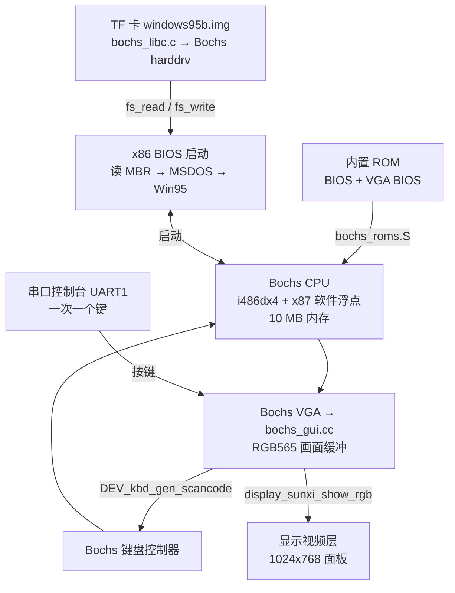
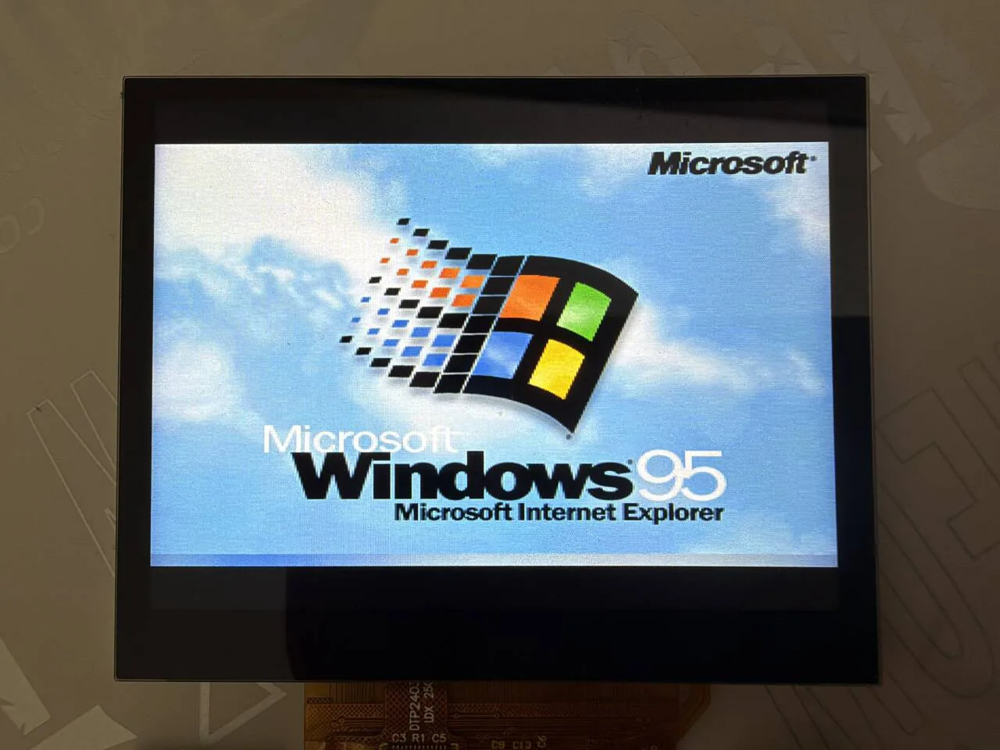
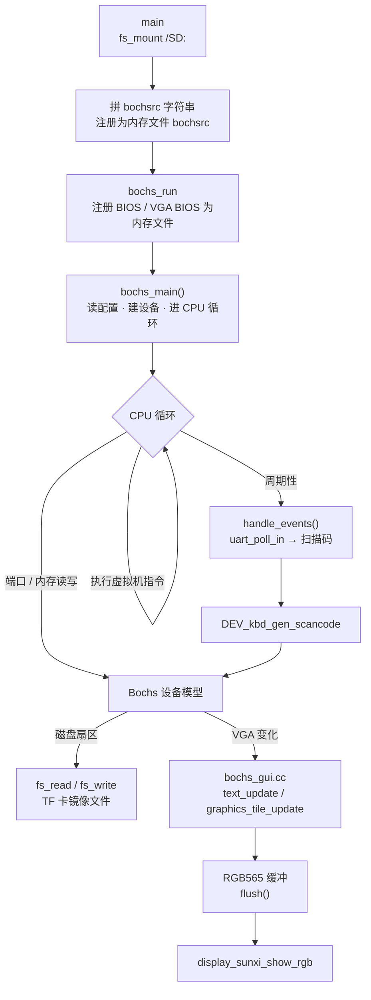

在板子上用 [Bochs](https://github.com/bochs-emu/Bochs) 模拟一台 486 级的 x86 PC，从 TF 卡上的磁盘镜像启动 Windows 95。组件是 `~/f101-zephyr/zephyr-components/bochs`，示例是 `samples/pc`。Bochs 是用 C++ 写的解释型模拟器，在 RISC-V 板子上整个跑在软件里，没有任何硬件加速，所以很慢。



## 准备

开始前请先完成 [配置开发环境](../zephyr-setup-env.md) 和 [获取 Zephyr 代码](../zephyr-get-source.md)。需要：

- 一块插好的 TF 卡，根目录放着已装好 Windows 95 的硬盘镜像；
- 串口终端，接 UART1（PB00/PB01，115200 8N1），键盘输入就在这个终端里打字；
- 板子屏幕，虚拟机画面显示在 1024×768 的面板上。

### 准备镜像

<strong>本文不提供任何镜像，也不带 Windows 的任何文件，需要用户自备，并自己确认授权。</strong>

示例要的是 TF 卡根目录下的一个<strong>平铺（flat）硬盘镜像</strong>，里面是已经装好 Windows 95 的整块硬盘（含 MBR 和分区表），不是安装光盘的 ISO，不是 VHD/VMDK 等带头的格式（对应的 Bochs 镜像插件在这里全是空桩）。

镜像用的是 Bochs 项目 archive.org 页面上的现成镜像：[archive.org/details/bochs_windows_images](https://archive.org/details/bochs_windows_images)。该页没有写明授权，请自行确认。用到的两个文件和几何参数：

| 镜像 | 柱面 / 磁头 / 每磁道扇区 | 大小 |
| --- | --- | --- |
| `Win31.img`（Windows 3.1） | 260 / 16 / 63 | 134184960 字节 |
| `windows95b.img`（Windows 95 OSR2） | 507 / 16 / 63 | 261660672 字节 |

大小对得上：507 × 16 × 63 × 512 = 261660672。柱面、磁头、扇区数必须和镜像一致，Bochs 平铺镜像没有头部，换一个镜像就要改 `prj.conf` 重新编译。

步骤：

1. 把镜像放到 TF 卡的<strong>根目录</strong>，文件名和 `prj.conf` 里的路径一致（这里用 `windows95b.img`）。卡要是 FAT 或 exFAT，支持长文件名。
2. 先在 PC 上备份一份原文件。模拟器会往镜像里写（Windows 的注册表、交换文件），用坏了就换回备份。
3. Bochs 异常退出会在镜像旁留下 `<镜像>.lock`，示例每次启动先 `fs_unlink()` 删掉它。

## 编译

在工作区里执行下面的命令。组件在 `zephyr-components/bochs`，Bochs 本体是它的 git 子模块 `Bochs/`。<strong>子模块没拉的话先拉</strong>，否则 CMake 会报 `Bochs sources missing`：

```sh
cd ~/f101-zephyr/zephyr-components
git submodule update --init bochs/Bochs
```

然后编译。`samples/pc` 自己的 `CMakeLists.txt` 已经用 `ZEPHYR_EXTRA_MODULES` 把 `bochs` 组件加进来，`prj.conf` 里已经选好了 Windows 95 镜像，不需要额外参数：

```sh
. ~/f101-zephyr/env.sh
cd ~/f101-zephyr
west build -b yuzukineko -d build/win95 zephyr-components/bochs/samples/pc
```

<div class="asciinema-cast" data-src="assets/casts/zephyr/apps-win95/build.cast" data-speed="6"></div>

产物是 `build/win95/zephyr/zephyr.bin`，约 2.9 MB，链接地址 `0x40010000`。第一次配置时 CMake 会用 `git apply` 把 `patches/` 里的补丁打到 Bochs 子模块上（见 [补丁](#补丁)），子模块的工作区因此显示为已修改，这是预期的。

`samples/pc/prj.conf` 里和镜像有关的几行（磁盘路径、几何参数、文本镜像）：

```text
CONFIG_SAMPLE_PC_DISK="/SD:/windows95b.img"
CONFIG_SAMPLE_PC_DISK_CYLINDERS=507
CONFIG_SAMPLE_PC_DISK_HEADS=16
CONFIG_SAMPLE_PC_DISK_SPT=63

CONFIG_BOCHS_TEXT_MIRROR=y
```

换成别的镜像就改这几行，柱面、磁头、扇区数必须和镜像一致。Windows 3.1 的镜像是 `/SD:/Win31.img`，柱面 260。

产物 `zephyr.bin` 为 2946308 字节，RAM 占用 17.6%，链接到 `0x40010000`（板子共 16 MB）。

## 运行

下载方式见 [编译与运行](../zephyr-build-run.md)。调试用方式一：

```sh
xfel ddr f101-s3
xfel write 0x40010000 build/win95/zephyr/zephyr.bin
xfel exec 0x40010000
```

板子要插着放了镜像的 TF 卡。画面在板子的屏幕上；键盘输入在 UART1 的串口终端里打字。

### 运行后的输出

#### 挂载 TF 卡与 BIOS 启动

执行 `xfel exec` 后，UART1 依次输出：

- `sd mount: 0`，列出 TF 卡文件，`lock file removed: 0`；
- Bochs 横幅 `Bochs x86 Emulator 3.1.devel`，`reading configuration from mem:bochsrc`；
- VGA BIOS：`Bochs VGABios (PCI) 0.9d`，`NO Bochs VBE Support available!`；
- BIOS：`Bochs 3.0.devel BIOS`，`ata0 master: Generic 1234 ATA-6 Hard-Disk ( 249 MBytes)`，`Press F12 for boot menu.`；
- `Booting from Hard Disk...`，`Invalid setting in the MSDOS.SYS file: WINVER=4.10.`，`Starting Windows 95...`。

249 MBytes 与镜像的 507 × 16 × 63 × 512 = 261660672 字节一致。

BIOS 的文字写在 VGA 文本屏上，不在串口上。`CONFIG_BOCHS_TEXT_MIRROR` 把文本屏变化的行以 `|行号|文本` 打到串口，上面的 BIOS 行就是这样来的。它在 `samples/pc/prj.conf` 里默认打开，因为不开的话串口上看不到 BIOS 的任何内容。代价是进入图形模式后这些行是噪声。BIOS 之前会先打出 25 行由未初始化显存产生的乱码行，之后才是正常文字。

完整输出（截取自 TF 卡挂载之后）：

```text
sd mount: 0
sd: file windows95b.img 261660672
sd: file windows95.img 471859200
sd: file Win31.img 134184960
（TF 卡上其余文件的 sd: 行省略）
lock file removed: 0
========================================================================
                     Bochs x86 Emulator 3.1.devel
             Built from GitHub snapshot after release 3.1
                  Compiled on Oct 11 2026 at 07:19:39
========================================================================
00000000000i[      ] BXSHARE not set. using compile time default '(null)'
00000000000i[      ] reading configuration from mem:bochsrc
（此处省略 25 行 |00|..|24| 乱码行：BIOS 启动前文本镜像读到未初始化的显存，是噪声）
|00|Bochs VGABios (PCI) 0.9d 07 Aug 2026
|01|This VGA/VBE Bios is released under the GNU LGPL
|03|Please visit :
|04| . https://bochs.sourceforge.io
|05| . https://www.nongnu.org/vgabios
|07|NO Bochs VBE Support available!
|09|Bochs 3.0.devel BIOS - build: 08/23/26
|10|Options: apmbios pcibios pnpbios eltorito
|12|ata0 master: Generic 1234 ATA-6 Hard-Disk ( 249 MBytes)
|14|Press F12 for boot menu.
[00:00:01.727,000] <err> fs: file open error (-2)
|16|Booting from Hard Disk...
|17|Invalid setting in the MSDOS.SYS file: WINVER=4.10.
|18|Starting Windows 95...
```

几处输出的含义：

- `lock file removed: 0` 是示例启动时删掉了上次异常退出留下的 `windows95b.img.lock`；没有这个文件时返回 `-2`（`-ENOENT`），也正常。
- `BXSHARE not set. using compile time default '(null)'` 是 Bochs 打印空字符串指针时 picolibc 给出的 `(null)`，无影响。
- 省略的那 25 行 `|00|…|24|` 是文本镜像在 BIOS 之前读到的未初始化显存，属于噪声。
- `<err> fs: file open error (-2)` 是 `-ENOENT`，出现在 BIOS 阶段，之后流程继续往下走。
- `Invalid setting in the MSDOS.SYS file: WINVER=4.10.` 是虚拟机里的 DOS 打印的，之后继续到 `Starting Windows 95...`。
- 进入图形模式后串口没有新输出，接下来看板子屏幕。

:::caution
Win95 启动菜单有 30 秒倒计时。虚拟机时钟必须和主机速度对上（`CONFIG_SAMPLE_PC_IPS`，默认 3000000）。默认的 5000 万会让这 30 秒在板上变成半个小时。
:::

#### Windows 95 启动画面与桌面

板子屏幕上，1024×768 的面板中画面居中。先是 Windows 95 的启动画面（`Microsoft Windows 95`、`Microsoft Internet Explorer`）：



接着进到桌面，弹出 `Welcome to Windows 95` 对话框（`Did you know...` 提示页，右边是 `Windows Tour`、`What's New` 等按钮）。桌面上有 `My Computer`、`Inbox`、`Recycle Bin`、`The Internet`、`My Briefcase`、`Online Services` 和 `Set Up The Microsoft Network` 图标，任务栏有 `Start` 按钮、`Welcome` 窗口按钮，右下角的时钟是 1:47 AM：


对话框上的鼠标指针是 Windows 自己画的：Windows 95 启动后总会在屏幕上渲染指针，不管有没有鼠标。板子这边没有把鼠标接到触摸屏或 USB 上（见 [功能范围](#功能范围)），所以这个指针不会动。


## 实现原理

| 层 | 文件 | 作用 |
| --- | --- | --- |
| 模拟器核 | `Bochs/`（子模块，LGPL-2.1+）的 `cpu/`、`memory/`、`iodev/` | 486 CPU、x87（softfloat）、PIC、PIT、DMA、CMOS、键盘控制器、软盘控制器、IDE 硬盘、串口/并口（空桩）、喇叭、普通 VGA |
| 构建 | `CMakeLists.txt`、`Kconfig` | 源文件列表、编译选项、缓存大小。打补丁。编译成 Zephyr 库 `bochs` |
| 配置头 | `include/config.h` | 给 RISC-V 32 位配好的 Bochs 配置头（CPU 级别 4） |
| C 库适配 | `shim/`、`src/bochs_libc.c`、`src/bochs_setjmp.S` | 补 minimal libc 没有的 POSIX 头、文件流、`sscanf`、`strtod`、`setjmp/longjmp`（CPU 靠 `longjmp` 离开一条指令） |
| 显示和键盘 | `src/bochs_gui.cc` | 代替 Bochs 的 `nogui`：画面和串口键盘 |
| 桩和入口 | `src/bochs_stubs.cc` | 没编进来的设备的入口、socket 桩、C++ 运行时、自检、心跳；`bochs_run()` |
| ROM | `src/bochs_roms.S` | 用 `.incbin` 把 Bochs 的 BIOS 和 VGA BIOS 链进镜像 |
| 示例 | `samples/pc/src/main.c` | 挂载 TF 卡，生成 bochsrc 字符串，调用 `bochs_run()` |

### 数据流



### bochsrc：模拟的机器长什么样

配置不是文件，是 `main.c` 里拼的一段字符串，用 `mem:bochsrc` 这个内存文件交给 Bochs。`samples/pc/src/main.c` 第 142–166 行：

```c
n = snprintf(rc, sizeof(rc),
        "romimage: file=mem:BIOS-bochs-legacy\n"
        "vgaromimage: file=mem:VGABIOS-lgpl-latest\n"
        "megs: %d\n"
        "cpu: count=1, ips=%d\n"
        "boot: disk\n"
        "display_library: nogui\n"
        "vga: extension=none\n"
        "mouse: enabled=0\n"
        "clock: sync=none, time0=1000000000\n"
        "port_e9_hack: enabled=1\n"
        "log: -\n"
        "panic: action=fatal\n"
        "error: action=ignore\n"
        "info: action=ignore\n"
        "debug: action=ignore\n",
        CONFIG_SAMPLE_PC_MEGS, CONFIG_SAMPLE_PC_IPS);
if (CONFIG_SAMPLE_PC_DISK[0] != '\0') {
  n += snprintf(rc + n, sizeof(rc) - n,
          "ata0-master: type=disk, path=\"%s\", mode=flat, cylinders=%d, heads=%d, spt=%d\n",
          CONFIG_SAMPLE_PC_DISK, CONFIG_SAMPLE_PC_DISK_CYLINDERS,
          CONFIG_SAMPLE_PC_DISK_HEADS, CONFIG_SAMPLE_PC_DISK_SPT);
}
bx_mem_file("bochsrc", rc, n);

return bochs_run(4, argv);
```

几处要点：

- `boot: disk`：只从硬盘启动。没有 `ata0-slave`、没有 `ata1`，没有软盘和光驱。
- `vga: extension=none`：关掉 VBE，因为 VBE 显存要 8 MB。
- `mouse: enabled=0`：鼠标关。
- `display_library: nogui`：是 Bochs 的名字，实际链接的是 `bochs_gui.cc`（它里面的类还叫 `bx_nogui_gui_c`），见下面。
- `clock: sync=none, time0=1000000000`：虚拟机时钟只由指令数推动，起点固定。

### 显示：`bochs_gui.cc`

CMake 里，只要启用了 `CONFIG_DISPLAY_SUNXI` 就编这个文件，代替 Bochs 自带的 `gui/nogui.cc`。

- 画面缓冲 `pic` 最大 720×480 RGB565（`MAX_W`、`MAX_H`），虚拟机分辨率超过会 `BX_PANIC`。
- 文本模式：基类在 `new_text_api = 1` 时对每个字符格调用 `draw_char()`，这里用 Bochs 的 VGA 字体 `vga_charmap` 画点阵。
- 图形模式：`graphics_tile_update()` 按 16×24 的分块，把调色板索引转成 RGB565。调色板变化在 `palette_change()` 里处理。<strong>只有调色板索引的图形模式</strong>，没有 16/24/32 位真彩色。
- `flush()` 在有改动时把缓冲刷 cache，再用 `display_sunxi_show_rgb()` 放到视频层（`nonblock = true`），由显示引擎缩放到 1024×768 面板。

```c
void bx_nogui_gui_c::flush(void)
{
  ...
  dirty = false;
  sys_cache_data_flush_range(pic, pic_w * pic_h * sizeof(Bit16u));
  img.data = pic;
  img.width = pic_w;
  img.height = pic_h;
  img.stride = pic_w * sizeof(Bit16u);
  img.xrgb8888 = false;
  img.nonblock = true;
  display_sunxi_show_rgb(disp, &img);
}
```

要改画面输出（例如改成整数倍缩放、画到 ARGB 层、加叠加显示速度），改这个函数。

### 键盘：`bochs_gui.cc` 的 `handle_events()`

没有 USB 键盘，没有按键矩阵。键盘就是串口控制台：`uart_poll_in()` 读到的字节进一个 256 字节的环，然后每隔至少 60 ms 取一个，`ascii_key()` 转成扫描码，送给 Bochs 的键盘控制器。

```c
while (uart_poll_in(console, &c) == 0) {
  if (((head + 1) & 255) != tail) {
    ring[head] = c;
    head = (head + 1) & 255;
  }
}
now = k_uptime_get();
if (head != tail && now - last_ms >= 60) {
  last_ms = now;
  ascii_key(ring[tail]);
  tail = (tail + 1) & 255;
}
```

为什么要一个一个送：串口终端一次把整行发过来，虚拟机键盘队列装不下，会丢键。所以串口敲字再粘贴整段话是可以的，但每个字符要排队 60 ms。

`ascii_key()` 能转换的字符：小写字母、大写字母（带 Shift）、数字、`)!@#$%^&*(`、空格、回车、退格、Tab、Esc，以及 `- = , . / ; ' \ [ \` _ + : ? " < >`。<strong>没有</strong>的：`]`、`{`、`}`、`|`、`~` 等；方向键、F1–F12、Ctrl、Alt、Delete、Home/End 等。

### 磁盘：`bochs_libc.c`

Bochs 的 `hdimage` 用 `open/read/write/lseek` 访问镜像。minimal libc 没有这些，`src/bochs_libc.c` 用 Zephyr 的 `fs_open/fs_read/fs_write/fs_seek` 补了一套文件描述符和 `FILE`。所以磁盘镜像就是 `/SD:/…` 下的一个文件。

Bochs 的 `vmware3/vmware4/vbox/vpc/vhdx/vvfat` 这些镜像格式插件在 `src/bochs_stubs.cc` 里都是返回 0 的桩（`STUB` 宏，注释写着“other than flat/growing”），所以只有 flat 和 Bochs 自带的 growing 格式可用，本文只用 flat。

### 内存

Bochs 原版的几项配置装不下，所以改小，见下面的 [补丁](#补丁)。

### 补丁

`patches/` 里的五个补丁，CMake 配置时对子模块 `git apply`：

| 补丁 | 内容 |
| --- | --- |
| `0001-icache-size.patch` | 指令缓存、trace 缓存、自修改代码表的大小可配置 |
| `0002-no-stl.patch` | 去掉 `std::string` |
| `0003-small-bios-window.patch` | BIOS 窗口 128 KiB，原版 4 MiB |
| `0004-digest.patch` | 寄存器摘要定时器，用来和原生 Bochs 逐行比对（`CONFIG_BOCHS_DIGEST`） |
| `0005-zero-ram.patch` | 虚拟机内存启动时清零 |

## 配置选项

示例（`samples/pc/Kconfig`）：

| 选项 | 默认 | 说明 |
| --- | --- | --- |
| `CONFIG_SAMPLE_PC_DISK` | `""`（Kconfig）；`prj.conf` 设为 `"/SD:/windows95b.img"` | 平铺硬盘镜像路径，空串表示不挂磁盘 |
| `CONFIG_SAMPLE_PC_DISK_CYLINDERS` | 914（Kconfig）；`prj.conf` 设为 507 | 磁盘柱面数，必须和镜像一致 |
| `CONFIG_SAMPLE_PC_DISK_HEADS` | 16 | 磁头数 |
| `CONFIG_SAMPLE_PC_DISK_SPT` | 63 | 每磁道扇区数 |
| `CONFIG_SAMPLE_PC_PATCH_AUTOEXEC` | n | 启动时原地改 v86 镜像的 `AUTOEXEC.BAT`，偏移写死为 63808512，只对那个 450 MB 镜像有意义 |
| `CONFIG_SAMPLE_PC_IPS` | 3000000 | 虚拟机时钟：每虚拟秒的指令数。比板子实际速度大，虚拟机里的计时就会变慢 |
| `CONFIG_SAMPLE_PC_VERIFY` | n | 启动时读整个镜像并打印 `crc32 <文件> <值>` |
| `CONFIG_SAMPLE_PC_MEGS` | 10 | 虚拟机内存，MiB |
| `CONFIG_SAMPLE_PC_TEST_PATTERN` | n | 不启动模拟器，只在视频层显示 720×400 的测试图，用来单独检查显示通路 |

组件（`Kconfig`）：

| 选项 | 默认 | 说明 |
| --- | --- | --- |
| `CONFIG_BOCHS` | n | 打开组件（依赖 `RISCV` 和 `CPP`，选择 `FILE_SYSTEM`） |
| `CONFIG_BOCHS_ICACHE_ENTRIES` | 4096 | 解码指令缓存项数（每项 32 字节，2 的幂）。原版 512K 项，16 MiB |
| `CONFIG_BOCHS_PAGE_STAMP_ENTRIES` | 16384 | 自修改代码的页戳个数（每个 4 字节，2 的幂）。16384 项覆盖 64 MiB，表小了只会多刷几次缓存 |
| `CONFIG_BOCHS_TRACE_ENTRIES` | 4096 | trace 缓存项数（每项 24 字节，2 的幂）。原版 64K 项 |
| `CONFIG_BOCHS_TRACE_POOL` | 8192 | trace 缓存池，解码指令条数。原版 576K 条 |
| `CONFIG_BOCHS_TEXT_MIRROR` | n（Kconfig）；`prj.conf` 设为 y | 把虚拟机文本屏变化的行以 `\|行\|文本` 打到串口。BIOS 的文字只有这样才能在串口上看到；图形模式下是噪声 |
| `CONFIG_BOCHS_SELFTEST` | n | 启动模拟器前先跑 C 库、浮点、softfloat 自检，打印 `memtest:`、`fp:`、`softfloat:` |
| `CONFIG_BOCHS_DIGEST` | n | 定时器每隔一段虚拟时间打印虚拟机寄存器摘要（`DG` 行），用来和另一个 Bochs 构建比对 |
| `CONFIG_BOCHS_DIGEST_PERIOD` | 1000000 | 摘要周期，虚拟微秒（`IPS=3000000` 时一虚拟微秒是 3 个 tick）。依赖 `BOCHS_DIGEST` |
| `CONFIG_BOCHS_DIGEST_CODE` | n | 每次摘要附带 eip 处的代码字节并做缓冲比对。依赖 `BOCHS_DIGEST` |
| `CONFIG_BOCHS_DIGEST_FROM` | 0 | 摘要窗口起点（虚拟 tick）。依赖 `BOCHS_DIGEST` |
| `CONFIG_BOCHS_DIGEST_TO` | 0 | 摘要窗口终点（虚拟 tick），0 表示不设窗口。依赖 `BOCHS_DIGEST` |
| `CONFIG_BOCHS_HEARTBEAT` | n | 每秒打印一次虚拟机 `eip` 和每秒虚拟 tick 数，用来判断虚拟机有没有在跑 |

`samples/pc/prj.conf` 里和本应用相关、默认就开的选项：`CONFIG_CPP`、`CONFIG_STD_CPP17`、`CONFIG_BOCHS`、`CONFIG_MAIN_STACK_SIZE=65536`、`CONFIG_COMMON_LIBC_MALLOC_ARENA_SIZE=-1`（堆用满剩余内存）、`CONFIG_SDHC`、`CONFIG_DISK_DRIVER_SDMMC`、`CONFIG_FAT_FILESYSTEM_ELM`、`CONFIG_FS_FATFS_EXFAT`、`CONFIG_FS_FATFS_LFN`、`CONFIG_DISPLAY`。`CONFIG_DISPLAY_SUNXI_FB_DIV=1` 是显示驱动的帧缓冲分频。


## 功能范围

- 鼠标：`bochsrc` 写死 `mouse: enabled=0`，GUI 里的 `mouse_enabled_changed_specific()` 是空函数，板上的触摸屏没有接给 Bochs。Windows 95 大部分操作靠鼠标，需要时在 `bochs_gui.cc` 里接入。
- 键盘：只有串口键盘，没有方向键、功能键、Ctrl、Alt。每个键间隔 60 ms，粘贴长文本按这个速度排队。
- 声音：没有声卡模型。网络：没有网卡模型，`socket` 等函数是返回 -1 的桩。
- PCI、VBE：BIOS 输出 `NO Bochs VBE Support available!`，只有标准 VGA。
- 光驱：`bochsrc` 里没有光驱，`boot` 只有 `disk`。

## 排错

| 现象 | 原因与处理 |
| --- | --- |
| CMake 报 `Bochs sources missing` | 子模块没拉：`git submodule update --init bochs/Bochs` |
| `sd mount:` 不是 0 | 卡没插好，或不是 FAT/exFAT |
| BIOS 里找不到硬盘，或 `ata0 master` 容量不对 | 镜像路径写错，或柱面/磁头/扇区数和镜像不一致 |
| Windows 报某个系统文件缺失 | 镜像坏了（多半是不干净拔卡），用 `CONFIG_SAMPLE_PC_VERIFY` 的 crc32 和原文件对 |
| 启动倒计时极慢 | `CONFIG_SAMPLE_PC_IPS` 比板子实际速度大，保持 3000000 或更小 |
| 启动就停在 `unreliable XMS memory at address 00100004h`、虚拟机死循环 | `romimage` 里写了 `address=`，不要写 |
| 文本显示右边缘出现下一行的开头 | `dimension_update()` 没把 `fwidth/fheight` 复制到 `guest_fwidth/guest_fheight`，或者没设 `new_text_api = 1` |
| 起动后卡在设备初始化 | 内存分配失败返回 NULL（没有异常），先看堆 |
