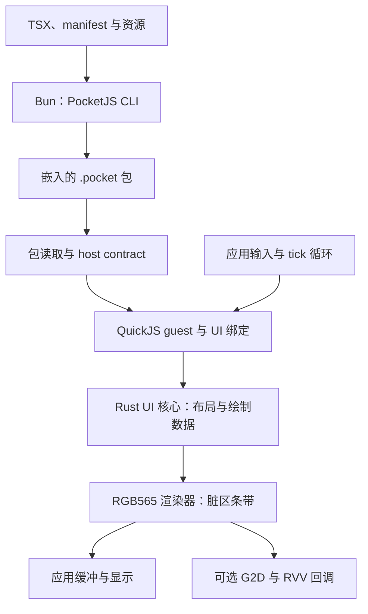

`zephyr-components/pocketjs` 提供由调用方驱动的 UI 运行时：`.pocket` 包读取器、QuickJS-ng JavaScript guest、Rust 保留式 UI 核心及 RGB565 渲染器。应用负责输入、turn 调度及像素显示。完整应用用法见 [PocketJS 播放器指南](../apps/pocketjs.md)。

## 版本与范围

Zephyr 4.2.2 或 4.5 均需使用配套的内核与组件分支，见[版本与 4.5 变更](../zephyr-4-5.md)。播放器配置已在 4.5 构建通过；4.5 的显示、输入、加速和持续内存使用仍需板上验证。

运行时支持打包的 PocketJS 应用，不提供浏览器 DOM、浏览器网络接口、Node.js API 或 ESP-IDF 任务环境。`hosts/esp-idf/` 下的头文件及打包工具定义了现有 PocketJS host ABI；Zephyr 模块在自己的循环中调用它们，并提供必要的 libc／头文件适配。HTML 渲染见 [LiteHTML](../apps/html.md)。

## 架构与源码布局



| `zephyr-components/pocketjs/` 下的路径 | 用途 |
| --- | --- |
| `zephyr/module.yml`、`Kconfig`、`CMakeLists.txt` | Zephyr 模块注册与构建 |
| `pocketjs/` | PocketJS 子模块：框架、CLI、包／UI 接口及 Rust crate |
| `quickjs-ng/` | QuickJS-ng v0.14.0 子模块 |
| `shim/`、`src/pocketjs_std.c` | 头文件与最小 libc 适配 |
| `src/pocketjs_g2d.c`、`include/pocketjs_zephyr/g2d_accel.h` | RGB565 加速钩子 |
| `tools/` | QuickJS 预处理、Rust target 及栅格补丁／检查 |
| `samples/player/` | 打包、主循环、触摸／UART 输入与显示接入 |

CMake 为 QuickJS 加入不可变 ArrayBuffer 支持和仅 UTC 的 Date 处理，关闭线程与原子操作。UI 核心和 RGB565 渲染器分别生成 Rust 静态库，并隔离符号命名空间。栅格修改应用于构建目录中的副本，不改动子模块源码。

## 准备依赖

选好版本后，在 west 工作区根目录执行：

```sh
git -C zephyr-components submodule update --init --recursive pocketjs/pocketjs pocketjs/quickjs-ng
bun install --cwd zephyr-components/pocketjs/pocketjs
rustup target add riscv32imac-unknown-none-elf
rustup toolchain install nightly-2026-07-02 --component rust-src
export PATH="$HOME/.cargo/bin:$HOME/.bun/bin:$PATH"
```

使用组件分支记录的版本。当前模块使用 PocketJS `11f48b264e3368490cf6a8623642a57131d01afe` 和 QuickJS-ng `3c051980ab7e783dfbfb1c70c014ce5e05ecf24c`；复现构建时不要单独更新其版本。

关闭 `CONFIG_FPU` 时，Rust 使用 `riscv32imac-unknown-none-elf`。启用后，CMake 选择 `tools/riscv32imafdc-zephyr.json`；若同时启用 `CONFIG_POCKETJS_RUST_RVV`，则选择 `riscv32imafdcv-zephyr.json`，通过固定 nightly 和 `rust-src` 构建 `core`／`alloc`。自定义 target 使用与镜像一致的 `ilp32d` ABI，C 与 Rust 的浮点 ABI 必须匹配。

## 接入模块

假设应用位于 `<workspace>/my-pocket-app/`，在 `find_package(Zephyr)` 前注册模块：

```cmake
cmake_minimum_required(VERSION 3.28.0)
list(APPEND ZEPHYR_EXTRA_MODULES
  "${CMAKE_CURRENT_SOURCE_DIR}/../zephyr-components/pocketjs")
find_package(Zephyr REQUIRED HINTS $ENV{ZEPHYR_BASE})
project(my_pocket_app)
target_sources(app PRIVATE src/main.c)
```

在 `prj.conf` 中启用 `CONFIG_POCKETJS=y`，即可使用包、guest、UI 和渲染器接口；资源打包、缓冲申请及主循环仍由应用负责。CLI 和 `embed_package.py` 构建规则可从 `samples/player/CMakeLists.txt` 起步，F101 显示应用配置可参考其 `prj.conf`。

| 选项 | 默认值／要求 | 含义 |
| --- | --- | --- |
| `CONFIG_POCKETJS` | 要求 32 位 RISC-V | 编译运行时 |
| `CONFIG_POCKETJS_GUEST_HEAP_LIMIT` | `4194304` 字节 | QuickJS 默认堆上限，不含原生 UI 和图像缓冲 |
| `CONFIG_POCKETJS_RUST_RVV` | FPU 和 F101 RVV 启用时为 `y` | 允许 Rust 库使用向量指令 |
| `CONFIG_POCKETJS_G2D` | 启用 `CONFIG_G2D` 时为 `y` | 编译加速适配器 |
| `CONFIG_POCKETJS_BLEND_RVV` | 启用适配器和 F101 RVV 时为 `y` | 用向量代码混合 A8 遮罩 |
| `CONFIG_POCKETJS_G2D_MIN_FILL` | `4096` 像素 | 不透明填充的最小加速面积 |
| `CONFIG_POCKETJS_G2D_MIN_BLEND` | `8192` 像素 | 覆盖率混合的最小加速面积 |
| `CONFIG_POCKETJS_TURN_STATS` | 关闭 | 收集脚本、tick 和 draw 耗时 |
| `CONFIG_POCKETJS_CARGO_OFFLINE` | 关闭 | 仅使用缓存的 Cargo 依赖 |

样例同时启用 `CONFIG_FPU`、`CONFIG_FPU_SHARING` 和 `CONFIG_SUN252I_F101_RVV`。应用启用浮点／向量执行时，要保留所需的上下文处理。CMake 缓存选项 `POCKETJS_QJS_OPT` 默认为 `-Os`，调整后需要重新比较体积与性能。

## Host 接口与初始化

公开运行时头文件由 `pocketjs/hosts/esp-idf/components/*/include/pocketjs/` 导出：

| 头文件 | 职责 |
| --- | --- |
| `pocketjs/package.h` | 打开容器，依据 host contract 选择变体 |
| `pocketjs/guest.h`、`pocketjs/guest_quickjs.h` | 创建／执行 guest、限制、统计及中断 |
| `pocketjs/ui_core.h`、`pocketjs/ui_types.h` | 保留式 UI 配置、资源与帧视图 |
| `pocketjs/ui_qjs.h` | 装载资源、挂载 JavaScript UI 接口及执行 turn |
| `pocketjs/render_rgb565.h` | 渲染器、逐缓冲 target 与脏区绘制 |

播放器按以下顺序初始化，每一步都需检查返回状态：

1. 对嵌入数据调用 `pocketjs_package_open()`，再用生成的 host contract 调用 `pocketjs_package_select()`。带版本信息的输出结构需初始化 `struct_size`。
2. 应用 `pocketjs_guest_config_defaults()`，再调用 `pocketjs_guest_create()`。JavaScript 栈上限必须适合所属线程；样例通过 `pocketjs_guest_quickjs_context()` 取得上下文后调用 `JS_SetMaxStackSize()`。
3. 从选中的 contract 获取逻辑宽高、栅格密度及 tick 频率，创建 UI core。
4. 调用 `pocketjs_ui_qjs_create()` 创建绑定，传入 contract 的 `target_id` 和 `host_abi`；用 `pocketjs_ui_qjs_feed_pak()` 装入选中的 PAK，再调用 `pocketjs_ui_qjs_mount()`。
5. 用 `pocketjs_guest_eval()` 执行选中的 JavaScript。生成的包带有末尾 NUL，样例传入的源码长度为 `app.javascript.size - 1U`。
6. 按 contract 的栅格密度创建 RGB565 renderer，为每张图像缓冲创建独立 target，并按需加入加速回调。

host contract 与包中的尺寸、显示方式及能力必须一致。替换应用时，生成的包、contract 和 JavaScript／PAK 应配套更新。

## Turn 与渲染

将 UI turn 与渲染放在同一所属线程。把输入采样到 `pocketjs_ui_input_t`，再调用 `pocketjs_ui_turn()` 执行脚本、推进 UI 状态并取得帧视图。该调用产生绘制数据，不负责显示像素。

选择显示端已不再使用的缓冲，对其 target 调用 `pocketjs_rgb565_prepare()`。逐个脏区调用 `pocketjs_rgb565_render_strip()`，目标内存按完整视口宽度的条带组织。成功绘制后调用 `pocketjs_rgb565_commit()`，刷新修改范围的 cache，再将缓冲交给显示端。放弃本次绘制时使用 `pocketjs_rgb565_abort()`；丢弃 target 的历史像素后使用 `pocketjs_rgb565_target_invalidate()`。

每张缓冲需要独立 target，因为脏区是相对于该缓冲的历史状态计算的。播放器使用四张动态申请、64 字节对齐的 RGB565 缓冲及独立显示线程。帧视图借用 core 内存，必须在下一次 turn 或修改使其失效前完成渲染。其他线程应排队提交输入，不要在回调里直接调用 UI API。

### G2D 与 RVV

启用 `CONFIG_POCKETJS_G2D` 后，可按下列方式取得可选钩子：

```c
#include <pocketjs_zephyr/g2d_accel.h>

pocketjs_g2d_t *g2d = pocketjs_g2d_create(NULL);
const pocketjs_rgb565_accelerator_t *accel = pocketjs_g2d_accelerator(g2d);
```

`pocketjs_g2d_create()` 可能返回 `NULL`，`pocketjs_g2d_accelerator(NULL)` 同样返回 `NULL`，此时可走软件渲染。按照播放器实现，把适配器的 fill／blend 阈值复制到 renderer 配置，并在条带绘制时传入 `accel`。

适配器实现 `fill_rgb565` 和 `blend_a8_rgb565`。小操作由 CPU 处理；大面积不透明填充使用 G2D，覆盖率混合在启用时使用 RVV，否则通过 ARGB 暂存缓冲交给 G2D。阈值单位为像素数。这些钩子不代表所有变换和绘制命令都由硬件执行，统计结构仍保留部分上游 `ppa_*` 字段名。

当前适配器没有公开 destroy API，播放器让它保持到固件结束。需要反复打开、关闭运行时的应用，应先明确适配器资源的释放与复用方案。

## 所有权与资源限制

- `pocketjs_package_open()` 借用输入数据，其有效期必须长于包句柄；`feed_pak()` 也借用 PAK 数据，直到 guest 与 binding 均销毁。JavaScript 不可变性不会延长原生存储的有效期。
- 借用的资源／帧视图会随 core 推进或修改而失效，不要跨 turn 保留或交给显示线程使用。
- guest 只有 `pocketjs_guest_interrupt()` 可在所属线程外调用，binding 另提供 `pocketjs_ui_qjs_interrupt()`。销毁对象前应先停止并等待所属线程退出。
- 必须先销毁 guest，再销毁其已挂载的 binding，然后释放 binding 和 core。显示及渲染使用方停止后释放 renderer target／renderer 与显示缓冲，最后关闭 package 并释放包数据。
- 4 MiB guest 上限只覆盖 QuickJS 分配。Rust UI 对象、栅格缓存、帧缓冲、暂存缓冲和线程栈还需额外内存。Rust 分配耗尽可能直接终止，不能统一视为可恢复错误。

栅格密度为 1 时，仅四张 RGB565 缓冲就需要 `4 × width × height × 2` 字节：320×240 为 614,400 字节，512×384 为 1,572,864 字节，尚未计入对齐和其他分配。提高栅格密度会使缓冲面积按平方增长。

## 检查与诊断

[播放器指南](../apps/pocketjs.md)介绍构建、UART 控制与确定性 benchmark。`CONFIG_POCKETJS_TURN_STATS` 提供 `pocketjs_zephyr/turn_stats.h` 中的 `pocketjs_turn_stats_take()`，每次返回累计的 script／tick／draw 耗时和脚本计数，然后清零。

栅格检查需要 Cargo 和可用的 crate：

```sh
sh zephyr-components/pocketjs/tools/check_core_raster.sh
```

它对比补丁版与参考版的随机三角形／纹理图形输出，并执行 core／backend 测试。当前辅助脚本通过管道过滤 Cargo 输出，脚本退出码不能可靠保留 Cargo 失败状态，需检查实际测试汇总及失败信息。主机检查覆盖栅格行为，显示／cache 正确性和内存稳定性仍需板上测试。本次文档更新未增加新的 PocketJS 运行时测试结果。
