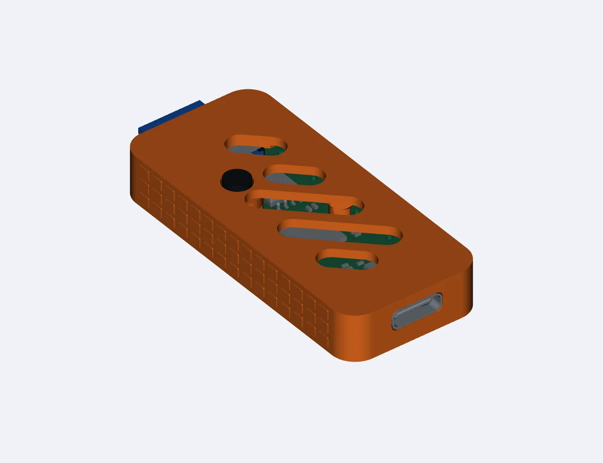
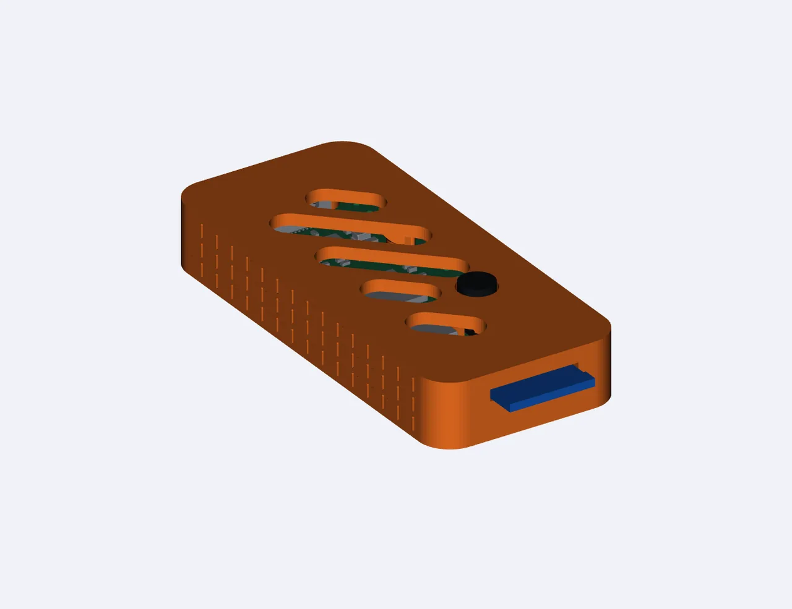
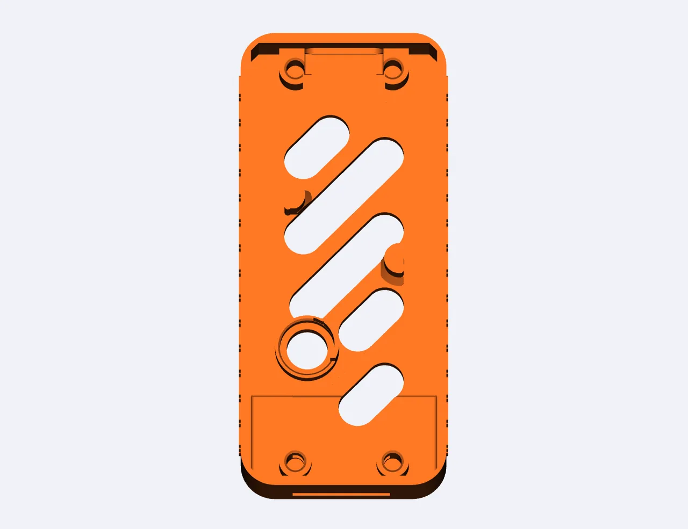
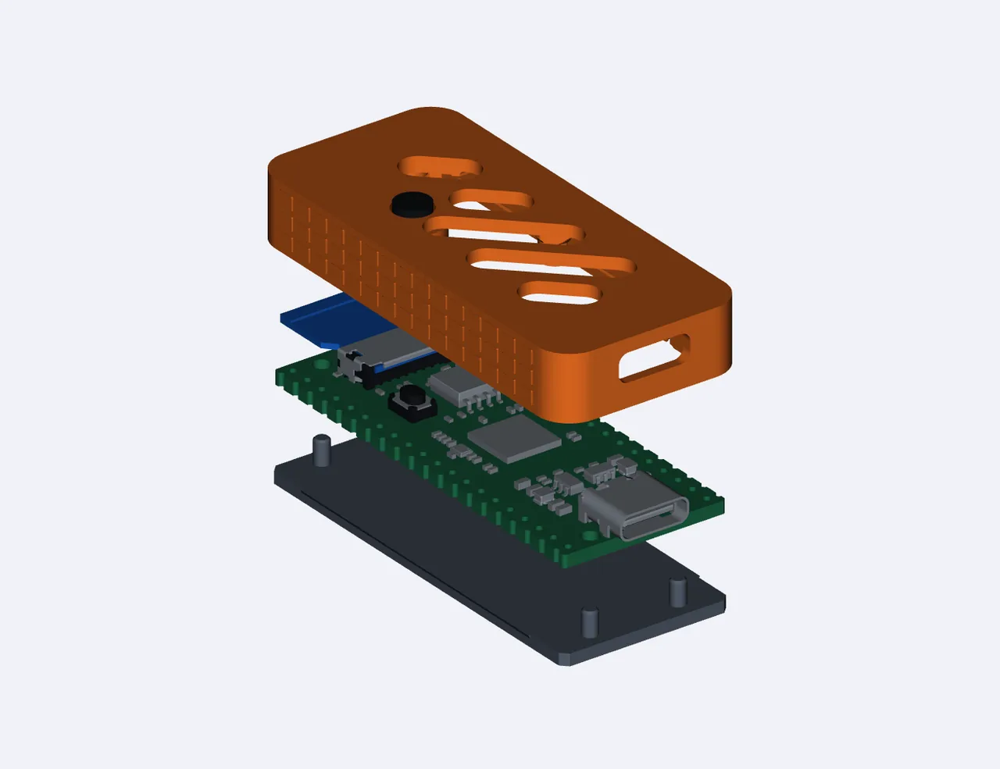
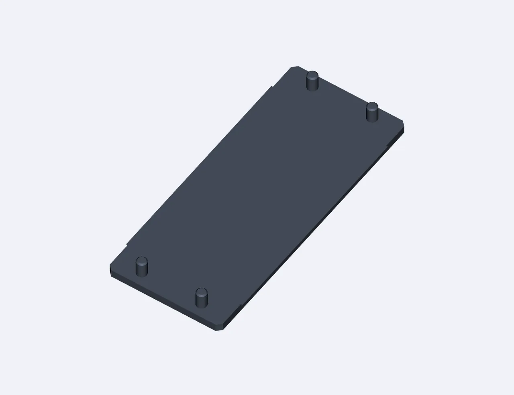
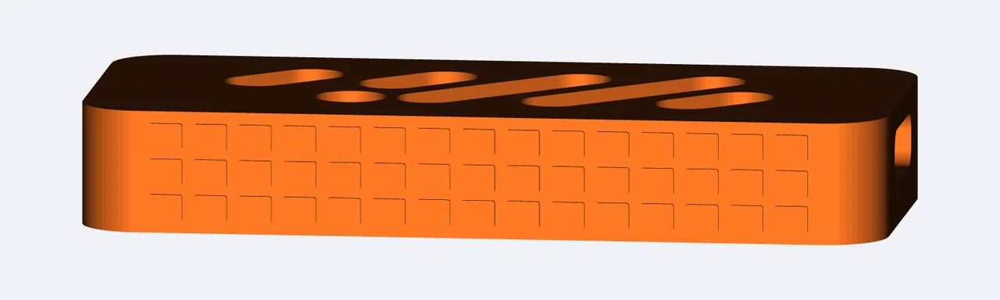

YuzukiNeko 有两个打印外壳：核心板单独用一个，YuzukiCube-M 底板用一个。两份文件不同，不能互换。

| 外壳 | 适用 | 文件 | 许可 |
| --- | --- | --- | --- |
| 核心板外壳 | 单独使用的 YuzukiNeko 核心板 | `YuzukiNeko_case.3mf` | BY-NC-SA，改自 dj.santos |
| 底板外壳 | YuzukiCube-M 底板 | `3DShell_PCB2.zip`（上下壳 STL） | CC0 1.0 |

两个文件都列在[硬件资料下载](hardware/download.md)里，和原理图、Gerber、BOM 放在一起。

## 核心板外壳

文件为 [YuzukiNeko_case.3mf](https://github.com/YuzukiHD/YuzukiNeko/blob/main/03_Shell_3D/YuzukiNeko_case.3mf)，改自 dj.santos 的 Pico 外壳（BY-NC-SA）。

### 预览

### 打印建议

- 直接把 `.3mf` 导入切片软件。下壳底面是平的，针尖带倒角，便于无支撑打印。
- 外壳有 USB-C 与 microSD 两端的开口，装配前先试装一遍。

## 底板外壳

文件为 [3DShell_PCB2.zip](https://github.com/YuzukiHD/YuzukiNeko/blob/main/04_BaseBoard/V1.0/04_3D/3DShell_PCB2.zip)，来自 YuzukiCube-M V1.0 工程。压缩包里是上壳 `3DShell_3DShell_PCB2_T.stl` 和下壳 `3DShell_3DShell_PCB2_B.stl`。下壳也可以单独下载：[3DShell_3DShell_PCB2_B.stl](https://github.com/YuzukiHD/YuzukiNeko/blob/main/04_BaseBoard/V1.0/04_3D/3DShell_3DShell_PCB2_B.stl)。

仓库里没有这个外壳的预览照片。先把 STL 导入切片软件确认形状和方向，再打印上下两件，在装好的底板上试装。核心板外壳装不到底板上：模块焊在载板上，底板四周还有连接器。

## 许可

核心板外壳改自 BY-NC-SA 的作品，<strong>请遵守其署名、非商业、相同方式共享的条款</strong>，不适用仓库的 CC0。底板外壳属于 `04_BaseBoard/V1.0/`，遵循硬件设计文件的 CC0 1.0 发布。
