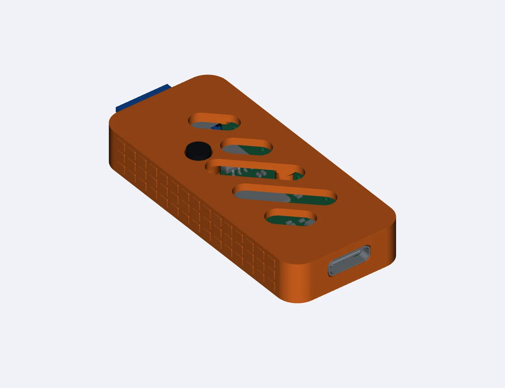
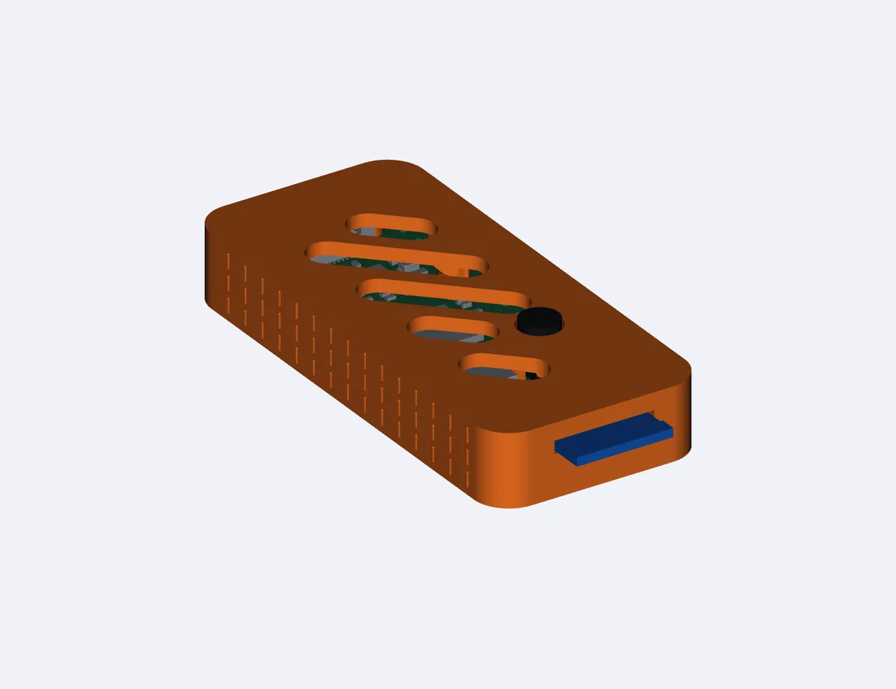
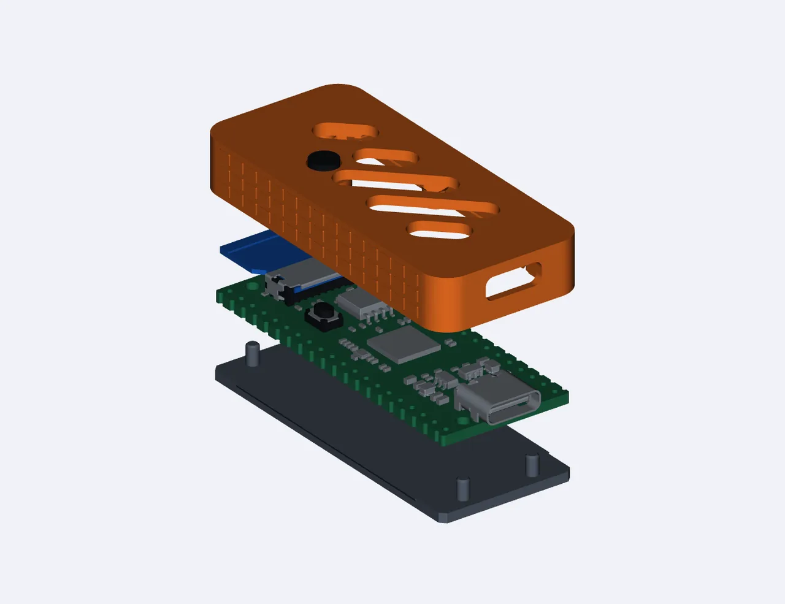
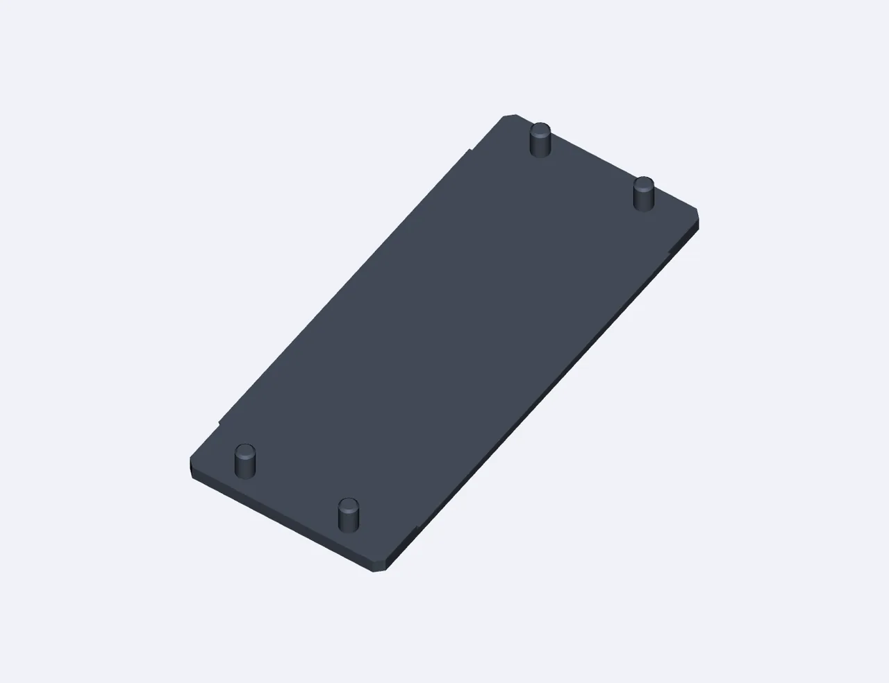

仓库 `03_Shell_3D/` 提供板子的外壳，文件为 [YuzukiNeko_case.3mf](https://github.com/YuzukiHD/YuzukiNeko/blob/main/03_Shell_3D/YuzukiNeko_case.3mf)，改自 dj.santos 的 Pico 外壳（BY-NC-SA）。

## 预览

## 打印建议

- 直接把 `.3mf` 导入切片软件；下壳底面是平的，针尖带倒角，便于无支撑打印。
- 外壳有 USB-C 与 microSD 两端的开口，装配前先试装一遍。

## 许可

外壳改自 BY-NC-SA 的作品，<strong>请遵守其署名、非商业、相同方式共享的条款</strong>，不适用仓库的 CC0。
